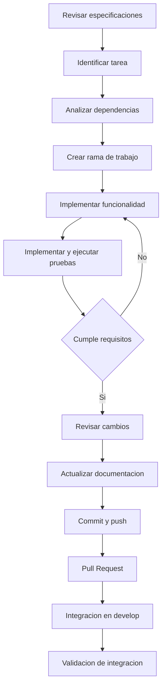
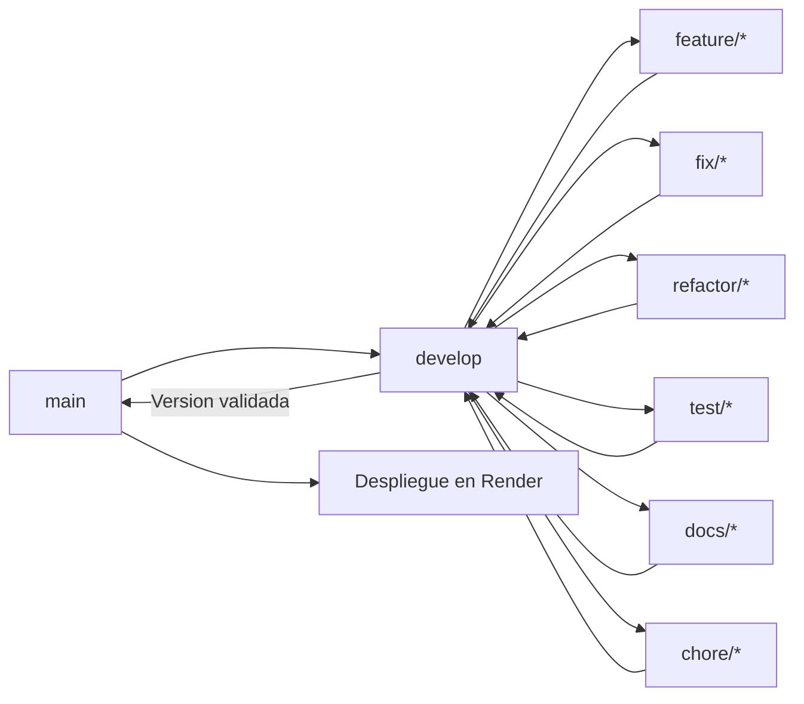
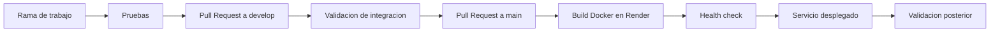

# Flujo de desarrollo — ReciclaTÍA PB03

## 1. Objetivo

Establecer la metodología de trabajo utilizada durante el desarrollo del Project Break 03, correspondiente al módulo de MLOps para IA Generativa.

El flujo de desarrollo deberá facilitar:

- La implementación incremental de funcionalidades.
- La trazabilidad de los cambios.
- La conservación de las funcionalidades existentes.
- La validación de los requisitos.
- La detección temprana de regresiones.
- La integración controlada de componentes.
- La preparación de versiones estables y desplegables.
- La documentación de decisiones técnicas.

Aunque el proyecto se desarrolla individualmente, se conservará una metodología de trabajo compatible con el desarrollo colaborativo de software.

## 2. Metodología de desarrollo

### 2.1. Specification-Driven Development

El desarrollo seguirá una metodología basada en especificaciones, denominada Specification-Driven Development (SDD).

Las especificaciones contenidas en specs/ constituirán la referencia técnica para implementar y validar el producto.

Antes de implementar una funcionalidad deberán conocerse:

- Su responsabilidad.
- Sus requisitos funcionales.
- Sus restricciones técnicas.
- Sus dependencias.
- Sus contratos de entrada y salida.
- Sus posibles errores.
- Sus criterios de aceptación.
- Sus implicaciones sobre otros componentes.

### 2.2. Ciclo de desarrollo



### 2.3. Cambios en las especificaciones

Cuando durante la implementación se detecte una contradicción, una limitación técnica o un requisito insuficientemente definido, deberá revisarse la especificación correspondiente.

No se modificarán unilateralmente los contratos del producto para adaptar las especificaciones a una implementación incorrecta.

Las modificaciones deberán:

1. Identificar el problema.
2. Analizar los componentes afectados.
3. Evaluar las alternativas.
4. Adoptar una decisión técnica.
5. Actualizar las especificaciones correspondientes.
6. Adaptar la implementación y las pruebas.

Las decisiones relevantes se documentarán en el informe de decisiones.

## 3. Gestión de versiones

Git será el sistema de control de versiones del proyecto.

GitHub alojará el repositorio remoto y permitirá gestionar ramas, commits, pull requests y versiones candidatas a despliegue.

Repositorio:

https://github.com/alex-bometon/pb03_equipo18

## 4. Estrategia de ramas

### 4.1. Ramas principales

| Rama | Responsabilidad |
|---|---|
| main | Versión estable y desplegable |
| develop | Integración de funcionalidades y preparación de versiones |

### 4.2. Ramas de trabajo

| Prefijo | Responsabilidad |
|---|---|
| feature/ | Implementación de funcionalidades |
| fix/ | Corrección de errores |
| refactor/ | Reestructuración del código |
| test/ | Incorporación o mejora de pruebas |
| docs/ | Documentación y especificaciones |
| chore/ | Mantenimiento y configuración técnica |

### 4.3. Convenciones de nombres

Los nombres de las ramas deberán:

- Identificar su finalidad.
- Utilizar nombres descriptivos.
- Evitar espacios.
- Utilizar preferentemente letras minúsculas.
- Separar palabras mediante guiones.

Ejemplos:

```text
docs/pb03-specs
feature/api-contracts
feature/postgresql-persistence
feature/authentication
feature/api-key-management
feature/rate-limiting
feature/agent-timeout
feature/streamlit-http-client
feature/docker-deployment
fix/duplicate-approval
refactor/agent-state
test/api-integration
```

Los ejemplos son orientativos.

Las ramas definitivas se establecerán conforme al plan de implementación.

## 5. Organización del flujo de ramas



Las ramas de trabajo se crearán normalmente a partir de develop.

La rama main no se utilizará para implementar directamente funcionalidades que todavía no hayan sido validadas.

## 6. Preparación del entorno de trabajo

### 6.1. Identificación de la rama

Antes de realizar modificaciones deberá comprobarse la rama activa:

```bash
git branch --show-current
```

### 6.2. Estado del repositorio

```bash
git status
```

No se cambiará de rama ni se iniciará una integración sin conocer la existencia de modificaciones locales pendientes.

### 6.3. Actualización de referencias remotas

```bash
git fetch origin
```

### 6.4. Inspección del historial

```bash
git log --oneline --graph --decorate --all
```

### 6.5. Comprobación de diferencias

```bash
git diff
```

Para comprobar los cambios preparados para un commit:

```bash
git diff --cached
```

## 7. Creación de ramas de trabajo

### 7.1. Actualizar develop

```bash
git switch develop
git pull --ff-only origin develop
```

### 7.2. Crear una rama

Ejemplo:

```bash
git switch -c feature/api-contracts
```

### 7.3. Comprobar la rama activa

```bash
git branch --show-current
```

### 7.4. Publicación inicial

Una vez exista una rama de trabajo que deba publicarse en GitHub:

```bash
git push -u origin feature/api-contracts
```

La opción -u establecerá la relación de seguimiento entre la rama local y la rama remota.

## 8. Implementación incremental

### 8.1. Unidad de trabajo

Cada rama deberá abordar una funcionalidad, corrección o conjunto de cambios relacionados.

No se incorporarán modificaciones ajenas al objetivo de la rama cuando puedan desarrollarse independientemente.

### 8.2. Dependencias

Antes de iniciar una funcionalidad deberá comprobarse si depende de componentes todavía no implementados o integrados.

El orden de desarrollo se establecerá en docs/plan-trabajo-pb03.md.

### 8.3. Conservación de contratos

Los componentes deberán mantener los contratos definidos en las especificaciones vigentes.

Cuando una modificación afecte a diferentes capas, deberán revisarse sus consecuencias sobre:

- Contratos HTTP.
- Modelos Pydantic.
- Modelos de persistencia.
- Estado del asistente.
- Herramientas.
- Autenticación.
- Autorización.
- Interfaz Streamlit.
- Pruebas.
- Documentación.

### 8.4. Refactorización

Las refactorizaciones deberán preservar el comportamiento funcional, salvo que exista una modificación expresamente definida.

No se eliminarán funcionalidades existentes únicamente para simplificar la implementación de MLOps.

## 9. Validación durante el desarrollo

### 9.1. Pruebas específicas

Cada funcionalidad deberá disponer de las comprobaciones necesarias para acreditar su comportamiento.

Durante la implementación podrán ejecutarse pruebas específicas del componente afectado.

Ejemplo:

```bash
python -m pytest tests/test_agent_regression.py -q --tb=short
```

### 9.2. Pruebas de regresión

Antes de integrar una modificación deberá ejecutarse la suite automatizada correspondiente.

```bash
python -m pytest tests/ -q --tb=short
```

Las pruebas que requieran recursos externos o una base de datos aislada deberán ejecutarse conforme a sus requisitos de configuración.

### 9.3. Comprobación sintáctica

Cuando se modifique app.py podrá realizarse:

```bash
python -m py_compile app.py
```

Esta comprobación no sustituye las pruebas funcionales.

### 9.4. Validación de contratos

Las modificaciones que afecten a la comunicación entre componentes deberán verificar los contratos correspondientes.

### 9.5. Validación de seguridad

Antes de integrar cambios deberán revisarse las implicaciones sobre:

- Credenciales.
- Autenticación.
- Autorización.
- Datos personales.
- Validación de entradas.
- Acceso a conversaciones.
- Ejecución de herramientas.
- Límites de consumo.

La estrategia general se define en specs/08-pruebas-y-validacion.md.

Los procedimientos concretos de ejecución se documentarán en docs/plan-pruebas.md.

## 10. Convenciones de commits

### 10.1. Finalidad

Los commits deberán representar unidades de cambio coherentes, identificables y suficientemente delimitadas.

El historial de Git deberá permitir comprender la evolución del proyecto.

### 10.2. Formato

Se utilizará preferentemente la siguiente convención:

```text
tipo(alcance): descripción
```

El alcance podrá omitirse cuando no resulte necesario.

### 10.3. Tipos de commits

| Prefijo | Finalidad |
|---|---|
| feat | Nueva funcionalidad |
| fix | Corrección de un error |
| docs | Modificación de documentación |
| test | Incorporación o modificación de pruebas |
| refactor | Reestructuración sin cambio funcional intencionado |
| chore | Mantenimiento o configuración |
| perf | Mejora de rendimiento |
| ci | Configuración de integración continua |
| build | Cambios relacionados con construcción y dependencias |

### 10.4. Ejemplos

```text
docs(specs): actualizar contratos HTTP del PB03

feat(api): implementar endpoint de health check

feat(auth): incorporar autenticacion mediante API key

feat(persistence): almacenar turnos resueltos en PostgreSQL

fix(hitl): impedir aprobaciones obsoletas

test(quotas): verificar ventanas temporales deslizantes

refactor(agent): separar resolucion directa y HITL

chore(deps): incorporar dependencias de MLOps

build(docker): construir indice desde embeddings existentes

ci: incorporar pruebas automatizadas
```

### 10.5. Reglas

Los mensajes deberán:

- Describir el cambio realizado.
- Evitar descripciones genéricas.
- Identificar el componente cuando resulte útil.
- Mantener coherencia con el contenido del commit.

Se evitará mezclar funcionalidades no relacionadas dentro de un mismo commit.

No se utilizará un mensaje de commit que atribuya al cambio funcionalidades que todavía no se han implementado.

## 11. Preparación y publicación de commits

### 11.1. Revisar archivos modificados

```bash
git status --short
```

### 11.2. Revisar diferencias

```bash
git diff
```

### 11.3. Preparar archivos

Se recomienda seleccionar explícitamente los archivos correspondientes al cambio.

Ejemplo:

```bash
git add specs/12-contratos-http.md
git add specs/13-persistencia.md
```

### 11.4. Revisar el contenido preparado

```bash
git diff --cached
```

También podrá comprobarse el resumen:

```bash
git diff --cached --stat
```

### 11.5. Crear el commit

```bash
git commit -m "docs(specs): actualizar contratos HTTP y persistencia"
```

### 11.6. Publicar los cambios

Cuando exista una relación de seguimiento configurada:

```bash
git push
```

### 11.7. Comprobación posterior

```bash
git status
git log -1 --oneline
```

## 12. Pull requests

### 12.1. Finalidad

Las pull requests permitirán revisar y documentar las modificaciones antes de integrarlas en las ramas principales.

Se utilizarán aunque exista un único desarrollador.

### 12.2. Destino ordinario

Las ramas de trabajo tendrán develop como destino ordinario de integración.

La rama main recibirá las versiones previamente validadas en develop.

### 12.3. Contenido de una pull request

Cada pull request deberá identificar:

- Objetivo.
- Funcionalidades implementadas.
- Componentes afectados.
- Especificaciones relacionadas.
- Cambios de comportamiento.
- Pruebas realizadas.
- Resultados obtenidos.
- Limitaciones conocidas.
- Riesgos pendientes.

### 12.4. Plantilla orientativa

```markdown
## Objetivo

Descripción del propósito de la modificación.

## Cambios realizados

- Cambio 1.
- Cambio 2.

## Especificaciones relacionadas

- Documento y apartado correspondiente.

## Validación

- Comando ejecutado.
- Resultado obtenido.

## Seguridad

- Comprobaciones realizadas.
- Ausencia de credenciales en los cambios.

## Limitaciones y trabajo pendiente

- Aspectos no implementados o no verificados.
```

### 12.5. Revisión

Antes de integrar una pull request deberán revisarse:

- Los archivos modificados.
- Las diferencias respecto a la rama de destino.
- Los contratos afectados.
- Las pruebas.
- La documentación.
- La ausencia de secretos.
- La existencia de posibles regresiones.

## 13. Integración en develop

### 13.1. Condiciones

Una rama podrá integrarse en develop cuando:

- La funcionalidad correspondiente esté implementada.
- Se cumplan los contratos aplicables.
- Las pruebas específicas sean satisfactorias.
- No existan regresiones sin resolver.
- Las especificaciones afectadas estén actualizadas.
- No se incorporen secretos.
- Los cambios hayan sido revisados.

### 13.2. Procedimiento preferente

La integración se realizará preferentemente mediante una pull request en GitHub.

Después de completar la integración:

```bash
git switch develop
git pull --ff-only origin develop
```

### 13.3. Validación posterior

La versión integrada deberá someterse nuevamente a las comprobaciones correspondientes.

La superación de pruebas en una rama aislada no garantiza automáticamente la compatibilidad con otras funcionalidades integradas.

### 13.4. Eliminación de ramas

Una rama de trabajo podrá eliminarse cuando su contenido haya sido integrado y no resulte necesario conservarla.

Ejemplo de eliminación local:

```bash
git branch -d feature/api-contracts
```

Ejemplo de eliminación remota:

```bash
git push origin --delete feature/api-contracts
```

La eliminación deberá realizarse únicamente después de comprobar que los cambios se encuentran correctamente integrados.

No se utilizará la eliminación forzada como procedimiento ordinario.

## 14. Conflictos de integración

### 14.1. Identificación

Cuando Git detecte conflictos, deberá identificarse qué archivos y modificaciones resultan incompatibles.

```bash
git status
```

### 14.2. Resolución

La resolución deberá considerar:

- La finalidad de cada modificación.
- Los requisitos vigentes.
- Los contratos afectados.
- La compatibilidad funcional.
- Las pruebas correspondientes.

No se seleccionará automáticamente una versión completa de un archivo sin revisar las consecuencias.

### 14.3. Validación

Después de resolver conflictos deberán ejecutarse las pruebas correspondientes.

La ausencia de conflictos sintácticos no garantiza que la integración sea funcionalmente correcta.

### 14.4. Protección del historial

No se utilizarán de forma ordinaria operaciones que reescriban el historial de ramas compartidas o eliminen modificaciones sin una revisión previa.

En particular, no se utilizarán git push --force ni git reset --hard como mecanismos rutinarios de resolución.

## 15. Integración continua — CI

### 15.1. Finalidad

La integración continua permitirá comprobar que las versiones candidatas cumplen los requisitos técnicos antes de su integración o despliegue.

### 15.2. Validaciones obligatorias

Las versiones candidatas a despliegue deberán superar:

1. Configuración de Python 3.13.2.
2. Instalación de dependencias.
3. Pruebas unitarias.
4. Pruebas de integración correspondientes.
5. Pruebas de regresión.
6. Construcción de la imagen Docker.
7. Comprobación de construcción sin credenciales de Gemini.

### 15.3. Dependencias externas

Las pruebas automatizadas deberán utilizar mocks o dependencias controladas cuando corresponda.

Las pruebas que requieran PostgreSQL utilizarán una base de datos aislada.

No se utilizará la base de datos de producción para ejecutar pruebas destructivas.

### 15.4. GitHub Actions

La automatización mediante GitHub Actions podrá incorporarse como ampliación del proyecto.

Ubicación orientativa:

```text
.github/workflows/ci.yml
```

La implementación de este workflow no constituye un requisito obligatorio inicial.

Las comprobaciones deberán realizarse independientemente de que estén automatizadas.

## 16. Preparación de versiones estables

### 16.1. Rama candidata

La rama develop constituirá el punto de integración de las funcionalidades implementadas.

### 16.2. Condiciones para integrar en main

Antes de integrar una versión en main deberá comprobarse:

- Cumplimiento de los requisitos correspondientes.
- Ausencia de fallos críticos conocidos.
- Superación de las pruebas obligatorias.
- Compatibilidad entre componentes.
- Construcción correcta de Docker.
- Configuración de infraestructura.
- Ausencia de credenciales versionadas.
- Documentación actualizada.

### 16.3. Integración

La integración de develop en main se realizará mediante una pull request destinada a preparar una versión estable.

### 16.4. Validación final

Después de la integración deberá identificarse el commit concreto que constituye la versión candidata a despliegue.

```bash
git switch main
git pull --ff-only origin main
git rev-parse HEAD
```

## 17. Entrega y despliegue continuo — CD

### 17.1. Flujo general



### 17.2. Origen del despliegue

Render desplegará el backend a partir de la rama main.

La versión desplegada deberá poder relacionarse con un commit identificable.

### 17.3. Despliegue automático

Cuando se utilice el despliegue automático, las modificaciones integradas en main podrán desencadenar una nueva construcción y despliegue.

La integración deberá realizarse únicamente después de completar las comprobaciones exigidas.

### 17.4. Despliegue manual

Podrán realizarse despliegues manuales para:

- Validar versiones.
- Reproducir incidencias.
- Recuperar el servicio.
- Controlar el momento de publicación.

### 17.5. Procedimientos operativos

Los procedimientos concretos de despliegue, redeploy y rollback se documentarán en:

docs/operaciones-despliegue.md

Los requisitos arquitectónicos de infraestructura se definen en:

specs/16-despliegue.md

## 18. Protección de credenciales y recursos

### 18.1. Archivos excluidos

Los archivos que contengan credenciales o información sensible deberán excluirse del control de versiones.

Entre ellos:

- Archivos .env con secretos.
- Entornos virtuales.
- Registros locales con información sensible.
- Archivos temporales de consumidores.
- Bases de datos locales no destinadas a versionado.
- Credenciales de infraestructura.

Podrán versionarse archivos de ejemplo que no contengan secretos reales.

### 18.2. Revisión antes de publicar

Antes de crear un commit deberá comprobarse que no se incorporan:

- GEMINI_API_KEY.
- API keys originales de ReciclaTÍA.
- Contraseñas.
- Tokens de sesión.
- Cadenas de conexión con credenciales.
- Datos personales innecesarios.

### 18.3. Artefactos documentales

Los recursos documentales y artefactos necesarios para reconstruir el índice deberán conservarse conforme a las especificaciones correspondientes.

No se eliminarán indiscriminadamente archivos de output/ sin comprobar cuáles son necesarios para la recuperación y el despliegue.

### 18.4. Exposición accidental

Si una credencial real se incorpora al historial de Git, deberá considerarse potencialmente comprometida.

Eliminarla del archivo actual no garantiza su eliminación del historial.

Deberá revocarse o rotarse la credencial y aplicar las medidas de recuperación correspondientes.

## 19. Documentación durante el desarrollo

### 19.1. Especificaciones

Los archivos de specs/ establecerán los requisitos, contratos, restricciones y criterios de aceptación.

### 19.2. Documentación operativa

Los archivos de docs/ establecerán procedimientos de desarrollo, pruebas, utilización, despliegue y mantenimiento.

### 19.3. Evidencias

Los archivos de entregables/evidencias/ conservarán resultados obtenidos durante ejecuciones y comprobaciones reales.

### 19.4. Informe de decisiones

El archivo entregables/informe_decisiones.md recogerá las decisiones relevantes, sus justificaciones y los resultados de validación correspondientes.

### 19.5. README

README.md proporcionará una visión general del proyecto y los primeros pasos necesarios para utilizarlo.

### 19.6. AGENTS.md

AGENTS.md establecerá las instrucciones que deberán respetarse durante el trabajo con agentes de programación.

No sustituirá las especificaciones ni los procedimientos detallados de desarrollo.

## 20. Uso de asistentes de programación

Los asistentes de programación deberán respetar las especificaciones y los límites establecidos en AGENTS.md.

Antes de proponer modificaciones deberán revisar:

- La rama de trabajo.
- El código existente.
- Las especificaciones relacionadas.
- Los contratos afectados.
- Las pruebas disponibles.
- Las dependencias de la funcionalidad.

No deberán inventar resultados de pruebas ni afirmar que se han ejecutado operaciones que no han sido realizadas.

No podrán realizar commits, merges, push ni otras operaciones que modifiquen el historial remoto sin autorización expresa.

Las propuestas que modifiquen contratos o decisiones arquitectónicas deberán comunicarse antes de su incorporación definitiva.

## 21. Definición de trabajo completado

Una tarea podrá considerarse completada cuando:

- Cumple su objetivo.
- Respeta las especificaciones.
- Conserva los contratos aplicables.
- Incluye las pruebas correspondientes.
- No introduce regresiones conocidas sin resolver.
- Mantiene las restricciones de seguridad.
- Dispone de documentación actualizada cuando corresponde.
- Sus cambios han sido revisados.
- Puede integrarse sin comprometer los componentes existentes.

Una tarea parcialmente implementada no deberá presentarse como completada.

Las limitaciones y comprobaciones pendientes deberán identificarse expresamente.

## 22. Referencias

- [Instrucciones de trabajo](../AGENTS.md)
- [Especificaciones del producto](../specs/)
- [Arquitectura MLOps](../specs/11-arquitectura-mlops.md)
- [Estrategia de pruebas y validación](../specs/08-pruebas-y-validacion.md)
- [Infraestructura y despliegue](../specs/16-despliegue.md)
- [Plan de trabajo PB03](plan-trabajo-pb03.md)
- [Plan de pruebas](plan-pruebas.md)
- [Operaciones de despliegue](operaciones-despliegue.md)
- [Gestión de incidencias](gestion-incidencias.md)
- [Línea base PB02](../entregables/evidencias/baseline-pb02.md)
- [Informe de decisiones](../entregables/informe_decisiones.md)