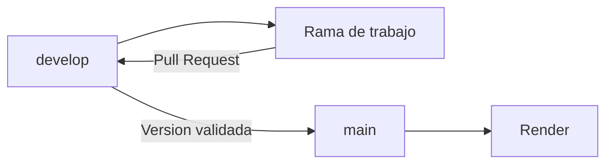

# Flujo de desarrollo — ReciclaTÍA PB03

## 1. Metodología

El proyecto seguirá Specification-Driven Development (SDD).

Las especificaciones de specs/ constituirán la referencia técnica. La implementación se organizará conforme a [plan-trabajo-pb03.md](plan-trabajo-pb03.md).

Cada unidad de trabajo seguirá este ciclo:

1. Revisar requisitos, código existente y dependencias.
2. Crear o seleccionar la rama correspondiente.
3. Implementar los cambios.
4. Ejecutar las pruebas necesarias.
5. Revisar las diferencias y actualizar la documentación afectada.
6. Crear el commit y publicar la rama.
7. Integrar mediante pull request.
8. Validar la versión integrada.

Cuando se detecte una contradicción en las especificaciones, deberá resolverse antes de modificar los contratos afectados.

Las decisiones relevantes se documentarán en el informe final.

## 2. Estrategia de ramas

Repositorio: https://github.com/alex-bometon/pb03_equipo18

| Rama o prefijo | Responsabilidad |
|---|---|
| main | Versión estable y desplegable |
| develop | Integración de funcionalidades |
| feature/ | Nuevas funcionalidades |
| fix/ | Corrección de errores |
| refactor/ | Reestructuración del código |
| test/ | Pruebas |
| docs/ | Documentación |
| chore/ | Mantenimiento y configuración |

Los nombres serán descriptivos, preferentemente en minúsculas y separados mediante guiones.

Las ramas de trabajo partirán normalmente de develop.



Las ramas concretas se establecen en el plan de trabajo.

No se implementarán directamente en main funcionalidades todavía no validadas.

## 3. Procedimientos Git

### 3.1. Preparar el trabajo

```bash
git branch --show-current
git status
git fetch origin
```

Comprobar las modificaciones pendientes antes de cambiar de rama.

Para inspeccionar el historial:

```bash
git log --oneline --graph --decorate --all
```

### 3.2. Crear una rama

Ejemplo:

```bash
git switch develop
git pull --ff-only origin develop
git switch -c feature/api-contracts
```

### 3.3. Revisar, registrar y publicar cambios

```bash
git status --short
git diff
```

Seleccionar explícitamente los archivos correspondientes al cambio:

```bash
git add api/schemas.py api/errors.py
git diff --cached
git diff --cached --stat
```

Crear el commit:

```bash
git commit -m "feat(api): implementar contratos HTTP"
```

Primera publicación de la rama:

```bash
git push -u origin feature/api-contracts
```

Publicaciones posteriores:

```bash
git push
```

Comprobación:

```bash
git status
git log -1 --oneline
```

### 3.4. Sincronizar después de integrar

```bash
git switch develop
git pull --ff-only origin develop
```

Ejecutar las comprobaciones correspondientes sobre la versión integrada.

### 3.5. Eliminar ramas integradas

Cuando se haya confirmado su integración y no sea necesario conservarlas:

```bash
git branch -d feature/api-contracts
git push origin --delete feature/api-contracts
```

No se utilizarán git push --force, git reset --hard ni la eliminación forzada de ramas como procedimientos ordinarios.

Ante conflictos, se revisarán las modificaciones y los contratos afectados antes de resolverlos. Después se ejecutarán las pruebas correspondientes.

## 4. Convenciones de commits

Formato preferente:

```text
tipo(alcance): descripción
```

| Tipo | Finalidad |
|---|---|
| feat | Funcionalidad |
| fix | Corrección |
| docs | Documentación |
| test | Pruebas |
| refactor | Reestructuración |
| chore | Mantenimiento |
| perf | Rendimiento |
| ci | Integración continua |
| build | Construcción y dependencias |

Ejemplos:

```text
docs(specs): consolidar contratos del PB03
feat(auth): implementar autenticacion mediante API key
fix(hitl): impedir aprobaciones obsoletas
test(quotas): verificar ventanas deslizantes
build(docker): reconstruir indice durante el build
```

Cada commit representará una unidad de cambio coherente.

Los mensajes describirán modificaciones realmente realizadas, evitando mezclar cambios no relacionados o atribuir funcionalidades todavía no implementadas.

## 5. Pull requests e integración

Se utilizarán pull requests aunque el desarrollo sea individual.

Las ramas de trabajo se integrarán ordinariamente en develop. Las versiones estables se integrarán posteriormente en main.

### Plantilla de pull request

```markdown
## Objetivo

## Cambios realizados

## Especificaciones relacionadas

## Pruebas ejecutadas y resultados

## Seguridad

## Limitaciones y trabajo pendiente
```

Antes de integrar deberá comprobarse:

- Cumplimiento de las especificaciones.
- Pruebas específicas y regresión satisfactorias.
- Compatibilidad con los componentes integrados.
- Ausencia de secretos versionados.
- Documentación correspondiente al comportamiento real.

Las comprobaciones se realizarán conforme a [plan-pruebas.md](plan-pruebas.md).

## 6. Integración y despliegue continuo

### 6.1. Integración continua — CI

Las versiones candidatas a despliegue deberán superar:

- Instalación reproducible con Python 3.13.2.
- Pruebas unitarias, integración y regresión.
- Validación relacional mediante PostgreSQL aislado.
- Construcción Docker sin credenciales de Gemini.

La automatización mediante GitHub Actions será opcional.

Si se incorpora, podrá utilizarse:

```text
.github/workflows/ci.yml
```

La ausencia de automatización no exime de ejecutar las comprobaciones obligatorias.

### 6.2. Preparación de una versión estable

Integrar develop en main mediante pull request después de completar las validaciones.

Identificar la versión candidata:

```bash
git switch main
git pull --ff-only origin main
git rev-parse HEAD
```

### 6.3. Despliegue continuo — CD

Render utilizará main como origen del despliegue.

El despliegue automático podrá activarse cuando la integración de cambios esté condicionada a las comprobaciones correspondientes.

Los despliegues manuales podrán utilizarse para controlar publicaciones, reproducir incidencias o recuperar versiones.

Cada despliegue deberá asociarse a un commit identificable y someterse a las comprobaciones posteriores.

Los procedimientos de despliegue, redeploy y rollback se establecen en [operaciones-despliegue.md](operaciones-despliegue.md).

## 7. Protección del repositorio

Antes de registrar o publicar cambios deberá comprobarse que no se incluyen:

- Archivos .env con secretos.
- Contraseñas, API keys, tokens y credenciales de proveedores.
- Cadenas de conexión sensibles.
- Entornos virtuales y archivos temporales.
- Registros y datos personales innecesarios.

.env.example únicamente contendrá configuraciones de ejemplo sin secretos reales.

Los artefactos necesarios para reconstruir el índice documental deberán conservarse conforme a las especificaciones.

Si una credencial se incorpora accidentalmente al historial de Git, deberá considerarse potencialmente comprometida.

Eliminarla del archivo actual no será suficiente: deberá revocarse o rotarse y gestionarse la incidencia correspondiente.

## 8. Documentación y asistencia de programación

| Ubicación | Responsabilidad |
|---|---|
| specs/ | Requisitos y contratos |
| docs/ | Procedimientos operativos |
| entregables/evidencias/ | Resultados reales de validación |
| entregables/informe_decisiones.md | Decisiones y justificaciones |
| README.md | Presentación y utilización inicial |
| AGENTS.md | Instrucciones para asistentes de programación |

El seguimiento del progreso se centralizará en el plan de trabajo.

Los asistentes de programación deberán respetar AGENTS.md y revisar el código y las especificaciones antes de proponer cambios.

No realizarán modificaciones directas de archivos, commits, merges, push ni otras operaciones sobre el repositorio sin autorización expresa.

No se presentarán como implementadas o verificadas funcionalidades que todavía no lo estén.