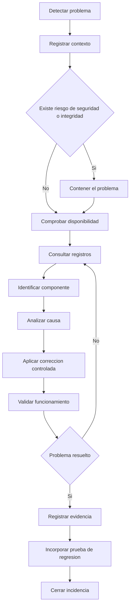

# Gestión de incidencias — ReciclaTÍA PB03

## 1. Objetivo

Establecer los procedimientos de identificación, diagnóstico, resolución y documentación de incidencias relacionadas con el funcionamiento de ReciclaTÍA.

El documento deberá facilitar la recuperación del servicio sin comprometer la seguridad, la integridad de los datos persistidos ni la consistencia del estado operativo.

Los procedimientos se aplicarán tanto al entorno local como al entorno desplegado en Render.

Los escenarios descritos constituyen situaciones previstas. No deberán presentarse como incidencias realmente observadas hasta que exista evidencia de su aparición.

## 2. Principios

- Identificar la causa antes de aplicar modificaciones.
- Diferenciar errores de utilización y fallos técnicos.
- Priorizar la conservación de los datos.
- Evitar operaciones destructivas innecesarias.
- Mantener los controles de autenticación y autorización.
- Consultar los registros antes de reiniciar servicios.
- Evitar la repetición automática de operaciones cuyo resultado sea desconocido.
- Diferenciar el estado operativo del historial persistente.
- Documentar las incidencias realmente observadas.
- Incorporar pruebas de regresión cuando corresponda.

Una incidencia no deberá resolverse desactivando indiscriminadamente los mecanismos de seguridad o validación.

## 3. Componentes susceptibles de fallo

| Componente | Responsabilidad |
|---|---|
| Streamlit | Interfaz y comunicación HTTP |
| FastAPI | Transporte, validación y contratos |
| Autenticación | Identificación de consumidores |
| Autorización | Control de acceso a funcionalidades y recursos |
| PostgreSQL | Persistencia relacional |
| LangGraph | Orquestación del asistente |
| MemorySaver | Estado operativo de conversaciones |
| ChromaDB | Recuperación documental |
| Gemini | Embeddings, generación e identificación multimodal |
| API municipal | Información geográfica |
| ThreadPoolExecutor | Ejecución controlada del asistente |
| Docker | Construcción y ejecución del backend |
| Render | Infraestructura remota |

La identificación del componente afectado permitirá delimitar las comprobaciones necesarias.

## 4. Clasificación de incidencias

### 4.1. Gravedad

| Nivel | Descripción | Ejemplo |
|---|---|---|
| Crítica | Riesgo para la seguridad, integridad de datos o disponibilidad general | Exposición de credenciales o acceso a conversaciones ajenas |
| Alta | Fallo de una funcionalidad principal o dependencia imprescindible | PostgreSQL no disponible |
| Media | Degradación funcional o fallo recuperable | Servicio municipal no disponible con respaldo local |
| Baja | Problema limitado que no impide el funcionamiento principal | Incidencia de presentación de resultados |

La clasificación deberá considerar el impacto real y no únicamente el código HTTP recibido.

### 4.2. Naturaleza

Las incidencias podrán clasificarse como:

- Infraestructura.
- Configuración.
- Dependencias.
- Persistencia.
- Seguridad.
- Autenticación.
- Autorización.
- Concurrencia.
- Estado conversacional.
- Recuperación documental.
- Inferencia.
- Comunicación HTTP.
- Interfaz.
- Procesamiento multimedia.

## 5. Procedimiento general de diagnóstico



## 6. Información necesaria para el diagnóstico

Cuando se detecte una incidencia deberán recopilarse, cuando estén disponibles:

| Campo | Finalidad |
|---|---|
| Fecha y hora | Identificar el momento del fallo |
| Entorno | Diferenciar local, pruebas y producción |
| Rama | Identificar el contexto de desarrollo |
| Commit | Identificar la versión afectada |
| Componente | Delimitar el origen del problema |
| request_id | Localizar la petición HTTP |
| thread_id | Identificar la conversación afectada |
| api_key_id | Identificar la clave sin exponer su secreto |
| Método HTTP | Identificar la operación |
| Endpoint | Identificar el contrato utilizado |
| Código HTTP | Clasificar el resultado |
| Código de error | Identificar la causa funcional |
| duration_ms | Analizar la duración de la petición |
| Estado del servicio | Determinar la disponibilidad |
| Resultado esperado | Identificar el comportamiento correcto |
| Resultado observado | Documentar el comportamiento real |

No deberán recopilarse credenciales, preguntas completas, datos personales innecesarios ni cuerpos íntegros de peticiones cuando no resulten imprescindibles.

## 7. Comprobaciones iniciales

### 7.1. Identificación de versión

```bash
git branch --show-current
git rev-parse HEAD
git status --short
```

### 7.2. Comprobación del entorno Python

```bash
python --version
python -m pip check
```

### 7.3. Estado de Docker

```bash
docker ps
docker ps -a
```

### 7.4. Consumo de recursos

```bash
docker stats
```

### 7.5. Estado del backend local

```bash
curl -i http://localhost:8000/health
```

### 7.6. Estado del backend remoto

```bash
curl -i https://nombre-del-servicio.onrender.com/health
```

La dirección de ejemplo deberá sustituirse por la URL real del servicio.

### 7.7. Registros locales

```bash
docker logs --tail 100 reciclatia-api
```

### 7.8. Registros de PostgreSQL

```bash
docker logs --tail 100 reciclatia-postgres
```

### 7.9. Registros remotos

Cuando el servicio se encuentre desplegado en Render deberán consultarse:

- Registros de construcción.
- Registros de ejecución.
- Eventos de despliegue.
- Estado del Web Service.
- Estado de PostgreSQL.
- Métricas de recursos disponibles.

## 8. Interpretación de los códigos HTTP

| Código | Interpretación general | Actuación inicial |
|---|---|---|
| 200 | Operación válida | Revisar el resultado semántico |
| 201 | Recurso creado | Confirmar el contrato de creación |
| 204 | Operación correcta sin contenido | No esperar un cuerpo JSON |
| 401 | Fallo de autenticación | Revisar las credenciales |
| 403 | Operación no autorizada | Revisar permisos y estado |
| 404 | Recurso inexistente o inaccesible | Revisar identificador y propiedad |
| 409 | Conflicto de estado | Revisar la situación del recurso |
| 413 | Archivo demasiado grande | Revisar las restricciones multimedia |
| 415 | Formato no admitido | Revisar el archivo |
| 422 | Incumplimiento de validación | Revisar el contrato de entrada |
| 429 | Límite de consumo alcanzado | Consultar Retry-After |
| 500 | Fallo interno inesperado | Consultar los registros |
| 503 | Servicio o capacidad no disponible | Identificar el recurso afectado |
| 504 | Timeout del asistente | Comprobar ejecución y estado |

Los códigos HTTP deberán interpretarse conjuntamente con el código funcional incluido en ErrorOut.

El catálogo completo se define en specs/12-contratos-http.md.

Una respuesta HTTP 200 puede contener una abstención o una aclaración válida. No todas las respuestas que carecen de una recomendación constituyen errores.

## 9. Incidencia I01 — PostgreSQL no disponible

### 9.1. Síntomas

- El backend no consigue iniciarse.
- GET /health devuelve HTTP 503.
- Las operaciones de persistencia fallan.
- No puede consultarse el historial.
- Los registros indican errores de conexión.

### 9.2. Posibles causas

- DATABASE_URL incorrecta.
- Credenciales inválidas.
- PostgreSQL detenido.
- Puerto incorrecto.
- Nombre de host incorrecto.
- Restricciones de red.
- Base de datos suspendida.
- Base de datos caducada.
- Servicio remoto no disponible.
- Agotamiento de conexiones.

### 9.3. Diagnóstico local

Comprobar el estado del contenedor:

```bash
docker ps -a
```

Consultar los registros:

```bash
docker logs --tail 100 reciclatia-postgres
```

Comprobar la disponibilidad:

```bash
docker exec reciclatia-postgres \
  pg_isready -U reciclatia -d reciclatia
```

Comprobar la conexión autenticada mediante un cliente autorizado.

pg_isready no acredita por sí solo que las credenciales utilizadas por el backend sean correctas.

### 9.4. Diagnóstico en Render

Comprobar:

- Estado de la instancia PostgreSQL.
- Disponibilidad del servicio.
- Fecha de caducidad, cuando corresponda.
- Configuración de DATABASE_URL.
- Región de los servicios.
- Restricciones de conexión.

El backend desplegado deberá utilizar preferentemente la URL interna de PostgreSQL.

### 9.5. Resolución

Según la causa identificada:

- Iniciar el contenedor.
- Corregir la cadena de conexión.
- Corregir las credenciales.
- Restaurar la comunicación de red.
- Recuperar la disponibilidad del servicio.
- Resolver problemas de conexiones.
- Restaurar datos desde una copia válida cuando sea necesario y exista autorización.

### 9.6. Validación posterior

- PostgreSQL acepta conexiones autorizadas.
- El backend se inicia correctamente.
- GET /health devuelve HTTP 200.
- Las operaciones protegidas funcionan.
- El historial previamente persistido sigue disponible.

### 9.7. Restricciones

No eliminar la base de datos ni su volumen para resolver un problema ordinario de conexión.

## 10. Incidencia I02 — Backend no disponible

### 10.1. Síntomas

- Streamlit no consigue conectar.
- Swagger no está disponible.
- GET /health no responde.
- El contenedor termina inesperadamente.
- Render declara fallido el despliegue.

### 10.2. Posibles causas

- Error de construcción Docker.
- Dependencias incompatibles.
- Error de importación.
- Puerto incorrecto.
- Configuración imprescindible ausente.
- Fallo de inicialización.
- PostgreSQL no disponible.
- Índice ChromaDB ausente.
- Memoria insuficiente.
- Fallo de infraestructura.

### 10.3. Diagnóstico local

```bash
docker ps -a
docker logs --tail 100 reciclatia-api
```

Si el contenedor continúa activo:

```bash
docker stats --no-stream reciclatia-api
```

### 10.4. Diagnóstico en Render

Revisar:

- Resultado de la construcción.
- Commit desplegado.
- Registros de ejecución.
- Configuración del Dockerfile.
- Variable PORT.
- Health Check Path.
- Recursos de CPU y memoria.
- Estado de PostgreSQL.

### 10.5. Resolución

Corregir la causa específica antes de iniciar un nuevo despliegue.

No aumentar automáticamente los recursos ni modificar los timeouts sin determinar previamente el origen del fallo.

### 10.6. Validación posterior

- Backend disponible.
- GET /health satisfactorio.
- Swagger accesible.
- PostgreSQL operativo.
- Índice disponible.
- Operaciones protegidas funcionales.

## 11. Incidencia I03 — Fallo de ejecución del asistente

### 11.1. Síntomas

- HTTP 500.
- HTTP 503.
- HTTP 504.
- Respuesta técnica de error.
- Ejecución que no completa correctamente el turno.

### 11.2. Posibles causas

- Fallo de Gemini.
- Cuota externa agotada.
- Credenciales externas incorrectas.
- Error de recuperación documental.
- Fallo de herramientas.
- Error del supervisor.
- Presupuesto interno agotado.
- Estado conversacional inconsistente.
- Fallo de persistencia posterior.

### 11.3. Diagnóstico

Identificar:

- request_id.
- thread_id.
- Código HTTP.
- Código de error.
- Duración de la petición.
- Eventos de inicio y finalización de la ejecución.
- Estado de las dependencias externas.
- Situación del checkpoint.

### 11.4. Resolución

Aplicar el procedimiento correspondiente al componente afectado.

Cuando no pueda garantizarse la consistencia de la conversación, deberá impedirse su reutilización.

### 11.5. Validación posterior

Realizar una consulta controlada mediante una conversación nueva cuando corresponda.

Verificar que no se hayan generado mensajes, planes ni aprobaciones ficticias.

## 12. Incidencia I04 — Error durante la construcción Docker

### 12.1. Síntomas

- docker build finaliza con error.
- Render no consigue construir la imagen.
- El Dockerfile no encuentra archivos.
- La instalación de dependencias falla.
- No puede reconstruirse el índice vectorial.

### 12.2. Posibles causas

- Dependencias incompatibles con Python 3.13.2.
- Arquitectura de hardware incompatible.
- Archivo requirements.txt incorrecto.
- Recursos documentales excluidos por .dockerignore.
- Artefactos no disponibles.
- Fallo durante la reconstrucción de ChromaDB.
- Dependencia accidental de credenciales durante el build.

### 12.3. Diagnóstico

Ejecutar una construcción local:

```bash
docker build --progress=plain \
  -t reciclatia-api:local .
```

Identificar la primera instrucción del Dockerfile que falla.

Comprobar:

```bash
ls -lh output/chunks.json
ls -lh output/embeddings.json
```

Revisar las exclusiones de .dockerignore.

### 12.4. Resolución

- Corregir dependencias incompatibles.
- Corregir rutas.
- Incorporar los recursos documentales necesarios.
- Ajustar .dockerignore.
- Corregir el procedimiento de indexación.
- Eliminar dependencias innecesarias de servicios externos durante la construcción.

### 12.5. Validación posterior

Construir la imagen nuevamente sin proporcionar credenciales de Gemini como argumentos de construcción.

## 13. Incidencia I05 — Índice ChromaDB no disponible

### 13.1. Síntomas

- El backend no supera el health check.
- La recuperación documental falla.
- No se encuentra la colección esperada.
- Se detectan dimensiones vectoriales incompatibles.

### 13.2. Posibles causas

- Índice inexistente.
- Índice corrupto.
- Configuración incorrecta.
- Artefactos incompatibles.
- Cambio del modelo de embeddings.
- Reconstrucción incompleta.
- Recursos excluidos de la imagen Docker.

### 13.3. Diagnóstico local

```bash
ls -lh output/chunks.json
ls -lh output/embeddings.json
ls -lh output/chroma_db/
```

Comprobar la configuración documental y los metadatos de la colección.

### 13.4. Resolución

Cuando los chunks y embeddings existentes sean válidos y compatibles:

```bash
python main.py rag index --yes
```

Si el problema requiere regenerar artefactos, deberá realizarse un análisis independiente de los cambios documentales o de configuración.

No se regenerarán automáticamente los embeddings ante cualquier fallo del índice.

### 13.5. Validación posterior

- Colección disponible.
- Recuperación funcional.
- Dimensiones compatibles.
- Metadatos conservados.
- Ausencia de errores técnicos durante las consultas.

## 14. Incidencia I06 — Gemini no disponible

### 14.1. Síntomas

- Fallo de generación.
- Fallo de embeddings.
- Fallo de identificación multimodal.
- Respuestas externas inválidas.
- Timeouts repetidos.

### 14.2. Posibles causas

- GEMINI_API_KEY inválida.
- Credencial revocada.
- Cuota del proveedor agotada.
- Modelo no disponible.
- Restricciones del proveedor.
- Fallo de red.
- Indisponibilidad temporal.
- Incompatibilidad de configuración.

### 14.3. Diagnóstico

Comprobar:

- Existencia de la configuración necesaria sin mostrar su valor.
- Modelo configurado.
- Registros técnicos sanitizados.
- Estado del proveedor.
- Cuotas y consumo.
- Duración de las llamadas.

### 14.4. Resolución

- Corregir la configuración.
- Sustituir una credencial inválida o comprometida.
- Revisar los límites del proveedor.
- Esperar a que se restablezca el servicio cuando la incidencia sea externa.
- Evaluar una modificación de modelo únicamente cuando resulte necesaria y esté documentada.

### 14.5. Restricciones

No realizar reintentos ilimitados.

No cambiar automáticamente el modelo de embeddings sin comprobar la compatibilidad del índice existente.

No presentar un fallo de Gemini como una abstención documental válida.

## 15. Incidencia I07 — API municipal no disponible

### 15.1. Síntomas

- Fallo de conexión con el servicio ArcGIS.
- Respuesta externa inválida.
- Timeout de la consulta geográfica.
- Activación del respaldo local.

### 15.2. Posibles causas

- Indisponibilidad temporal.
- Cambios en el servicio municipal.
- Restricciones de red.
- Respuesta incompatible con el contrato.
- Tiempo de espera agotado.

### 15.3. Diagnóstico

Comprobar:

- Estado de la herramienta geográfica.
- Resultado técnico de la consulta.
- Procedencia de los resultados.
- Disponibilidad del corpus local.
- Activación correcta del respaldo.

### 15.4. Resolución

Cuando exista un fallo técnico, utilizar el respaldo documental autorizado conforme a specs/05-tools.md.

### 15.5. Resultado esperado

Si el respaldo funciona:

- La consulta podrá devolver un resultado válido.
- fuente tendrá el valor corpus_local.
- Se comunicarán las limitaciones de actualidad.

### 15.6. Restricción

Una respuesta válida con cero coincidencias no constituye una caída del servicio.

No deberá utilizarse el respaldo únicamente porque no se hayan encontrado instalaciones.

## 16. Incidencia I08 — Fallo de autenticación

### 16.1. Códigos asociados

| HTTP | Código |
|---|---|
| 401 | API_KEY_REQUIRED |
| 401 | INVALID_API_KEY |
| 401 | INVALID_CREDENTIALS |
| 401 | INVALID_SESSION |
| 401 | SESSION_EXPIRED |
| 422 | AMBIGUOUS_CREDENTIALS |

### 16.2. Diagnóstico

Comprobar:

- Modalidad de autenticación utilizada.
- Presencia de las cabeceras necesarias.
- Validez de la sesión.
- Caducidad de la sesión.
- Estado de la credencial.
- Compatibilidad entre el endpoint y la modalidad de autenticación.

### 16.3. Resolución

- Proporcionar una credencial válida.
- Iniciar sesión nuevamente.
- Corregir las cabeceras.
- Eliminar combinaciones incompatibles de modalidades de autenticación.
- Solicitar una credencial nueva mediante los mecanismos autorizados cuando resulte necesario.

### 16.4. Restricciones

No desactivar la autenticación para resolver un problema de acceso.

No registrar credenciales originales durante el diagnóstico.

## 17. Incidencia I09 — Operación no autorizada

### 17.1. Códigos asociados

| HTTP | Código |
|---|---|
| 403 | API_KEY_INACTIVE |
| 403 | USER_INACTIVE |
| 403 | INSUFFICIENT_PERMISSIONS |
| 403 | USER_TIER_NOT_AUTHORIZED |
| 404 | THREAD_NOT_FOUND |
| 404 | API_KEY_NOT_FOUND |

### 17.2. Diagnóstico

Comprobar:

- Rol de la API key.
- Estado de la clave.
- Estado del usuario asociado.
- Propiedad del recurso.
- Permisos del endpoint.
- Modalidad de autenticación.

### 17.3. Resolución

Utilizar únicamente los procedimientos legítimos de autorización, selección de claves o reactivación administrativa.

### 17.4. Consideraciones

THREAD_NOT_FOUND puede indicar que la conversación no existe o que el consumidor no está autorizado a acceder a ella.

No se deberá revelar a consumidores ordinarios la existencia de conversaciones ajenas.

### 17.5. Restricciones

No modificar directamente el rol de una credencial ni reasignar la propiedad de una conversación para resolver una incidencia ordinaria.

## 18. Incidencia I10 — Cuota agotada

### 18.1. Código asociado

```text
HTTP 429
RATE_LIMIT_EXCEEDED
```

### 18.2. Posibles causas

- Límite general de peticiones HTTP.
- Cuota comercial por minuto.
- Cuota comercial por hora.
- Cuota comercial por 24 horas.
- Límite de autenticación.
- Límite de registro.
- Límite de emisión de API keys.

### 18.3. Diagnóstico

Identificar:

- Operación realizada.
- Rol autenticado.
- Tipo de límite alcanzado, cuando pueda determinarse internamente.
- Cabecera Retry-After.
- Contadores correspondientes.

### 18.4. Resolución

Respetar el tiempo de reintento indicado por el backend.

Evaluar la configuración únicamente cuando exista una necesidad técnica justificada.

### 18.5. Restricciones

No generar nuevas API keys para eludir deliberadamente las cuotas.

No reiniciar el backend como mecanismo ordinario para restablecer contadores.

## 19. Incidencia I11 — Conversación ocupada

### 19.1. Código asociado

```text
HTTP 409
THREAD_BUSY
```

### 19.2. Causa

Existe otra operación modificando la misma conversación.

### 19.3. Diagnóstico

Comprobar:

- thread_id.
- Operaciones concurrentes.
- Eventos de inicio y finalización.
- Existencia de un timeout anterior.
- Estado del bloqueo.

### 19.4. Resolución

No iniciar otra modificación simultánea de la conversación.

Esperar a que la ejecución anterior finalice realmente y verificar posteriormente el estado disponible.

### 19.5. Restricciones

No liberar manualmente un bloqueo mientras una ejecución pueda continuar modificando el checkpoint.

## 20. Incidencia I12 — Capacidad del asistente agotada

### 20.1. Código asociado

```text
HTTP 503
SERVER_BUSY
```

### 20.2. Causa

El único worker disponible del asistente se encuentra ocupado.

### 20.3. Diagnóstico

Comprobar:

- Ejecuciones activas.
- Eventos de inicio y finalización real.
- Duración de las operaciones.
- Existencia de timeouts.
- Consumo de recursos.

### 20.4. Resolución

Permitir que finalice la operación activa.

Si la situación es frecuente, evaluar el rendimiento y las causas antes de modificar la capacidad de ejecución.

### 20.5. Restricciones

No introducir colas de espera no contempladas en la arquitectura.

No incrementar el número de workers sin validar las consecuencias sobre concurrencia, memoria, checkpoints y consumo.

## 21. Incidencia I13 — Timeout del asistente

### 21.1. Código asociado

```text
HTTP 504
AGENT_TIMEOUT
```

### 21.2. Posibles causas

- Respuesta lenta de Gemini.
- Respuesta lenta de la API municipal.
- Ejecución compleja.
- Reintentos de proveedores externos.
- Recuperación documental lenta.
- Recursos insuficientes.
- Operaciones bloqueantes.

### 21.3. Diagnóstico

Correlacionar el registro HTTP con los eventos de ejecución real.

Comprobar:

- request_id.
- thread_id.
- Duración HTTP.
- Estado del worker.
- Llamadas a servicios externos.
- Resultado de la ejecución subyacente.

### 21.4. Consideraciones

La devolución de HTTP 504 no garantiza que el worker haya finalizado.

Mientras la ejecución continúe activa podrán permanecer ocupados:

- El worker.
- El bloqueo de conversación.
- Los archivos temporales necesarios.

### 21.5. Resolución

Identificar la operación que provoca el exceso de duración.

Revisar los timeouts de dependencias, los reintentos y las operaciones innecesarias.

Cuando el checkpoint no pueda considerarse consistente, deberá impedirse la continuación del hilo.

### 21.6. Restricciones

- No persistir automáticamente resultados tardíos.
- No devolver éxito retroactivo.
- No liberar prematuramente los recursos.
- No repetir automáticamente la petición POST.
- No aumentar indiscriminadamente ASK_TIMEOUT_SECONDS.

## 22. Incidencia I14 — Estado conversacional no disponible

### 22.1. Código asociado

```text
HTTP 409
THREAD_STATE_LOST
```

### 22.2. Posibles causas

- Reinicio del backend.
- Redeploy.
- Pérdida de MemorySaver.
- Timeout con estado inconsistente.
- Fallo posterior a una modificación del checkpoint.
- Fallo de persistencia.

### 22.3. Diagnóstico

Comprobar:

- Existencia de la conversación en PostgreSQL.
- Disponibilidad del historial.
- Existencia del checkpoint.
- Eventos recientes de reinicio.
- Fallos de ejecución o persistencia.

### 22.4. Resolución

Conservar el historial disponible.

Informar de que el estado necesario para continuar no puede recuperarse mediante los mecanismos actuales.

Permitir iniciar una conversación nueva.

### 22.5. Restricciones

No reconstruir automáticamente el checkpoint a partir de los mensajes SQL.

No eliminar el historial por el hecho de que se haya perdido el estado operativo.

## 23. Incidencia I15 — Conflictos HITL

### 23.1. Códigos asociados

| HTTP | Código | Situación |
|---|---|---|
| 409 | NO_PENDING_APPROVAL | No existe aprobación pendiente |
| 409 | PENDING_APPROVAL | Se intenta iniciar otro turno mientras existe HITL |
| 409 | STALE_APPROVAL | El identificador no corresponde al plan vigente |
| 409 | THREAD_CLOSED | La conversación ha finalizado |
| 409 | TURN_LIMIT_REACHED | Se ha agotado el límite de consultas |

### 23.2. Diagnóstico

Comprobar:

- Estado real del checkpoint.
- thread_id.
- approval_id.
- Existencia de una interrupción.
- Estado de la conversación.
- Contador de turnos.
- Posibles decisiones anteriores.

### 23.3. Resolución

| Situación | Actuación |
|---|---|
| NO_PENDING_APPROVAL | Retirar acciones HITL que ya no resultan válidas |
| PENDING_APPROVAL | Resolver la aprobación vigente antes de realizar otra consulta |
| STALE_APPROVAL | Descartar el identificador obsoleto |
| THREAD_CLOSED | Iniciar una conversación nueva |
| TURN_LIMIT_REACHED | Iniciar una conversación nueva |

### 23.4. Restricciones

No modificar manualmente los atributos de aprobación para simular una resolución satisfactoria.

No sustituir automáticamente un approval_id obsoleto por otro identificador sin una nueva decisión autorizada.

## 24. Incidencia I16 — Fallo de persistencia

### 24.1. Síntomas

- El asistente completa su ejecución, pero falla la respuesta HTTP.
- PostgreSQL no consigue almacenar los mensajes.
- Se produce una excepción durante la transacción.

### 24.2. Posibles causas

- Pérdida de conexión.
- Restricción de integridad.
- Conflicto de unicidad.
- Esquema incompatible.
- Error de transacción.
- Base de datos no disponible.

### 24.3. Diagnóstico

Comprobar:

- request_id.
- thread_id.
- Registros de persistencia.
- Estado de PostgreSQL.
- Resultado de la transacción.
- Existencia de los mensajes correspondientes.
- Consistencia del checkpoint.

### 24.4. Resolución

Aplicar rollback cuando corresponda.

Corregir la causa que impide la persistencia.

Cuando el checkpoint haya avanzado y no pueda garantizarse su consistencia con el historial, impedir la reutilización de la conversación.

### 24.5. Validación posterior

- No existen turnos parcialmente persistidos.
- No existen mensajes duplicados.
- El historial anterior permanece disponible.
- Las nuevas conversaciones pueden persistirse correctamente.
- No se devuelve éxito ficticio al consumidor.

## 25. Incidencia I17 — Error de procesamiento multimedia

### 25.1. Códigos asociados

| HTTP | Código |
|---|---|
| 413 | IMAGE_FILE_TOO_LARGE |
| 415 | IMAGE_FORMAT_NOT_ALLOWED |
| 422 | IMAGE_RESOLUTION_EXCEEDED |
| 422 | IMAGE_CORRUPTED |
| 422 | IMAGE_CONTENT_NOT_ALLOWED |

### 25.2. Diagnóstico

Comprobar:

- Formato real.
- Integridad del archivo.
- Peso.
- Resolución.
- Posibilidad de adaptación segura.
- Resultado de la validación semántica.
- Estado del proveedor externo.

### 25.3. Resolución

Según la situación:

- Solicitar un archivo válido.
- Solicitar un formato admitido.
- Adaptar el archivo cuando pueda hacerse de forma segura.
- Solicitar una nueva imagen cuando la identificación sea incierta.
- Rechazar contenido no permitido conforme al contrato.

### 25.4. Consideraciones

Una imagen que supera los límites finales no constituye necesariamente un error si puede comprimirse o redimensionarse correctamente.

Las imágenes fuera de dominio y las identificaciones inciertas podrán producir respuestas HTTP 200 controladas.

### 25.5. Restricciones

No desactivar los límites absolutos ni los controles de integridad para permitir imágenes incompatibles.

## 26. Incidencia I18 — Streamlit no conecta con FastAPI

### 26.1. Síntomas

- Error de conexión.
- Backend no disponible en la interfaz.
- Fallo al enviar una consulta.
- Timeout del cliente.

### 26.2. Posibles causas

- API_BASE_URL incorrecta.
- Backend detenido.
- Puerto incorrecto.
- Problemas de red.
- Backend remoto suspendido o iniciándose.
- Fallo de resolución DNS.
- Error de certificado.
- Timeout del cliente.

### 26.3. Diagnóstico

Comprobar directamente el health check del backend.

```bash
curl -i http://localhost:8000/health
```

Revisar la configuración de API_BASE_URL.

### 26.4. Interpretación

Si GET /health funciona, el problema podría encontrarse en la configuración del cliente HTTP, en el contrato utilizado o en una operación específica.

Si GET /health no funciona, deberá diagnosticarse primero el backend o la comunicación de red.

### 26.5. CORS

Las peticiones realizadas por el proceso de Streamlit hacia FastAPI no están sujetas al mecanismo CORS del navegador.

No deberá atribuirse automáticamente un fallo de comunicación entre ambos procesos a CORS.

### 26.6. Restricciones

No desactivar la validación HTTPS ni repetir automáticamente operaciones POST cuyo resultado sea desconocido.

## 27. Incidencia I19 — Memoria insuficiente

### 27.1. Síntomas

- Terminación inesperada del contenedor.
- Reinicios repetidos.
- Fallos durante la carga del índice.
- Consumo elevado de memoria.
- Render informa de agotamiento de recursos.

### 27.2. Diagnóstico

```bash
docker stats --no-stream
```

Revisar:

- Recursos asignados a Docker.
- Memoria del backend.
- Inicialización de ChromaDB.
- Tamaño del contexto documental.
- Número de workers.
- Procesamiento multimedia.
- Dependencias cargadas.
- Recursos contratados en Render.

### 27.3. Resolución

Evaluar la reducción de recursos innecesarios, la optimización de operaciones y, si resulta necesario, el aumento de capacidad de infraestructura.

### 27.4. Restricciones

No eliminar componentes documentales necesarios ni reducir arbitrariamente la calidad de recuperación para conseguir que el servicio arranque.

## 28. Incidencia I20 — Exposición accidental de credenciales

### 28.1. Gravedad

Esta situación deberá tratarse como una incidencia de seguridad prioritaria.

### 28.2. Posibles situaciones

- Archivo .env publicado.
- API key incluida en un commit.
- Token de sesión registrado en logs.
- Credencial visible en una captura.
- Cadena DATABASE_URL expuesta.
- Credenciales incorporadas a una imagen Docker.

### 28.3. Contención

1. Identificar la credencial afectada.
2. Revocar, desactivar o rotar la credencial.
3. Limitar los accesos afectados cuando sea necesario.
4. Revisar posibles operaciones no autorizadas.
5. Identificar los lugares donde se ha producido la exposición.

### 28.4. Corrección

- Actualizar la configuración segura.
- Eliminar la exposición de los archivos actuales.
- Evaluar la eliminación del secreto del historial cuando corresponda.
- Revisar .gitignore y .dockerignore.
- Revisar las restricciones de logging.
- Reconstruir las imágenes afectadas cuando resulte necesario.

### 28.5. Validación

Comprobar que la credencial anterior ya no permite acceder al recurso correspondiente.

### 28.6. Restricción

Eliminar un secreto del archivo actual no garantiza que haya desaparecido del historial de Git, de imágenes anteriores o de copias externas.

## 29. Incidencia I21 — Acceso no autorizado a datos

### 29.1. Gravedad

Un acceso indebido a conversaciones, cuentas o credenciales deberá tratarse como una incidencia de seguridad prioritaria.

### 29.2. Contención

- Limitar temporalmente las operaciones afectadas.
- Proteger los recursos expuestos.
- Conservar los registros necesarios.
- Revocar credenciales comprometidas cuando corresponda.

### 29.3. Diagnóstico

Revisar:

- Autenticación.
- Autorización por roles.
- Autorización por propiedad.
- Consultas SQL.
- Identificadores de recursos.
- Aislamiento de sesiones.
- Contratos de respuesta.

### 29.4. Resolución

Corregir la causa de la exposición.

Incorporar pruebas específicas que reproduzcan el fallo sin utilizar datos reales innecesarios.

### 29.5. Validación

Verificar que:

- Los recursos propios continúan disponibles.
- Los recursos ajenos permanecen protegidos.
- No puede repetirse el acceso indebido.
- Los contratos públicos no revelan información no autorizada.

## 30. Situaciones que no constituyen incidencias por sí mismas

| Situación | Interpretación |
|---|---|
| Abstención válida | Ausencia de evidencia suficiente |
| Evidencia parcial | Respuesta limitada a información fundamentada |
| Consulta fuera de dominio | Aplicación correcta de restricciones |
| Solicitud de aclaración | Información insuficiente para resolver la consulta |
| Ausencia de puntos limpios | Resultado geográfico vacío |
| Horario desconocido | Limitación de información disponible |
| Respaldo local autorizado | Mecanismo de continuidad funcional |
| Imagen adaptada correctamente | Procesamiento satisfactorio |
| Plan pendiente | Estado normal de HITL |
| Plan rechazado | Decisión válida del consumidor |
| Cuota alcanzada | Aplicación de límites |
| Clave desactivada | Aplicación de restricciones de acceso |
| Pérdida de MemorySaver tras redeploy | Limitación conocida de la arquitectura |
| Historial sin mensajes | Estado válido cuando corresponda |

Estas situaciones podrán motivar una investigación si aparecen de forma inesperada o con una frecuencia incompatible con el funcionamiento previsto.

No deberán contabilizarse automáticamente como fallos técnicos.

## 31. Trazabilidad mediante request_id

### 31.1. Finalidad

request_id permitirá relacionar una petición HTTP con los registros y eventos técnicos correspondientes.

### 31.2. Obtención

El identificador podrá obtenerse de:

- La cabecera X-Request-ID.
- El contrato ErrorOut.
- Los registros estructurados del backend.

### 31.3. Consulta local

Una vez identificado el request_id podrá localizarse en los registros:

```bash
docker logs reciclatia-api 2>&1 | grep -F "$REQUEST_ID"
```

REQUEST_ID deberá contener el identificador correspondiente a la petición investigada.

### 31.4. Diferenciación

request_id identifica una petición HTTP.

thread_id identifica una conversación.

Una misma conversación puede estar asociada a múltiples peticiones HTTP.

### 31.5. Ejecuciones tardías

La investigación de timeouts deberá considerar los eventos posteriores al registro de finalización HTTP.

Una ejecución puede continuar activa después de que la petición haya devuelto un error.

## 32. Procedimiento de recuperación mediante rollback

Cuando una incidencia haya sido introducida por una versión desplegada, podrá evaluarse la recuperación de una versión anterior.

Antes del rollback deberá comprobarse:

- Versión afectada.
- Última versión estable.
- Compatibilidad con PostgreSQL.
- Configuración necesaria.
- Recursos documentales.
- Dependencias.

El procedimiento operativo se define en docs/operaciones-despliegue.md.

Un rollback del backend no revierte automáticamente la base de datos ni recupera estados almacenados anteriormente en memoria.

## 33. Registro de incidencias reales

Las incidencias efectivamente observadas durante el desarrollo deberán documentarse con información verificable.

### 33.1. Plantilla

```markdown
# Incidencia

## Identificación

- ID:
- Fecha:
- Gravedad:
- Entorno:
- Rama:
- Commit:
- Componente afectado:

## Descripción

Comportamiento observado.

## Resultado esperado

Comportamiento definido por las especificaciones.

## Evidencia

- request_id:
- thread_id:
- Código HTTP:
- Código funcional:
- Registros sanitizados:
- Comando de reproducción:

## Diagnóstico

Comprobaciones realizadas.

## Causa raíz

Causa confirmada o hipótesis pendiente de validación.

## Corrección

Modificaciones realizadas.

## Validación posterior

- Pruebas ejecutadas:
- Resultados:
- Commit de corrección:

## Prevención

Pruebas o medidas incorporadas para evitar recurrencias.

## Estado

Abierta, en diagnóstico, resuelta o pendiente de verificación.
```

### 33.2. Requisitos

La documentación deberá distinguir entre:

- Hechos observados.
- Hipótesis.
- Causas confirmadas.
- Correcciones aplicadas.
- Resultados verificados.
- Trabajo pendiente.

No se documentarán como hechos las causas que únicamente se hayan planteado como posibilidades.

## 34. Prevención de regresiones

Cuando una incidencia corresponda a un defecto reproducible del producto deberá evaluarse la incorporación de una prueba de regresión.

La prueba deberá reproducir el comportamiento incorrecto y verificar que la modificación lo corrige.

Cuando el problema dependa de un servicio externo podrán utilizarse mocks o dependencias controladas para comprobar la respuesta del sistema.

Las pruebas se organizarán conforme a specs/08-pruebas-y-validacion.md.

## 35. Criterios de cierre

Una incidencia podrá considerarse resuelta cuando:

- Se haya identificado suficientemente su causa.
- Se haya aplicado una corrección o recuperación.
- Se haya comprobado el funcionamiento esperado.
- No se hayan comprometido los controles de seguridad.
- No existan inconsistencias de datos conocidas sin resolver.
- Se hayan realizado las comprobaciones necesarias.
- Se hayan registrado las evidencias correspondientes.
- Se haya incorporado una prueba de regresión cuando proceda.

Una incidencia mitigada temporalmente no deberá presentarse necesariamente como una incidencia cuya causa raíz ha sido corregida.

## 36. Referencias

- [Arquitectura MLOps](../specs/11-arquitectura-mlops.md)
- [Contratos HTTP](../specs/12-contratos-http.md)
- [Persistencia](../specs/13-persistencia.md)
- [Autenticación y autorización](../specs/14-autenticacion-autorizacion.md)
- [Robustez y observabilidad](../specs/15-robustez-observabilidad.md)
- [Despliegue e infraestructura](../specs/16-despliegue.md)
- [Seguridad del núcleo](../specs/10-seguridad.md)
- [Estrategia de pruebas](../specs/08-pruebas-y-validacion.md)
- [Operaciones de despliegue](operaciones-despliegue.md)
- [Flujo de desarrollo](flujo-desarrollo.md)
- [Plan de pruebas](plan-pruebas.md)
- [Informe de decisiones](../entregables/informe_decisiones.md)