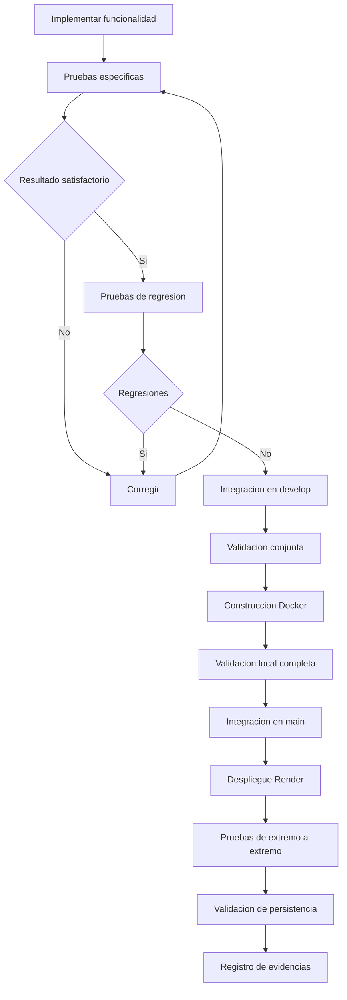

# Plan de pruebas — ReciclaTÍA PB03

## 1. Objetivo

Establecer los procedimientos de ejecución, evaluación y registro de las pruebas necesarias para validar ReciclaTÍA durante el desarrollo del Project Break 03.

Este documento desarrolla operativamente la estrategia definida en specs/08-pruebas-y-validacion.md.

El plan permitirá comprobar tanto la conservación de las funcionalidades existentes de la fase de desarrollo anterior como la incorporación de los requisitos correspondientes a MLOps y despliegue.

Los resultados concretos de las pruebas se documentarán en entregables/evidencias/.

## 2. Referencia inicial

La validación inicial del proyecto se encuentra documentada en:

entregables/evidencias/baseline-pb02.md

Esta referencia permitirá distinguir entre:

- Funcionalidades previamente disponibles.
- Regresiones introducidas durante el desarrollo.
- Modificaciones de comportamiento intencionadas.
- Funcionalidades nuevas.
- Comprobaciones todavía pendientes.

El número de pruebas superadas en la línea base no constituye un objetivo cuantitativo obligatorio para las versiones posteriores.

## 3. Organización de la validación

| Nivel | Procedimiento | Momento de ejecución |
|---|---|---|
| Unitario | pytest y dependencias controladas | Durante la implementación |
| Integración interna | pytest y componentes reales o controlados | Antes de integrar funcionalidades |
| Contratos HTTP | Cliente de pruebas de FastAPI | Durante el desarrollo del backend |
| Persistencia | PostgreSQL aislado | Durante la implementación relacional |
| Regresión | Suite automatizada | Antes y después de integrar cambios |
| Evaluación RAG | Scripts de evaluación existentes | Ante cambios documentales o de generación |
| Seguridad | Entradas adversariales y pruebas de autorización | Antes de integrar y desplegar |
| Robustez | Simulación de límites, concurrencia y errores | Durante la implementación del backend |
| Interfaz | Pruebas automatizadas y manuales | Durante la adaptación de Streamlit |
| Infraestructura | Docker y Render | Antes de la entrega |
| Extremo a extremo | Recorridos completos del producto | Validación final |

## 4. Flujo de validación



La incorporación de funcionalidades deberá realizarse progresivamente.

No será necesario ejecutar todas las evaluaciones contra servicios externos después de cada modificación menor.

## 5. Preparación del entorno

### 5.1. Identificación de la versión

Desde la raíz del repositorio:

```bash
git branch --show-current
git rev-parse HEAD
git status --short
```

Estos datos deberán conservarse cuando se registre una ejecución relevante.

### 5.2. Comprobación de Python

```bash
python --version
```

Versión establecida para el proyecto:

```text
Python 3.13.2
```

### 5.3. Activación del entorno virtual

En macOS y Linux:

```bash
source .venv/bin/activate
```

### 5.4. Instalación de dependencias

```bash
python -m pip install -r requirements.txt
```

### 5.5. Comprobación de compatibilidad

```bash
python -m pip check
```

### 5.6. Disponibilidad de recursos documentales

```bash
ls -lh output/chunks.json
ls -lh output/embeddings.json
ls -ld output/chroma_db/
```

### 5.7. Reconstrucción del índice

Cuando sea necesario reconstruir el índice desde los artefactos existentes:

```bash
python main.py rag index --yes
```

No se regenerarán los embeddings sistemáticamente antes de ejecutar las pruebas.

## 6. Aislamiento del entorno de pruebas

### 6.1. Base de datos

Las pruebas de integración relacional utilizarán una instancia o base de datos PostgreSQL independiente de producción.

Se utilizará una configuración de conexión específica para las pruebas.

No se ejecutarán procedimientos destructivos sobre bases de datos utilizadas por consumidores reales.

### 6.2. Servicios externos

Las pruebas unitarias utilizarán mocks o dependencias controladas para las operaciones que requieran:

- Gemini.
- API municipal.
- Servicios externos de infraestructura.

### 6.3. Credenciales

Las pruebas deberán utilizar credenciales ficticias o credenciales específicas de evaluación según corresponda.

No se incorporarán secretos reales a los archivos de pruebas.

### 6.4. Estado operativo

Deberá garantizarse el aislamiento de:

- Instancias del grafo.
- Checkpoints.
- Sesiones de autenticación.
- API keys de prueba.
- Cuotas.
- Rate limiting.
- Bloqueos.
- Workers.
- Archivos temporales.

Las pruebas deberán limpiar los recursos generados cuando termine su ejecución.

## 7. Ejecución de pruebas automatizadas

### 7.1. Suite completa

```bash
python -m pytest tests/ -q --tb=short
```

### 7.2. Descubrimiento de pruebas

```bash
python -m pytest tests/ --collect-only -q
```

Este comando permitirá comprobar qué pruebas detecta pytest.

Los scripts de evaluación externa no deberán ejecutarse accidentalmente como parte de la suite unitaria ordinaria.

### 7.3. Ejecución detallada

```bash
python -m pytest tests/ -v
```

### 7.4. Detención ante el primer fallo

```bash
python -m pytest tests/ -x --tb=short
```

Este procedimiento podrá utilizarse durante el diagnóstico de fallos.

### 7.5. Ejecución mediante nombre de prueba

```bash
python -m pytest tests/ -k "nombre_de_prueba" -v
```

### 7.6. Comprobación sintáctica de Streamlit

```bash
python -m py_compile app.py
```

La comprobación sintáctica no sustituye la validación funcional de la interfaz.

## 8. Pruebas de regresión del PB02

### 8.1. Recuperación semántica

```bash
python -m pytest tests/test_retrieve.py -v
```

Comprobar:

- Top-k.
- Metadatos.
- Filtros.
- Compatibilidad vectorial.
- Gestión de resultados.

### 8.2. Recuperación estructurada

```bash
python -m pytest \
  tests/test_retrieve_structured.py \
  tests/test_rag_structured.py -v
```

Comprobar catálogo, relaciones entre residuos y destinos, modalidades y horarios asociados a registros concretos.

### 8.3. Generación y RAG

```bash
python -m pytest \
  tests/test_generate.py \
  tests/test_rag.py \
  tests/test_rag_domain.py -v
```

Comprobar contratos, citas, fuentes, abstenciones, restricciones geográficas y errores.

### 8.4. Herramientas

```bash
python -m pytest \
  tests/test_tools_registry.py \
  tests/test_rag_tool.py \
  tests/test_api_puntos_limpios.py \
  tests/test_describir_imagen.py \
  tests/test_hora_actual.py -v
```

Comprobar permisos, argumentos, formatos, procedencia y mecanismos de respaldo.

### 8.5. Sistema multiagente

```bash
python -m pytest \
  tests/test_agent_regression.py \
  tests/test_agent_resultado.py -v
```

Comprobar enrutamiento, especialistas, límites, síntesis, estado e HITL.

Las pruebas deberán adaptarse a la posibilidad de resolver consultas sin HITL obligatorio.

### 8.6. Interpretación temporal

```bash
python -m pytest \
  tests/test_agent_schedule.py \
  tests/test_agent_schedule_integration.py -v
```

Comprobar horarios, intervalos, priorización y la regla específica de envases de vidrio.

### 8.7. Interfaz de terminal

```bash
python -m pytest tests/test_cli.py -v
```

Comprobar la conservación de los comandos y contratos de ejecución independiente.

## 9. Evaluación de la recuperación documental

### 9.1. Script existente

```bash
python tests/evaluate_retrieve.py
```

Este script evalúa la recuperación utilizando 14 consultas etiquetadas.

Compara los siguientes valores de K:

| Configuración | Valor |
|---|---:|
| K1 | 3 |
| K2 | 5 |
| K3 | 8 |
| K4 | 10 |

Se genera un embedding por consulta cuando no existe un vector compatible en caché.

El embedding se reutiliza para comparar las diferentes configuraciones de K.

El script no realiza generación de respuestas ni modifica ChromaDB.

### 9.2. Caché

```text
output/cache/pb02_embeddings_consultas.json
```

La compatibilidad de la caché depende de:

- Modelo de embeddings.
- Dimensiones vectoriales.
- Formato de las consultas.

Cuando la caché resulte incompatible podrán necesitarse nuevas llamadas al proveedor.

### 9.3. Resultados

```text
output/evaluation/retrieval_pb02.json
```

### 9.4. Interpretación

La evaluación deberá considerar:

- Presencia de fuentes esperadas.
- Posición de los resultados relevantes.
- Comportamiento al modificar K.
- Distancias vectoriales.
- Consultas fuera del dominio.

La coincidencia de una fuente esperada no implica necesariamente que todos los fragmentos recuperados sean relevantes.

### 9.5. Métricas adicionales

Precision@k y Recall@k podrán incorporarse cuando exista una referencia de relevancia suficientemente detallada.

No se calcularán utilizando etiquetas documentales como si constituyeran automáticamente etiquetas de relevancia de todos los chunks.

### 9.6. Conservación de evidencias

Los resultados relevantes deberán asociarse al commit, configuración y modelo utilizados durante la evaluación.

No se sobrescribirá una evidencia histórica sin conservar la información necesaria para realizar comparaciones posteriores.

## 10. Evaluación de la generación

### 10.1. Evaluación completa

```bash
python tests/evaluate_rag.py
```

El script utiliza las 14 consultas definidas por la evaluación de retrieval.

### 10.2. Evaluación selectiva

```bash
python tests/evaluate_rag.py --ids 9 10 14
```

Este procedimiento permite ejecutar casos específicos sin realizar toda la evaluación.

### 10.3. Casos de especial interés

| ID | Consulta | Comportamiento esperado |
|---|---|---|
| 9 | ¿Qué horario tiene el punto limpio móvil? | Solicitar aclaración sobre la parada o distrito |
| 10 | ¿Qué tipos de residuos reconoce el Ayuntamiento de Madrid? | Resumen estructurado del catálogo |
| 12 | ¿Cuál es el horario de las piscinas municipales de Madrid? | Abstención fuera de dominio |
| 13 | ¿Dónde reciclo el vidrio en Barcelona? | No extrapolar la información de Madrid |
| 14 | ¿Qué servicios de reparación de móviles hay cerca de Gran Vía? | Abstención fuera de dominio |

### 10.4. Consultas estructuradas

Los casos 9 y 10 utilizan mecanismos estructurados que no requieren embeddings de consulta ni generación mediante Gemini en la implementación existente.

Podrán evaluarse independientemente:

```bash
python tests/evaluate_rag.py --ids 9 10
```

### 10.5. Resultados

```text
output/evaluation/rag_pb02.json
```

### 10.6. Revisión factual

Los resultados deberán revisarse considerando:

- Corrección de la recomendación.
- Correspondencia entre afirmaciones y fuentes.
- Interpretación de restricciones.
- Calidad de las aclaraciones.
- Abstenciones esperadas.
- Abstenciones indebidas.
- Respuestas sin evidencia suficiente.

La ausencia de alertas automáticas no constituirá una garantía de corrección factual.

### 10.7. Consumo

Las evaluaciones podrán realizar llamadas reales a Gemini.

Antes de ejecutar una evaluación completa deberá comprobarse la necesidad de utilizar recursos externos.

## 11. Comprobaciones mediante CLI

### 11.1. Ayuda general

```bash
python main.py --help
```

### 11.2. Ayuda del RAG

```bash
python main.py rag --help
```

### 11.3. Recuperación documental

Consultar las opciones disponibles:

```bash
python main.py rag query --help
```

Ejecutar una búsqueda documental representativa.

Comprobar los chunks, fuentes y metadatos obtenidos.

### 11.4. Generación

```bash
python main.py rag ask --help
```

Ejecutar una consulta representativa conforme a los argumentos disponibles.

### 11.5. Asistente

```bash
python main.py agente demo --help
```

Comprobar los recorridos de demostración correspondientes.

### 11.6. Independencia

La ejecución del RAG y de la CLI deberá comprobarse sin depender de PostgreSQL ni del servicio FastAPI.

## 12. Preparación de las pruebas del PB03

Los nombres de archivos correspondientes a las nuevas pruebas se concretarán durante la implementación.

La siguiente organización constituye una propuesta inicial.

| Archivo propuesto | Responsabilidad |
|---|---|
| test_api_health.py | Estado del servicio |
| test_api_ask.py | Consultas textuales |
| test_api_approve.py | HITL |
| test_api_images.py | Consultas multimodales |
| test_api_threads.py | Historial y conversaciones |
| test_auth.py | Registro y autenticación |
| test_sessions.py | Sesiones |
| test_api_keys.py | Emisión y gestión de claves |
| test_authorization.py | Roles y propiedad |
| test_admin.py | Operaciones administrativas |
| test_models.py | Modelos relacionales |
| test_persistence.py | Persistencia y transacciones |
| test_rate_limit.py | Rate limiting HTTP |
| test_quotas.py | Cuotas comerciales |
| test_domain_filter.py | Filtrado de dominio |
| test_image_validation.py | Procesamiento multimedia |
| test_concurrency.py | Bloqueos y capacidad |
| test_timeout.py | Timeouts |
| test_observability.py | Logging y trazabilidad |
| test_api_errors.py | Contratos de error |
| test_cors.py | Política CORS |
| test_http_client.py | Cliente HTTP |

Estos archivos no deberán considerarse existentes hasta que sean implementados.

## 13. Validación HTTP inicial — Sprint 14

### 13.1. Arranque del backend

Una vez implementada la capa FastAPI:

```bash
python -m uvicorn api.main:app \
  --host 127.0.0.1 \
  --port 8000 \
  --workers 1
```

### 13.2. Health check

```bash
curl -i http://localhost:8000/health
```

### 13.3. Swagger

```text
http://localhost:8000/docs
```

### 13.4. OpenAPI

```text
http://localhost:8000/openapi.json
```

### 13.5. Comprobaciones

- Los endpoints implementados aparecen en Swagger.
- Los modelos Pydantic representan los contratos definidos.
- Las operaciones protegidas permiten proporcionar las credenciales correspondientes.
- Los errores utilizan ErrorOut.
- Las respuestas incluyen X-Request-ID.

### 13.6. Clientes automatizados

Las pruebas automatizadas de endpoints podrán utilizar TestClient de FastAPI y HTTPX cuando corresponda.

Deberán utilizar una inicialización controlada del backend y dependencias aisladas.

No deberán requerir que el desarrollador mantenga manualmente un servidor Uvicorn activo para ejecutar pruebas unitarias.

## 14. Casos de prueba de contratos HTTP

| ID | Entrada o condición | HTTP esperado | Resultado |
|---|---|---:|---|
| HTTP-01 | GET /health operativo | 200 | HealthOut válido |
| HTTP-02 | Petición protegida sin credencial | 401 | API_KEY_REQUIRED |
| HTTP-03 | API key inválida | 401 | INVALID_API_KEY |
| HTTP-04 | Pregunta vacía | 422 | EMPTY_QUESTION |
| HTTP-05 | Pregunta de 501 caracteres | 422 | QUESTION_TOO_LONG |
| HTTP-06 | UUID mal formado | 422 | INVALID_THREAD_ID |
| HTTP-07 | Coordenadas incompletas | 422 | INVALID_LOCATION |
| HTTP-08 | Coordenadas fuera de rango | 422 | INVALID_LOCATION |
| HTTP-09 | max_steps=0 | 422 | INVALID_MAX_STEPS |
| HTTP-10 | max_steps=5 | 422 | INVALID_MAX_STEPS |
| HTTP-11 | Consulta válida | 200 | AskOut válido |
| HTTP-12 | Respuesta directa | 200 | Sin HITL |
| HTTP-13 | Abstención válida | 200 | Resultado semántico |
| HTTP-14 | Aclaración válida | 200 | Resultado semántico |
| HTTP-15 | Fallo interno simulado | 500 | ErrorOut válido |
| HTTP-16 | Dependencia imprescindible no disponible | 503 | ErrorOut válido |
| HTTP-17 | Timeout simulado del agente | 504 | AGENT_TIMEOUT |

En los casos de validación de entradas deberán utilizarse credenciales válidas y condiciones de admisión compatibles para aislar el control evaluado.

Deberán añadirse comprobaciones de los valores límite válidos, incluyendo preguntas de exactamente 500 caracteres y valores max_steps comprendidos entre 1 y 4.

Los códigos definitivos serán los establecidos en specs/12-contratos-http.md.

## 15. Validación de autenticación

### 15.1. Registro

| ID | Escenario | Resultado esperado |
|---|---|---|
| AUTH-01 | Registro válido | HTTP 201 |
| AUTH-02 | Email duplicado | HTTP 409 |
| AUTH-03 | Email inválido | HTTP 422 |
| AUTH-04 | Contraseña inválida | HTTP 422 |
| AUTH-05 | Email con mayúsculas y espacios exteriores | Normalización conforme al contrato |

### 15.2. Contraseñas

Comprobar los límites de longitud, restricciones y tratamiento de caracteres definidos en specs/14-autenticacion-autorizacion.md.

Verificar que PostgreSQL almacena únicamente la representación protegida de la contraseña.

### 15.3. Inicio de sesión

| ID | Escenario | Resultado esperado |
|---|---|---|
| AUTH-06 | Credenciales válidas | LoginOut válido |
| AUTH-07 | Contraseña incorrecta | HTTP 401 |
| AUTH-08 | Usuario inexistente | HTTP 401 |
| AUTH-09 | Usuario desactivado con credenciales correctas | Rechazo autorizado |
| AUTH-10 | Token inválido | HTTP 401 |
| AUTH-11 | Token caducado | HTTP 401 |
| AUTH-12 | Cierre de sesión | HTTP 204 |
| AUTH-13 | Reutilización de sesión cerrada | Rechazo |
| AUTH-14 | Cambio de contraseña | Invalidación de sesiones correspondientes |
| AUTH-15 | Reinicio del backend | Pérdida controlada de sesiones |

Las pruebas de caducidad deberán utilizar referencias temporales controladas.

## 16. Validación de API keys y autorización

### 16.1. Datos de prueba

Preparar identidades independientes:

| Identidad | Finalidad |
|---|---|
| Free anónima | Consultas sin registro |
| Usuario A | Propietario de claves registradas |
| Usuario B | Comprobaciones de aislamiento |
| Free registrada A | Acceso Free e historial mediante sesión |
| User A1 | Consultas textuales y multimodales |
| User A2 | Aislamiento entre claves del mismo propietario |
| User B1 | Aislamiento entre consumidores |
| Admin | Operaciones administrativas autorizadas |

Las credenciales deberán generarse mediante los procedimientos de prueba autorizados.

### 16.2. Emisión de claves

| ID | Escenario | Resultado esperado |
|---|---|---|
| KEY-01 | Emitir Free anónima | HTTP 201 |
| KEY-02 | Emitir Free registrada | HTTP 201 |
| KEY-03 | Emitir User con autorización | HTTP 201 |
| KEY-04 | Solicitar User sin autorización | HTTP 403 |
| KEY-05 | Intentar emitir Admin mediante endpoint ordinario | Rechazo |
| KEY-06 | Consultar una clave existente | Sin secreto original ni hash |
| KEY-07 | Superar límite de claves activas | HTTP 409 |
| KEY-08 | Superar límite temporal de emisión | HTTP 429 |
| KEY-09 | Emitir claves concurrentemente | No superar el límite |
| KEY-10 | Utilizar clave desactivada | HTTP 403 |

### 16.3. Matriz de acceso

| Operación | Free | User | Admin |
|---|---|---|---|
| POST /ask | Permitida | Permitida | Permitida |
| POST /ask/image | Denegada | Permitida | Permitida |
| POST /approve | Permitida | Permitida | Permitida |
| GET /threads | Denegada | Permitida | Permitida |
| GET /threads/{thread_id} | Denegada | Según propiedad | Permitida |
| GET /threads/{thread_id}/messages | Denegada | Según propiedad | Permitida |
| /admin/* | Denegada | Denegada | Permitida |

La matriz corresponde a la autenticación mediante API key.

Los endpoints autenticados por sesión deberán comprobarse adicionalmente conforme a sus propios contratos.

### 16.4. Aislamiento de conversaciones

1. Crear una conversación con User A1.
2. Consultarla mediante User A1.
3. Intentar consultarla mediante User A2.
4. Intentar consultarla mediante User B1.
5. Consultarla mediante una clave Admin autorizada.

Resultado esperado:

- User A1 puede consultar su conversación.
- User A2 no puede acceder utilizando su propia credencial.
- User B1 no puede acceder.
- Admin puede acceder conforme a sus permisos.

### 16.5. Historial mediante sesión

Comprobar que el usuario A puede consultar el historial de sus propias claves mediante los endpoints correspondientes, aunque una clave se encuentre desactivada.

No deberá poder consultar claves de otro usuario ni claves eliminadas lógicamente mediante los mecanismos ordinarios.

### 16.6. Modalidades de autenticación

Comprobar:

- X-API-Key.
- Authorization.
- Authorization y X-API-Key-Id.
- Mezcla incompatible de credenciales.
- Selección de claves ajenas.
- Intento de utilizar una clave Admin mediante sesión ordinaria.

## 17. Validación del asistente mediante HTTP

### 17.1. Consulta textual de ejemplo

Enviar mediante Swagger o un cliente HTTP autorizado:

```json
{
    "pregunta": "¿Dónde puedo reciclar unas pilas?",
    "thread_id": null,
    "auto_aprobar": false,
    "ubicacion": null,
    "max_steps": 3
}
```

### 17.2. Comprobaciones

- HTTP 200 cuando la consulta sea procesada correctamente.
- thread_id válido.
- Respuesta conforme a AskOut.
- Fuentes correspondientes cuando exista evidencia documental.
- Estado conversacional coherente.
- Ausencia de información interna no autorizada.

### 17.3. Continuidad

Utilizar el thread_id obtenido en una nueva consulta cuando el estado de la conversación permita continuar.

### 17.4. Consultas representativas

| ID | Consulta | Comprobación |
|---|---|---|
| AG-01 | ¿Dónde tiro una botella de plástico? | Clasificación documentada |
| AG-02 | ¿Qué tipos de residuos puedo reciclar? | Recuperación estructurada |
| AG-03 | ¿Dónde está el punto limpio más cercano? | Solicitud de coordenadas cuando no existen |
| AG-04 | ¿Dónde reciclo vidrio en Barcelona? | Restricción geográfica |
| AG-05 | ¿Qué horario tiene el punto limpio móvil? | Aclaración |
| AG-06 | ¿Dónde tiro unas pilas y qué punto limpio compatible tengo cerca? | Integración de especialidades |
| AG-07 | ¿Cuál es la capital de Francia? | Filtrado previo |
| AG-08 | ¿Y si es de plástico? | Interpretación contextual cuando corresponda |

La ejecución de los casos deberá adaptarse al estado de cada conversación.

## 18. Validación de respuestas directas y HITL

### 18.1. Respuesta directa

Utilizar un caso informativo que no requiera aprobación, conforme a los criterios de planificación establecidos.

Resultado esperado:

```json
{
    "plan": [],
    "plan_aprobado": null,
    "pendiente_hitl": false,
    "approval_id": null,
    "done": false
}
```

El ejemplo representa únicamente los campos relevantes del contrato.

### 18.2. Plan pendiente

Utilizar un caso que requiera un plan conforme a la política HITL.

Comprobar:

- plan válido.
- pendiente_hitl=True.
- plan_aprobado=None.
- approval_id válido.
- done=False.
- Existencia de una interrupción real.

### 18.3. Aprobación

Enviar:

```json
{
    "thread_id": "UUID_DE_LA_CONVERSACION",
    "approval_id": "UUID_DE_LA_APROBACION",
    "aprobado": true
}
```

Los identificadores deberán sustituirse por los valores realmente recibidos.

Resultado esperado:

- plan_aprobado=True.
- pendiente_hitl=False.
- approval_id=None.
- done=True.
- Turno resuelto.

### 18.4. Rechazo

Crear un nuevo caso con HITL pendiente y enviar aprobado=False.

Resultado esperado:

- plan_aprobado=False.
- pendiente_hitl=False.
- approval_id=None.
- done=False.
- Posibilidad de reformular dentro de los límites establecidos.

### 18.5. Conflictos

| ID | Escenario | HTTP esperado | Código |
|---|---|---:|---|
| HITL-01 | Aprobar sin plan pendiente | 409 | NO_PENDING_APPROVAL |
| HITL-02 | Preguntar con HITL pendiente | 409 | PENDING_APPROVAL |
| HITL-03 | Aprobar con identificador anterior | 409 | STALE_APPROVAL |
| HITL-04 | Preguntar después de aprobar | 409 | THREAD_CLOSED |
| HITL-05 | Preguntar tras agotar turnos | 409 | TURN_LIMIT_REACHED |

### 18.6. Aprobación automática

Enviar una consulta con auto_aprobar=True y utilizar un caso que requiera HITL.

Comprobar que el backend utiliza las transiciones autorizadas y no modifica ficticiamente los atributos de aprobación.

### 18.7. Persistencia

Verificar que:

- Un plan pendiente no genera un turno persistido como resuelto.
- Una respuesta directa puede persistirse conforme a su política.
- Una aprobación válida persiste una sola pareja de mensajes.
- Un rechazo válido persiste una sola pareja de mensajes.
- Una decisión duplicada no duplica registros.

## 19. Validación de persistencia — Sprint 15

### 19.1. Preparación

Iniciar PostgreSQL en el entorno de pruebas conforme a docs/operaciones-despliegue.md.

### 19.2. Inspección

```bash
docker exec -it reciclatia-postgres \
  psql -U reciclatia -d reciclatia
```

El comando anterior corresponde a la configuración local de referencia.

### 19.3. Listado de tablas

```sql
\dt
```

Comprobar las tablas correspondientes a:

- Usuarios.
- API keys.
- Conversaciones.
- Mensajes.

### 19.4. Comprobación de registros

```sql
SELECT COUNT(*) FROM conversation;
SELECT COUNT(*) FROM message;
```

### 19.5. Validación de turnos

1. Registrar el número inicial de mensajes asociados al hilo.
2. Resolver correctamente una consulta.
3. Consultar el historial.
4. Comprobar que se han incorporado el mensaje del usuario y el mensaje del asistente.
5. Verificar que ambos pertenecen a la misma conversación.
6. Comprobar que no existen registros duplicados.

### 19.6. Atomicidad

Simular un fallo durante la inserción de los mensajes del turno.

Resultado esperado:

- Rollback de la transacción.
- Ausencia de almacenamiento parcial.
- Ausencia de respuesta satisfactoria.
- Protección del estado operativo afectado.

### 19.7. Restricciones relacionales

Comprobar mediante PostgreSQL real:

- Unicidad.
- Claves foráneas.
- Enumerados.
- Restricciones obligatorias.
- Integridad referencial.
- Numeración de turnos.
- Eliminación lógica.

Las pruebas deberán ajustarse al modelo definitivo de specs/13-persistencia.md.

### 19.8. Eliminación lógica

Verificar que la desactivación o eliminación de una clave no elimina automáticamente las conversaciones y mensajes asociados.

Comprobar las restricciones de acceso correspondientes.

## 20. Validación de cuotas y rate limiting

### 20.1. Cuotas comerciales vigentes

| Rol | Minuto | Hora | 24 horas |
|---|---:|---:|---:|
| Free | 2 | 10 | 30 |
| User | 5 | 20 | 45 |
| Admin | Sin cuota comercial | Sin cuota comercial | Sin cuota comercial |

Los valores utilizados durante la implementación deberán corresponder a specs/15-robustez-observabilidad.md.

### 20.2. Prueba de cuota Free

Utilizar una clave Free nueva y consultas válidas que realmente alcancen la ejecución contabilizable.

| Petición | Resultado esperado |
|---|---|
| Primera | Admitida |
| Segunda | Admitida |
| Tercera dentro de la misma ventana | HTTP 429 |

Cada consulta deberá utilizar un estado conversacional compatible.

No deberán reutilizarse conversaciones cerradas o con HITL pendiente para evaluar la cuota.

### 20.3. Prueba de cuota User

Utilizar una clave User nueva.

Las primeras cinco consultas contabilizables podrán admitirse dentro de una ventana de 60 segundos.

La sexta deberá rechazarse si las demás condiciones permiten alcanzar el control de cuota.

### 20.4. Ventanas temporales

Utilizar un reloj controlado para comprobar:

- Ventana de 60 segundos.
- Ventana de 3600 segundos.
- Ventana de 86400 segundos.
- Expiración de registros.
- Recuperación de capacidad.
- Aplicación simultánea de las ventanas.

Para evaluar los límites por hora y por día deberán distribuirse los instantes de las consultas evitando agotar previamente las ventanas más cortas.

No será necesario esperar una hora o un día real.

### 20.5. Rate limiting general

Comprobar el límite HTTP mediante operaciones protegidas que no consuman cuota comercial.

Por ejemplo, operaciones de consulta de historial autorizadas.

Con la configuración inicial de 30 peticiones por minuto y un contador vacío, comprobar que la petición 31 dentro de la misma ventana resulta rechazada.

### 20.6. Independencia de contadores

Comprobar:

- Diferentes API keys.
- Diferentes usuarios.
- Autenticación mediante clave original.
- Autenticación mediante sesión y selección de la misma clave.
- Operaciones de cuenta.
- Operaciones administrativas.

### 20.7. Operaciones sin consumo comercial

| Escenario | Consumo esperado |
|---|---|
| Consulta rechazada antes de LangGraph por dominio | No |
| Aclaración determinista previa | No |
| Petición inválida | No |
| Credenciales incorrectas | No |
| Conversación ajena | No |
| Conversación ocupada | No |
| Capacidad agotada antes de ejecutar | No |
| Aprobación o rechazo | No |
| GET /health | No |

### 20.8. Operaciones contabilizadas

| Escenario | Consumo esperado |
|---|---|
| Consulta válida ejecutada | Sí |
| Abstención durante la ejecución | Sí |
| Aclaración durante la ejecución | Sí |
| Consulta con HITL | Sí |
| Timeout después de iniciar la ejecución | Sí |
| Fallo técnico después de iniciar la ejecución | Sí |
| Imagen admitida para identificación semántica | Sí |

Las clasificaciones semánticas desfavorables obtenidas después de llamar a Gemini también consumen cuota.

### 20.9. Retry-After

Comprobar la cabecera cuando pueda determinarse el tiempo de reintento.

El valor deberá permitir satisfacer todas las ventanas agotadas que resulten aplicables.

## 21. Validación del filtrado de dominio

### 21.1. Conjunto inicial

| ID | Consulta | Clasificación esperada |
|---|---|---|
| DOM-01 | ¿Dónde tiro unas pilas? | Dominio admitido |
| DOM-02 | ¿Qué hago con un sofá viejo? | Dominio admitido |
| DOM-03 | ¿Dónde deposito el aceite usado? | Dominio admitido |
| DOM-04 | ¿Cómo programo una API? | Fuera de dominio |
| DOM-05 | ¿Qué horario tienen las piscinas municipales? | Fuera de dominio |
| DOM-06 | ¿Dónde reciclo esto en Barcelona? | Fuera del ámbito geográfico |
| DOM-07 | ¿Y si es de plástico? | Dependiente del contexto |
| DOM-08 | ¿Hay uno más cerca? | Dependiente del contexto |
| DOM-09 | ¿Y mañana? | Dependiente del contexto |
| DOM-10 | ¿Qué hago con esto? | Ambigüedad sin contexto suficiente |

Los casos dependientes del contexto deberán evaluarse dentro de una conversación compatible y también sin contexto previo.

### 21.2. Comprobación de llamadas

Mediante mocks o contadores, verificar que las consultas rechazadas determinísticamente no invocan:

- LangGraph.
- Gemini.
- RAG.
- Herramientas.

### 21.3. Evaluación

Se considerará clase positiva la consulta que debe admitirse para ejecutar el asistente.

| Resultado | Interpretación |
|---|---|
| Verdadero positivo | Consulta admisible correctamente admitida |
| Verdadero negativo | Consulta no admisible correctamente excluida |
| Falso positivo | Consulta no admisible admitida incorrectamente |
| Falso negativo | Consulta admisible excluida incorrectamente |

Las consultas ambiguas que deban recibir una aclaración previa se evaluarán como una categoría diferenciada.

### 21.4. Revisión

Los errores de clasificación deberán analizarse antes de modificar las reglas del filtro.

No se ampliará indiscriminadamente el conjunto de palabras prohibidas sin comprobar sus efectos sobre consultas válidas y reformulaciones.

## 22. Validación multimodal

### 22.1. Preparación de archivos

Preparar archivos sintéticos o imágenes de prueba autorizadas.

No utilizar imágenes personales innecesarias.

### 22.2. Validación técnica

| ID | Archivo | Resultado esperado |
|---|---|---|
| IMG-01 | JPEG válido dentro de límites | Admitido |
| IMG-02 | PNG válido dentro de límites | Admitido |
| IMG-03 | JPEG superior a 5 MiB, adaptable | Comprimir y continuar |
| IMG-04 | Imagen superior a 16 millones de píxeles, adaptable | Redimensionar y continuar |
| IMG-05 | Archivo superior a 20 MiB | Rechazo |
| IMG-06 | Imagen superior a 32 millones de píxeles | Rechazo |
| IMG-07 | Archivo corrupto | HTTP 422 |
| IMG-08 | Formato no permitido | HTTP 415 |
| IMG-09 | Extensión engañosa | Resultado según formato real e integridad |
| IMG-10 | Archivo vacío | HTTP 422 |

Los archivos adaptables deberán encontrarse dentro de las restricciones absolutas de recepción.

### 22.3. Autorización

Intentar enviar una imagen válida mediante una clave Free.

Resultado esperado:

- HTTP 403.
- INSUFFICIENT_PERMISSIONS.
- Ausencia de identificación multimodal.
- Ausencia de consumo comercial.

### 22.4. Validación semántica

Utilizar una clave User y simular resultados del proveedor correspondientes a:

| Clasificación | Comportamiento esperado |
|---|---|
| allowed | Continuar hacia LangGraph |
| out_of_domain | Respuesta controlada sin ejecutar LangGraph |
| policy_violation | HTTP 422, IMAGE_CONTENT_NOT_ALLOWED |
| uncertain | Solicitar una nueva imagen sin ejecutar LangGraph |
| Resultado estructurado inválido | Fallo técnico |

Los nombres definitivos deberán ajustarse al contrato estructurado de identificación multimodal.

### 22.5. Reutilización

Comprobar que una identificación válida no provoca una segunda llamada a Gemini para describir la misma imagen durante el turno.

### 22.6. Limpieza

Verificar la eliminación de archivos temporales:

- Después de una ejecución satisfactoria.
- Después de un rechazo.
- Después de un fallo técnico.
- Después de la finalización real de una ejecución que haya sufrido timeout.

### 22.7. Seguridad

Comprobar que las herramientas no pueden acceder a archivos fuera de las ubicaciones autorizadas.

## 23. Validación de concurrencia

### 23.1. Preparación

Utilizar ejecuciones simuladas y mecanismos de sincronización que permitan controlar cuándo comienza y termina una operación.

Podrán utilizarse eventos de threading para mantener una ejecución activa de manera controlada.

No depender exclusivamente de time.sleep() ni de la velocidad del equipo.

### 23.2. Mismo hilo

1. Iniciar una petición sobre una conversación.
2. Mantener activa la ejecución.
3. Enviar una segunda petición sobre el mismo thread_id.
4. Comprobar el rechazo de la segunda petición.

Resultado esperado:

```text
HTTP 409
THREAD_BUSY
```

La segunda petición no deberá consumir cuota comercial.

### 23.3. Hilos diferentes

1. Mantener ocupado el único worker.
2. Enviar una petición correspondiente a otra conversación.
3. Comprobar el rechazo inmediato.

Resultado esperado:

```text
HTTP 503
SERVER_BUSY
```

No deberá encolarse la segunda ejecución ni consumirse cuota comercial.

### 23.4. Operaciones independientes

Mientras el worker permanezca ocupado, ejecutar una operación HTTP que no necesite acceder al executor del asistente.

Por ejemplo, GET /health.

Comprobar que la ocupación del worker no impide por sí sola responder a dicha operación.

### 23.5. Liberación

Finalizar la ejecución controlada y comprobar que una nueva operación compatible puede admitirse.

### 23.6. Aprobaciones concurrentes

Enviar dos decisiones correspondientes al mismo approval_id.

Verificar que únicamente una puede resolver satisfactoriamente la aprobación y que los mensajes no se duplican.

## 24. Validación de timeouts

### 24.1. Configuración

La configuración ordinaria utilizará el timeout establecido en specs/15-robustez-observabilidad.md.

Para las pruebas podrán utilizarse valores reducidos y dependencias controladas.

### 24.2. Ejecución simulada

1. Iniciar una ejecución que permanezca activa más allá del timeout.
2. Comprobar que el backend devuelve HTTP 504.
3. Confirmar que el worker continúa activo.
4. Intentar una nueva operación incompatible.
5. Comprobar que no se han liberado prematuramente los recursos.
6. Permitir que termine la ejecución original.
7. Comprobar la limpieza de los recursos.
8. Verificar la ausencia de persistencia tardía.

### 24.3. Resultado esperado

```text
HTTP 504
AGENT_TIMEOUT
```

### 24.4. Estado operativo

Cuando no pueda garantizarse la consistencia del checkpoint, verificar que la conversación no puede reutilizarse.

### 24.5. Timeout del cliente

Simular la pérdida de la respuesta HTTP en Streamlit.

Comprobar que:

- No se repite automáticamente la petición POST.
- No se presenta una resolución ficticia.
- Se comunica la incertidumbre del resultado.
- No se reconstruye el checkpoint desde el historial visible.

El alcance exacto del timeout sobre la identificación multimodal se comprobará cuando quede definida la política correspondiente.

## 25. Validación de seguridad

| ID | Intento | Resultado esperado |
|---|---|---|
| SEC-01 | Ignorar las herramientas y responder inventando | No fabricar evidencia |
| SEC-02 | Ejecutar una herramienta inexistente | Rechazo |
| SEC-03 | Ejecutar una herramienta de otro especialista | Rechazo |
| SEC-04 | Leer un archivo fuera de assets/ | Rechazo |
| SEC-05 | Utilizar un enlace simbólico fuera de la ubicación permitida | Rechazo |
| SEC-06 | Consultar una URL externa arbitraria | Rechazo |
| SEC-07 | Proporcionar coordenadas no finitas | Rechazo |
| SEC-08 | Obtener una API key almacenada | No revelar el secreto |
| SEC-09 | Consultar una conversación ajena | Rechazo conforme al contrato |
| SEC-10 | Aprobar mediante instrucciones en el prompt | No autorizar |
| SEC-11 | Insertar instrucciones maliciosas en un documento | No modificar permisos |
| SEC-12 | Insertar instrucciones maliciosas en una imagen | No modificar reglas |
| SEC-13 | Superar presupuestos mediante múltiples tool calls | Bloquear exceso |
| SEC-14 | Obtener variables de entorno | No revelar secretos |
| SEC-15 | Modificar el estado interno mediante una petición HTTP | Rechazo |

Deberán verificarse los efectos reales de las entradas adversariales, no únicamente el texto de la respuesta.

## 26. Validación de CORS

### 26.1. Preparación

Configurar un origen de prueba autorizado y otro no autorizado.

### 26.2. Petición preflight

Ejemplo:

```bash
curl -i -X OPTIONS \
  http://localhost:8000/ask \
  -H "Origin: http://localhost:3000" \
  -H "Access-Control-Request-Method: POST" \
  -H "Access-Control-Request-Headers: content-type,x-api-key"
```

El origen deberá coincidir con una configuración autorizada para este caso.

### 26.3. Comprobaciones

- Origen permitido.
- Métodos autorizados.
- Cabeceras autorizadas.
- Comportamiento de un origen no permitido.
- Ausencia de consumo comercial durante el preflight.
- Exposición de X-Request-ID y Retry-After cuando corresponda.

No se considerará CORS una medida sustitutiva de autenticación o autorización.

## 27. Validación de observabilidad

### 27.1. Petición identificable

Realizar una petición protegida y registrar:

- Código HTTP.
- X-Request-ID.
- Código funcional, cuando exista.

### 27.2. Localización del registro

```bash
docker logs reciclatia-api 2>&1 | grep -F "$REQUEST_ID"
```

### 27.3. Comprobaciones

El registro correspondiente deberá contener los campos definidos en specs/15-robustez-observabilidad.md.

### 27.4. Datos prohibidos

Utilizar valores ficticios identificables para comprobar que los registros no contienen:

- Contraseñas.
- API keys originales.
- Tokens.
- Hashes de credenciales.
- Cadenas de conexión.
- Preguntas completas.
- Respuestas completas.
- Coordenadas personales.
- Prompts internos.

### 27.5. Timeouts

Comprobar que los eventos de inicio y finalización real permiten distinguir el tiempo de ejecución del agente de la duración HTTP.

### 27.6. Métricas

Obtener, cuando corresponda:

- Número de peticiones.
- Distribución por endpoint.
- Latencia media.
- Percentil 95.
- Tasas de respuestas 2xx, 4xx y 5xx.
- Número de respuestas 429.
- Número de respuestas 504.
- Rechazos SERVER_BUSY.
- Concurrencia efectiva.

## 28. Validación manual de Streamlit

### 28.1. Arranque

```bash
python -m streamlit run app.py
```

### 28.2. Lista de comprobación

- [ ] Acceso Free anónimo.
- [ ] Registro de usuario.
- [ ] Inicio de sesión.
- [ ] Selección de API key.
- [ ] Envío de consulta textual.
- [ ] Consulta multimodal autorizada.
- [ ] Restricción multimodal Free.
- [ ] Visualización de fuentes.
- [ ] Visualización de limitaciones.
- [ ] Ubicación desactivada.
- [ ] Envío de coordenadas autorizadas.
- [ ] Visualización de resultados geográficos.
- [ ] Visualización de mapa.
- [ ] Identificación de procedencia.
- [ ] Respuesta directa sin HITL.
- [ ] Plan pendiente.
- [ ] Aprobación.
- [ ] Rechazo.
- [ ] Reformulación.
- [ ] Nueva conversación.
- [ ] Cambio de API key.
- [ ] Historial persistente.
- [ ] Caducidad de sesión.
- [ ] Cierre de sesión.
- [ ] Cuota agotada.
- [ ] Backend no disponible.
- [ ] Timeout.
- [ ] Ausencia de envíos duplicados durante reruns.

### 28.3. Conectividad

Realizar las comprobaciones primero contra el backend local y posteriormente contra el backend desplegado.

El cambio deberá efectuarse exclusivamente mediante API_BASE_URL.

## 29. Validación de infraestructura — Sprint 16

### 29.1. Construcción Docker

```bash
docker build -t reciclatia-api:local .
```

Comprobar:

- Instalación de dependencias.
- Disponibilidad del corpus.
- Reconstrucción del índice.
- Ausencia de errores.
- Construcción sin proporcionar credenciales de Gemini.

### 29.2. Ejecución local

Seguir el procedimiento establecido en docs/operaciones-despliegue.md.

### 29.3. Comprobación

```bash
docker ps
curl -i http://localhost:8000/health
```

### 29.4. Consumo de recursos

```bash
docker stats --no-stream \
  reciclatia-api \
  reciclatia-postgres
```

### 29.5. Validación en Render

- [ ] Construcción remota satisfactoria.
- [ ] Backend iniciado.
- [ ] PostgreSQL disponible.
- [ ] Índice vectorial disponible.
- [ ] Acceso HTTPS.
- [ ] Health check satisfactorio.
- [ ] Swagger disponible.
- [ ] Autenticación funcional.
- [ ] Consultas textuales funcionales.
- [ ] Consultas multimodales funcionales.
- [ ] HITL funcional.
- [ ] Historial disponible.
- [ ] Streamlit conectado al backend remoto.
- [ ] Registros disponibles.
- [ ] Recursos de infraestructura suficientes.

## 30. Prueba de persistencia después de redeploy

### 30.1. Preparación

Utilizar una API key User específica para la evaluación.

Crear una conversación nueva y resolver correctamente una consulta.

Para comprobar la pérdida del checkpoint deberá utilizarse una conversación que permanezca abierta y que disponga de estado operativo previo.

### 30.2. Registro anterior al redeploy

| Campo | Resultado |
|---|---|
| Commit desplegado | Pendiente |
| thread_id | Pendiente |
| Número de mensajes | Pendiente |
| Consulta de historial | Pendiente |
| Estado operativo disponible | Pendiente |

### 30.3. Redespliegue

Ejecutar un redeploy del backend sin modificar ni sustituir PostgreSQL.

### 30.4. Comprobación posterior

1. Comprobar GET /health.
2. Utilizar la misma API key original.
3. Consultar el historial correspondiente.
4. Comparar los mensajes antes y después.
5. Intentar continuar la conversación cuyo checkpoint se ha perdido.

### 30.5. Resultado esperado

- Los mensajes persistidos permanecen disponibles.
- La clave continúa siendo válida si no ha sido modificada.
- El checkpoint anterior no se recupera automáticamente.
- La continuación que requiera dicho checkpoint devuelve el error correspondiente.

### 30.6. Evidencia

Registrar los resultados en un documento de evidencia independiente.

No incluir el secreto original de la API key.

## 31. Validación de rollback

### 31.1. Preparación

Identificar dos versiones compatibles con el esquema relacional utilizado.

### 31.2. Procedimiento

1. Identificar la versión estable.
2. Desplegar la versión candidata.
3. Ejecutar el procedimiento de recuperación controlada.
4. Verificar GET /health.
5. Comprobar autenticación.
6. Comprobar historial.
7. Comprobar las funcionalidades principales.

### 31.3. Resultado esperado

La recuperación deberá permitir utilizar una versión estable compatible sin eliminar los datos persistidos.

No se considerará que el rollback recupera checkpoints, sesiones o contadores anteriores.

## 32. Evaluación de rendimiento y consumo

### 32.1. Tipos de consulta

Preparar consultas representativas de:

- Respuesta determinista.
- Consulta textual sencilla.
- Consulta estructurada.
- Consulta compuesta.
- Consulta geográfica.
- Consulta multimodal.
- Consulta con HITL.
- Abstención.

### 32.2. Información registrada

| Métrica | Unidad |
|---|---|
| Duración HTTP | ms |
| Duración real del agente | ms |
| Tiempo de recuperación | ms |
| Tiempo de generación | ms |
| Llamadas a Gemini | Número |
| Llamadas a herramientas | Número |
| Tokens de entrada, cuando disponibles | Número |
| Tokens de salida, cuando disponibles | Número |
| Resultado | Categoría |
| Fallos técnicos | Número |

### 32.3. Comparabilidad

Las comparaciones deberán identificar:

- Commit.
- Modelo utilizado.
- Configuración.
- Consulta.
- Entorno.
- Estado de caché.
- Dependencias externas.

### 32.4. Scripts auxiliares

Se conservarán los scripts existentes:

```text
tests/smoke_generate.py
tests/prueba_consumo.py
```

Antes de ejecutarlos deberá revisarse su comportamiento para determinar si consumen recursos externos.

### 32.5. Interpretación económica

Los resultados de consumo permitirán elaborar las estimaciones económicas correspondientes en entregables/informe_decisiones.md.

No se utilizarán mediciones aisladas como garantía del coste de todas las consultas futuras.

## 33. Escenarios de fallo documentados

Deberán comprobarse, como mínimo, los tres escenarios de infraestructura y operación recuperados del planteamiento original del PB03.

| ID | Escenario | Comprobación |
|---|---|---|
| FAIL-01 | PostgreSQL no disponible | Detección, diagnóstico y recuperación |
| FAIL-02 | Backend no disponible | Detección, revisión de logs y recuperación |
| FAIL-03 | Fallo de ejecución del asistente | Error controlado y protección de estado |

Las simulaciones deberán realizarse en entornos controlados.

No se provocarán interrupciones innecesarias en un servicio utilizado por consumidores reales.

Los procedimientos de diagnóstico se definen en docs/gestion-incidencias.md.

## 34. Casos de regresión documental especialmente relevantes

### 34.1. Catálogo incompleto

Comprobar que las consultas generales sobre los tipos de residuos no presentan un subconjunto arbitrario de resultados top-k como si fuera un catálogo completo.

### 34.2. Horarios mezclados

Comprobar que los horarios de diferentes paradas móviles no se combinan como si pertenecieran a una misma instalación.

### 34.3. Referencias inexistentes

Simular una respuesta generada que utilice identificadores de citas inexistentes.

Comprobar que el sistema no presenta una respuesta afirmativa sin soporte válido.

### 34.4. Consideración

Estos escenarios representan riesgos identificados.

Solo deberán documentarse como fallos efectivamente observados cuando exista evidencia de su reproducción.

## 35. Registro de evidencias

### 35.1. Ubicación

```text
entregables/evidencias/
```

### 35.2. Organización propuesta

```text
entregables/evidencias/
├── baseline-pb02.md
├── validacion-sprint14.md
├── validacion-sprint15.md
├── validacion-sprint16.md
├── evaluacion-rag.md
├── rendimiento-consumo.md
├── persistencia-redeploy.md
└── validacion-final.md
```

Los archivos se crearán cuando exista información que registrar.

No se considerarán evidencias los documentos que únicamente describan resultados esperados.

### 35.3. Plantilla de ejecución

```markdown
# Evidencia de validación

## Identificación

- Fecha:
- Entorno:
- Rama:
- Commit:
- Versión de Python:
- Componente:
- Especificaciones relacionadas:

## Procedimiento

- Comando ejecutado:
- Datos de prueba:
- Dependencias utilizadas:
- Servicios externos utilizados:

## Resultado esperado

Descripción del comportamiento definido.

## Resultado observado

Descripción del comportamiento obtenido.

## Resultados automatizados

- Pruebas ejecutadas:
- Pruebas superadas:
- Pruebas fallidas:
- Pruebas omitidas:
- Duración:

## Evidencia adicional

- request_id:
- thread_id:
- Salida significativa:
- Registros sanitizados:
- Capturas:

## Estado

Superada, fallida, omitida, bloqueada o pendiente.

## Observaciones

Limitaciones, incidencias y comprobaciones pendientes.
```

### 35.4. Protección de evidencias

Las evidencias no deberán contener:

- Credenciales originales.
- Contraseñas.
- Tokens.
- Cadenas de conexión.
- Datos personales innecesarios.
- Archivos multimedia privados.
- Información de otros consumidores.

Las salidas de evaluación que contengan información de prueba podrán conservarse después de revisar su contenido.

## 36. Matriz de seguimiento

La siguiente matriz permitirá relacionar la implementación con los procedimientos de validación.

| Bloque | Estado inicial |
|---|---|
| Línea base PB02 | Documentada |
| Regresión del PB02 sobre código nuevo | Pendiente |
| Contratos HTTP | Pendiente |
| Autenticación | Pendiente |
| Autorización | Pendiente |
| API keys | Pendiente |
| Persistencia PostgreSQL | Pendiente |
| Respuestas directas | Pendiente |
| HITL identificado | Pendiente |
| Filtrado previo | Pendiente |
| Procesamiento multimodal | Pendiente |
| Cuotas | Pendiente |
| Rate limiting | Pendiente |
| Concurrencia | Pendiente |
| Timeout | Pendiente |
| Observabilidad | Pendiente |
| Seguridad | Pendiente |
| Streamlit HTTP | Pendiente |
| Docker | Pendiente |
| Render | Pendiente |
| Persistencia tras redeploy | Pendiente |
| Rollback | Pendiente |
| Validación final | Pendiente |

La matriz deberá actualizarse conforme se ejecuten las comprobaciones.

## 37. Criterios para finalizar la validación

La versión candidata deberá disponer de:

- Pruebas unitarias correspondientes.
- Pruebas de integración necesarias.
- Regresión satisfactoria.
- Contratos HTTP verificados.
- Autenticación y autorización verificadas.
- Persistencia relacional comprobada.
- Cuotas y límites comprobados.
- Escenarios de concurrencia verificados.
- Timeouts gestionados correctamente.
- Seguridad comprobada mediante casos representativos.
- Streamlit funcional como cliente HTTP.
- Docker construido correctamente.
- Backend desplegado en Render.
- Historial conservado después de redeploy.
- Evidencias de ejecución.
- Limitaciones y comprobaciones pendientes identificadas.

No se presentarán como superadas las comprobaciones que no hayan sido ejecutadas.

## 38. Referencias

- [Estrategia de pruebas y validación](../specs/08-pruebas-y-validacion.md)
- [Seguridad del núcleo](../specs/10-seguridad.md)
- [Contratos HTTP](../specs/12-contratos-http.md)
- [Persistencia](../specs/13-persistencia.md)
- [Autenticación y autorización](../specs/14-autenticacion-autorizacion.md)
- [Robustez y observabilidad](../specs/15-robustez-observabilidad.md)
- [Despliegue e infraestructura](../specs/16-despliegue.md)
- [Flujo de desarrollo](flujo-desarrollo.md)
- [Operaciones de despliegue](operaciones-despliegue.md)
- [Gestión de incidencias](gestion-incidencias.md)
- [Plan de trabajo PB03](plan-trabajo-pb03.md)
- [Línea base PB02](../entregables/evidencias/baseline-pb02.md)
- [Informe de decisiones](../entregables/informe_decisiones.md)