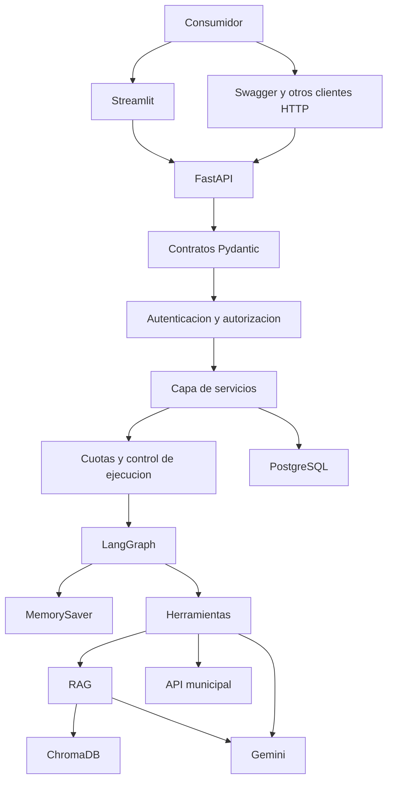
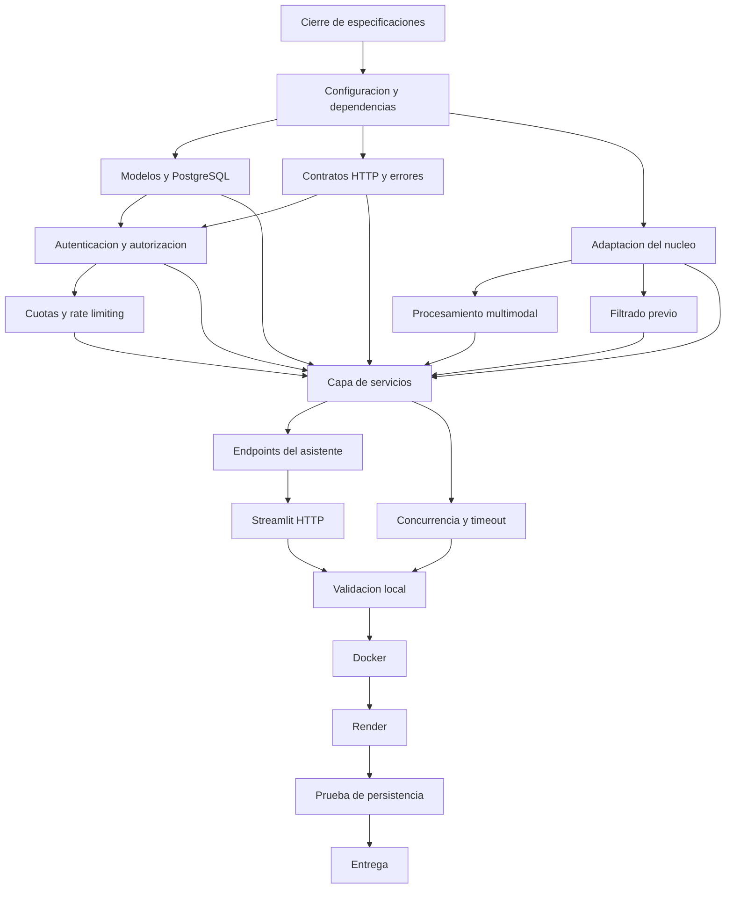
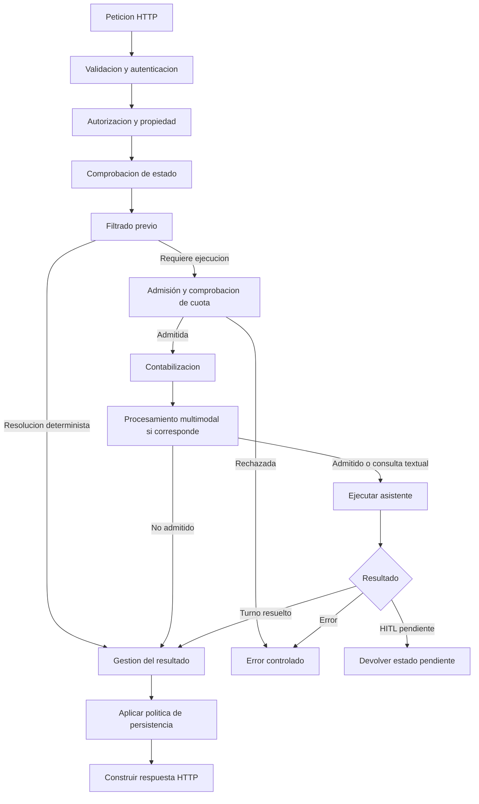

# Plan de trabajo — ReciclaTÍA PB03

## 1. Identificación del proyecto

| Parámetro | Valor |
|---|---|
| Proyecto | ReciclaTÍA |
| Módulo | MLOps para IA Generativa |
| Entrega | Project Break 03 |
| Sprints | 14, 15 y 16 |
| Modalidad | Desarrollo individual |
| Repositorio | alex-bometon/pb03_equipo18 |
| Metodología | Specification-Driven Development |
| Fecha límite individual | 29/11/2026 a las 23:59 |
| Presentación | 04/12/2026, de 16:00 a 18:00, según el enunciado general |
| Versión de Python | 3.13.2 |
| Rama estable | main |
| Rama de integración | develop |

## 2. Objetivo

Transformar el asistente desarrollado durante el PB02 en un servicio accesible mediante una API REST, incorporando persistencia relacional, autenticación, autorización, mecanismos de robustez y despliegue en infraestructura remota.

La implementación deberá conservar las capacidades documentales y multiagente existentes, salvo aquellas modificaciones expresamente definidas en las especificaciones.

El resultado deberá permitir utilizar ReciclaTÍA mediante Streamlit y otros clientes HTTP autorizados.

## 3. Documentación de referencia

### 3.1. Requisitos académicos

- [Enunciado oficial del Project Break 03](https://github.com/alex-bometon/bootcamp_AI_Engineering_05_26/tree/apuntes/Project_Break/PB_03_MLOps).
- [Material docente de MLOps para IA Generativa](https://github.com/alex-bometon/bootcamp_AI_Engineering_05_26/tree/apuntes/07_MLOps_para_IA_Generativa).

### 3.2. Especificaciones del producto

Los documentos de specs/ constituyen la referencia técnica del producto.

| Documento | Responsabilidad |
|---|---|
| 00-producto.md | Alcance y comportamiento funcional |
| 01-retrieval.md | Pipeline documental y recuperación |
| 02-mejoras-retrieval.md | Recuperación filtrada y estructurada |
| 03-generacion.md | Generación fundamentada |
| 04-consultas-generales.md | Interpretación de consultas |
| 05-tools.md | Herramientas y permisos |
| 06-langgraph.md | Orquestación, estado y HITL |
| 07-streamlit.md | Cliente web |
| 08-pruebas-y-validacion.md | Estrategia de validación |
| 09-datos-y-fuentes.md | Corpus y procedencia |
| 10-seguridad.md | Seguridad del núcleo |
| 11-arquitectura-mlops.md | Arquitectura general |
| 12-contratos-http.md | API REST |
| 13-persistencia.md | Modelo relacional |
| 14-autenticacion-autorizacion.md | Seguridad de acceso |
| 15-robustez-observabilidad.md | Límites y protección operativa |
| 16-despliegue.md | Infraestructura |

## 4. Requisitos académicos

### 4.1. Sprint 14

- FastAPI.
- Contratos Pydantic.
- Documentación Swagger.
- Integración del agente mediante HTTP.
- Resolución HITL mediante endpoints.
- Persistencia mediante SQLModel y PostgreSQL.
- Recuperación del historial.

### 4.2. Sprint 15

- Autenticación mediante API key.
- Rate limiting.
- Timeout del asistente.
- CORS.
- Logging.
- Gestión controlada de errores.
- Validación de los mecanismos de robustez.

### 4.3. Sprint 16

- Construcción de una imagen Docker.
- Ejecución local del contenedor.
- Despliegue en Render.
- PostgreSQL gestionado.
- Streamlit conectado a la URL pública.
- Persistencia después de un redeploy.
- Análisis de arquitectura y costes.
- Conclusiones sobre CI/CD.

La automatización completa mediante GitHub Actions constituye una ampliación opcional.

## 5. Alcance adicional del producto

ReciclaTÍA incorpora requisitos propios que amplían el mínimo académico:

- Acceso Free anónimo.
- Registro de usuarios.
- Autenticación mediante sesiones.
- Gestión de API keys.
- Roles Free, User y Admin.
- Autorización basada en propiedad.
- Cuotas comerciales por ventanas temporales.
- Límites de emisión de credenciales.
- Administración de usuarios y claves.
- Procesamiento multimodal mediante HTTP.
- Validación semántica de imágenes.
- Filtrado previo de dominio.
- Respuestas directas sin HITL obligatorio.
- Identificación individual de aprobaciones.
- Control de concurrencia por conversación.
- Admisión controlada de ejecuciones.
- Protección frente a resultados tardíos.

Estos requisitos forman parte del alcance definido en las especificaciones.

Su implementación deberá planificarse conjuntamente con los requisitos académicos, evitando crear una arquitectura provisional incompatible con ellos.

## 6. Priorización

### 6.1. Prioridad P0 — Camino crítico académico

Incluye los componentes imprescindibles para acreditar el funcionamiento del Project Break 03:

- API REST funcional.
- Swagger.
- Integración del agente.
- HITL.
- PostgreSQL.
- Historial persistente.
- Autenticación mediante API key.
- Rate limiting.
- Timeout.
- CORS.
- Logging.
- Docker.
- Render.
- Streamlit como cliente HTTP.
- Prueba de persistencia después de redeploy.
- Documentación y entrega.

### 6.2. Prioridad P1 — Requisitos específicos de ReciclaTÍA

Incluye las funcionalidades adicionales formalizadas en las especificaciones:

- Gestión completa de cuentas.
- Sesiones.
- Roles y propiedad.
- Administración.
- Cuotas diferenciadas.
- Procesamiento multimodal.
- Filtrado previo.
- Identificación de aprobaciones.
- Respuestas directas.
- Controles adicionales de robustez.

Estas funcionalidades no deberán considerarse opcionales por el hecho de superar el mínimo académico.

Los componentes de P1 que constituyan dependencias de P0 deberán implementarse antes de los componentes dependientes.

### 6.3. Prioridad P2 — Ampliaciones opcionales

- Automatización completa mediante GitHub Actions.
- Docker Compose, cuando facilite el trabajo local.
- Geolocalización automática mediante navegador.
- Mejoras visuales no imprescindibles.
- Diagnósticos adicionales.
- Optimizaciones no necesarias para cumplir los requisitos.

No se iniciarán ampliaciones opcionales mientras existan requisitos obligatorios pendientes que comprometan la entrega.

### 6.4. Gestión de desviaciones

Si una limitación temporal o técnica impide implementar un requisito definido, deberá registrarse expresamente.

No se eliminará un requisito de las especificaciones ni se presentará como completado sin una decisión justificada.

## 7. Arquitectura objetivo



La API, el agente, el RAG y ChromaDB compartirán un único contenedor Docker.

PostgreSQL constituirá un servicio independiente.

Streamlit accederá al producto exclusivamente mediante HTTP.

## 8. Dependencias principales



El diagrama representa dependencias funcionales, no necesariamente ramas independientes ni un orden estrictamente secuencial para todas las tareas.

## 9. Fases de trabajo

| Fase | Responsabilidad |
|---|---|
| 00 | Preparación, línea base y especificaciones |
| 01 | Configuración y estructura del backend |
| 02 | Persistencia relacional |
| 03 | Contratos HTTP y errores |
| 04 | Autenticación y autorización |
| 05 | Adaptación del núcleo del asistente |
| 06 | Filtrado previo y procesamiento multimodal |
| 07 | Robustez y observabilidad |
| 08 | Integración de servicios y endpoints |
| 09 | Streamlit como cliente HTTP |
| 10 | Docker y validación local |
| 11 | Despliegue en Render |
| 12 | Validación final y entrega |

Cada fase deberá disponer de tareas verificables y condiciones de finalización.

## 10. Fase 00 — Preparación y especificaciones

### Objetivo

Establecer una referencia técnica estable antes de introducir modificaciones funcionales.

### Tareas

- [x] 00.01. Identificar el commit inicial de referencia.
- [x] 00.02. Validar el entorno Python existente.
- [x] 00.03. Comprobar el índice ChromaDB y la recuperación documental.
- [x] 00.04. Ejecutar las pruebas iniciales de regresión.
- [x] 00.05. Crear las ramas de integración y especificaciones.
- [x] 00.06. Redactar las especificaciones correspondientes a MLOps.
- [ ] 00.07. Completar la revisión y auditoría transversal de las 17 especificaciones.
- [ ] 00.08. Cerrar las decisiones técnicas pendientes.
- [ ] 00.09. Incorporar los documentos operativos redactados.
- [ ] 00.10. Actualizar AGENTS.md.
- [ ] 00.11. Preparar la actualización inicial de README.md.
- [ ] 00.12. Comprobar las referencias entre documentos.
- [ ] 00.13. Revisar las diferencias de la rama documental.
- [ ] 00.14. Registrar y publicar los cambios.
- [ ] 00.15. Integrar las especificaciones en develop.

### Rama

docs/pb03-specs

### Evidencia

entregables/evidencias/baseline-pb02.md

### Condición de finalización

Las especificaciones deberán estar disponibles en el repositorio, ser coherentes entre sí y contener los contratos necesarios para iniciar la implementación.

La redacción de los documentos no implica automáticamente su incorporación al repositorio remoto.

## 11. Fase 01 — Configuración y estructura del backend

### Objetivo

Preparar el entorno técnico necesario para incorporar MLOps sin romper la ejecución independiente del núcleo.

### Dependencias

Fase 00.

### Rama propuesta

feature/api-foundation

### Tareas

- [ ] 01.01. Revisar requirements.txt.
- [ ] 01.02. Incorporar dependencias de FastAPI.
- [ ] 01.03. Incorporar SQLModel y el driver PostgreSQL.
- [ ] 01.04. Declarar explícitamente las dependencias utilizadas directamente.
- [ ] 01.05. Verificar compatibilidad con Python 3.13.2.
- [ ] 01.06. Crear el paquete api/.
- [ ] 01.07. Crear api/config.py.
- [ ] 01.08. Separar la configuración del backend de la configuración del núcleo.
- [ ] 01.09. Preparar .env.example.
- [ ] 01.10. Revisar .gitignore.
- [ ] 01.11. Crear la aplicación FastAPI inicial en api/main.py.
- [ ] 01.12. Comprobar el arranque de Uvicorn y Swagger.
- [ ] 01.13. Incorporar pruebas de configuración.
- [ ] 01.14. Ejecutar las pruebas de regresión.

### Componentes principales

- requirements.txt.
- .env.example.
- .gitignore.
- api/__init__.py.
- api/config.py.
- api/main.py.

### Condición de finalización

FastAPI puede inicializarse en el entorno de desarrollo y las dependencias no impiden utilizar las funcionalidades existentes.

La disponibilidad de Swagger no implicará todavía que el servicio completo se encuentre operativo.

## 12. Fase 02 — Persistencia relacional

### Objetivo

Implementar el almacenamiento de usuarios, API keys, conversaciones y mensajes mediante PostgreSQL.

### Dependencias

Fase 01.

Decisiones cerradas sobre creación de conversaciones, identificación de recursos y numeración de turnos.

### Rama propuesta

feature/postgresql-persistence

### Tareas

- [ ] 02.01. Seleccionar la versión de PostgreSQL.
- [ ] 02.02. Preparar PostgreSQL local mediante Docker.
- [ ] 02.03. Configurar DATABASE_URL.
- [ ] 02.04. Implementar la normalización de la cadena de conexión.
- [ ] 02.05. Crear src/enums.py.
- [ ] 02.06. Crear src/models.py.
- [ ] 02.07. Implementar el modelo User.
- [ ] 02.08. Implementar el modelo ApiKey.
- [ ] 02.09. Implementar el modelo Conversation.
- [ ] 02.10. Implementar el modelo Message.
- [ ] 02.11. Definir restricciones e índices.
- [ ] 02.12. Crear src/db.py.
- [ ] 02.13. Implementar la inicialización del engine.
- [ ] 02.14. Implementar la creación de tablas.
- [ ] 02.15. Implementar la gestión de sesiones SQL.
- [ ] 02.16. Incorporar operaciones de persistencia y consulta.
- [ ] 02.17. Implementar la escritura atómica de los mensajes de un turno.
- [ ] 02.18. Incorporar operaciones compatibles con eliminación lógica.
- [ ] 02.19. Crear un entorno PostgreSQL aislado para pruebas.
- [ ] 02.20. Verificar integridad referencial y restricciones.
- [ ] 02.21. Verificar rollback de transacciones.

### Componentes principales

- src/enums.py.
- src/models.py.
- src/db.py.
- Módulos de acceso a datos que se determinen durante la implementación.

### Condición de finalización

PostgreSQL permite almacenar y recuperar las entidades del producto respetando sus restricciones.

Las operaciones correspondientes a una misma transacción no generan registros parciales.

El núcleo del RAG permanece independiente de PostgreSQL.

## 13. Fase 03 — Contratos HTTP y gestión de errores

### Objetivo

Implementar los modelos públicos y los mecanismos comunes de validación y respuesta del backend.

### Dependencias

Fases 01 y 02 en lo relativo a enumerados compartidos.

### Rama propuesta

feature/api-contracts

### Tareas

- [ ] 03.01. Crear api/schemas.py.
- [ ] 03.02. Implementar UbicacionIn.
- [ ] 03.03. Implementar AskIn.
- [ ] 03.04. Implementar AskOut.
- [ ] 03.05. Implementar ApproveIn.
- [ ] 03.06. Implementar FuenteOut.
- [ ] 03.07. Implementar GeografiaOut.
- [ ] 03.08. Implementar ConversationOut.
- [ ] 03.09. Implementar MessageOut.
- [ ] 03.10. Implementar HealthOut.
- [ ] 03.11. Implementar los contratos de registro y autenticación.
- [ ] 03.12. Implementar los contratos de API keys.
- [ ] 03.13. Implementar los contratos administrativos.
- [ ] 03.14. Implementar ErrorOut.
- [ ] 03.15. Crear api/errors.py.
- [ ] 03.16. Implementar el tratamiento homogéneo de excepciones.
- [ ] 03.17. Adaptar los errores de validación de FastAPI.
- [ ] 03.18. Incorporar request_id y X-Request-ID.
- [ ] 03.19. Verificar los contratos mediante pruebas.
- [ ] 03.20. Comprobar su representación en OpenAPI.

### Condición de finalización

Los contratos públicos coinciden con las especificaciones y pueden validarse independientemente de las operaciones reales de Gemini.

No se exponen directamente los modelos SQL ni los estados internos de LangGraph.

## 14. Fase 04 — Autenticación y autorización

### Objetivo

Implementar los mecanismos de identidad, credenciales, permisos y acceso a recursos.

### Dependencias

Fases 02 y 03.

### Rama propuesta

feature/auth-authorization

### Tareas

- [ ] 04.01. Crear api/security.py.
- [ ] 04.02. Crear api/dependencies.py.
- [ ] 04.03. Implementar normalización y validación de email.
- [ ] 04.04. Implementar validación de contraseñas.
- [ ] 04.05. Implementar almacenamiento mediante bcrypt.
- [ ] 04.06. Implementar registro.
- [ ] 04.07. Implementar inicio de sesión.
- [ ] 04.08. Implementar tokens de sesión.
- [ ] 04.09. Implementar caducidad e invalidación de sesiones.
- [ ] 04.10. Implementar cierre de sesión.
- [ ] 04.11. Implementar consulta de cuenta.
- [ ] 04.12. Implementar modificación de contraseña.
- [ ] 04.13. Implementar generación y hash de API keys.
- [ ] 04.14. Implementar emisión Free anónima.
- [ ] 04.15. Implementar emisión Free registrada.
- [ ] 04.16. Implementar emisión User autorizada.
- [ ] 04.17. Implementar aprovisionamiento administrativo.
- [ ] 04.18. Implementar autenticación mediante X-API-Key.
- [ ] 04.19. Implementar autenticación mediante sesión.
- [ ] 04.20. Implementar autenticación mediante sesión y selección de clave.
- [ ] 04.21. Impedir modalidades de autenticación incompatibles.
- [ ] 04.22. Implementar autorización por roles.
- [ ] 04.23. Implementar autorización por propiedad.
- [ ] 04.24. Implementar límites de claves activas.
- [ ] 04.25. Implementar consulta de claves propias.
- [ ] 04.26. Implementar operaciones administrativas.
- [ ] 04.27. Verificar desactivación y eliminación lógica.
- [ ] 04.28. Incorporar pruebas de seguridad y aislamiento.

### Condición de finalización

El backend distingue correctamente los perfiles de acceso y protege los recursos conforme a sus roles, estado y propiedad.

Ninguna operación ordinaria permite adquirir permisos administrativos.

Los endpoints públicos de emisión y autenticación deberán recibir los límites temporales de seguridad de la fase 07 antes de exponerse públicamente.

## 15. Fase 05 — Adaptación del núcleo del asistente

### Objetivo

Adaptar el sistema multiagente existente para admitir los nuevos contratos funcionales.

### Dependencias

Decisiones técnicas de la fase 00.

### Rama propuesta

refactor/agent-execution

### Tareas

- [ ] 05.01. Revisar src/state.py.
- [ ] 05.02. Incorporar approval_id.
- [ ] 05.03. Adaptar RegistroTurno.
- [ ] 05.04. Diferenciar turno resuelto y conversación finalizada.
- [ ] 05.05. Adaptar la preparación de nuevos turnos.
- [ ] 05.06. Adaptar el enrutamiento.
- [ ] 05.07. Incorporar salidas directas sin HITL.
- [ ] 05.08. Adaptar la generación de planes.
- [ ] 05.09. Mantener la interrupción real antes de aplicar.
- [ ] 05.10. Adaptar procesar_turno().
- [ ] 05.11. Adaptar aprobar_plan().
- [ ] 05.12. Validar identificadores de aprobación.
- [ ] 05.13. Impedir aprobaciones obsoletas.
- [ ] 05.14. Adaptar el contexto posterior al rechazo.
- [ ] 05.15. Adaptar los límites internos.
- [ ] 05.16. Incorporar el contrato interno de identificación multimodal.
- [ ] 05.17. Permitir reutilizar identificaciones previas.
- [ ] 05.18. Adaptar la interfaz de terminal.
- [ ] 05.19. Adaptar las pruebas de regresión.
- [ ] 05.20. Verificar la independencia del núcleo.

### Componentes principales

- config.py.
- src/state.py.
- src/graph.py.
- src/agent.py.
- src/nodes.py.
- src/agent_routing.py.
- src/agent_resultado.py.
- src/agent_tool_loop.py.
- Componentes de la CLI afectados.

### Condición de finalización

El asistente puede resolver consultas directas, generar planes pendientes, aprobarlos o rechazarlos sin depender de FastAPI ni PostgreSQL.

Las funcionalidades documentales y herramientas existentes permanecen disponibles.

## 16. Fase 06 — Filtrado previo y procesamiento multimodal

### Objetivo

Impedir ejecuciones innecesarias del asistente y garantizar el tratamiento seguro de imágenes.

### Dependencias

Fases 03 y 05.

La integración de permisos y consumo dependerá adicionalmente de las fases 04 y 07.

### Rama propuesta

feature/input-processing

### Tareas

- [ ] 06.01. Implementar filtrado previo de dominio textual.
- [ ] 06.02. Incorporar interpretación del contexto autorizado.
- [ ] 06.03. Implementar aclaraciones deterministas previas.
- [ ] 06.04. Crear api/images.py.
- [ ] 06.05. Validar formatos multimedia.
- [ ] 06.06. Validar integridad de archivos.
- [ ] 06.07. Aplicar límites absolutos.
- [ ] 06.08. Implementar redimensionamiento.
- [ ] 06.09. Implementar compresión.
- [ ] 06.10. Verificar los límites finales.
- [ ] 06.11. Preparar almacenamiento temporal seguro.
- [ ] 06.12. Implementar identificación multimodal estructurada.
- [ ] 06.13. Validar el resultado semántico.
- [ ] 06.14. Interrumpir consultas multimedia no admisibles.
- [ ] 06.15. Reutilizar la identificación válida.
- [ ] 06.16. Impedir llamadas multimodales duplicadas.
- [ ] 06.17. Implementar limpieza de archivos temporales.
- [ ] 06.18. Verificar falsos positivos y negativos del filtrado.
- [ ] 06.19. Incorporar pruebas técnicas y semánticas.

### Condición de finalización

Las entradas incompatibles no provocan ejecuciones innecesarias y las imágenes admitidas pueden procesarse mediante el contrato multimedia definido.

La contabilización y admisión definitivas deberán verificarse durante la integración del servicio.

## 17. Fase 07 — Robustez y observabilidad

### Objetivo

Implementar los mecanismos de protección de recursos y trazabilidad del backend.

### Dependencias

Fases 01, 03 y 04.

### Rama propuesta

feature/api-robustness

### Tareas

- [ ] 07.01. Crear api/rate_limit.py.
- [ ] 07.02. Implementar Sliding Window Log.
- [ ] 07.03. Implementar rate limiting HTTP.
- [ ] 07.04. Implementar cuotas Free.
- [ ] 07.05. Implementar cuotas User.
- [ ] 07.06. Aplicar límites técnicos a Admin.
- [ ] 07.07. Implementar límites de registro.
- [ ] 07.08. Implementar límites de autenticación.
- [ ] 07.09. Implementar límites de emisión de claves.
- [ ] 07.10. Implementar cálculo de Retry-After.
- [ ] 07.11. Garantizar atomicidad de contadores.
- [ ] 07.12. Implementar limpieza de registros expirados.
- [ ] 07.13. Implementar exclusión por conversación.
- [ ] 07.14. Implementar admisión global sin cola.
- [ ] 07.15. Configurar ThreadPoolExecutor.
- [ ] 07.16. Implementar timeout del asistente.
- [ ] 07.17. Controlar la finalización real del worker.
- [ ] 07.18. Gestionar resultados tardíos.
- [ ] 07.19. Garantizar liberación segura de recursos.
- [ ] 07.20. Implementar logging estructurado.
- [ ] 07.21. Registrar eventos de inicio y finalización real.
- [ ] 07.22. Proteger información sensible en registros.
- [ ] 07.23. Configurar CORS.
- [ ] 07.24. Incorporar pruebas con reloj controlado.
- [ ] 07.25. Incorporar pruebas de concurrencia.
- [ ] 07.26. Incorporar pruebas de timeout.

### Condición de finalización

Los controles técnicos pueden verificar la admisión de operaciones, impedir modificaciones incompatibles y gestionar los timeouts sin liberar recursos prematuramente.

Los valores y condiciones serán los establecidos en specs/15-robustez-observabilidad.md.

## 18. Fase 08 — Integración de servicios y endpoints

### Objetivo

Coordinar todos los componentes mediante el servicio HTTP completo.

### Dependencias

Fases 02, 03, 04, 05, 06 y 07.

### Rama propuesta

feature/api-agent-integration

### Tareas

- [ ] 08.01. Crear api/service.py.
- [ ] 08.02. Integrar la autenticación de peticiones.
- [ ] 08.03. Integrar autorización de operaciones.
- [ ] 08.04. Integrar creación y recuperación de conversaciones.
- [ ] 08.05. Verificar la propiedad de cada conversación.
- [ ] 08.06. Integrar validación de estado operativo.
- [ ] 08.07. Integrar filtrado previo.
- [ ] 08.08. Integrar admisión y cuotas.
- [ ] 08.09. Integrar ejecución del asistente.
- [ ] 08.10. Integrar procesamiento multimodal.
- [ ] 08.11. Integrar aprobación manual.
- [ ] 08.12. Integrar aprobación automática.
- [ ] 08.13. Integrar persistencia de turnos resueltos.
- [ ] 08.14. Gestionar inconsistencias entre checkpoint y PostgreSQL.
- [ ] 08.15. Implementar GET /health.
- [ ] 08.16. Implementar POST /ask.
- [ ] 08.17. Implementar POST /ask/image.
- [ ] 08.18. Implementar POST /approve.
- [ ] 08.19. Implementar endpoints de conversaciones e historial.
- [ ] 08.20. Completar endpoints de cuenta y gestión de claves.
- [ ] 08.21. Completar endpoints administrativos.
- [ ] 08.22. Integrar inicialización y cierre de recursos.
- [ ] 08.23. Verificar la documentación Swagger.
- [ ] 08.24. Ejecutar pruebas de integración HTTP.
- [ ] 08.25. Verificar los errores 401, 429 y 504.
- [ ] 08.26. Ejecutar pruebas de regresión.

### Flujo conceptual de una consulta



El diagrama no sustituye el orden exacto de validaciones y operaciones establecido en los contratos.

Los bloqueos y la capacidad deberán adquirirse antes de las operaciones que los requieran y conservarse durante el periodo correspondiente.

### Condición de finalización

El backend funciona mediante HTTP en local y permite ejecutar consultas, resolver HITL, consultar historial y gestionar credenciales conforme a los permisos definidos.

La persistencia de turnos y los errores técnicos se gestionan de forma consistente.

## 19. Fase 09 — Streamlit como cliente HTTP

### Objetivo

Adaptar la interfaz existente para consumir el backend sin ejecutar directamente el núcleo del asistente.

### Dependencias

Fases 03, 04 y 08.

La estructura visual y el cliente HTTP podrán prepararse antes mediante respuestas controladas.

### Rama propuesta

feature/streamlit-http-client

### Tareas

- [ ] 09.01. Revisar app.py.
- [ ] 09.02. Identificar componentes visuales reutilizables.
- [ ] 09.03. Crear el cliente HTTP centralizado.
- [ ] 09.04. Configurar API_BASE_URL.
- [ ] 09.05. Adaptar la gestión del estado de sesión.
- [ ] 09.06. Implementar acceso Free anónimo.
- [ ] 09.07. Implementar registro.
- [ ] 09.08. Implementar inicio de sesión.
- [ ] 09.09. Implementar cierre de sesión.
- [ ] 09.10. Implementar consulta de cuenta.
- [ ] 09.11. Implementar modificación de contraseña.
- [ ] 09.12. Implementar gestión de claves propias.
- [ ] 09.13. Implementar selección de clave.
- [ ] 09.14. Adaptar la creación de conversaciones.
- [ ] 09.15. Adaptar consultas textuales.
- [ ] 09.16. Adaptar envío multipart de imágenes.
- [ ] 09.17. Adaptar el envío de ubicación.
- [ ] 09.18. Adaptar la presentación de fuentes.
- [ ] 09.19. Adaptar resultados geográficos y mapas.
- [ ] 09.20. Adaptar los mecanismos HITL.
- [ ] 09.21. Incorporar approval_id.
- [ ] 09.22. Incorporar historial persistente autorizado.
- [ ] 09.23. Adaptar el tratamiento de errores.
- [ ] 09.24. Gestionar timeouts y resultados desconocidos.
- [ ] 09.25. Prevenir envíos duplicados durante reruns.
- [ ] 09.26. Eliminar dependencias directas del agente.
- [ ] 09.27. Eliminar acceso directo a archivos temporales del backend.
- [ ] 09.28. Incorporar pruebas del cliente HTTP.
- [ ] 09.29. Ejecutar la validación funcional de Streamlit.

### Condición de finalización

Streamlit funciona contra el backend local y utiliza exclusivamente los contratos HTTP.

El cambio de backend no requiere modificar el código fuente de la interfaz.

## 20. Fase 10 — Docker y validación local

### Objetivo

Construir una imagen reproducible y verificar el funcionamiento integral del producto en local.

### Dependencias

Fases 01 a 09 en lo necesario para la versión candidata.

### Rama propuesta

feature/docker-deployment

### Tareas

- [ ] 10.01. Crear Dockerfile.
- [ ] 10.02. Crear .dockerignore.
- [ ] 10.03. Revisar los recursos incluidos.
- [ ] 10.04. Excluir secretos y archivos innecesarios.
- [ ] 10.05. Incorporar los documentos originales necesarios.
- [ ] 10.06. Incorporar chunks y embeddings.
- [ ] 10.07. Reconstruir ChromaDB durante el build.
- [ ] 10.08. Verificar la construcción sin credenciales de Gemini.
- [ ] 10.09. Configurar el comando de arranque.
- [ ] 10.10. Utilizar PORT.
- [ ] 10.11. Configurar un único proceso Uvicorn.
- [ ] 10.12. Construir la imagen local.
- [ ] 10.13. Ejecutar PostgreSQL.
- [ ] 10.14. Ejecutar el backend Docker.
- [ ] 10.15. Comprobar GET /health.
- [ ] 10.16. Comprobar Swagger.
- [ ] 10.17. Ejecutar una consulta real.
- [ ] 10.18. Ejecutar un flujo HITL.
- [ ] 10.19. Consultar el historial.
- [ ] 10.20. Conectar Streamlit.
- [ ] 10.21. Medir consumo de recursos.
- [ ] 10.22. Verificar compatibilidad de arquitectura.
- [ ] 10.23. Revisar la configuración definitiva.
- [ ] 10.24. Ejecutar la validación local completa.

### Condición de finalización

El backend se ejecuta correctamente dentro de Docker, se conecta a PostgreSQL y proporciona sus funcionalidades mediante HTTP.

La construcción no necesita regenerar los embeddings del corpus.

## 21. Fase 11 — Despliegue en Render

### Objetivo

Publicar ReciclaTÍA mediante una URL HTTPS accesible por los clientes autorizados.

### Dependencias

Fase 10.

### Rama propuesta

fix/render-deployment para correcciones de infraestructura cuando resulten necesarias.

El despliegue estable utilizará main.

### Tareas

- [ ] 11.01. Revisar las condiciones vigentes de Render.
- [ ] 11.02. Seleccionar región y plan.
- [ ] 11.03. Comprobar compatibilidad de memoria y CPU.
- [ ] 11.04. Crear PostgreSQL gestionado.
- [ ] 11.05. Obtener la URL interna de conexión.
- [ ] 11.06. Preparar las credenciales de producción.
- [ ] 11.07. Integrar la versión candidata en main.
- [ ] 11.08. Crear Render Web Service.
- [ ] 11.09. Vincular el repositorio.
- [ ] 11.10. Configurar Docker.
- [ ] 11.11. Configurar las variables de entorno.
- [ ] 11.12. Configurar el health check.
- [ ] 11.13. Ejecutar el primer despliegue.
- [ ] 11.14. Revisar los registros de construcción.
- [ ] 11.15. Revisar los registros de ejecución.
- [ ] 11.16. Comprobar GET /health.
- [ ] 11.17. Comprobar Swagger público.
- [ ] 11.18. Comprobar autenticación.
- [ ] 11.19. Ejecutar consultas reales.
- [ ] 11.20. Comprobar HITL.
- [ ] 11.21. Comprobar historial persistente.
- [ ] 11.22. Configurar Streamlit con la URL remota.
- [ ] 11.23. Verificar el despliegue desde main.
- [ ] 11.24. Comprobar la disponibilidad durante el periodo de evaluación.

### Condición de finalización

El producto dispone de una URL pública HTTPS y permite utilizar las funcionalidades autorizadas mediante la API y Streamlit.

## 22. Fase 12 — Validación final y entrega

### Objetivo

Acreditar el cumplimiento de los requisitos académicos y del producto, documentar los resultados y preparar la entrega.

### Dependencias

Fases anteriores.

### Rama propuesta

docs/pb03-delivery

Las correcciones funcionales deberán realizarse en ramas independientes.

### Tareas

- [ ] 12.01. Ejecutar la suite automatizada final.
- [ ] 12.02. Validar el núcleo RAG.
- [ ] 12.03. Validar los contratos HTTP.
- [ ] 12.04. Validar autenticación y autorización.
- [ ] 12.05. Validar persistencia.
- [ ] 12.06. Validar límites y cuotas.
- [ ] 12.07. Validar concurrencia.
- [ ] 12.08. Validar timeouts.
- [ ] 12.09. Validar observabilidad.
- [ ] 12.10. Validar Streamlit.
- [ ] 12.11. Crear una conversación de prueba en producción.
- [ ] 12.12. Resolver un turno.
- [ ] 12.13. Registrar el historial anterior al redeploy.
- [ ] 12.14. Ejecutar un redeploy.
- [ ] 12.15. Comprobar la conservación del historial.
- [ ] 12.16. Comprobar el tratamiento de checkpoints perdidos.
- [ ] 12.17. Documentar tres escenarios de fallo.
- [ ] 12.18. Registrar las limitaciones realmente observadas.
- [ ] 12.19. Consultar las tarifas vigentes de los servicios.
- [ ] 12.20. Medir consumo de consultas representativas.
- [ ] 12.21. Estimar los costes de infraestructura e inferencia.
- [ ] 12.22. Completar README.md.
- [ ] 12.23. Completar docs/manual_uso.md.
- [ ] 12.24. Completar entregables/informe_decisiones.md.
- [ ] 12.25. Organizar las evidencias.
- [ ] 12.26. Preparar una API key específica para evaluación.
- [ ] 12.27. Verificar la credencial de evaluación.
- [ ] 12.28. Comprobar que no existen secretos versionados.
- [ ] 12.29. Verificar el commit final.
- [ ] 12.30. Enviar la URL pública.
- [ ] 12.31. Facilitar la credencial de evaluación por el canal privado.
- [ ] 12.32. Preparar la presentación final.

### Condición de finalización

Los requisitos implementados disponen de comprobaciones y evidencias suficientes.

La URL pública funciona, el profesorado dispone de una credencial autorizada y la documentación final corresponde a la versión realmente entregada.

## 23. Estrategia de ramas

| Orden orientativo | Rama | Fase |
|---|---|---|
| 1 | docs/pb03-specs | 00 |
| 2 | feature/api-foundation | 01 |
| 3 | feature/postgresql-persistence | 02 |
| 4 | feature/api-contracts | 03 |
| 5 | feature/auth-authorization | 04 |
| 6 | refactor/agent-execution | 05 |
| 7 | feature/input-processing | 06 |
| 8 | feature/api-robustness | 07 |
| 9 | feature/api-agent-integration | 08 |
| 10 | feature/streamlit-http-client | 09 |
| 11 | feature/docker-deployment | 10 |
| Según necesidad | fix/render-deployment | 11 |
| 12 | docs/pb03-delivery | 12 |

Las ramas deberán crearse desde una versión de develop que incluya las dependencias necesarias.

La tabla constituye una propuesta organizativa. Podrán agruparse bloques relacionados cuando resulte más eficiente y no se comprometa la trazabilidad.

No se crearán todas las ramas simultáneamente al iniciar el proyecto.

## 24. Estructura objetivo del repositorio

```text
pb03_equipo18/
├── AGENTS.md
├── README.md
├── app.py
├── main.py
├── config.py
├── requirements.txt
├── Dockerfile
├── .dockerignore
├── .gitignore
├── .env.example
├── api/
│   ├── __init__.py
│   ├── main.py
│   ├── config.py
│   ├── schemas.py
│   ├── errors.py
│   ├── security.py
│   ├── dependencies.py
│   ├── rate_limit.py
│   ├── images.py
│   └── service.py
├── src/
│   ├── enums.py
│   ├── models.py
│   ├── db.py
│   ├── agent.py
│   ├── graph.py
│   ├── state.py
│   └── ... componentes existentes
├── data/
├── assets/
├── output/
├── tests/
├── specs/
├── docs/
└── entregables/
```

La estructura representa los componentes principales y no constituye un inventario exhaustivo.

La ubicación definitiva del cliente HTTP de Streamlit, los módulos de acceso a datos y la organización interna de rutas deberán concretarse durante la implementación.

No se trasladarán archivos existentes únicamente para reproducir esta estructura si su ubicación actual resulta compatible con la arquitectura.

## 25. Decisiones técnicas pendientes

Antes de implementar los componentes afectados deberán resolverse las siguientes cuestiones.

| ID | Decisión | Documentos afectados |
|---|---|---|
| D01 | Tratamiento de UUID proporcionados por el cliente que no existan | 12, 13 |
| D02 | Persistencia de respuestas generadas antes de LangGraph | 12, 13, 15 |
| D03 | Numeración y contabilización de turnos | 06, 12, 13, 15 |
| D04 | Condiciones exactas para respuesta directa o planificación HITL | 00, 03, 06 |
| D05 | Contrato de identificación multimodal | 05, 06, 15 |
| D06 | Firma definitiva de procesar_turno() | 06 |
| D07 | Firma definitiva de aprobar_plan() | 06 |
| D08 | Alcance del timeout durante el procesamiento multimodal | 15 |
| D09 | Contrato FuenteOut | 07, 09, 12 |
| D10 | Contrato GeografiaOut | 05, 07, 12 |
| D11 | Contratos de emisión y gestión de API keys | 12, 14 |
| D12 | Recuperación del estado público tras perder una respuesta HTTP | 07, 12 |

Las decisiones deberán registrarse en las especificaciones correspondientes.

No se considerarán resueltas por el hecho de estar identificadas en este plan.

### 25.1. Dependencias entre decisiones

D01, D02 y D03 deberán resolverse conjuntamente para garantizar la consistencia entre conversaciones, estado operativo e historial.

D04, D05, D06 y D07 deberán resolverse antes de adaptar el núcleo.

D08 deberá resolverse antes de integrar el procesamiento multimodal y el executor.

D09 y D10 deberán resolverse antes de implementar los modelos públicos y la representación de resultados.

D11 deberá resolverse antes de implementar los endpoints de credenciales.

D12 deberá resolverse antes de finalizar la integración de Streamlit.

### 25.2. Decisiones de infraestructura

También deberán concretarse:

- Versiones definitivas de las nuevas dependencias.
- Versión de PostgreSQL.
- Organización de configuraciones locales.
- Capacidad de infraestructura de Render.
- Plan de alojamiento.
- Procedimiento de conservación de datos durante la evaluación.

Estas decisiones deberán basarse en comprobaciones reales y condiciones vigentes de los proveedores.

## 26. Estrategia de implementación incremental

### 26.1. Primer hito — Backend mínimo integrado

El primer hito deberá permitir:

- Inicializar FastAPI.
- Conectar con PostgreSQL.
- Autenticar una API key mediante el mecanismo definitivo.
- Ejecutar una consulta textual.
- Resolver un plan pendiente.
- Persistir los mensajes.
- Consultar el historial.

No se utilizará una autenticación provisional incompatible con el modelo definitivo de datos.

### 26.2. Segundo hito — Servicio protegido

El backend deberá incorporar:

- Roles y propiedad.
- Cuotas.
- Rate limiting.
- Timeout.
- Concurrencia.
- Logging.
- Gestión homogénea de errores.
- CORS.

El servicio no deberá publicarse antes de incorporar los controles de seguridad necesarios.

### 26.3. Tercer hito — Funcionalidades completas

Se completarán:

- Registro y sesiones.
- Gestión de credenciales.
- Administración.
- Procesamiento multimodal.
- Filtrado previo.
- Respuestas directas.
- Integración de Streamlit.

### 26.4. Cuarto hito — Producto desplegado

Deberán estar disponibles:

- Imagen Docker.
- PostgreSQL gestionado.
- Backend en Render.
- URL pública.
- Streamlit conectado.
- Validación de persistencia.

### 26.5. Quinto hito — Entrega

Se completarán las pruebas finales, evidencias, informe, README y materiales de presentación.

Los hitos representan puntos de comprobación funcional. No obligan a retrasar todas las tareas de una fase hasta haber completado íntegramente la anterior.

## 27. Planificación temporal

La fecha límite individual comunicada es el 29 de noviembre de 2026 a las 23:59.

La planificación deberá concentrar el desarrollo en el camino crítico y reservar tiempo para el despliegue y la validación final.

| Fecha | Objetivo principal |
|---|---|
| 25/11 | Cierre de especificaciones, documentación imprescindible y preparación del desarrollo |
| 26/11 | Configuración, contratos, PostgreSQL, autenticación e integración inicial del agente |
| 27/11 | Adaptación del asistente, robustez, endpoints y cliente HTTP |
| 28/11 | Integración funcional, Docker y primer despliegue en Render |
| 29/11 | Validación final, redeploy, correcciones, informe y entrega |
| 30/11–03/12 | Preparación de la presentación sobre la versión entregada |
| 04/12 | Presentación, conforme al calendario general del curso |

Esta distribución constituye un objetivo de planificación, no una garantía de que todas las tareas puedan completarse dentro del tiempo disponible.

Deberá actualizarse según el progreso real y las incidencias observadas.

### 27.1. Restricciones temporales

La amplitud de los requisitos adicionales de ReciclaTÍA representa un riesgo relevante para la fecha límite.

Para reducir dicho riesgo:

- Priorizar la implementación de recorridos completos.
- Mantener las decisiones técnicas centralizadas.
- Evitar refactorizaciones ajenas a MLOps.
- Evitar duplicar componentes.
- Ejecutar pruebas específicas durante cada bloque.
- No dedicar tiempo a ampliaciones opcionales antes de completar el núcleo.
- Comprobar tempranamente la viabilidad de Docker y Render.
- Elaborar las evidencias conforme se obtengan resultados.

## 28. Estrategia de validación

### 28.1. Durante cada fase

Ejecutar las pruebas específicas de los componentes modificados.

### 28.2. Antes de integrar

Ejecutar la regresión correspondiente.

Revisar contratos, dependencias, seguridad y documentación.

### 28.3. Después de integrar

Comprobar la compatibilidad de los componentes incorporados a develop.

### 28.4. Antes de desplegar

Verificar las pruebas automatizadas, PostgreSQL, Docker y la configuración de seguridad.

### 28.5. Después de desplegar

Ejecutar pruebas de extremo a extremo sobre la URL pública.

El procedimiento detallado se define en docs/plan-pruebas.md.

## 29. Evidencias

### 29.1. Organización propuesta

| Documento | Finalidad |
|---|---|
| baseline-pb02.md | Referencia inicial |
| validacion-sprint14.md | API, agente y persistencia |
| validacion-sprint15.md | Seguridad y robustez |
| validacion-sprint16.md | Docker y despliegue |
| evaluacion-rag.md | Evaluación documental |
| rendimiento-consumo.md | Medición de recursos |
| persistencia-redeploy.md | Conservación del historial |
| validacion-final.md | Resultado global de la entrega |

Los documentos se crearán cuando existan resultados reales.

### 29.2. Capturas y registros

Las capturas podrán acreditar:

- Swagger.
- Health check.
- Consultas textuales.
- Procesamiento multimodal.
- Aprobación y rechazo.
- Historial.
- Tablas PostgreSQL.
- Errores HTTP.
- Registros de ejecución.
- Construcción Docker.
- Despliegue en Render.
- Persistencia después de redeploy.

No deberán exponer credenciales ni información personal innecesaria.

## 30. Credenciales de evaluación

### 30.1. Finalidad

El profesorado deberá disponer de acceso suficiente para comprobar las funcionalidades del producto desplegado.

### 30.2. Credencial principal

Se generará preferentemente una API key User específica de evaluación.

La clave deberá permitir:

- Consultas textuales.
- Consultas multimodales.
- Resolución HITL.
- Consulta del historial propio.

### 30.3. Administración

Solo se facilitará una credencial administrativa si resulta necesaria para evaluar funcionalidades específicas de administración.

La entrega de esta credencial deberá realizarse mediante un canal privado autorizado.

### 30.4. Restricciones

- No publicar claves en README.md.
- No publicar claves en el informe.
- No incorporar claves a capturas.
- No incluir claves en parámetros de URL.
- No versionar secretos.
- No utilizar una clave Admin para todas las consultas ordinarias.

### 30.5. Validación

Antes de realizar la entrega deberá comprobarse:

- La validez de la clave.
- Los permisos correspondientes.
- La disponibilidad del servicio.
- El acceso al historial.
- Las cuotas disponibles para la evaluación.

Las credenciales deberán permanecer operativas durante el periodo de evaluación autorizado.

## 31. Gestión de riesgos

| Riesgo | Impacto | Medida de mitigación |
|---|---|---|
| Tiempo insuficiente | Alto | Priorizar recorridos completos y evitar ampliaciones opcionales |
| Contratos insuficientemente definidos | Alto | Cerrar decisiones antes de implementar componentes dependientes |
| Incompatibilidad de dependencias | Alto | Validación temprana con Python 3.13.2 |
| Regresiones del PB02 | Alto | Pruebas incrementales |
| Problemas de PostgreSQL | Alto | Integración temprana y pruebas aisladas |
| Inconsistencia de checkpoints | Alto | Controles de estado y exclusión |
| Duplicación de mensajes | Alto | Transacciones y restricciones |
| Exposición de credenciales | Alto | Hashes, revisión de archivos y logging restringido |
| Consumo excesivo de Gemini | Alto | Cuotas, mocks y reutilización de resultados |
| Memoria insuficiente en Render | Alto | Medición temprana y selección de infraestructura compatible |
| Fallos durante Docker build | Alto | Construcción local y comprobación de dependencias |
| Arranques en frío | Medio | Validación previa de disponibilidad |
| Caducidad de PostgreSQL | Alto | Comprobación de condiciones y conservación de datos |
| Timeout de consultas reales | Alto | Evaluación de duración y límites |
| Fallos de red durante la presentación | Medio | Preparación de evidencias y respaldo audiovisual permitido |

La clasificación expresa una estimación inicial de impacto y no implica que los riesgos se hayan materializado.

## 32. Gestión de costes

Durante la implementación deberán evitarse operaciones innecesarias que consuman recursos externos.

Se priorizará:

- Reutilización de embeddings existentes.
- Uso de mocks.
- Evaluaciones selectivas.
- Rutas deterministas.
- Filtrado previo de dominio.
- Ausencia de identificaciones multimodales duplicadas.
- Límites de ejecución.
- Control de emisión de claves.
- Cuotas comerciales.
- Configuración razonada de infraestructura.

Antes de la entrega deberán consultarse las tarifas vigentes de Gemini y Render.

El informe deberá diferenciar entre costes observados, costes contratados y estimaciones.

## 33. Criterios académicos de evaluación

| Área | Peso |
|---|---:|
| Desarrollo técnico | 35 % |
| Presentación | 23 % |
| Git | 17 % |
| Trabajo en equipo y aportación individual | 15 % |
| Memoria | 10 % |
| Extras opcionales | Hasta +10 % |

Los porcentajes corresponden al enunciado general del Project Break 03.

La adaptación de los criterios de trabajo en equipo a la modalidad individual deberá ajustarse a las indicaciones del profesorado.

Los extras no sustituirán los requisitos obligatorios.

## 34. Entregables finales

- [ ] Repositorio GitHub actualizado.
- [ ] Rama main estable y desplegable.
- [ ] Historial de commits y pull requests.
- [ ] README.md actualizado.
- [ ] requirements.txt.
- [ ] .env.example sin secretos.
- [ ] .gitignore.
- [ ] Dockerfile.
- [ ] .dockerignore.
- [ ] API FastAPI funcional.
- [ ] Swagger accesible.
- [ ] PostgreSQL local.
- [ ] PostgreSQL gestionado en Render.
- [ ] URL pública HTTPS.
- [ ] Streamlit conectado a Render.
- [ ] Evidencia de consulta textual.
- [ ] Evidencia de HITL.
- [ ] Evidencia de autenticación.
- [ ] Evidencia de rate limiting.
- [ ] Evidencia de timeout.
- [ ] Evidencia de logging.
- [ ] Evidencia de persistencia después de redeploy.
- [ ] Informe de decisiones.
- [ ] Conclusiones de arquitectura y coste.
- [ ] Conclusiones de CI/CD.
- [ ] Tres escenarios de fallo y procedimientos de actuación.
- [ ] Credencial de evaluación comunicada de forma privada.
- [ ] URL enviada al profesorado.

## 35. Presentación final

Duración aproximada: 10 minutos.

### 35.1. Bloque de producto

Duración orientativa: 4 minutos.

Contenido:

- Problema que resuelve ReciclaTÍA.
- Continuidad respecto al PB01 y PB02.
- Demostración de Streamlit conectado a Render.
- Consulta de dominio.
- Recuperación del historial.
- Resolución HITL.

### 35.2. Bloque técnico

Duración orientativa: 6 minutos.

Contenido:

- Arquitectura desplegada.
- Swagger.
- Health check.
- Autenticación.
- Integración de LangGraph.
- PostgreSQL.
- Diferencia entre historial y MemorySaver.
- Docker.
- Render.
- Robustez.
- Evidencia de persistencia.
- Limitaciones observadas.
- Costes.
- CI/CD y rollback.

### 35.3. Preparación

La presentación deberá corresponder al producto realmente entregado.

No se utilizarán resultados ficticios ni se atribuirán a la versión desplegada funcionalidades que no se encuentren disponibles.

Podrá prepararse un respaldo audiovisual conforme a las condiciones académicas.

## 36. Seguimiento del progreso

| Fase | Estado inicial |
|---|---|
| 00. Preparación y especificaciones | En curso |
| 01. Configuración | Pendiente |
| 02. Persistencia | Pendiente |
| 03. Contratos HTTP | Pendiente |
| 04. Autenticación y autorización | Pendiente |
| 05. Adaptación del núcleo | Pendiente |
| 06. Filtrado y multimodal | Pendiente |
| 07. Robustez | Pendiente |
| 08. Integración HTTP | Pendiente |
| 09. Streamlit | Pendiente |
| 10. Docker | Pendiente |
| 11. Render | Pendiente |
| 12. Validación y entrega | Pendiente |

### 36.1. Estados permitidos

- Pendiente.
- En curso.
- Bloqueada.
- Implementada pendiente de validación.
- Validada.
- Integrada.
- Completada.

Una tarea implementada no deberá considerarse completada hasta superar las comprobaciones correspondientes.

### 36.2. Registro de bloqueos

Cada bloqueo deberá identificar:

- Tarea afectada.
- Componente.
- Dependencia.
- Causa.
- Alternativas.
- Decisión adoptada.
- Impacto sobre la planificación.

## 37. Definición de fase completada

Una fase podrá considerarse completada cuando:

- Las tareas obligatorias correspondientes estén implementadas.
- Los contratos se encuentren respetados.
- Las pruebas necesarias sean satisfactorias.
- No existan regresiones incompatibles sin resolver.
- Los controles de seguridad correspondientes estén activos.
- La documentación refleje el comportamiento real.
- Las evidencias necesarias estén registradas.
- Los cambios se encuentren revisados e integrados.

No será necesario esperar al final del proyecto para documentar los resultados de cada fase.

## 38. Referencias internas

- [Instrucciones de trabajo](../AGENTS.md)
- [Especificaciones](../specs/)
- [Flujo de desarrollo](flujo-desarrollo.md)
- [Plan de pruebas](plan-pruebas.md)
- [Operaciones de despliegue](operaciones-despliegue.md)
- [Gestión de incidencias](gestion-incidencias.md)
- [Manual de uso](manual_uso.md)
- [Línea base PB02](../entregables/evidencias/baseline-pb02.md)
- [Informe de decisiones](../entregables/informe_decisiones.md)