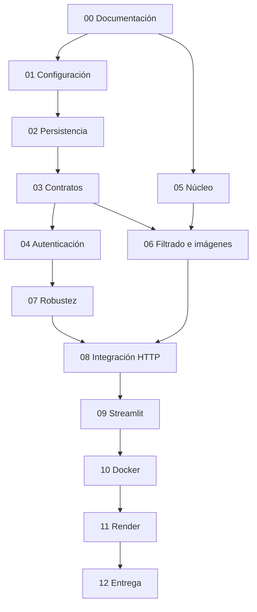

# Plan de trabajo — ReciclaTÍA PB03

## 1. Identificación

| Parámetro | Valor |
|---|---|
| Proyecto | ReciclaTÍA |
| Módulo | MLOps para IA Generativa |
| Sprints | 14, 15 y 16 |
| Modalidad | Individual |
| Metodología | Specification-Driven Development |
| Python | 3.13.2 |
| Entrega | 29/11/2026 a las 23:59 |
| Presentación | 04/12/2026, de 16:00 a 18:00 |
| Rama estable | main |
| Rama de integración | develop |

Referencias:

- [Enunciado del Project Break 03](https://github.com/alex-bometon/bootcamp_AI_Engineering_05_26/tree/apuntes/Project_Break/PB_03_MLOps).
- [Material docente](https://github.com/alex-bometon/bootcamp_AI_Engineering_05_26/tree/apuntes/07_MLOps_para_IA_Generativa).
- [Especificaciones del producto](../specs/).

## 2. Prioridades

| Prioridad | Alcance |
|---|---|
| P0 | Requisitos académicos obligatorios y camino crítico de entrega |
| P1 | Requisitos adicionales de ReciclaTÍA formalizados en las especificaciones |
| P2 | Ampliaciones opcionales |

Los requisitos P1 no serán opcionales por superar el mínimo académico. Sus dependencias deberán incorporarse al camino crítico cuando corresponda.

Las ampliaciones P2 incluyen GitHub Actions, Docker Compose, geolocalización automática, despliegue independiente de Streamlit y mejoras visuales no imprescindibles.

No se iniciarán ampliaciones opcionales que comprometan la entrega.

## 3. Fases de implementación

### Fase 00 — Preparación y especificaciones

**Rama:** docs/pb03-specs.

- [x] Identificar el commit de referencia.
- [x] Validar Python, ChromaDB y recuperación documental.
- [x] Ejecutar y documentar la línea base de regresión.
- [x] Crear las ramas de integración y documentación.
- [x] Redactar y revisar las 17 especificaciones.
- [x] Resolver las decisiones técnicas D01–D12.
- [x] Incorporar las versiones consolidadas al repositorio.
- [x] Revisar y consolidar los documentos operativos.
- [x] Actualizar AGENTS.md.
- [x] Verificar coherencia transversal y referencias.
- [x] Revisar el diff, publicar e integrar en develop.

**Finalización:** documentación técnica coherente, revisada e integrada.

La actualización de README.md se realizará en la fase 12.

### Fase 01 — Configuración y estructura

**Rama:** feature/api-foundation.

**Dependencia:** fase 00.

- [x] Incorporar y verificar las dependencias de MLOps.
- [x] Crear el paquete api/ y la configuración del backend.
- [x] Preparar .env.example y revisar .gitignore.
- [x] Inicializar FastAPI y comprobar Uvicorn y Swagger.
- [x] Validar configuración y regresión.

**Archivos:** requirements.txt, .env.example, .gitignore, api/__init__.py, api/config.py, api/main.py, tests/test_api_config.py, tests/test_api_main.py.

**Finalización:** backend inicial operativo y núcleo independiente.

**Referencia:** especificaciones 11 y 16.

### Fase 02 — Persistencia relacional

**Rama:** feature/postgresql-persistence.

**Dependencia:** fase 01.

- [ ] Seleccionar la versión de PostgreSQL y preparar el entorno local.
- [ ] Implementar los enumerados y cuatro modelos relacionales.
- [ ] Configurar engine, sesiones e inicialización de tablas.
- [ ] Implementar las operaciones de persistencia y consulta.
- [ ] Implementar transacciones de turnos y eliminación lógica.
- [ ] Verificar restricciones, concurrencia relacional y rollback mediante PostgreSQL aislado.

**Archivos:** src/enums.py, src/models.py, src/db.py.

**Finalización:** almacenamiento relacional validado.

**Referencia:** especificación 13.

### Fase 03 — Contratos HTTP y errores

**Rama:** feature/api-contracts.

**Dependencias:** fases 01 y 02 para los enumerados compartidos.

- [ ] Implementar todos los modelos públicos.
- [ ] Centralizar el catálogo y tratamiento de errores.
- [ ] Adaptar los errores de validación de FastAPI.
- [ ] Incorporar request_id y X-Request-ID.
- [ ] Validar los contratos y su representación en OpenAPI.

**Archivos:** api/schemas.py, api/errors.py, api/main.py.

**Finalización:** contratos públicos implementados y comprobados.

**Referencia:** especificación 12.

### Fase 04 — Autenticación y autorización

**Rama:** feature/auth-authorization.

**Dependencias:** fases 02 y 03.

- [ ] Implementar registro, hashing y gestión de contraseñas.
- [ ] Implementar sesiones, caducidad e invalidación.
- [ ] Implementar generación, emisión y consulta de API keys.
- [ ] Implementar el aprovisionamiento administrativo.
- [ ] Implementar autenticación, roles y comprobación de propiedad.
- [ ] Implementar límites de claves activas y operaciones administrativas.
- [ ] Verificar aislamiento, revocación y protección de credenciales.

**Archivos:** api/security.py, api/dependencies.py, api/main.py, src/db.py.

**Finalización:** identidades, permisos y gestión de credenciales validados.

**Referencia:** especificación 14.

Los endpoints públicos no se expondrán en producción antes de incorporar los límites de seguridad de la fase 07.

### Fase 05 — Adaptación del núcleo

**Rama:** refactor/agent-execution.

**Dependencia:** fase 00.

- [ ] Incorporar approval_id e identificacion_imagen al estado.
- [ ] Adaptar procesar_turno() y aprobar_plan().
- [ ] Reforzar las comprobaciones del checkpoint y las transiciones HITL.
- [ ] Adaptar la preparación de turnos y el contexto posterior al rechazo.
- [ ] Corregir la detección de fallos técnicos bloqueantes.
- [ ] Corregir la interpretación de modalidades, compatibilidad y horarios.
- [ ] Diferenciar búsquedas vacías de resultados técnicamente inválidos.
- [ ] Adaptar presupuestos internos y validaciones de herramientas.
- [ ] Adaptar la integración multimodal y la CLI.
- [ ] Ejecutar las pruebas de regresión.

**Archivos principales:** config.py, src/state.py, src/graph.py, src/agent.py, src/nodes.py, src/agent_routing.py, src/agent_resultado.py, src/agent_schedule.py, src/agent_tool_loop.py, src/tools/ y CLI.

**Finalización:** núcleo adaptado, funcional e independiente, conservando la topología y el HITL obligatorio.

**Referencias:** especificaciones 01 a 06 y 10.

### Fase 06 — Filtrado previo y multimodalidad

**Rama:** feature/input-processing.

**Dependencias:** fases 03 y 05. Integración definitiva con las fases 04 y 07.

- [ ] Implementar filtrado determinista y aclaraciones previas.
- [ ] Incorporar la interpretación del contexto autorizado.
- [ ] Implementar recepción, validación y adaptación de imágenes.
- [ ] Implementar almacenamiento temporal seguro.
- [ ] Extraer identificar_imagen() y validar su resultado.
- [ ] Integrar la admisibilidad semántica y reutilización de identificaciones.
- [ ] Verificar limpieza de archivos y ausencia de llamadas duplicadas.
- [ ] Ejecutar pruebas de filtrado y multimodalidad.

**Archivos:** api/images.py, api/service.py, src/domain.py, src/tools/describir_imagen.py y componentes afectados del agente.

**Finalización:** entradas incompatibles controladas e imágenes admitidas reutilizables por el agente.

**Referencias:** especificaciones 04, 05, 10 y 15.

### Fase 07 — Robustez y observabilidad

**Rama:** feature/api-robustness.

**Dependencias:** fases 01, 03 y 04.

- [ ] Implementar Sliding Window Log y contadores independientes.
- [ ] Implementar rate limiting, cuotas y límites de seguridad.
- [ ] Implementar Retry-After y limpieza de contadores.
- [ ] Implementar exclusión por conversación y capacidad global.
- [ ] Configurar executor y timeout compartido.
- [ ] Implementar controles temporales entre fases.
- [ ] Gestionar resultados tardíos, invalidación y liberación segura de recursos.
- [ ] Incorporar logging estructurado, sanitización y CORS.
- [ ] Ejecutar pruebas temporales, concurrentes y de robustez.

**Archivos:** api/rate_limit.py, api/service.py, api/config.py, api/main.py.

**Finalización:** controles de admisión, consumo y ejecución validados.

**Referencia:** especificación 15.

### Fase 08 — Integración de servicios y endpoints

**Rama:** feature/api-agent-integration.

**Dependencias:** fases 02 a 07.

- [ ] Completar la capa de servicios.
- [ ] Integrar autenticación, propiedad, admisión y estado operativo.
- [ ] Integrar filtrado previo, identificación visual y ejecución de LangGraph.
- [ ] Implementar consultas textuales y multimodales.
- [ ] Integrar aprobación manual y automática.
- [ ] Validar resultados, autorización final y persistencia.
- [ ] Implementar historial y completar endpoints de cuenta y administración.
- [ ] Implementar health check y ciclo de vida del backend.
- [ ] Validar Swagger, contratos, errores e integración HTTP.
- [ ] Ejecutar la regresión completa.

**Archivos:** api/service.py, api/main.py y dependencias de los componentes anteriores.

**Finalización:** API REST completa y operativa en local.

**Referencias:** especificaciones 11 a 15.

### Fase 09 — Streamlit como cliente HTTP

**Rama:** feature/streamlit-http-client.

**Dependencias:** fases 03, 04 y 08.

- [ ] Conservar los componentes visuales reutilizables.
- [ ] Implementar el cliente HTTP centralizado y API_BASE_URL.
- [ ] Adaptar estado de sesión, autenticación y selección de claves.
- [ ] Integrar consultas textuales, imágenes y ubicación.
- [ ] Adaptar fuentes, mapas y presentación de resultados.
- [ ] Integrar HITL, reformulación e historial autorizado.
- [ ] Gestionar errores, incertidumbre y reruns.
- [ ] Eliminar las dependencias directas del núcleo y del almacenamiento.
- [ ] Ejecutar la validación del cliente.

**Archivo principal:** app.py.

**Finalización:** interfaz funcional mediante HTTP, sin dependencia directa de LangGraph ni PostgreSQL.

**Referencia:** especificación 07.

### Fase 10 — Docker y validación local

**Rama:** feature/docker-deployment.

**Dependencias:** fases 01 a 09.

- [ ] Crear Dockerfile y .dockerignore.
- [ ] Incorporar los recursos documentales y reconstruir ChromaDB durante el build.
- [ ] Verificar la construcción sin credenciales de Gemini.
- [ ] Configurar el arranque del backend y PORT.
- [ ] Ejecutar Docker y PostgreSQL en local.
- [ ] Validar health, Swagger, consultas, HITL, historial y Streamlit.
- [ ] Medir consumo y comprobar compatibilidad de infraestructura.

**Archivos:** Dockerfile, .dockerignore, configuración de despliegue.

**Finalización:** producto completo ejecutado y validado mediante Docker.

**Referencia:** especificación 16.

### Fase 11 — Despliegue en Render

**Rama estable:** main.

**Rama de correcciones, si procede:** fix/render-deployment.

**Dependencia:** fase 10.

- [ ] Comprobar condiciones vigentes, región y capacidad de Render.
- [ ] Crear PostgreSQL gestionado y preparar credenciales.
- [ ] Integrar la versión candidata en main.
- [ ] Crear el Web Service y configurar Docker, entorno y health check.
- [ ] Desplegar y revisar los registros.
- [ ] Validar HTTPS, Swagger y funcionalidades protegidas.
- [ ] Conectar Streamlit mediante la URL remota.
- [ ] Comprobar disponibilidad y conservación de datos durante la evaluación.

**Finalización:** backend público HTTPS operativo.

**Referencia:** [operaciones-despliegue.md](operaciones-despliegue.md).

### Fase 12 — Validación final y entrega

**Rama:** docs/pb03-delivery.

**Dependencias:** fases anteriores.

- [ ] Ejecutar la validación final conforme al plan de pruebas.
- [ ] Comprobar persistencia después de redeploy y tratamiento de checkpoints perdidos.
- [ ] Validar rollback y documentar los tres escenarios de fallo académicos.
- [ ] Medir rendimiento y consumo.
- [ ] Consultar tarifas vigentes y estimar costes.
- [ ] Completar README.md.
- [ ] Completar docs/manual_uso.md.
- [ ] Completar entregables/informe_decisiones.md.
- [ ] Organizar las evidencias de ejecución.
- [ ] Preparar y verificar la credencial de evaluación.
- [ ] Revisar secretos, commit final y disponibilidad del servicio.
- [ ] Enviar la URL y facilitar la credencial por canal privado.
- [ ] Preparar la presentación.

**Finalización:** entrega realizada, accesible y respaldada por evidencias reales.

## 4. Dependencias y camino crítico

Las ramas se crearán desde develop cuando estén disponibles sus dependencias.

Podrán agruparse fases relacionadas si ello facilita la implementación y conserva la trazabilidad.

Los procedimientos de Git e integración se establecen en [flujo-desarrollo.md](flujo-desarrollo.md).

## 5. Decisiones técnicas

Las decisiones D01–D12 se encuentran resueltas en las especificaciones.

| ID | Decisión | Referencia |
|---|---|---|
| D01 | Identificación de conversaciones | 12, 13 |
| D02 | Persistencia de turnos | 13 |
| D03 | Contabilización | 06, 15 |
| D04 | HITL obligatorio | 06 |
| D05 | Identificación multimodal | 05 |
| D06 | procesar_turno() | 06 |
| D07 | aprobar_plan() | 06 |
| D08 | Presupuesto temporal | 15 |
| D09 | FuenteOut | 12 |
| D10 | GeografiaOut | 12 |
| D11 | Gestión de API keys | 12, 14 |
| D12 | Respuestas HTTP perdidas | 07 |

Su contenido no se reproducirá en este plan.

Quedan pendientes de concreción durante la implementación:

- Versiones definitivas de dependencias y PostgreSQL.
- Procedimiento interno de aprovisionamiento administrativo.
- Organización final del cliente HTTP.
- Calibración de presupuestos y timeouts.
- Plan, capacidad y condiciones de Render.
- Conservación de datos durante la evaluación.

## 6. Planificación temporal

| Fecha | Objetivo |
|---|---|
| 25/11 | Cierre documental |
| 26/11 | Configuración, PostgreSQL, contratos, autenticación y núcleo |
| 27/11 | Adaptación del agente, robustez, integración HTTP y Streamlit |
| 28/11 | Docker, validación local y despliegue |
| 29/11 | Validación final, redeploy, informe y entrega |
| 30/11–03/12 | Preparación de la presentación |
| 04/12 | Presentación |

La planificación es orientativa y deberá ajustarse al progreso real.

La fecha límite individual permanece establecida en el 29/11/2026 a las 23:59.

## 7. Seguimiento y control de riesgos

Las listas de tareas de cada fase constituirán el registro principal de progreso.

Estados admitidos:

- Pendiente.
- En curso.
- Bloqueada.
- Implementada pendiente de validación.
- Validada.
- Integrada.
- Completada.

Cada bloqueo deberá identificar la tarea afectada, causa, decisión adoptada e impacto temporal.

| Riesgo | Mitigación |
|---|---|
| Tiempo insuficiente | Priorizar recorridos completos y evitar ampliaciones opcionales |
| Regresiones | Pruebas incrementales |
| Incompatibilidad de dependencias | Verificación temprana del entorno |
| Fallos de integración | Validación de contratos y dependencias |
| Consumo excesivo | Mocks y evaluaciones selectivas |
| Infraestructura insuficiente | Comprobación temprana de Docker y Render |
| Pérdida de datos | Validación de persistencia y recuperación |
| Fallos durante la presentación | Evidencias y respaldo audiovisual permitido |

Una fase se considerará completada cuando sus tareas obligatorias estén implementadas, validadas e integradas.

Las comprobaciones se realizarán conforme a [plan-pruebas.md](plan-pruebas.md).

No se marcarán como completadas tareas no verificadas.

## 8. Entrega académica

La fase 12 deberá acreditar:

- Repositorio actualizado y rama main desplegable.
- API, Swagger, PostgreSQL y Streamlit funcionales.
- Configuración reproducible y Dockerfile.
- Autenticación, HITL, rate limiting, timeout y logging.
- URL pública de Render.
- Persistencia después de redeploy.
- Evidencias de ejecución y tres escenarios de fallo.
- README, manual e informe de decisiones.
- Análisis de arquitectura, escalabilidad, costes y CI/CD.
- Credencial de evaluación comunicada por canal privado.

Se utilizará preferentemente una API key User específica de evaluación. Solo se facilitará una clave Admin cuando sea necesario evaluar operaciones administrativas.

### Criterios de evaluación

| Área | Peso |
|---|---:|
| Desarrollo técnico | 35 % |
| Presentación | 23 % |
| Git | 17 % |
| Trabajo en equipo y aportación individual | 15 % |
| Memoria | 10 % |
| Extras | Hasta +10 % |

La adaptación del criterio de trabajo en equipo a la modalidad individual dependerá de las indicaciones del profesorado.

## 9. Presentación final

Duración orientativa: 10 minutos.

| Bloque | Duración | Contenido |
|---|---:|---|
| Producto | 4 minutos | Problema, continuidad del proyecto, demostración, HITL e historial |
| Técnico | 6 minutos | Arquitectura, API, persistencia, robustez, Docker, Render, costes, CI/CD y limitaciones |

La presentación deberá corresponder a la versión realmente entregada.