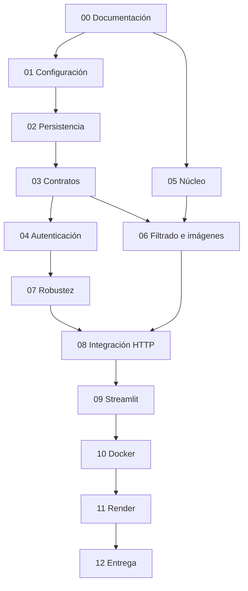

# Plan de trabajo — ReciclaTÍA PB03

## 1. Identificación

| Parámetro | Valor |
|---|---|
| Proyecto | ReciclaTÍA |
| Módulo | MLOps para IA Generativa |
| Sprints | 14, 15 y 16 |
| Modalidad | Individual |
| Metodología | Specification-Driven Development |
| Python | 3.13.2 |
| Entrega | 29/11/2026 a las 23:59 |
| Presentación | 04/12/2026, de 16:00 a 18:00 |
| Rama estable | main |
| Rama de integración | develop |

Referencias:

- [Enunciado del Project Break 03](https://github.com/alex-bometon/bootcamp_AI_Engineering_05_26/tree/apuntes/Project_Break/PB_03_MLOps).
- [Material docente](https://github.com/alex-bometon/bootcamp_AI_Engineering_05_26/tree/apuntes/07_MLOps_para_IA_Generativa).
- [Especificaciones del producto](../specs/).

## 2. Prioridades

| Prioridad | Alcance |
|---|---|
| P0 | Requisitos académicos obligatorios y camino crítico de entrega |
| P1 | Requisitos adicionales de ReciclaTÍA formalizados en las especificaciones |
| P2 | Ampliaciones opcionales |

Los requisitos P1 no serán opcionales por superar el mínimo académico. Sus dependencias deberán incorporarse al camino crítico cuando corresponda.

Las ampliaciones P2 incluyen GitHub Actions, Docker Compose, geolocalización automática, despliegue independiente de Streamlit y mejoras visuales no imprescindibles.

No se iniciarán ampliaciones opcionales que comprometan la entrega.

## 3. Fases de implementación

### Fase 00 — Preparación y especificaciones

**Rama:** docs/pb03-specs.

- [x] Identificar el commit de referencia.
- [x] Validar Python, ChromaDB y recuperación documental.
- [x] Ejecutar y documentar la línea base de regresión.
- [x] Crear las ramas de integración y documentación.
- [x] Redactar y revisar las 17 especificaciones.
- [x] Resolver las decisiones técnicas D01–D12.
- [x] Incorporar las versiones consolidadas al repositorio.
- [x] Revisar y consolidar los documentos operativos.
- [x] Actualizar AGENTS.md.
- [x] Verificar coherencia transversal y referencias.
- [x] Revisar el diff, publicar e integrar en develop.

**Finalización:** documentación técnica coherente, revisada e integrada.

La actualización de README.md se realizará en la fase 12.

### Fase 01 — Configuración y estructura

**Rama:** feature/api-foundation.

**Dependencia:** fase 00.

- [x] Incorporar y verificar las dependencias de MLOps.
- [x] Crear el paquete api/ y la configuración del backend.
- [x] Preparar .env.example y revisar .gitignore.
- [x] Inicializar FastAPI y comprobar Uvicorn y Swagger.
- [x] Validar configuración y regresión.

**Archivos:** requirements.txt, .env.example, .gitignore, api/__init__.py, api/config.py, api/main.py, tests/test_api_config.py, tests/test_api_main.py.

**Finalización:** backend inicial operativo y núcleo independiente.

**Referencia:** especificaciones 11 y 16.

### Fase 02 — Persistencia relacional

**Rama:** feature/persistence.

**Dependencia:** fase 01.

- [x] Seleccionar la versión de PostgreSQL y preparar el entorno local.
- [x] Implementar los enumerados y cuatro modelos relacionales.
- [x] Configurar engine, sesiones e inicialización de tablas.
- [x] Implementar las operaciones de persistencia y consulta.
- [x] Implementar transacciones de turnos y eliminación lógica.
- [x] Verificar restricciones, concurrencia relacional y rollback mediante PostgreSQL aislado.

**Archivos:**

- src/enums.py
- src/models.py
- src/db.py
- api/config.py
- api/main.py
- .env.example
- pytest.ini
- tests/conftest.py
- tests/test_api_main.py
- tests/test_db.py
- tests/test_db_integrity.py
- tests/test_db_concurrency.py

**Decisiones:** D13–D28.

**Infraestructura:** PostgreSQL 18.7 mediante Docker.

**Validación:** 424 pruebas superadas, incluidas 25 pruebas de integración con PostgreSQL real.

**Evidencias:** [Validación de la fase 02](../entregables/evidencias/fase-02-persistencia.md).

**Finalización:** almacenamiento relacional validado.

**Referencia:** especificaciones 13, 14 y 16.

### Fase 03 — Contratos HTTP y errores

**Rama:** feature/contracts.

**Dependencias:** fases 01 y 02.

- [x] Implementar todos los modelos públicos.
- [x] Centralizar el catálogo y tratamiento de errores.
- [x] Adaptar los errores de validación de FastAPI.
- [x] Incorporar request_id y X-Request-ID.
- [x] Implementar middleware, logging HTTP y CORS.
- [x] Validar los contratos y su representación en OpenAPI.
- [x] Ejecutar la regresión completa.

**Archivos principales:**

- api/base.py
- api/config.py
- api/schemas.py
- api/credential_validation.py
- api/mappers.py
- api/error_catalog.py
- api/errors.py
- api/exception_handlers.py
- api/request_context.py
- api/middleware.py
- api/main.py

**Decisiones:** D29–D72.

**Validación:** 1276 pruebas superadas en 5,62 segundos,
incluyendo la regresión relacional.

**Evidencias:** [Validación de la fase 03](../entregables/evidencias/fase-03-contratos-http.md).

**Finalización:** contratos públicos, tratamiento de errores
y trazabilidad HTTP implementados y validados.

**Integración:** PR #5 integrado en develop.

**Referencia:** especificaciones 08, 12, 14 y 15.

La validación definitiva de OpenAPI por endpoint se realizará
durante la integración de los servicios correspondientes.

### Fase 04 — Autenticación y autorización

**Rama:** feature/auth.

**Dependencias:** fases 02 y 03.

- [x] Implementar registro, hashing y gestión de contraseñas.
- [x] Implementar sesiones, caducidad e invalidación.
- [x] Implementar generación, emisión y consulta de API keys.
- [x] Implementar el aprovisionamiento administrativo.
- [x] Implementar autenticación, roles y comprobación de propiedad.
- [x] Implementar límites de claves activas y operaciones administrativas.
- [x] Verificar aislamiento, revocación y protección de credenciales.

**Archivos principales:** api/security.py, api/auth_service.py,
api/dependencies.py y api/request_context.py.

**Decisiones:** D73–D109.

**Validación:** 1680 pruebas superadas en 11,52 segundos,
sin fallos ni omisiones.

**Evidencias:** [Validación de la fase 04](../entregables/evidencias/fase-04-autenticacion-autorizacion.md).

**Finalización:** identidades, permisos y gestión de credenciales
implementados y validados.

**Integración:** PR #6 integrado en develop.

**Referencia:** especificaciones 12, 13, 14 y 15.

Los límites temporales de seguridad se implementarán en la fase 07.
La autorización final del asistente y los endpoints definitivos
se integrarán en la fase 08.

### Fase 05 — Adaptación del núcleo

**Rama:** refactor/execution.

**Dependencia:** fase 00.

- [x] Incorporar approval_id e identificacion_imagen al estado.
- [x] Adaptar procesar_turno() y aprobar_plan().
- [x] Reforzar las comprobaciones del checkpoint y las transiciones HITL.
- [x] Adaptar la preparación de turnos y el contexto posterior al rechazo.
- [x] Corregir la detección de fallos técnicos bloqueantes.
- [x] Corregir la interpretación de modalidades, compatibilidad y horarios.
- [x] Diferenciar búsquedas vacías de resultados técnicamente inválidos.
- [x] Adaptar presupuestos internos y validaciones de herramientas.
- [x] Adaptar la integración multimodal y la CLI.
- [x] Ejecutar las pruebas de regresión.

**Archivos principales:** config.py, src/state.py, src/agent.py,
src/nodes.py, src/agent_routing.py, src/agent_resultado.py,
src/agent_schedule.py, src/agent_tool_loop.py, src/agent_prompts.py,
src/retrieve_structured.py, src/tools/, src/cli_agent.py y app.py.

**Validación:** 1680 pruebas superadas en la regresión completa.

**Evidencias:** [Validación de la fase 05](../entregables/evidencias/fase-05-adaptacion-nucleo.md).

**Finalización:** núcleo adaptado a los contratos del PB03, conservando la topología, la independencia del backend y el HITL obligatorio.

**Integración:** PR #7 integrado en develop.

**Referencias:** especificaciones 01 a 06, 10, 12 y 15.

La recepción y adaptación de imágenes, la identificación visual estructurada y el filtrado previo se implementarán en la fase 06.
La coordinación temporal y concurrente se implementará en la fase 07.
La integración definitiva con FastAPI se realizará en la fase 08.

### Fase 06 — Filtrado previo y multimodalidad

**Rama:** feature/input-processing.

**Dependencias:** fases 03 y 05. Integración definitiva con las fases 04 y 07.

- [x] Implementar filtrado determinista y aclaraciones previas.
- [x] Incorporar la interpretación del contexto autorizado.
- [x] Implementar recepción, validación y adaptación de imágenes.
- [x] Implementar almacenamiento temporal seguro.
- [x] Extraer identificar_imagen() y validar su resultado.
- [x] Integrar la admisibilidad semántica y reutilización de identificaciones.
- [x] Verificar limpieza de archivos y ausencia de llamadas duplicadas.
- [x] Ejecutar pruebas de filtrado y multimodalidad.

**Archivos:** api/images.py, api/service.py, src/domain.py, src/tools/describir_imagen.py y componentes afectados del agente.

**Finalización:** entradas incompatibles controladas e imágenes admitidas reutilizables por el agente.

**Integración:** PR #8 integrado en develop.

**Referencias:** especificaciones 04, 05, 10 y 15.

### Fase 07 — Robustez y observabilidad

**Rama:** feature/robustness.

**Dependencias:** fases 01, 03 y 04.

- [x] Implementar Sliding Window Log y contadores independientes.
- [x] Implementar rate limiting, cuotas y límites de seguridad.
- [x] Implementar Retry-After y limpieza de contadores.
- [x] Implementar exclusión por conversación y capacidad global.
- [x] Configurar executor y timeout compartido.
- [x] Implementar controles temporales entre fases.
- [x] Gestionar resultados tardíos, invalidación y liberación segura de recursos.
- [x] Completar la observabilidad de cuotas, concurrencia, ejecución y proveedores externos sobre el middleware implementado en la fase 03.
- [x] Ejecutar pruebas temporales, concurrentes y de robustez.

**Archivos:** api/rate_limit.py, api/service.py, api/config.py, api/main.py.

**Finalización:** controles de admisión, consumo y ejecución validados.

**Integración:** PR #9 integrado en develop.

**Referencia:** especificación 15.

### Fase 08 — Integración de servicios y endpoints

**Rama:** feature/api-agent-integration.

**Dependencias:** fases 02 a 07.

- [ ] Completar la capa de servicios.
- [ ] Integrar autenticación, propiedad, admisión y estado operativo.
- [ ] Integrar filtrado previo, identificación visual y ejecución de LangGraph.
- [ ] Implementar consultas textuales y multimodales.
- [ ] Integrar aprobación manual y automática.
- [ ] Validar resultados, autorización final y persistencia.
- [ ] Implementar historial y completar endpoints de cuenta y administración.
- [ ] Implementar health check y ciclo de vida del backend.
- [ ] Validar Swagger, contratos, errores e integración HTTP.
- [ ] Ejecutar la regresión completa.

**Archivos:** api/service.py, api/main.py y dependencias de los componentes anteriores.

**Finalización:** API REST completa y operativa en local.

**Referencias:** especificaciones 11 a 15.

### Fase 09 — Streamlit como cliente HTTP

**Rama:** feature/streamlit-http-client.

**Dependencias:** fases 03, 04 y 08.

- [ ] Conservar los componentes visuales reutilizables.
- [ ] Implementar el cliente HTTP centralizado y API_BASE_URL.
- [ ] Adaptar estado de sesión, autenticación y selección de claves.
- [ ] Integrar consultas textuales, imágenes y ubicación.
- [ ] Adaptar fuentes, mapas y presentación de resultados.
- [ ] Integrar HITL, reformulación e historial autorizado.
- [ ] Gestionar errores, incertidumbre y reruns.
- [ ] Eliminar las dependencias directas del núcleo y del almacenamiento.
- [ ] Ejecutar la validación del cliente.

**Archivo principal:** app.py.

**Finalización:** interfaz funcional mediante HTTP, sin dependencia directa de LangGraph ni PostgreSQL.

**Referencia:** especificación 07.

### Fase 10 — Docker y validación local

**Rama:** feature/docker-deployment.

**Dependencias:** fases 01 a 09.

- [ ] Crear Dockerfile y .dockerignore.
- [ ] Incorporar los recursos documentales y reconstruir ChromaDB durante el build.
- [ ] Verificar la construcción sin credenciales de Gemini.
- [ ] Configurar el arranque del backend y PORT.
- [ ] Ejecutar Docker y PostgreSQL en local.
- [ ] Validar health, Swagger, consultas, HITL, historial y Streamlit.
- [ ] Medir consumo y comprobar compatibilidad de infraestructura.

**Archivos:** Dockerfile, .dockerignore, configuración de despliegue.

**Finalización:** producto completo ejecutado y validado mediante Docker.

**Referencia:** especificación 16.

### Fase 11 — Despliegue en Render

**Rama estable:** main.

**Rama de correcciones, si procede:** fix/render-deployment.

**Dependencia:** fase 10.

- [ ] Comprobar condiciones vigentes, región y capacidad de Render.
- [ ] Crear PostgreSQL gestionado y preparar credenciales.
- [ ] Integrar la versión candidata en main.
- [ ] Crear el Web Service y configurar Docker, entorno y health check.
- [ ] Desplegar y revisar los registros.
- [ ] Validar HTTPS, Swagger y funcionalidades protegidas.
- [ ] Conectar Streamlit mediante la URL remota.
- [ ] Comprobar disponibilidad y conservación de datos durante la evaluación.

**Finalización:** backend público HTTPS operativo.

**Referencia:** [operaciones-despliegue.md](operaciones-despliegue.md).

### Fase 12 — Validación final y entrega

**Rama:** docs/pb03-delivery.

**Dependencias:** fases anteriores.

- [ ] Ejecutar la validación final conforme al plan de pruebas.
- [ ] Comprobar persistencia después de redeploy y tratamiento de checkpoints perdidos.
- [ ] Validar rollback y documentar los tres escenarios de fallo académicos.
- [ ] Medir rendimiento y consumo.
- [ ] Consultar tarifas vigentes y estimar costes.
- [ ] Completar README.md.
- [ ] Completar docs/manual_uso.md.
- [ ] Completar entregables/informe_decisiones.md.
- [ ] Organizar las evidencias de ejecución.
- [ ] Preparar y verificar la credencial de evaluación.
- [ ] Revisar secretos, commit final y disponibilidad del servicio.
- [ ] Enviar la URL y facilitar la credencial por canal privado.
- [ ] Preparar la presentación.

**Finalización:** entrega realizada, accesible y respaldada por evidencias reales.

## 4. Dependencias y camino crítico

Las ramas se crearán desde develop cuando estén disponibles sus dependencias.

Podrán agruparse fases relacionadas si ello facilita la implementación y conserva la trazabilidad.

Los procedimientos de Git e integración se establecen en [flujo-desarrollo.md](flujo-desarrollo.md).

## 5. Decisiones técnicas

Las decisiones D01–D118 han sido aprobadas y se encuentran recogidas en las especificaciones y documentos de referencia.

| ID | Decisión | Referencia |
|---|---|---|
| D01 | Identificación de conversaciones | 12, 13 |
| D02 | Persistencia de turnos | 13 |
| D03 | Contabilización | 06, 15 |
| D04 | HITL obligatorio | 06 |
| D05 | Identificación multimodal | 05 |
| D06 | procesar_turno() | 06 |
| D07 | aprobar_plan() | 06 |
| D08 | Presupuesto temporal | 15 |
| D09 | FuenteOut | 12 |
| D10 | GeografiaOut | 12 |
| D11 | Gestión de API keys | 12, 14 |
| D12 | Respuestas HTTP perdidas | 07 |
| D13 | Definición de modelos mediante Field de SQLModel, utilizando Column cuando sea imprescindible | 13 |
| D14 | Claves foráneas explícitas sin Relationship | 13 |
| D15 | Generación de fechas desde Python en UTC | 13 |
| D16 | Identificadores BIGINT mediante Identity | 13 |
| D17 | Nombres descriptivos de restricciones e índices | 13 |
| D18 | Engine gestionado mediante lifespan | 13, 16 |
| D19 | Sesiones y transacciones controladas por la capa de servicios | 13 |
| D20 | Pool limitado y timeouts SQL configurables | 13, 16 |
| D21 | Arranque estricto respecto a PostgreSQL y recuperación controlada durante la ejecución | 16 |
| D22 | Funciones independientes de persistencia sin clases Repository | 13 |
| D23 | Retorno de objetos SQLModel desde persistencia | 13 |
| D24 | Utilización de flush cuando sea necesario | 13 |
| D25 | Bloqueo de registros mediante el parámetro opcional for_update | 13 |
| D26 | Base de datos y usuario independientes para pruebas | Plan de pruebas |
| D27 | Limpieza mediante TRUNCATE con comprobaciones de aislamiento | Plan de pruebas |
| D28 | Separación de pruebas relacionales y marcador integration | Plan de pruebas |
| D29 | Rechazo de campos adicionales en los modelos públicos | 12 |
| D30 | Validación estricta según el tipo de campo | 12 |
| D31 | Normalización específica por campo | 12, 14 |
| D32 | Reutilización de la validación de preguntas del núcleo | 12 |
| D33 | Mappers explícitos y puros, independientes de la persistencia | 11, 12, 13 |
| D34 | Validación de resultados antes de persistir y comunicar éxito HTTP | 12, 13 |
| D35 | Canonicalización de identificadores UUIDText | 12 |
| D36 | Separación de validación estructural y semántica de preguntas | 12 |
| D37 | Límite API de cuatro pasos independiente del límite interno del agente | 06, 12 |
| D38 | Reutilización de tipos Annotated para restricciones compartidas | 12 |
| D39 | Reutilización de restricciones geográficas | 05, 12 |
| D40 | Validación de invariantes mediante model_validator en modo after | 12 |
| D41 | Presencia obligatoria de todos los campos de AskOut, incluidos los anulables | 12 |
| D42 | Rechazo de resultados incompatibles con las invariantes del asistente | 06, 12 |
| D43 | Centralización de los límites geográficos en config.py | 05, 12 |
| D44 | Centralización de los límites de email y contraseña | 12, 14 |
| D45 | Validación de emails mediante email-validator sin comprobaciones DNS | 14 |
| D46 | Separación de validación de contraseñas nuevas y de autenticación | 12, 14 |
| D47 | Protección de contraseñas mediante SecretStr estricto | 12, 14 |
| D48 | Configuración segura compartida mediante SecureBaseModel | 11, 12 |
| D49 | Restricción de emisión de API keys a los roles Free y User | 12, 14 |
| D50 | Fechas conscientes de zona horaria y normalización a UTC | 12, 13 |
| D51 | Exclusión de credenciales originales de la representación textual de los modelos | 10, 12, 14 |
| D52 | Contratos públicos independientes para conversaciones y mensajes | 12, 13 |
| D53 | HealthOut como contrato de disponibilidad satisfactoria | 12, 15 |
| D54 | Catálogo centralizado e inmutable de códigos, estados HTTP y mensajes | 12 |
| D55 | ErrorOut como contrato común de errores | 12 |
| D56 | ApiError independiente de las excepciones HTTP del framework | 12 |
| D57 | Excepciones específicas para errores de validación semántica | 12, 14 |
| D58 | Incorporación de errores propios del protocolo HTTP | 12 |
| D59 | Mensajes públicos exclusivos del catálogo y validación de Retry-After | 12, 15 |
| D60 | Separación entre excepciones propias y manejadores HTTP | 11, 12 |
| D61 | Generación y reutilización del request_id mediante request.state | 12, 15 |
| D62 | Traducción de errores mediante tipo, campo y operación HTTP | 12 |
| D63 | Prioridad explícita entre errores de validación simultáneos | 12 |
| D64 | Conservación controlada de las cabeceras HTTP correspondientes | 12 |
| D65 | Sanitización de fallos inesperados mediante un manejador común | 10, 12, 15 |
| D66 | Validación de manejadores mediante pruebas unitarias y HTTP aisladas | 08, Plan de pruebas |
| D67 | Middleware ASGI puro para la trazabilidad HTTP | 11, 15 |
| D68 | Logging estructurado JSON mediante la biblioteca estándar de Python | 15 |
| D69 | Prevención de registros duplicados y sanitización de excepciones propagadas | 10, 15 |
| D70 | CORSMiddleware nativo con trazabilidad y conservación de rechazos preflight | 12, 15 |
| D71 | Documentación OpenAPI de errores generada desde el catálogo centralizado | 12 |
| D72 | Validación de OpenAPI mediante aplicaciones FastAPI aisladas | 08, 12, Plan de pruebas |
| D73 | Hash auxiliar para reducir la enumeración temporal de usuarios | 14 |
| D74 | Diferenciación entre credenciales incorrectas y corrupción interna | 14 |
| D75 | Gestor de sesiones en memoria con tokens opacos | 14 |
| D76 | Protección de sesiones mediante RLock | 14 |
| D77 | Caducidad mediante reloj monotónico y fechas UTC | 14 |
| D78 | Limpieza periódica diferida de sesiones caducadas | 14 |
| D79 | Servicios de autenticación con engine explícito | 13, 14 |
| D80 | Resolución de registros concurrentes mediante restricciones SQL | 13, 14 |
| D81 | Traducción de errores relacionales mediante SQLSTATE | 12, 13 |
| D82 | Verificación de contraseñas con hash auxiliar | 14 |
| D83 | Bloqueo del usuario antes del bloqueo de sesiones | 13, 14 |
| D84 | Invalidación conservadora ante commits inciertos | 14 |
| D85 | Reutilización de servicios de emisión de credenciales | 14 |
| D86 | Colisiones de credenciales tratadas como errores internos | 14 |
| D87 | No repetir emisiones con resultado transaccional incierto | 14 |
| D88 | Aprovisionamiento obligatorio mediante ADMIN_EMAIL, ADMIN_PASSWORD y API_KEY | 14, 16 |
| D89 | Rechazo del arranque ante configuración administrativa inválida | 14, 16 |
| D90 | Generación independiente y segura de secretos administrativos | 14 |
| D91 | Aprovisionamiento idempotente sin sobrescribir cuentas ni claves | 14 |
| D92 | Rotación administrativa mediante configuración y aprovisionamiento | 14, 16 |
| D93 | Sincronización de la contraseña administrativa con el entorno | 14, 16 |
| D94 | AuthContext mínimo e inmutable, sin secretos ni hashes | 14 |
| D95 | Validación de combinaciones y duplicados de cabeceras | 12, 14 |
| D96 | Diferenciación de errores de autenticación | 12, 14 |
| D97 | Sesiones SQL breves durante la autenticación | 13, 14 |
| D98 | Esquemas nativos de seguridad en OpenAPI y WWW-Authenticate | 12, 14 |
| D99 | Modalidades de autenticación específicas por endpoint | 12, 14 |
| D100 | Dependencias parametrizables por rol | 14 |
| D101 | Centralización de la propiedad de API keys | 14 |
| D102 | Centralización del acceso autorizado a conversaciones | 13, 14 |
| D103 | Comprobación de permisos y propiedad antes del estado operativo | 14, 15 |
| D104 | Protección de las credenciales de aprovisionamiento configuradas | 14, 16 |
| D105 | Idempotencia de operaciones administrativas de estado | 12, 14 |
| D106 | Prioridad de errores administrativos | 12, 14 |
| D107 | Orden determinista de bloqueos e invalidación coordinada | 13, 14 |
| D108 | Incorporación de deleted_at a UserOut | 12 |
| D109 | Pruebas críticas de concurrencia y autorización final en fase 08 | Plan de pruebas |
| D110 | Filtrado determinista conservador sin LLM | 04, 15 |
| D111 | Coordinación de la aplicación mediante api/service.py sin duplicar la orquestación del núcleo | 11, 15 |
| D112 | Reutilización y centralización de las reglas de filtrado existentes | 04, 15 |
| D113 | Admisión de consultas compuestas con posibilidad de respuesta parcial fundamentada | 04, 15 |
| D114 | Interpretación de reformulaciones mediante el contexto operativo autorizado | 06, 10, 15 |
| D115 | Login limitado a 5 intentos por email y hora, y 20 intentos por origen fiable cada 30 minutos | 15 |
| D116 | Timeout de transporte de Gemini de 45 segundos | 15 |
| D117 | Un único reintento explícito en generación RAG y ninguno en las demás operaciones del asistente | 03, 15 |
| D118 | Exclusión de errores 429 de los reintentos automáticos durante las consultas | 03, 15 |

Su contenido no se reproducirá en este plan.

Quedan pendientes de concreción durante la implementación:

- Versiones definitivas de las dependencias de Python utilizadas en la entrega.
- Procedimiento interno de aprovisionamiento administrativo.
- Organización final del cliente HTTP.
- Calibración de presupuestos y timeouts.
- Plan, capacidad y condiciones de Render.
- Conservación de datos durante la evaluación.
- Integración de WWW-Authenticate con los mecanismos de autenticación correspondientes.
- Contabilización de intentos de autenticación rechazados durante la validación de entrada.
- Documentación OpenAPI de cabeceras, permisos y errores aplicables a cada endpoint definitivo.
- Sanitización de registros generados por proveedores externos.

## 6. Planificación temporal

| Fecha | Objetivo |
|---|---|
| 25/11 | Cierre documental |
| 26/11 | Configuración, PostgreSQL, contratos, autenticación y núcleo |
| 27/11 | Adaptación del agente, robustez, integración HTTP y Streamlit |
| 28/11 | Docker, validación local y despliegue |
| 29/11 | Validación final, redeploy, informe y entrega |
| 30/11–03/12 | Preparación de la presentación |
| 04/12 | Presentación |

La planificación es orientativa y deberá ajustarse al progreso real.

La fecha límite individual permanece establecida en el 29/11/2026 a las 23:59.

## 7. Seguimiento y control de riesgos

Las listas de tareas de cada fase constituirán el registro principal de progreso.

Estados admitidos:

- Pendiente.
- En curso.
- Bloqueada.
- Implementada pendiente de validación.
- Validada.
- Integrada.
- Completada.

Cada bloqueo deberá identificar la tarea afectada, causa, decisión adoptada e impacto temporal.

| Riesgo | Mitigación |
|---|---|
| Tiempo insuficiente | Priorizar recorridos completos y evitar ampliaciones opcionales |
| Regresiones | Pruebas incrementales |
| Incompatibilidad de dependencias | Verificación temprana del entorno |
| Fallos de integración | Validación de contratos y dependencias |
| Consumo excesivo | Mocks y evaluaciones selectivas |
| Infraestructura insuficiente | Comprobación temprana de Docker y Render |
| Pérdida de datos | Validación de persistencia y recuperación |
| Fallos durante la presentación | Evidencias y respaldo audiovisual permitido |

Una fase se considerará completada cuando sus tareas obligatorias estén implementadas, validadas e integradas.

Las comprobaciones se realizarán conforme a [plan-pruebas.md](plan-pruebas.md).

No se marcarán como completadas tareas no verificadas.

## 8. Entrega académica

La fase 12 deberá acreditar:

- Repositorio actualizado y rama main desplegable.
- API, Swagger, PostgreSQL y Streamlit funcionales.
- Configuración reproducible y Dockerfile.
- Autenticación, HITL, rate limiting, timeout y logging.
- URL pública de Render.
- Persistencia después de redeploy.
- Evidencias de ejecución y tres escenarios de fallo.
- README, manual e informe de decisiones.
- Análisis de arquitectura, escalabilidad, costes y CI/CD.
- Credencial de evaluación comunicada por canal privado.

Se utilizará preferentemente una API key User específica de evaluación. Solo se facilitará una clave Admin cuando sea necesario evaluar operaciones administrativas.

### Criterios de evaluación

| Área | Peso |
|---|---:|
| Desarrollo técnico | 35 % |
| Presentación | 23 % |
| Git | 17 % |
| Trabajo en equipo y aportación individual | 15 % |
| Memoria | 10 % |
| Extras | Hasta +10 % |

La adaptación del criterio de trabajo en equipo a la modalidad individual dependerá de las indicaciones del profesorado.

## 9. Presentación final

Duración orientativa: 10 minutos.

| Bloque | Duración | Contenido |
|---|---:|---|
| Producto | 4 minutos | Problema, continuidad del proyecto, demostración, HITL e historial |
| Técnico | 6 minutos | Arquitectura, API, persistencia, robustez, Docker, Render, costes, CI/CD y limitaciones |

La presentación deberá corresponder a la versión realmente entregada.