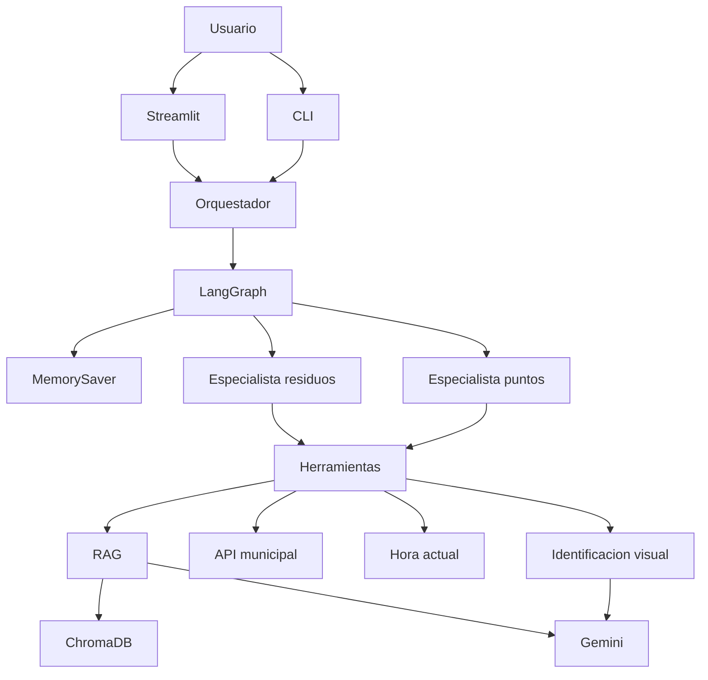

# Línea base de funcionamiento — PB02

## 1. Objetivo

Registrar el estado inicial de ReciclaTÍA antes de incorporar los requisitos correspondientes al Project Break 03 de MLOps para IA Generativa.

Esta línea base constituye una referencia histórica para identificar regresiones, evaluar las modificaciones realizadas y comprobar la conservación de las funcionalidades desarrolladas durante el PB02.

## 2. Identificación de la línea base

| Parámetro | Valor |
|---|---|
| Proyecto | ReciclaTÍA |
| Repositorio | pb03_equipo18 |
| Rama de referencia | main |
| Commit abreviado | 3997e0a |
| Commit completo | 3997e0a9278d79821b0deeac948f7a7ab2729688 |
| Fecha de validación | 24/11/2026 |
| Versión de Python | 3.13.2 |
| Framework de pruebas | pytest |

[Consultar commit de referencia](https://github.com/alex-bometon/pb03_equipo18/commit/3997e0a9278d79821b0deeac948f7a7ab2729688)

## 3. Arquitectura inicial

Antes de incorporar la capa MLOps, ReciclaTÍA disponía de un sistema RAG autónomo, una arquitectura multiagente mediante LangGraph, herramientas especializadas y una interfaz web desarrollada con Streamlit.



La interfaz Streamlit utilizaba directamente las funciones públicas del orquestador.

El estado operativo de las conversaciones se conservaba mediante MemorySaver.

La arquitectura todavía no incorporaba la capa HTTP de FastAPI ni la persistencia relacional de conversaciones mediante PostgreSQL.

## 4. Funcionalidades existentes

| Componente | Funcionalidad disponible |
|---|---|
| Pipeline documental | Carga, limpieza, fragmentación, embeddings e indexación |
| Recuperación semántica | Búsqueda vectorial mediante ChromaDB |
| Recuperación filtrada | Restricciones mediante metadatos |
| Recuperación estructurada | Consultas sobre catálogo, modalidades y horarios |
| Generación | Respuestas fundamentadas mediante Gemini |
| Control de evidencia | Validación de fuentes y abstenciones |
| Orquestación | Sistema multiagente mediante LangGraph |
| Especialista residuos | Clasificación documental de residuos |
| Especialista puntos | Información geográfica y temporal |
| Herramientas | Registro centralizado y permisos por especialista |
| Geografía | Consulta de la API municipal y cálculo de proximidad |
| Respaldo geográfico | Recuperación desde el corpus local |
| Procesamiento temporal | Interpretación de horarios publicados |
| Procesamiento multimodal | Identificación visual de imágenes |
| HITL | Aprobación y rechazo de planes |
| Estado conversacional | Checkpoints mediante MemorySaver |
| CLI | Ejecución independiente mediante terminal |
| Streamlit | Interfaz web conectada directamente al asistente |

Este inventario describe las capacidades presentes en la arquitectura inicial. No implica que todas ellas hayan sido verificadas individualmente mediante servicios externos reales durante la validación de la línea base.

## 5. Validación del entorno

Se comprobó la disponibilidad del entorno de ejecución utilizado para iniciar el desarrollo del PB03.

| Comprobación | Resultado |
|---|---|
| Versión de Python 3.13.2 | Validada |
| Entorno virtual | Disponible |
| Dependencias necesarias para PB02 | Operativas |
| Ejecución de pruebas automatizadas | Correcta |
| Disponibilidad del índice vectorial | Validada |
| Recuperación documental | Validada |

La validación corresponde al entorno anterior a la incorporación de las nuevas dependencias de MLOps.

No acredita todavía la compatibilidad de las dependencias necesarias para FastAPI, SQLModel y PostgreSQL.

## 6. Validación de los recursos documentales

Se comprobó la existencia de los artefactos necesarios para el funcionamiento del RAG.

| Recurso | Ubicación | Resultado |
|---|---|---|
| Documentos originales | data/raw/ | Disponible |
| Fragmentos documentales | output/chunks.json | Disponible |
| Embeddings | output/embeddings.json | Disponible |
| Índice vectorial | output/chroma_db/ | Validado |

La disponibilidad de estos recursos permitió iniciar el desarrollo del PB03 sin necesidad de regenerar los embeddings existentes.

La reconstrucción reproducible del índice durante la construcción de una imagen Docker deberá comprobarse posteriormente.

## 7. Validación de pruebas automatizadas

### 7.1. Comando de ejecución

```bash
python -m pytest tests/ -q --tb=short
```

### 7.2. Resultado

| Métrica | Resultado |
|---|---:|
| Pruebas superadas | 358 |
| Pruebas fallidas | 0 |
| Tiempo de ejecución | 1,27 segundos |
| Resultado general | Satisfactorio |

La ejecución constituye la referencia inicial de regresión del proyecto.

El número de pruebas superadas corresponde al código evaluado en esta línea base. No constituye un número mínimo obligatorio para futuras versiones.

### 7.3. Componentes cubiertos por la suite existente

| Archivo | Componente |
|---|---|
| tests/test_retrieve.py | Recuperación semántica |
| tests/test_retrieve_structured.py | Recuperación estructurada |
| tests/test_rag_structured.py | Integración de consultas estructuradas |
| tests/test_rag.py | Integración del RAG |
| tests/test_rag_domain.py | Ámbito documental y geográfico |
| tests/test_generate.py | Generación y validación de respuestas |
| tests/test_tools_registry.py | Registro y permisos de herramientas |
| tests/test_rag_tool.py | Herramienta de consulta documental |
| tests/test_api_puntos_limpios.py | Herramienta geográfica |
| tests/test_describir_imagen.py | Procesamiento multimodal |
| tests/test_hora_actual.py | Herramienta temporal |
| tests/test_agent_regression.py | Orquestación y regresión del agente |
| tests/test_agent_resultado.py | Integración de resultados |
| tests/test_agent_schedule.py | Interpretación temporal |
| tests/test_agent_schedule_integration.py | Integración temporal del asistente |
| tests/test_cli.py | Interfaz de terminal |

## 8. Validación sintáctica de Streamlit

### 8.1. Comando ejecutado

```bash
python -m py_compile app.py
```

### 8.2. Resultado

La comprobación sintáctica de app.py finalizó correctamente.

No se detectaron errores de compilación sintáctica.

Esta comprobación no constituye una validación completa de los recorridos funcionales de la interfaz web.

## 9. Situación anterior a MLOps

La línea base corresponde a una arquitectura funcional anterior a la incorporación de los siguientes componentes:

| Componente | Situación inicial |
|---|---|
| FastAPI | Pendiente de incorporación |
| Contratos HTTP | Pendiente de implementación |
| PostgreSQL | Pendiente de incorporación |
| SQLModel | Pendiente de incorporación |
| Autenticación mediante API keys | Pendiente de implementación |
| Autenticación mediante sesiones | Pendiente de implementación |
| Autorización por roles y propiedad | Pendiente de implementación |
| Historial relacional de conversaciones | Pendiente de implementación |
| Rate limiting HTTP | Pendiente de implementación |
| Cuotas comerciales | Pendiente de implementación |
| Concurrencia controlada del backend | Pendiente de implementación |
| Timeout HTTP del asistente | Pendiente de implementación |
| Observabilidad HTTP | Pendiente de implementación |
| Streamlit como cliente HTTP | Pendiente de adaptación |
| Imagen Docker del backend | Pendiente de construcción |
| Despliegue en Render | Pendiente de realización |
| Validación de persistencia tras redeploy | Pendiente de realización |

Estos componentes corresponden a requisitos del PB03 y no constituyen fallos atribuibles a la versión inicial del PB02.

## 10. Modificaciones funcionales previstas

La transición al PB03 contempla modificaciones expresas del comportamiento existente.

Entre ellas:

- Resolución de consultas directas sin HITL obligatorio.
- Identificación individual de aprobaciones mediante approval_id.
- Validación semántica de imágenes antes de LangGraph.
- Reutilización de la identificación multimodal.
- Adaptación de los límites internos del asistente.
- Separación entre historial persistente y estado operativo.
- Incorporación de autenticación y autorización.
- Adaptación de Streamlit como cliente HTTP.

Las pruebas afectadas por estas modificaciones deberán adaptarse conforme a las nuevas especificaciones.

Las funcionalidades que no hayan sido modificadas expresamente deberán conservar sus comportamientos válidos.

## 11. Utilización como referencia de regresión

Durante la implementación del PB03 se utilizará esta línea base para:

- Identificar funcionalidades previamente disponibles.
- Detectar regresiones introducidas durante el desarrollo.
- Comprobar la conservación de los contratos internos vigentes.
- Diferenciar cambios funcionales intencionados de fallos inesperados.
- Evaluar la evolución de la suite automatizada.
- Comparar resultados de validación antes y después de incorporar MLOps.

La comparación del número total de pruebas deberá considerar las nuevas comprobaciones incorporadas y las modificaciones justificadas de pruebas existentes.

La reducción o ampliación del número de pruebas no constituirá por sí sola una medida suficiente de calidad.

## 12. Limitaciones de la validación inicial

Los resultados de esta línea base no acreditan:

- La disponibilidad permanente de Gemini.
- La disponibilidad permanente de la API municipal.
- La corrección factual de todas las posibles respuestas.
- La seguridad completa frente a entradas adversariales.
- El funcionamiento de la futura capa HTTP.
- La compatibilidad con PostgreSQL.
- La construcción correcta de una imagen Docker.
- La viabilidad del despliegue en Render.
- El rendimiento del backend bajo concurrencia.
- La persistencia de datos después de un redeploy.

Estas comprobaciones deberán realizarse durante las fases correspondientes del PB03.

## 13. Conclusión

La validación inicial de ReciclaTÍA registró 358 pruebas automatizadas superadas, ninguna prueba fallida, disponibilidad del índice vectorial y compilación sintáctica correcta de app.py.

Estos resultados permiten establecer una referencia técnica inicial para incorporar progresivamente los requisitos de MLOps.

La línea base constituye un registro histórico y deberá conservarse independientemente de los resultados obtenidos durante las siguientes fases de implementación.

## 14. Referencias

- [Commit de referencia del PB02](https://github.com/alex-bometon/pb03_equipo18/commit/3997e0a9278d79821b0deeac948f7a7ab2729688)
- [Estrategia de pruebas y validación](../../specs/08-pruebas-y-validacion.md)
- [Arquitectura MLOps](../../specs/11-arquitectura-mlops.md)
- [Informe de decisiones](../informe_decisiones.md)