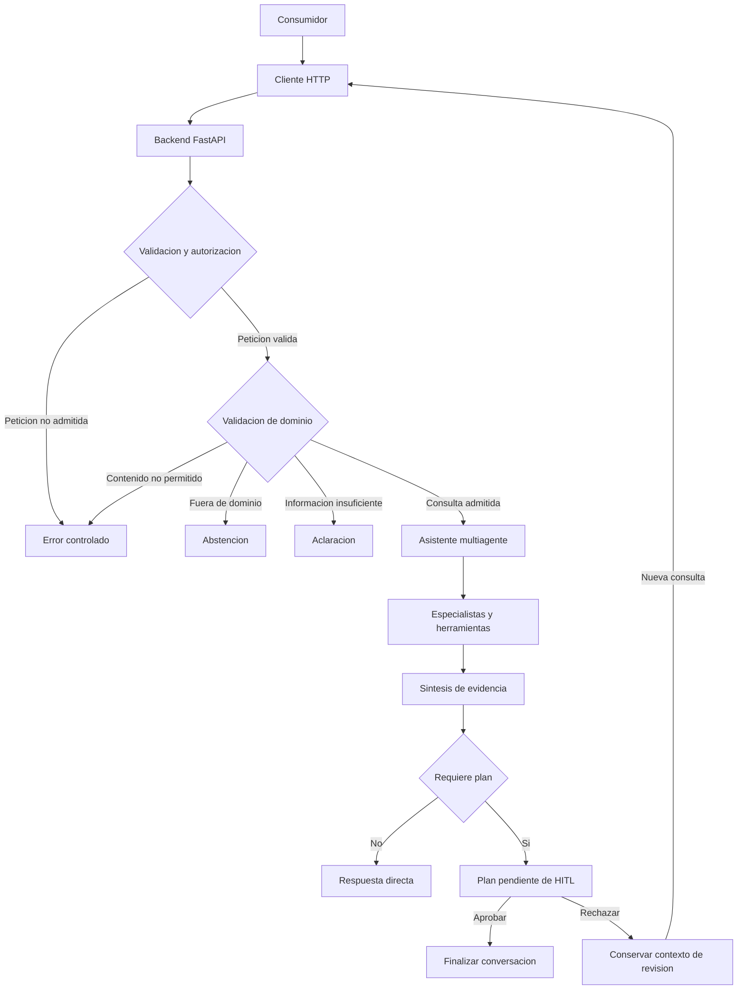

# 00. Producto y alcance

## 1. Propósito

ReciclaTÍA es un asistente especializado en la gestión de residuos domésticos y los servicios municipales de recogida de Madrid ciudad.

Su objetivo es proporcionar información contrastable que permita al usuario identificar el destino adecuado de un residuo, conocer las modalidades de recogida disponibles y localizar instalaciones compatibles con sus necesidades.

ReciclaTÍA no es un asistente conversacional de propósito general ni un sistema de consulta sobre sostenibilidad sin restricciones de dominio.

Las recomendaciones deberán fundamentarse en documentación verificable y, cuando corresponda, en información geográfica y temporal.

## 2. Principios del producto

- Especialización en un dominio delimitado.
- Fundamentación de las respuestas mediante evidencia documental.
- Transparencia sobre las fuentes utilizadas.
- Abstención cuando la información disponible sea insuficiente.
- Diferenciación entre información documentada e inferencia del modelo.
- Protección de los datos y las credenciales de los consumidores.
- Control del consumo de recursos y servicios externos.
- Independencia entre el núcleo del asistente y sus interfaces.
- Supervisión humana de los planes que requieran aprobación.
- Acceso a las funcionalidades según los permisos del consumidor.

## 3. Ámbito funcional y geográfico

### 3.1. Ámbito funcional

El asistente proporcionará información relacionada con:

- Clasificación de residuos domésticos.
- Destinos autorizados para el depósito de residuos.
- Contenedores y modalidades de recogida.
- Puntos limpios fijos.
- Puntos limpios móviles.
- Puntos limpios móviles de 24 horas.
- Puntos limpios de proximidad.
- Horarios publicados de los servicios municipales.
- Localización de instalaciones de recogida.
- Identificación visual de objetos y residuos mediante imágenes.
- Reformulación de consultas y revisión de recomendaciones.

### 3.2. Ámbito geográfico

El ámbito geográfico del producto se limita al municipio de Madrid.

No se extrapolarán las normas, instalaciones ni servicios municipales de Madrid a otros municipios, comunidades autónomas o países.

Cuando una consulta requiera información correspondiente a un ámbito geográfico no cubierto, el asistente indicará expresamente esta limitación.

### 3.3. Fuentes de información

El producto utilizará:

- El corpus documental municipal disponible.
- Los datos estructurados incorporados al corpus.
- Los servicios municipales autorizados para obtener información geográfica.
- Los mecanismos de consulta temporal necesarios para interpretar horarios publicados.

La procedencia, actualización y utilización de las fuentes se definen en [09-datos-y-fuentes.md](09-datos-y-fuentes.md).

## 4. Perfiles de acceso

ReciclaTÍA dispondrá de tres roles de API key: Free, User y Admin.

La identidad del consumidor y su nivel de acceso constituyen conceptos independientes.

### 4.1. Free

Representa el nivel gratuito del producto.

Podrá utilizarse sin registro obligatorio o mediante una cuenta registrada.

Permite:

- Realizar consultas textuales.
- Iniciar conversaciones propias.
- Continuar conversaciones propias cuando su estado operativo lo permita.
- Aprobar o rechazar planes.
- Solicitar aclaraciones y reformular consultas.

Las consultas con imágenes no estarán disponibles para este nivel.

Los consumidores Free registrados podrán consultar el historial asociado a sus propias API keys mediante una sesión autenticada.

### 4.2. User

Representa el nivel avanzado del producto, destinado a constituir una futura modalidad de pago.

Requiere una cuenta registrada y autorización para acceder a este nivel.

Permite:

- Utilizar las funcionalidades disponibles en el nivel Free.
- Realizar consultas con imágenes.
- Consultar el historial asociado a las API keys propias mediante los mecanismos de acceso autorizados.
- Disponer de límites de consumo superiores a los del nivel Free.

El registro de una cuenta no concede automáticamente acceso al nivel User.

### 4.3. Admin

Representa el nivel administrativo del producto.

Permite:

- Utilizar las funcionalidades del asistente.
- Consultar cualquier conversación.
- Administrar usuarios.
- Administrar API keys.
- Activar o desactivar recursos cuando corresponda.
- Aplicar las operaciones de eliminación lógica autorizadas.

Las credenciales administrativas se obtendrán exclusivamente mediante procedimientos restringidos.

El administrador estará sujeto a los límites técnicos del sistema, aunque no disponga de una cuota comercial del asistente.

### 4.4. Disponibilidad de funcionalidades

| Funcionalidad | Free anónimo | Free registrado | User | Admin |
|---|---|---|---|---|
| Consultas textuales | Sí | Sí | Sí | Sí |
| Consultas con imágenes | No | No | Sí | Sí |
| Conversaciones propias | Sí | Sí | Sí | Sí |
| Aprobación y rechazo de planes | Sí | Sí | Sí | Sí |
| Historial persistente propio | No | Sí | Sí | Sí |
| Gestión de claves propias mediante sesión | No | Sí | Sí | Sí |
| Acceso global a conversaciones | No | No | No | Sí |
| Administración de usuarios | No | No | No | Sí |
| Administración global de API keys | No | No | No | Sí |

Las reglas de autenticación, autorización y acceso a recursos se definen en [14-autenticacion-autorizacion.md](14-autenticacion-autorizacion.md).

Los límites de consumo se definen en [15-robustez-observabilidad.md](15-robustez-observabilidad.md).

## 5. Interfaces del producto

### 5.1. Cliente web

Streamlit constituirá la interfaz web de ReciclaTÍA.

Permitirá utilizar las funcionalidades disponibles según los permisos del consumidor.

La interfaz no ejecutará directamente el agente, el RAG ni las herramientas.

Toda comunicación con el backend se realizará mediante HTTP.

Los requisitos de la interfaz se definen en [07-streamlit.md](07-streamlit.md).

### 5.2. API REST

FastAPI constituirá la interfaz programática del producto.

Permitirá utilizar las funcionalidades autorizadas del asistente desde Streamlit, Swagger y otros clientes HTTP compatibles.

La API será responsable de aplicar las reglas de autenticación, autorización, validación, consumo y persistencia.

Los contratos públicos se definen en [12-contratos-http.md](12-contratos-http.md).

### 5.3. Interfaz de terminal

La interfaz de terminal se conservará como herramienta de desarrollo, evaluación y ejecución independiente del núcleo del asistente.

Permitirá utilizar las funcionalidades existentes del RAG y del sistema multiagente sin depender del servicio HTTP ni de PostgreSQL.

La ejecución local mediante terminal no constituye un mecanismo de acceso remoto al servicio ni permite eludir los controles establecidos para la API.

## 6. Casos de uso

| Necesidad | Comportamiento esperado |
|---|---|
| Identificar el destino de un residuo | Consultar la evidencia disponible y recomendar un destino documentado. |
| Consultar modalidades de recogida | Diferenciar las modalidades municipales y sus restricciones. |
| Consultar un catálogo de residuos | Utilizar los datos estructurados disponibles sin presentar información parcial como exhaustiva. |
| Localizar puntos limpios cercanos | Utilizar coordenadas proporcionadas voluntariamente y obtener instalaciones compatibles. |
| Consultar horarios | Mostrar los horarios publicados sin garantizar la apertura física de la instalación. |
| Realizar una consulta compuesta | Integrar la clasificación del residuo y la información geográfica o temporal necesaria. |
| Analizar una fotografía | Identificar el contenido observable, comprobar su admisibilidad y contrastar el destino del residuo mediante el RAG. |
| Solicitar una aclaración | Identificar la información que falta para resolver correctamente la consulta. |
| Reformular una consulta | Conservar el contexto necesario sin reutilizar evidencia que no corresponda al nuevo pedido. |
| Aprobar una recomendación | Registrar la aceptación de un plan pendiente. |
| Rechazar una recomendación | Registrar el rechazo y permitir una reformulación dentro de los límites establecidos. |
| Consultar conversaciones anteriores | Recuperar el historial persistente según los permisos del consumidor. |
| Registrar una cuenta | Permitir la identificación del usuario y el acceso a las funcionalidades correspondientes. |
| Gestionar credenciales | Generar y consultar API keys conforme a las reglas de autorización. |

## 7. Validación del dominio

Las consultas deberán pertenecer al ámbito funcional y geográfico del producto.

### 7.1. Consultas textuales

Las consultas textuales se someterán a un filtro previo de dominio.

Cuando una consulta se identifique inequívocamente como fuera del dominio, el sistema devolverá una respuesta controlada sin ejecutar el asistente.

Cuando la consulta sea ambigua, podrá solicitarse una aclaración determinista antes de ejecutar el asistente.

El filtro deberá contemplar el contexto conversacional cuando sea necesario para interpretar reformulaciones y preguntas relacionadas con mensajes anteriores.

No se rechazará una consulta únicamente por no contener términos explícitamente relacionados con el reciclaje cuando su contexto permita identificar una intención válida.

### 7.2. Consultas multimodales

Las imágenes deberán superar una validación técnica y semántica antes de continuar con la ejecución del asistente.

Cuando una imagen:

- Se identifique como fuera del dominio.
- Contenga material no permitido.
- No pueda identificarse con suficiente certeza.

El sistema interrumpirá el flujo y devolverá la respuesta correspondiente sin continuar con la recuperación documental, las búsquedas geográficas, la síntesis ni la aprobación de planes.

La identificación visual de un objeto no constituye por sí sola una clasificación documental válida de su destino.

Las reglas de validación y contabilización del consumo se definen en [15-robustez-observabilidad.md](15-robustez-observabilidad.md).

## 8. Recorrido funcional

El recorrido representa las principales posibilidades funcionales del servicio.

La ejecución de especialistas y herramientas dependerá de las necesidades de cada consulta.

No se ejecutarán sistemáticamente todos los componentes del asistente.

Las consultas que puedan resolverse mediante mecanismos deterministas no requerirán necesariamente la intervención del modelo de lenguaje.

## 9. Requisitos de las respuestas

### 9.1. Evidencia documental

Las recomendaciones sobre destinos de residuos deberán apoyarse en evidencia documental suficiente.

No se considerará válida una recomendación basada exclusivamente en la inferencia del modelo de lenguaje.

Las fuentes utilizadas deberán respaldar las afirmaciones para las que se presentan como evidencia.

No se inventarán fuentes, instalaciones, direcciones, horarios ni datos municipales.

### 9.2. Suficiencia de evidencia

El asistente distinguirá entre:

- Evidencia suficiente.
- Evidencia parcial.
- Evidencia insuficiente.

Cuando la evidencia sea parcial, se indicarán las limitaciones correspondientes.

Cuando la evidencia sea insuficiente, el asistente deberá abstenerse de proporcionar una recomendación no fundamentada.

### 9.3. Consultas compuestas

Una consulta podrá requerir diferentes tipos de evidencia.

La clasificación de un residuo, la localización de instalaciones y la interpretación de horarios deberán mantenerse como operaciones diferenciadas.

La proximidad de una instalación no constituye por sí sola evidencia de que dicha instalación admita el residuo consultado.

### 9.4. Tipos de resultado

El producto deberá distinguir funcionalmente entre:

- Respuesta directa.
- Recomendación con plan pendiente de aprobación.
- Solicitud de aclaración.
- Respuesta con evidencia parcial.
- Abstención por falta de evidencia.
- Abstención por consulta fuera del dominio.
- Ausencia de instalaciones compatibles.
- Fallo técnico.

Una abstención o una solicitud de aclaración válida no constituirán por sí mismas un error técnico.

Los contratos correspondientes se definen en [12-contratos-http.md](12-contratos-http.md).

## 10. Información geográfica y temporal

### 10.1. Ubicación

El uso de la ubicación será voluntario.

El asistente únicamente utilizará coordenadas proporcionadas explícitamente por el usuario.

No se asumirán coordenadas a partir de valores predeterminados, direcciones escritas o información no autorizada.

Cuando una consulta necesite coordenadas y estas no estén disponibles, el sistema solicitará la información necesaria o indicará la limitación correspondiente.

### 10.2. Proximidad

Las distancias geográficas deberán identificarse como tales.

No se presentarán distancias en línea recta como distancias por carretera, tiempos de desplazamiento o garantías de accesibilidad.

Las instalaciones recomendadas deberán ser compatibles con los requisitos documentados del residuo y de la modalidad de recogida.

### 10.3. Horarios

Los horarios se interpretarán conforme a la documentación disponible y a la hora correspondiente a Madrid.

El asistente distinguirá entre:

- Instalación dentro del horario publicado.
- Instalación fuera del horario publicado.
- Situación horaria desconocida.

No se garantizará que una instalación esté físicamente abierta únicamente por encontrarse dentro del horario publicado.

### 10.4. Procedencia geográfica

Cuando la información geográfica proceda del corpus local como mecanismo de respaldo autorizado, deberá indicarse su procedencia y la posibilidad de que esté desactualizada.

Las reglas de interpretación geográfica y temporal se definen en [04-consultas-generales.md](04-consultas-generales.md) y [05-tools.md](05-tools.md).

## 11. Conversaciones

### 11.1. Identificación

Cada conversación dispondrá de un identificador único denominado thread_id.

El identificador permitirá relacionar el estado operativo del asistente y su historial persistente.

El conocimiento de un thread_id no concede permiso para acceder a la conversación correspondiente.

### 11.2. Propiedad

Cada conversación creada mediante la API pertenecerá exclusivamente a una API key.

Dos API keys pertenecientes al mismo usuario no compartirán automáticamente sus conversaciones.

El acceso mediante una sesión autenticada permitirá seleccionar explícitamente las claves propias autorizadas.

Las credenciales administrativas podrán acceder a cualquier conversación.

### 11.3. Continuidad

Una conversación podrá contener varios turnos mientras:

- No haya finalizado.
- No exista una aprobación pendiente que impida continuar.
- No se hayan agotado los límites establecidos.
- Se conserve un estado operativo válido cuando resulte necesario.
- La operación se encuentre autorizada.

Las consultas de una conversación no deberán modificar ni utilizar indebidamente el estado de otra.

### 11.4. Nueva conversación

El consumidor podrá iniciar una nueva conversación independientemente de las conversaciones anteriores.

La nueva conversación no heredará automáticamente los mensajes, evidencias, planes ni autorizaciones de ubicación de otros hilos.

## 12. Supervisión humana — HITL

### 12.1. Finalidad

HITL permite al consumidor revisar, aprobar o rechazar las recomendaciones que se materialicen en un plan.

No todas las respuestas deberán generar un plan.

Las respuestas directas, las aclaraciones y las abstenciones que no requieran aprobación podrán resolverse sin HITL.

### 12.2. Aprobación

Cuando exista un plan pendiente, el sistema deberá registrar la decisión correspondiente a dicho plan.

La aprobación finalizará la conversación conforme al contrato establecido.

Aprobar una recomendación no supone ejecutar operaciones externas ni realizar acciones en nombre del consumidor.

### 12.3. Rechazo

El rechazo resolverá el turno correspondiente y permitirá reformular la consulta mientras se mantengan las condiciones de continuidad.

El contexto necesario para interpretar la reformulación podrá conservarse.

Las evidencias anteriores no se tratarán automáticamente como pruebas válidas para el nuevo pedido.

### 12.4. Modalidades de aprobación

Streamlit no aprobará automáticamente los planes.

El modo interactivo de terminal conservará la aprobación manual.

La API podrá admitir la resolución automática de planes conforme a su contrato de entrada.

El modo de demostración de terminal podrá utilizar la opción explícita --auto-aprobar.

Las reglas de transición, validación y protección de las aprobaciones se definen en:

- [06-langgraph.md](06-langgraph.md).
- [12-contratos-http.md](12-contratos-http.md).
- [15-robustez-observabilidad.md](15-robustez-observabilidad.md).

## 13. Historial y estado operativo

### 13.1. Historial persistente

El servicio HTTP conservará el historial de los turnos resueltos conforme a los criterios de persistencia establecidos.

El acceso al historial estará condicionado por las reglas de autorización y propiedad de los recursos.

La existencia de historial persistente no implica que pueda recuperarse automáticamente el estado operativo necesario para continuar una conversación.

### 13.2. Estado operativo

El estado de ejecución del asistente y las aprobaciones pendientes se mantendrán en memoria durante esta fase del desarrollo.

Los reinicios y redespliegues podrán provocar la pérdida del estado operativo sin eliminar el historial almacenado.

Cuando no resulte posible continuar una conversación de forma segura, el usuario podrá consultar su historial autorizado e iniciar una nueva conversación.

### 13.3. Diferenciación de responsabilidades

El historial persistente y el estado operativo del agente constituyen recursos independientes.

El modelo de almacenamiento y sus garantías se definen en [13-persistencia.md](13-persistencia.md).

## 14. Gestión de usuarios y credenciales

El producto deberá permitir:

- Registro de cuentas.
- Inicio y cierre de sesión.
- Consulta de la cuenta propia.
- Modificación de contraseña.
- Emisión controlada de API keys.
- Selección de API keys propias.
- Consulta del historial autorizado.
- Administración restringida de usuarios y credenciales.

El registro de usuarios no será obligatorio para acceder al nivel Free.

Las credenciales administrativas no podrán obtenerse mediante los procedimientos ordinarios de registro y generación de claves.

Las operaciones de gestión deberán respetar las reglas de seguridad, propiedad, integridad referencial y eliminación lógica.

## 15. Requisitos no funcionales

### 15.1. Seguridad

El sistema deberá impedir accesos no autorizados, elevaciones de privilegios y modificaciones indebidas de conversaciones.

Las decisiones de seguridad no dependerán exclusivamente del modelo de lenguaje ni de restricciones visuales de la interfaz.

### 15.2. Privacidad

La información tratada y almacenada deberá limitarse a la necesaria para proporcionar las funcionalidades del producto.

No se expondrán credenciales, información interna del sistema ni datos correspondientes a recursos no autorizados.

Las imágenes recibidas no se conservarán permanentemente.

El análisis de imágenes y las operaciones de inferencia podrán requerir el tratamiento de información mediante servicios externos autorizados.

### 15.3. Robustez

El sistema deberá gestionar de forma controlada:

- Entradas inválidas.
- Consumo excesivo de recursos.
- Conflictos de estado.
- Ejecuciones concurrentes.
- Tiempos de espera.
- Fallos de dependencias externas.
- Fallos de persistencia.
- Pérdida del estado operativo.

### 15.4. Observabilidad

El servicio deberá proporcionar información suficiente para identificar peticiones, evaluar su comportamiento y diagnosticar incidencias sin exponer información sensible.

### 15.5. Eficiencia

El asistente deberá evitar llamadas innecesarias a modelos de lenguaje, herramientas y servicios externos.

Las cuotas y restricciones de ejecución deberán preservar los requisitos funcionales y de calidad.

### 15.6. Mantenibilidad

Las responsabilidades del producto deberán mantenerse separadas entre la interfaz, los contratos HTTP, las reglas de negocio, el asistente, la recuperación documental y la persistencia.

La incorporación de nuevas funcionalidades no deberá comprometer el funcionamiento independiente de los componentes existentes.

Los requisitos técnicos correspondientes se desarrollan en las especificaciones de arquitectura, seguridad, robustez y despliegue.

## 16. Fuera de alcance

Durante esta fase del desarrollo, ReciclaTÍA no proporcionará:

- Información municipal específica de otros municipios.
- Conversaciones generales ajenas al dominio de los residuos domésticos.
- Clasificación visual infalible de objetos.
- Recomendaciones no fundamentadas documentalmente.
- Geocodificación automática de direcciones.
- Cálculo de rutas a pie o por carretera.
- Garantías de apertura física de instalaciones.
- Actualización permanente de todos los horarios municipales.
- Reserva de servicios de recogida.
- Automatización de recogidas.
- Ejecución de acciones externas mediante la aprobación de planes.
- Contratación de suscripciones.
- Pasarela de pago.
- Facturación comercial.

La geolocalización automática del navegador constituye una ampliación opcional.

Las restricciones de infraestructura y las tecnologías excluidas se definen en [16-despliegue.md](16-despliegue.md).

## 17. Criterios de aceptación

- El producto responde a consultas relacionadas con los residuos domésticos y servicios municipales de Madrid.
- Las consultas inequívocamente fuera del dominio reciben respuestas controladas.
- Las recomendaciones se fundamentan en evidencia verificable.
- Las fuentes respaldan las afirmaciones correspondientes.
- El asistente se abstiene cuando no dispone de evidencia suficiente.
- Las consultas simples y compuestas utilizan únicamente los componentes necesarios.
- Los resultados geográficos identifican su procedencia.
- La ubicación únicamente se utiliza cuando ha sido proporcionada voluntariamente.
- Los horarios publicados no se presentan como garantías de apertura física.
- Las imágenes se validan antes de continuar con la ejecución del asistente.
- Las imágenes no admisibles no generan recomendaciones ni planes.
- El nivel Free puede utilizarse sin registro obligatorio.
- Los consumidores registrados pueden utilizar las funcionalidades autorizadas.
- El registro no concede automáticamente acceso al nivel User.
- Los perfiles sin autorización no pueden realizar consultas multimodales.
- Las funcionalidades administrativas están restringidas a las credenciales correspondientes.
- Las conversaciones mantienen su propiedad y aislamiento.
- Los usuarios pueden consultar el historial autorizado.
- Las respuestas que no necesitan un plan pueden resolverse sin HITL.
- Los planes pendientes pueden aprobarse o rechazarse conforme al contrato establecido.
- Las aprobaciones no ejecutan acciones externas.
- Los fallos técnicos se distinguen de las abstenciones válidas.
- El historial persistente se diferencia del estado operativo del agente.
- Streamlit utiliza HTTP para comunicarse con el backend.
- El núcleo RAG puede utilizarse independientemente del servicio HTTP.
- El producto respeta los límites de seguridad, consumo y ejecución establecidos.

## 18. Especificaciones relacionadas

| Documento | Responsabilidad |
|---|---|
| [01-retrieval.md](01-retrieval.md) | Recuperación semántica |
| [02-mejoras-retrieval.md](02-mejoras-retrieval.md) | Mejoras y filtros de recuperación |
| [03-generacion.md](03-generacion.md) | Generación, evidencia y citas |
| [04-consultas-generales.md](04-consultas-generales.md) | Interpretación de consultas y datos estructurados |
| [05-tools.md](05-tools.md) | Herramientas del asistente |
| [06-langgraph.md](06-langgraph.md) | Orquestación, estado y HITL |
| [07-streamlit.md](07-streamlit.md) | Interfaz web |
| [08-pruebas-y-validacion.md](08-pruebas-y-validacion.md) | Estrategia de verificación y validación |
| [09-datos-y-fuentes.md](09-datos-y-fuentes.md) | Corpus, procedencia y fuentes |
| [10-seguridad.md](10-seguridad.md) | Seguridad del núcleo del asistente |
| [11-arquitectura-mlops.md](11-arquitectura-mlops.md) | Arquitectura general |
| [12-contratos-http.md](12-contratos-http.md) | Contratos públicos de la API |
| [13-persistencia.md](13-persistencia.md) | Persistencia y modelo relacional |
| [14-autenticacion-autorizacion.md](14-autenticacion-autorizacion.md) | Identidad, credenciales y permisos |
| [15-robustez-observabilidad.md](15-robustez-observabilidad.md) | Límites, concurrencia y observabilidad |
| [16-despliegue.md](16-despliegue.md) | Infraestructura y despliegue |

Este documento establece el alcance funcional del producto.

Las especificaciones especializadas desarrollan los contratos, restricciones y requisitos técnicos correspondientes a cada componente.