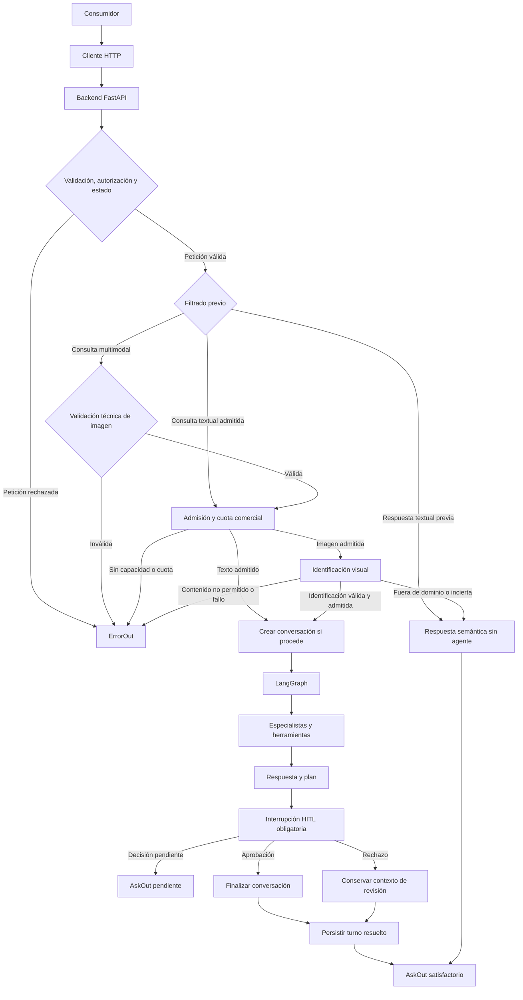

# 00. Producto y alcance

## 1. Propósito

ReciclaTÍA es un asistente especializado en la gestión de residuos domésticos y los servicios municipales de recogida de Madrid ciudad.

Su objetivo es proporcionar información contrastable que permita al usuario identificar el destino adecuado de un residuo, conocer las modalidades de recogida disponibles y localizar instalaciones compatibles con sus necesidades.

ReciclaTÍA no es un asistente conversacional de propósito general ni un sistema de consulta sobre sostenibilidad sin restricciones de dominio.

Las recomendaciones deberán fundamentarse en documentación verificable y, cuando corresponda, en información geográfica y temporal obtenida mediante los mecanismos autorizados.

El Project Break 03 constituye una continuación del producto desarrollado durante el PB02.

La incorporación de la arquitectura MLOps permitirá ofrecer las capacidades existentes mediante una API REST, incorporar persistencia relacional, aplicar controles de seguridad y robustez y desplegar el servicio en un entorno de producción.

No se sustituirá innecesariamente el núcleo funcional desarrollado durante el PB02.

## 2. Principios del producto

- Especialización en un dominio delimitado.
- Limitación al ámbito geográfico autorizado.
- Fundamentación de las respuestas mediante evidencia documental.
- Utilización exclusiva de fuentes de información autorizadas.
- Transparencia sobre la procedencia de los resultados.
- Abstención cuando la información disponible sea insuficiente.
- Diferenciación entre información documentada e inferencia del modelo.
- Diferenciación entre resultados semánticos válidos y fallos técnicos.
- Protección de los datos y credenciales de los consumidores.
- Control del consumo de recursos y servicios externos.
- Independencia entre el núcleo del asistente y sus interfaces.
- HITL obligatorio en las ejecuciones satisfactorias de LangGraph.
- Acceso a funcionalidades según los permisos del consumidor.
- Aislamiento de conversaciones.
- Conservación del historial de turnos resueltos.
- Minimización de llamadas externas innecesarias.
- Preservación de los requisitos funcionales y académicos anteriores.

La reducción del consumo de recursos no deberá comprometer la calidad de las respuestas, la seguridad ni el cumplimiento de los requisitos académicos.

## 3. Ámbito funcional y geográfico

### 3.1. Ámbito funcional

El asistente proporcionará información relacionada con:

- Clasificación de residuos domésticos.
- Destinos autorizados para el depósito de residuos.
- Contenedores y modalidades de recogida.
- Puntos limpios fijos.
- Puntos limpios móviles.
- Puntos limpios móviles de 24 horas.
- Puntos limpios de proximidad.
- Horarios publicados de los servicios municipales.
- Localización de instalaciones de recogida.
- Identificación visual de objetos y residuos mediante imágenes.
- Interpretación de consultas compuestas.
- Reformulación de consultas.
- Revisión de recomendaciones.
- Aprobación y rechazo de planes.

Las funcionalidades estarán condicionadas por la evidencia disponible, los permisos del consumidor y los límites establecidos.

### 3.2. Ámbito geográfico

El ámbito geográfico del producto se limita al municipio de Madrid.

No se extrapolarán las normas, instalaciones ni servicios municipales de Madrid a otros municipios, comunidades autónomas o países.

Cuando una consulta requiera información de un ámbito geográfico no cubierto, el asistente indicará expresamente esta limitación.

No se incorporarán nuevos ámbitos geográficos durante el PB03.

### 3.3. Fuentes de conocimiento autorizadas

Las fuentes autorizadas serán:

| Fuente | Responsabilidad |
|---|---|
| Corpus documental indexado en ChromaDB | Clasificación, normativa, modalidades de recogida y demás información documentada |
| Datos estructurados incorporados al corpus | Consultas de catálogos, restricciones, instalaciones y horarios |
| API ArcGIS del Ayuntamiento de Madrid | Información geográfica de puntos limpios |
| Corpus local georreferenciado | Respaldo autorizado ante fallos técnicos del servicio municipal |

Las referencias normativas incorporadas previamente al núcleo deberán proceder de documentación municipal autorizada.

No constituirán una fuente de búsqueda independiente.

La procedencia, actualización y utilización de las fuentes se definen en [09-datos-y-fuentes.md](09-datos-y-fuentes.md).

### 3.4. Servicios complementarios

Gemini se utilizará para:

- Generación de embeddings.
- Interpretación de consultas.
- Razonamiento.
- Generación de respuestas fundamentadas.
- Identificación visual.

Gemini no constituirá una fuente documental autorizada.

El reloj del sistema proporcionará información temporal correspondiente a Europe/Madrid.

La identificación visual y la información temporal complementarán las evidencias disponibles, pero no sustituirán la documentación necesaria para fundamentar recomendaciones sobre residuos.

### 3.5. Restricción de búsquedas externas

El asistente no realizará:

- Búsquedas abiertas en Internet.
- Consultas mediante motores de búsqueda.
- Grounding mediante buscadores externos.
- Recuperación arbitraria de páginas web.
- Consultas a proveedores documentales adicionales.
- Consultas a proveedores geográficos alternativos.

Las URL oficiales presentadas al usuario constituirán referencias de procedencia.

La presentación de estas referencias no implicará realizar nuevas peticiones externas durante la consulta.

Cuando las fuentes autorizadas no proporcionen evidencia suficiente, el asistente deberá abstenerse.

Si la ausencia de evidencia se debe a un fallo técnico no recuperado, deberá comunicar el error correspondiente.

## 4. Perfiles de acceso

ReciclaTÍA dispondrá de tres roles de API key:

- Free.
- User.
- Admin.

La identidad del consumidor, su sesión y el rol de su API key constituyen conceptos independientes.

El rol pertenecerá a la credencial y no a la cuenta de usuario.

### 4.1. Free

Representa el nivel gratuito del producto.

Podrá utilizarse sin registro obligatorio o mediante una cuenta registrada.

Permite:

- Realizar consultas textuales.
- Iniciar conversaciones propias.
- Continuar conversaciones propias cuando su estado operativo lo permita.
- Aprobar o rechazar planes.
- Solicitar aclaraciones.
- Reformular consultas.

Las consultas con imágenes no estarán disponibles para este nivel.

El consumidor Free anónimo podrá utilizar el asistente mediante una API key generada por el backend y conservada durante su sesión.

No dispondrá de acceso a los endpoints de historial persistente.

El consumidor Free registrado podrá consultar el historial asociado a sus propias API keys mediante una sesión autenticada.

El registro no modificará las cuotas del nivel Free.

### 4.2. User

Representa el nivel avanzado del producto, destinado a constituir una futura modalidad de pago.

Requiere:

- Una cuenta registrada.
- Una API key User autorizada.
- El cumplimiento de los controles de seguridad y consumo correspondientes.

Permite:

- Utilizar las funcionalidades disponibles en Free.
- Realizar consultas con imágenes.
- Consultar el historial correspondiente a la API key utilizada.
- Consultar el historial de otras claves propias mediante los mecanismos autorizados de cuenta.
- Disponer de cuotas superiores a las del nivel Free.

El registro de una cuenta no concede automáticamente acceso al nivel User.

La autorización para emitir claves User se gestionará mediante configuración controlada de identificadores de usuarios o mediante emisión administrativa.

Durante el PB03 no se implementará un sistema de pago.

### 4.3. Admin

Representa el nivel administrativo del producto.

Permite:

- Utilizar las funcionalidades del asistente.
- Consultar cualquier conversación.
- Administrar usuarios.
- Administrar API keys.
- Emitir claves Free y User.
- Activar o desactivar recursos cuando corresponda.
- Aplicar las operaciones autorizadas de eliminación lógica.

Las credenciales Admin se obtendrán exclusivamente mediante procedimientos internos restringidos.

Ningún endpoint permitirá generar nuevas claves Admin.

La utilización de una credencial administrativa requerirá proporcionar su secreto original mediante X-API-Key.

El administrador estará sujeto a los límites técnicos del sistema, aunque no disponga de una cuota comercial del asistente.

### 4.4. Disponibilidad de funcionalidades

| Funcionalidad | Free anónimo | Free registrado | User | Admin |
|---|---|---|---|---|
| Consultas textuales | Sí | Sí | Sí | Sí |
| Consultas con imágenes | No | No | Sí | Sí |
| Conversaciones propias | Sí | Sí | Sí | Sí |
| Aprobación y rechazo de planes | Sí | Sí | Sí | Sí |
| Historial persistente propio | No | Sí | Sí | Sí |
| Gestión de claves propias mediante sesión | No | Sí | Sí | Sí |
| Acceso global a conversaciones | No | No | No | Sí |
| Administración de usuarios | No | No | No | Sí |
| Administración global de API keys | No | No | No | Sí |

Las funcionalidades administrativas se expondrán mediante los endpoints protegidos correspondientes.

No será obligatorio implementar un panel administrativo completo en Streamlit durante el PB03.

Swagger permitirá comprobar las operaciones administrativas autorizadas.

Las reglas de autenticación, autorización y acceso a recursos se definen en [14-autenticacion-autorizacion.md](14-autenticacion-autorizacion.md).

### 4.5. Cuotas comerciales

| Rol | Por minuto | Por hora | Por 24 horas |
|---|---|---|---|
| Free | 2 | 10 | 30 |
| User | 5 | 20 | 45 |
| Admin | Sin límite comercial | Sin límite comercial | Sin límite comercial |

Las cuotas se aplicarán individualmente a cada API key mediante ventanas temporales deslizantes.

Las consultas textuales y multimodales compartirán cuota comercial.

Las operaciones de aprobación o rechazo no consumirán una nueva consulta comercial.

Todos los perfiles estarán sujetos a los límites HTTP y técnicos aplicables.

Los criterios de admisión, contabilización y recuperación de capacidad se definen en [15-robustez-observabilidad.md](15-robustez-observabilidad.md).

## 5. Interfaces del producto

### 5.1. Cliente web

Streamlit constituirá la interfaz web de ReciclaTÍA.

Permitirá utilizar las funcionalidades disponibles según los permisos del consumidor.

La interfaz será responsable de:

- Recoger las consultas.
- Gestionar la interacción con el consumidor.
- Gestionar el estado local de la sesión.
- Presentar respuestas.
- Presentar fuentes y resultados geográficos.
- Mostrar limitaciones.
- Solicitar decisiones HITL.
- Consultar el historial autorizado.
- Comunicar errores de forma comprensible.

Streamlit no ejecutará directamente LangGraph, el RAG ni las herramientas del asistente.

No accederá directamente a ChromaDB ni a PostgreSQL.

No realizará consultas directas a Gemini o ArcGIS para completar las respuestas del asistente.

La comunicación funcional con el backend se realizará mediante HTTP.

Los requisitos de la interfaz se definen en [07-streamlit.md](07-streamlit.md).

### 5.2. API REST

FastAPI constituirá la interfaz programática del producto.

Permitirá utilizar las funcionalidades autorizadas del asistente desde:

- Streamlit.
- Swagger.
- Otros clientes HTTP compatibles.

La API será responsable de aplicar:

- Autenticación.
- Autorización.
- Validación de entradas.
- Comprobación de propiedad.
- Controles de consumo.
- Admisión de ejecuciones.
- Concurrencia.
- Timeouts.
- Validación de resultados.
- Persistencia.
- Gestión de errores.
- Observabilidad.

Los contratos públicos se definen en [12-contratos-http.md](12-contratos-http.md).

### 5.3. Interfaz de terminal

La interfaz de terminal se conservará como herramienta de desarrollo, evaluación y ejecución independiente del núcleo.

Permitirá utilizar las funcionalidades existentes del RAG y del sistema multiagente sin depender del servicio HTTP ni de PostgreSQL.

La ejecución local conservará las validaciones y restricciones internas correspondientes.

La ejecución independiente mediante terminal no constituye un mecanismo de acceso remoto al servicio ni permite eludir los controles establecidos para la API.

## 6. Casos de uso

| Necesidad | Comportamiento esperado |
|---|---|
| Identificar el destino de un residuo | Consultar la evidencia autorizada y recomendar un destino documentado. |
| Consultar modalidades de recogida | Diferenciar las modalidades municipales y sus restricciones. |
| Consultar un catálogo de residuos | Utilizar los datos estructurados sin presentar información parcial como exhaustiva. |
| Localizar puntos limpios cercanos | Utilizar coordenadas proporcionadas voluntariamente y obtener resultados geográficos autorizados. |
| Determinar la compatibilidad de una instalación | Contrastar la información documental correspondiente al residuo y la modalidad de recogida. |
| Consultar horarios | Mostrar horarios publicados sin garantizar apertura física. |
| Consultar disponibilidad horaria actual | Interpretar la hora de Madrid frente a los horarios documentados. |
| Realizar una consulta compuesta | Integrar evidencias documentales, geográficas y temporales. |
| Analizar una fotografía | Identificar características observables, comprobar admisibilidad y contrastar documentalmente el destino cuando corresponda. |
| Solicitar una aclaración | Identificar los datos necesarios para responder correctamente. |
| Reformular una consulta | Interpretar el contexto autorizado sin reutilizar automáticamente evidencias obsoletas. |
| Revisar una propuesta | Mostrar la respuesta y el plan pendiente de HITL. |
| Aprobar una propuesta | Registrar la aceptación y finalizar la conversación. |
| Rechazar una propuesta | Registrar el rechazo y permitir reformular dentro de los límites establecidos. |
| Consultar conversaciones anteriores | Recuperar el historial persistente autorizado. |
| Iniciar una nueva conversación | Crear un nuevo hilo independiente cuando proceda ejecutar LangGraph. |
| Registrar una cuenta | Crear una identidad registrada sin conceder privilegios adicionales automáticamente. |
| Gestionar credenciales | Emitir y consultar API keys conforme a los permisos establecidos. |
| Administrar recursos | Aplicar las operaciones administrativas autorizadas. |

Los casos de uso que requieran ejecutar LangGraph deberán respetar el HITL obligatorio.

## 7. Validación del dominio

Las consultas deberán pertenecer al ámbito funcional y geográfico del producto.

### 7.1. Consultas textuales

Las consultas textuales HTTP estarán sujetas a un filtro determinista previo de dominio.

Cuando una consulta se identifique inequívocamente como fuera del dominio, el backend devolverá una abstención controlada sin ejecutar:

- LangGraph.
- Gemini.
- RAG.
- Herramientas.

Cuando la consulta sea ambigua, podrá solicitarse una aclaración determinista antes de ejecutar el agente.

El filtro deberá contemplar el contexto operativo autorizado cuando resulte necesario interpretar reformulaciones.

No se rechazará una consulta únicamente por carecer de términos explícitamente relacionados con el reciclaje cuando su contexto permita identificar una intención válida.

### 7.2. Restricciones del filtrado previo

El filtrado previo no sustituirá:

- La autenticación.
- La autorización.
- El control de propiedad.
- El rate limiting HTTP.
- Las comprobaciones de estado conversacional.
- Las restricciones internas del RAG.
- Las validaciones de herramientas.

Si el consumidor proporciona un thread_id existente, deberá comprobarse primero que puede utilizar legítimamente esa conversación.

No se permitirá utilizar una respuesta determinista previa para eludir restricciones de una conversación cerrada, ocupada, agotada o con HITL pendiente.

### 7.3. Consultas multimodales

Las imágenes deberán superar:

1. Los controles de autenticación y autorización.
2. La validación técnica.
3. La adaptación de peso y resolución cuando resulte necesaria y segura.
4. Los controles de admisión y consumo.
5. La identificación semántica estructurada.
6. La validación del resultado de identificación.

Los formatos iniciales admitidos serán JPEG y PNG.

Superar los límites finales de peso o resolución no constituirá un error cuando la imagen pueda adaptarse correctamente dentro de los límites absolutos establecidos.

### 7.4. Admisibilidad multimodal

| Estado de identificación | Comportamiento |
|---|---|
| allowed | Continuar con LangGraph reutilizando la identificación |
| out_of_domain | Abstención controlada sin ejecutar LangGraph |
| policy_violation | Rechazo mediante el error HTTP correspondiente |
| uncertain | Solicitar una nueva imagen sin ejecutar LangGraph |

Los resultados semánticos no admitidos no continuarán con:

- Recuperación documental.
- Búsquedas geográficas.
- Ejecución de especialistas.
- Síntesis.
- Generación de planes.
- HITL.

No se creará una conversación nueva ni se incrementará el contador de turnos del agente.

No se persistirán mensajes.

Cuando ya se haya realizado la identificación mediante Gemini, se consumirá la cuota comercial correspondiente.

### 7.5. Reutilización de la identificación

Cuando una imagen resulte admitida, el agente reutilizará su identificación previamente validada.

No se repetirá la llamada multimodal.

La descripción visual no constituye por sí sola evidencia documental para clasificar el destino de un residuo.

Una consulta exclusivamente descriptiva podrá fundamentarse en características visuales observables.

### 7.6. Fallos técnicos

Un fallo de identificación multimodal no deberá presentarse como una imagen incierta o fuera de dominio.

Las respuestas estructuradas inválidas y los fallos de proveedores deberán comunicar el error técnico correspondiente.

Las reglas detalladas de validación y contabilización se definen en [05-tools.md](05-tools.md) y [15-robustez-observabilidad.md](15-robustez-observabilidad.md).

## 8. Recorrido funcional

El diagrama representa el recorrido funcional del producto.

Los fallos técnicos podrán interrumpir cualquiera de las fases de ejecución y producir el ErrorOut correspondiente.

No se ejecutarán sistemáticamente todos los componentes del asistente.

Las rutas deterministas podrán reducir llamadas a Gemini cuando resulte posible.

Esta optimización no eliminará el HITL obligatorio de las ejecuciones satisfactorias de LangGraph.

## 9. Requisitos de las respuestas

### 9.1. Evidencia documental

Las recomendaciones sobre destinos de residuos deberán apoyarse en evidencia documental suficiente.

No se considerará válida una recomendación basada exclusivamente en la inferencia del modelo.

Las fuentes deberán respaldar las afirmaciones para las que se presentan como evidencia.

No se inventarán:

- Documentos.
- Referencias.
- Enlaces.
- Instalaciones.
- Direcciones.
- Coordenadas.
- Horarios.
- Compatibilidades.
- Datos municipales.

### 9.2. Suficiencia de evidencia

El asistente distinguirá entre:

| Estado | Significado |
|---|---|
| suficiente | La evidencia permite resolver los aspectos requeridos |
| parcial | La evidencia permite resolver únicamente determinados aspectos |
| insuficiente | La evidencia no permite fundamentar adecuadamente la respuesta |

Cuando la evidencia sea parcial, deberán indicarse las limitaciones correspondientes.

Cuando resulte insuficiente, el asistente se abstendrá de proporcionar recomendaciones no fundamentadas.

No se utilizará la evidencia parcial para ocultar fallos técnicos imprescindibles no recuperados.

### 9.3. Consultas compuestas

Una consulta podrá requerir diferentes tipos de evidencia.

La clasificación de un residuo, la localización de instalaciones y la interpretación de horarios permanecerán como operaciones diferenciadas.

La proximidad de una instalación no constituye por sí sola evidencia de que admita el residuo consultado.

### 9.4. Tipos de resultado

El producto deberá distinguir funcionalmente entre:

- Respuesta determinista anterior a LangGraph.
- Abstención previa por consulta fuera de dominio.
- Aclaración previa.
- Imagen fuera de dominio.
- Identificación visual incierta.
- Respuesta y plan pendientes de HITL.
- Turno aprobado.
- Turno rechazado.
- Respuesta con evidencia parcial legítima.
- Abstención documental.
- Aclaración generada dentro del agente.
- Búsqueda geográfica válida sin resultados.
- Fallo técnico.

Los resultados semánticos generados dentro de LangGraph estarán sujetos al HITL obligatorio.

### 9.5. Prevención de falsos éxitos

Una respuesta HTTP satisfactoria deberá corresponder a una operación correctamente realizada.

Un fallo técnico no se presentará como:

- Una abstención documental válida.
- Una búsqueda geográfica vacía.
- Una identificación visual incierta.
- Un plan aprobado.
- Una conversación finalizada satisfactoriamente.
- Un turno correctamente almacenado.

Las respuestas AskOut satisfactorias contendrán error=None.

Los fallos técnicos se comunicarán mediante ErrorOut y un código HTTP adecuado.

Los contratos correspondientes se definen en [12-contratos-http.md](12-contratos-http.md).

### 9.6. Presentación de fuentes

La interfaz podrá mostrar:

- Referencias documentales.
- Nombre de las fuentes.
- URL oficiales autorizadas cuando estén disponibles.
- Procedencia de resultados geográficos.
- Limitaciones de actualización.
- Advertencias relevantes.

No se expondrán automáticamente rutas locales, embeddings, checkpoints ni trazas internas completas.

## 10. Información geográfica y temporal

### 10.1. Ubicación

El uso de la ubicación será voluntario.

Inicialmente se utilizarán coordenadas proporcionadas manualmente por el consumidor.

No se asumirán coordenadas a partir de:

- Valores predeterminados.
- Direcciones escritas.
- Ubicaciones aproximadas no autorizadas.
- Información inventada por el modelo.

Cuando una consulta requiera coordenadas y estas no estén disponibles, se solicitará la información necesaria o se comunicará la limitación correspondiente.

### 10.2. Proximidad

Las distancias geográficas corresponderán a distancias en línea recta calculadas mediante Haversine.

No se presentarán como:

- Distancias por carretera.
- Rutas a pie.
- Tiempos de desplazamiento.
- Garantías de accesibilidad.

Las recomendaciones deberán respetar los requisitos documentados del residuo y de la modalidad de recogida.

### 10.3. Resultados geográficos

Los resultados públicos utilizarán los contratos PuntoLimpioOut y GeografiaOut.

Se presentarán hasta diez registros por búsqueda geográfica.

Los resultados identificarán:

- Su procedencia.
- La modalidad solicitada.
- El radio consultado.
- El total de coincidencias válidas.
- Las instalaciones más próximas.
- Las limitaciones correspondientes.

Los candidatos adicionales utilizados por el agente permanecerán como información interna.

La tabla de proximidad no constituirá necesariamente una reproducción de todas las instalaciones consideradas durante la síntesis.

### 10.4. Horarios

Los horarios se interpretarán conforme a la documentación disponible y a la hora de Madrid.

El asistente distinguirá entre:

- Dentro del horario publicado.
- Fuera del horario publicado.
- Horario desconocido.

No se garantizará la apertura física de una instalación únicamente por encontrarse dentro del horario publicado.

### 10.5. Respaldo geográfico

Cuando ArcGIS sufra un fallo técnico recuperable, podrá utilizarse el corpus local autorizado.

Deberá indicarse expresamente su procedencia y la posibilidad de que los datos estén desactualizados.

Una búsqueda válida sin coincidencias no activará automáticamente el respaldo.

La imposibilidad técnica de procesar los datos no deberá presentarse como ausencia legítima de instalaciones.

Las reglas de interpretación geográfica y temporal se definen en [04-consultas-generales.md](04-consultas-generales.md) y [05-tools.md](05-tools.md).

## 11. Conversaciones

### 11.1. Identificación

Cada conversación dispondrá de un identificador UUID denominado thread_id.

Este identificador relacionará:

- El estado operativo de LangGraph.
- La propiedad de la conversación.
- El historial persistente.

Conocer un thread_id no concede acceso a la conversación.

### 11.2. Creación

El backend será responsable de generar los identificadores de conversaciones HTTP.

Cuando el consumidor solicite iniciar una nueva conversación, proporcionará thread_id=None o no proporcionará el identificador.

La conversación se creará cuando la consulta haya superado los controles previos y corresponda iniciar LangGraph.

No se creará una conversación nueva para una respuesta determinista anterior al agente.

Cuando no exista una conversación previa, dicha respuesta devolverá thread_id=None.

Un UUID válido pero inexistente proporcionado por un consumidor no permitirá crear una conversación con ese identificador.

### 11.3. Propiedad

Cada conversación creada mediante la API pertenecerá exclusivamente a una API key.

Dos API keys pertenecientes a un mismo usuario no compartirán automáticamente sus conversaciones.

El acceso mediante sesión permitirá seleccionar explícitamente las claves propias autorizadas.

Las credenciales Admin podrán acceder a cualquier conversación conforme a las restricciones aplicables.

El acceso administrativo no modificará la propiedad del hilo.

### 11.4. Continuidad

Una conversación podrá contener varios turnos mientras:

- No haya finalizado.
- No exista una aprobación pendiente que impida iniciar otra consulta.
- No se hayan agotado los límites establecidos.
- Se conserve un checkpoint válido.
- No exista otra operación modificando el hilo.
- La operación se encuentre autorizada.

Una respuesta determinista previa sobre una conversación existente no modificará su estado operativo.

### 11.5. Límite de turnos

Se establecen inicialmente:

| Parámetro | Valor |
|---|---|
| Límite predeterminado | 6 turnos |
| Límite máximo configurable | 12 turnos |

El consumidor no podrá ampliar arbitrariamente estos límites mediante peticiones HTTP.

La aprobación o rechazo no incrementará el contador de turnos.

El último turno permitido podrá resolver su HITL aunque se haya alcanzado el límite.

Los valores deberán verificarse durante la implementación conforme a la especificación de robustez.

### 11.6. Nueva conversación

El consumidor podrá iniciar una nueva conversación independientemente de las anteriores.

No heredará automáticamente:

- Mensajes.
- Evidencias.
- Planes.
- Aprobaciones.
- Coordenadas.
- Imágenes.
- Contexto operativo.
- Contadores de otros hilos.

Iniciar una nueva conversación no reiniciará las cuotas comerciales de la API key utilizada.

## 12. Supervisión humana — HITL

### 12.1. Finalidad

HITL permitirá al consumidor revisar, aprobar o rechazar las propuestas generadas por el asistente.

Se conservará el mecanismo obligatorio desarrollado durante el PB02.

Toda ejecución satisfactoria de LangGraph deberá producir una respuesta válida y un plan y alcanzar la interrupción anterior al nodo aplicar.

Esto incluye:

- Consultas documentales.
- Consultas informativas.
- Consultas geográficas.
- Consultas temporales.
- Consultas compuestas.
- Consultas multimodales admitidas.
- Abstenciones generadas dentro del agente.
- Aclaraciones generadas dentro del agente.

No se incorporarán rutas de finalización satisfactoria de LangGraph sin HITL.

### 12.2. Excepciones anteriores al agente

Las respuestas deterministas previas, las imágenes no admitidas y las operaciones rechazadas antes de LangGraph no requerirán HITL.

Estas operaciones no constituyen turnos del agente.

Los fallos técnicos tampoco se considerarán propuestas satisfactorias pendientes de aprobación.

### 12.3. Identificación de la aprobación

Cada propuesta pendiente dispondrá de un approval_id único.

Este identificador deberá corresponder a una interrupción real de LangGraph.

No se permitirá:

- Aprobar una propuesta inexistente.
- Aprobar un plan diferente del actualmente pendiente.
- Resolver nuevamente una aprobación ya completada.
- Resolver una aprobación utilizando un identificador obsoleto.

### 12.4. Aprobación

Cuando el consumidor apruebe una propuesta válida:

- Se registrará la decisión.
- Se resolverá el turno.
- Se finalizará la conversación.
- Se persistirán los mensajes correspondientes.

La aprobación no supone:

- Ejecutar físicamente acciones.
- Realizar operaciones externas.
- Contratar servicios.
- Reservar recogidas.
- Verificar adicionalmente la exactitud documental de la respuesta.

### 12.5. Rechazo

Cuando el consumidor rechace una propuesta válida:

- Se registrará el rechazo.
- Se resolverá el turno.
- Se conservará la propuesta original en el historial.
- Se identificará expresamente que ha sido rechazada.
- Se permitirá reformular cuando existan turnos disponibles.

El contexto necesario podrá conservarse.

Las evidencias anteriores no se considerarán automáticamente válidas para el nuevo pedido.

### 12.6. Modalidades de aprobación

Streamlit utilizará auto_aprobar=False.

El modo interactivo de terminal conservará la aprobación manual.

La API permitirá solicitar auto_aprobar=True conforme a los contratos establecidos.

La aprobación automática reutilizará el mismo mecanismo de resolución que la aprobación manual.

No se omitirá el nodo aplicar.

El modo de demostración de terminal conservará la opción explícita --auto-aprobar.

Las reglas completas se definen en:

- [06-langgraph.md](06-langgraph.md).
- [12-contratos-http.md](12-contratos-http.md).
- [15-robustez-observabilidad.md](15-robustez-observabilidad.md).

## 13. Historial y estado operativo

### 13.1. Historial persistente

El servicio HTTP conservará en PostgreSQL los mensajes correspondientes a turnos del agente correctamente resueltos.

Esto incluye los turnos aprobados y rechazados.

Cada turno persistido generará dos mensajes:

- Pregunta original del usuario.
- Respuesta del asistente con la información correspondiente a la decisión HITL.

Los mensajes del turno se almacenarán mediante una única transacción.

### 13.2. Interacciones no persistidas

No se persistirán como turnos resueltos:

- Respuestas anteriores a LangGraph.
- Aclaraciones deterministas previas.
- Imágenes no admitidas.
- Propuestas pendientes de HITL.
- Peticiones inválidas.
- Operaciones no autorizadas.
- Fallos técnicos.
- Timeouts.
- Resultados tardíos descartados.

La interfaz podrá mostrar algunas de estas interacciones durante la sesión activa.

El historial SQL no constituirá necesariamente una reproducción completa de todas las interacciones visualizadas en Streamlit.

### 13.3. Acceso al historial

El acceso dependerá de los permisos y la propiedad de las conversaciones.

Los consumidores Free anónimos no dispondrán de acceso al historial persistente mediante los endpoints correspondientes.

Los usuarios registrados podrán consultar el historial autorizado de sus claves propias mediante sesión.

Una credencial User podrá consultar las conversaciones de la clave utilizada.

Una credencial Admin podrá consultar cualquier conversación.

### 13.4. Estado operativo

MemorySaver conservará el estado de ejecución de LangGraph.

Esto incluye:

- Checkpoints.
- Contexto operativo.
- Propuestas pendientes.
- Identificadores de aprobación.
- Contadores del agente.

Los checkpoints permanecerán en memoria durante esta fase.

No se almacenarán en PostgreSQL.

### 13.5. Reinicios y redespliegues

Los reinicios y redespliegues del backend podrán provocar la pérdida de:

- Checkpoints.
- Aprobaciones pendientes.
- Sesiones de autenticación.
- Contadores temporales de consumo.

Los usuarios, las API keys, las conversaciones y los mensajes SQL previamente confirmados permanecerán disponibles.

La pérdida del checkpoint no implicará la pérdida del historial persistente.

No se reconstruirá automáticamente el estado de LangGraph utilizando los mensajes SQL.

Cuando no resulte posible continuar una conversación de forma segura, el consumidor podrá consultar su historial autorizado e iniciar una nueva.

### 13.6. Pérdida de respuestas HTTP

Cuando el cliente no reciba una respuesta concluyente a una operación POST:

- No asumirá automáticamente que ha fallado.
- No asumirá automáticamente que ha finalizado correctamente.
- No repetirá automáticamente la petición.
- No deducirá la aprobación pendiente mediante el historial SQL.

La interfaz permitirá consultar el historial autorizado e iniciar una nueva conversación.

### 13.7. Diferenciación de responsabilidades

El historial persistente y el estado operativo del agente constituyen recursos independientes.

No se garantizará la recuperación completa de una conversación operativa después de un reinicio.

El modelo de almacenamiento y sus garantías se definen en [13-persistencia.md](13-persistencia.md).

## 14. Gestión de usuarios y credenciales

El producto deberá permitir:

- Registro de cuentas.
- Inicio y cierre de sesión.
- Consulta de la cuenta propia.
- Modificación de contraseña.
- Emisión controlada de API keys.
- Selección de API keys propias.
- Consulta del historial autorizado.
- Administración restringida de usuarios y credenciales.

### 14.1. Registro

El registro no será obligatorio para utilizar el nivel Free.

Registrar una cuenta no generará automáticamente:

- Una API key.
- Un token de sesión.
- Acceso al nivel User.
- Permisos administrativos.

La autenticación se realizará posteriormente mediante el endpoint correspondiente.

### 14.2. Emisión de claves

Los consumidores anónimos podrán obtener claves Free dentro de los límites establecidos.

Los usuarios registrados podrán solicitar claves conforme a los permisos de su cuenta.

La emisión ordinaria User exigirá autorización previa basada en identificadores de usuarios autorizados.

No se concederán privilegios únicamente por registrar un email incluido en una lista de direcciones permitidas.

### 14.3. Protección de credenciales

Las contraseñas y API keys se almacenarán mediante hashes apropiados.

Los secretos originales no podrán recuperarse desde PostgreSQL.

Las API keys originales únicamente se devolverán durante su emisión autorizada.

Los tokens de sesión originales únicamente se devolverán durante el inicio de sesión.

### 14.4. Gestión administrativa

Las operaciones administrativas permitirán activar, desactivar y eliminar lógicamente recursos conforme a los contratos correspondientes.

Las claves y usuarios eliminados no podrán reactivarse mediante operaciones ordinarias.

La reactivación de claves respetará los límites de claves activas.

Las operaciones administrativas no permitirán modificar arbitrariamente roles, propietarios o identificadores existentes.

### 14.5. Alcance

Las cuentas y sesiones constituyen ampliaciones funcionales del producto.

No sustituirán la autenticación mediante API key exigida en el Project Break 03.

Las reglas completas se definen en [14-autenticacion-autorizacion.md](14-autenticacion-autorizacion.md).

## 15. Requisitos no funcionales

### 15.1. Seguridad

El sistema deberá impedir:

- Accesos no autorizados.
- Elevaciones de privilegios.
- Acceso indebido a conversaciones.
- Modificación arbitraria de checkpoints.
- Ejecución de herramientas no autorizadas.
- Utilización de fuentes no autorizadas.
- Resolución indebida de aprobaciones.

Las decisiones de seguridad se aplicarán mediante mecanismos deterministas.

Las instrucciones del modelo y las restricciones visuales de la interfaz no sustituirán los controles del backend.

### 15.2. Privacidad

La información tratada y almacenada deberá limitarse a la necesaria para proporcionar las funcionalidades del producto.

No se expondrán credenciales, información interna ni datos de recursos no autorizados.

Las imágenes recibidas no se conservarán permanentemente.

El análisis de imágenes y las operaciones de inferencia podrán requerir el tratamiento de información mediante Gemini como proveedor autorizado.

Las conversaciones de consumidores no se incorporarán automáticamente al corpus documental.

### 15.3. Robustez

El sistema deberá gestionar de forma controlada:

- Entradas inválidas.
- Credenciales incorrectas.
- Permisos insuficientes.
- Consumo excesivo.
- Conflictos de estado.
- Ejecuciones concurrentes.
- Capacidad agotada.
- Timeouts.
- Fallos de dependencias externas.
- Fallos de persistencia.
- Pérdida del estado operativo.
- Resultados tardíos.

No se devolverán códigos HTTP satisfactorios para ocultar fallos técnicos.

### 15.4. Control del consumo

Se mantendrán mecanismos independientes para contabilizar:

- Peticiones HTTP.
- Cuotas comerciales.
- Turnos iniciados en LangGraph.

Las respuestas textuales deterministas previas al agente no consumirán cuota comercial.

Las identificaciones visuales ejecutadas consumirán la cuota correspondiente.

Resolver un HITL no consumirá una nueva consulta comercial ni incrementará el número de turnos.

Los límites se aplicarán conforme a la especificación de robustez.

### 15.5. Observabilidad

El servicio proporcionará información suficiente para:

- Identificar peticiones.
- Medir tiempos de respuesta.
- Evaluar códigos HTTP.
- Identificar fallos técnicos.
- Analizar consumo.
- Diagnosticar incidencias.
- Distinguir resultados funcionales.

Los registros no expondrán secretos ni información personal innecesaria.

El éxito HTTP no constituirá por sí solo una medida de calidad documental.

### 15.6. Eficiencia

El asistente evitará llamadas innecesarias a modelos, herramientas y servicios externos.

Se priorizará:

- Filtrado determinista previo.
- Selección justificada de especialistas.
- Reutilización de evidencia.
- Reutilización de identificación visual.
- Integración determinista de resultados.
- Límites de ejecución.
- Ausencia de búsquedas externas no autorizadas.

La optimización no eliminará el HITL obligatorio ni comprometerá la fundamentación documental.

### 15.7. Mantenibilidad

Las responsabilidades permanecerán separadas entre:

- Interfaz.
- Contratos HTTP.
- Autenticación y autorización.
- Capa de servicios.
- Orquestación del asistente.
- Herramientas.
- Recuperación documental.
- Persistencia.
- Configuración.
- Observabilidad.

La incorporación de MLOps no deberá comprometer el funcionamiento independiente del núcleo.

### 15.8. Despliegue

El backend deberá poder ejecutarse en desarrollo local y desplegarse en Render mediante Docker.

PostgreSQL constituirá el almacenamiento relacional.

Se comprobará la conservación del historial después de un redeploy.

Se mantendrán documentadas las limitaciones de la arquitectura de un único proceso y de los mecanismos almacenados en memoria.

Los requisitos técnicos se desarrollan en las especificaciones 11, 13, 15 y 16.

## 16. Fuera de alcance

### 16.1. Funcionalidades

Durante el PB03, ReciclaTÍA no proporcionará:

- Información municipal específica de otros municipios.
- Conversaciones generales ajenas al dominio.
- Búsquedas abiertas en Internet.
- Clasificación visual infalible.
- Recomendaciones documentales no fundamentadas.
- Geocodificación automática de direcciones.
- Cálculo de rutas a pie o por carretera.
- Garantías de apertura física de instalaciones.
- Actualización permanente de todos los horarios municipales.
- Reserva de servicios de recogida.
- Automatización de recogidas.
- Ejecución de acciones externas mediante aprobación de planes.

### 16.2. Funcionalidades comerciales

No se implementarán:

- Suscripciones comerciales.
- Pasarelas de pago.
- Facturación.
- Renovaciones automáticas.
- Contabilización persistente de consumo para facturación.
- Verificación automatizada de correo electrónico.

La existencia de un rol User no implica que se haya implementado una modalidad comercial de pago.

### 16.3. Recuperación e infraestructura

No se incorporarán durante el PB03:

- Persistencia durable de checkpoints.
- Reconstrucción automática de estados perdidos.
- Idempotencia avanzada de operaciones HTTP.
- Recuperación automática de aprobaciones perdidas.
- Cancelación cooperativa de ejecuciones.
- Redis para sesiones o cuotas.
- JWT.
- OAuth.
- Kubernetes.
- Arquitectura de múltiples réplicas.
- Servicios externos de colas.
- Migraciones automatizadas mediante Alembic.

Las restricciones técnicas y de despliegue se definen en [16-despliegue.md](16-despliegue.md).

### 16.4. Ampliaciones opcionales

La geolocalización automática del navegador podrá considerarse una ampliación opcional.

El despliegue independiente de Streamlit en producción podrá valorarse si se dispone de tiempo y recursos suficientes.

Estas ampliaciones no deberán comprometer la implementación ni la validación de los requisitos obligatorios del Project Break 03.

## 17. Criterios de aceptación

### 17.1. Dominio y fuentes

- El producto responde a consultas sobre residuos domésticos y servicios municipales de Madrid.
- Las consultas inequívocamente fuera de dominio reciben respuestas controladas.
- Las recomendaciones se fundamentan en evidencia verificable.
- El conocimiento documental procede exclusivamente de fuentes autorizadas.
- Los resultados geográficos proceden de ArcGIS o del respaldo local.
- No se realizan búsquedas abiertas en Internet.
- Gemini no se utiliza como fuente documental independiente.
- Las fuentes respaldan las afirmaciones correspondientes.
- El asistente se abstiene cuando no dispone de evidencia suficiente.

### 17.2. Geografía y tiempo

- Los resultados geográficos identifican su procedencia.
- La ubicación se utiliza únicamente cuando ha sido proporcionada voluntariamente.
- Las distancias se identifican como distancias geográficas.
- La proximidad no se confunde con compatibilidad.
- Los horarios publicados no se presentan como garantías de apertura física.
- El respaldo local comunica sus limitaciones.
- Las búsquedas legítimamente vacías se distinguen de los fallos técnicos.

### 17.3. Multimodalidad

- Las imágenes se validan técnica y semánticamente.
- Las imágenes adaptables se procesan de forma segura.
- Las imágenes no admitidas no ejecutan LangGraph.
- Las imágenes no admitidas no generan planes ni HITL.
- Las imágenes admitidas reutilizan su identificación.
- No se repiten llamadas multimodales innecesarias.
- La descripción visual no sustituye la evidencia documental.
- Los fallos técnicos no se presentan como incertidumbre semántica.

### 17.4. Perfiles y permisos

- Free puede utilizarse sin registro obligatorio.
- Free registrado puede consultar su historial autorizado.
- El registro no concede automáticamente acceso al nivel User.
- Los perfiles sin autorización no pueden realizar consultas multimodales.
- Las funcionalidades administrativas están restringidas.
- El rol pertenece a la API key.
- Las conversaciones mantienen su propiedad y aislamiento.
- Dos API keys del mismo usuario no comparten automáticamente conversaciones.
- Las cuotas respetan el rol de la clave utilizada.

### 17.5. Conversaciones y HITL

- El backend genera los identificadores de conversaciones.
- Las respuestas previas al agente no crean conversaciones innecesarias.
- Las ejecuciones satisfactorias de LangGraph conservan el HITL obligatorio.
- Los planes pendientes disponen de un approval_id válido.
- Las aprobaciones y rechazos se verifican contra el checkpoint real.
- Las aprobaciones obsoletas no modifican el estado.
- La aprobación finaliza la conversación.
- El rechazo permite reformular dentro de los límites.
- Las decisiones HITL no ejecutan acciones externas.
- Resolver HITL no incrementa el contador de turnos.

### 17.6. Persistencia

- Los turnos aprobados y rechazados se almacenan correctamente.
- Las propuestas pendientes no se persisten como turnos resueltos.
- Las respuestas previas al agente no generan mensajes SQL.
- Los fallos técnicos y timeouts no generan turnos persistidos.
- El historial autorizado permanece disponible después de un redeploy.
- El historial persistente se diferencia del estado operativo.
- No se reconstruyen automáticamente checkpoints perdidos.

### 17.7. Robustez

- Los fallos técnicos se distinguen de las abstenciones válidas.
- Los fallos técnicos no se ocultan mediante HTTP 200.
- Las peticiones respetan los límites de seguridad y consumo.
- Se controlan las ejecuciones concurrentes.
- Los timeouts se comunican mediante el error correspondiente.
- Los resultados tardíos no se persisten.
- Los estados inconsistentes no se reutilizan.
- No se repiten automáticamente peticiones POST de resultado desconocido.

### 17.8. Arquitectura y cumplimiento académico

- Streamlit utiliza HTTP para comunicarse con FastAPI.
- Swagger permite comprobar los contratos de la API.
- La autenticación mediante API key permanece disponible.
- PostgreSQL conserva los mensajes de los turnos resueltos.
- El backend dispone de health check.
- El servicio dispone de controles de robustez y observabilidad.
- La topología original de LangGraph se conserva.
- La CLI puede utilizarse independientemente del servicio HTTP.
- El núcleo RAG permanece independiente.
- El backend puede desplegarse mediante Docker y Render.
- La incorporación de MLOps preserva los requisitos funcionales del PB02 y satisface los requisitos del Project Break 03.

## 18. Especificaciones relacionadas

| Documento | Responsabilidad |
|---|---|
| [01-retrieval.md](01-retrieval.md) | Recuperación semántica |
| [02-mejoras-retrieval.md](02-mejoras-retrieval.md) | Mejoras y filtros de recuperación |
| [03-generacion.md](03-generacion.md) | Generación, evidencia y citas |
| [04-consultas-generales.md](04-consultas-generales.md) | Interpretación de consultas y datos estructurados |
| [05-tools.md](05-tools.md) | Herramientas del asistente |
| [06-langgraph.md](06-langgraph.md) | Orquestación, estado y HITL |
| [07-streamlit.md](07-streamlit.md) | Interfaz web |
| [08-pruebas-y-validacion.md](08-pruebas-y-validacion.md) | Estrategia de verificación y validación |
| [09-datos-y-fuentes.md](09-datos-y-fuentes.md) | Corpus, procedencia y fuentes |
| [10-seguridad.md](10-seguridad.md) | Seguridad del núcleo |
| [11-arquitectura-mlops.md](11-arquitectura-mlops.md) | Arquitectura general |
| [12-contratos-http.md](12-contratos-http.md) | Contratos públicos de la API |
| [13-persistencia.md](13-persistencia.md) | Persistencia y modelo relacional |
| [14-autenticacion-autorizacion.md](14-autenticacion-autorizacion.md) | Identidad, credenciales y permisos |
| [15-robustez-observabilidad.md](15-robustez-observabilidad.md) | Límites, concurrencia y observabilidad |
| [16-despliegue.md](16-despliegue.md) | Infraestructura y despliegue |

Este documento establece el alcance funcional del producto.

Las especificaciones especializadas desarrollan los contratos, restricciones y requisitos técnicos correspondientes a cada componente.

La implementación deberá respetar conjuntamente estas especificaciones y los requisitos académicos del Project Break 03.