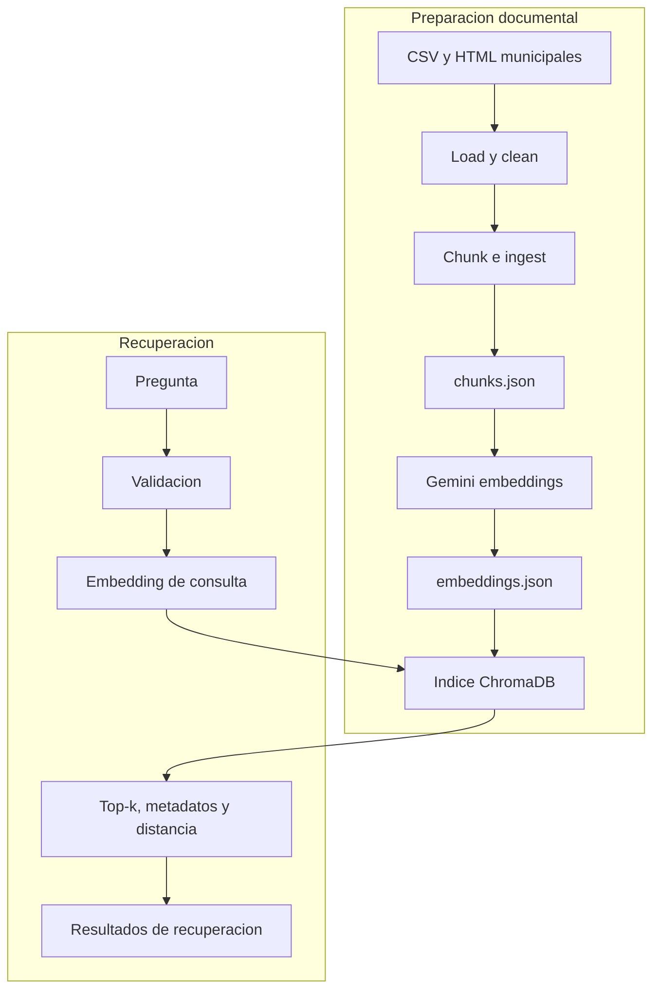

# 01. Pipeline documental y recuperación semántica

## 1. Objetivo

Definir el funcionamiento del pipeline documental y del sistema de recuperación semántica de ReciclaTÍA.

El sistema deberá recuperar evidencia documental relevante para las consultas del usuario, conservando la procedencia de la información y proporcionando resultados utilizables por la capa de generación y el sistema multiagente.

## 2. Principios arquitectónicos

El RAG funcionará de manera independiente de:

- FastAPI.
- Streamlit.
- LangGraph.
- PostgreSQL.
- Los mecanismos de autenticación y autorización.
- La gestión de sesiones de usuario.
- Las cuotas comerciales del servicio HTTP.

El corpus se preparará fuera del flujo conversacional.

Durante una consulta únicamente se ejecutarán las operaciones de recuperación necesarias para obtener evidencia relevante.

La incorporación de nuevas interfaces o mecanismos de persistencia no deberá modificar el comportamiento del pipeline documental ni del contrato de recuperación.

## 3. Arquitectura



La preparación documental y la recuperación semántica constituyen procesos diferenciados.

La generación de embeddings del corpus no formará parte de la ejecución ordinaria de las consultas del asistente.

## 4. Configuración

Los parámetros del pipeline documental y de recuperación se definirán en config.py.

| Parámetro | Valor |
|---|---|
| CHUNK_SIZE | 1000 caracteres |
| CHUNK_OVERLAP | 100 caracteres |
| EMBEDDING_MODEL | gemini-embedding-2 |
| EMBEDDING_DIMENSIONS | 768 |
| CHROMA_COLLECTION_NAME | residuos_madrid |
| CHROMA_DISTANCE | cosine |
| TOP_K | 5 |
| MAX_TOP_K_RETRIEVAL | 10 |
| MAX_PREGUNTA_CARACTERES | 500 |
| MAX_CONTEXTO_CARACTERES | 12000 |

Los parámetros deberán permanecer centralizados.

No se introducirán configuraciones independientes de recuperación en FastAPI o Streamlit que puedan modificar de manera inconsistente el comportamiento del RAG.

### 4.1. Compatibilidad de embeddings

El modelo de embeddings, las dimensiones vectoriales y la configuración de la colección deberán ser compatibles con el índice existente.

Los embeddings utilizados para representar las consultas deberán generarse mediante una configuración compatible con la utilizada para representar el corpus.

Un cambio del modelo de embeddings o de sus dimensiones requerirá actualizar los artefactos correspondientes y reconstruir el índice.

La modificación de la métrica de distancia requerirá reconstruir la colección con la configuración correspondiente.

## 5. Separación de responsabilidades

| Archivo | Responsabilidad |
|---|---|
| src/load.py | Lectura del corpus |
| src/clean.py | Limpieza y normalización de HTML y CSV |
| src/chunk.py | Fragmentación documental |
| src/ingest.py | Orquestación de la preparación de chunks |
| src/embed.py | Generación de vectores mediante Gemini |
| src/index.py | Construcción y gestión del índice ChromaDB |
| src/retrieve.py | Recuperación semántica top-k y filtros |
| src/retrieve_structured.py | Recuperación estructurada del catálogo y las paradas |

La capa de recuperación no será responsable de generar respuestas finales, gestionar conversaciones ni determinar permisos de acceso.

## 6. Preparación documental

### 6.1. Carga y limpieza

El pipeline deberá cargar los documentos del corpus autorizado y aplicar los mecanismos de limpieza y normalización correspondientes.

El procesamiento no deberá eliminar información necesaria para interpretar correctamente los residuos, sus destinos, las modalidades de recogida o los horarios publicados.

La procedencia y las características del corpus se definen en [09-datos-y-fuentes.md](09-datos-y-fuentes.md).

### 6.2. Fragmentación

Los documentos se dividirán en fragmentos conforme a los parámetros establecidos.

Los fragmentos deberán conservar los metadatos necesarios para identificar su procedencia.

La fragmentación deberá permitir recuperar información relevante sin perder las relaciones documentales necesarias para interpretar correctamente el contenido.

### 6.3. Generación de embeddings

Los fragmentos documentales se representarán mediante embeddings generados con el modelo configurado.

Los vectores deberán respetar las dimensiones establecidas.

No se mezclarán embeddings incompatibles dentro de una misma colección.

Los fallos durante la generación de embeddings deberán gestionarse como errores técnicos y no producir vectores simulados.

### 6.4. Artefactos documentales

El pipeline conservará los siguientes artefactos:

| Artefacto | Contenido |
|---|---|
| output/chunks.json | Fragmentos documentales y metadatos |
| output/embeddings.json | Representaciones vectoriales del corpus |
| output/chroma_db/ | Índice vectorial ChromaDB |

Los artefactos deberán ser coherentes entre sí.

El índice vectorial podrá reconstruirse utilizando los chunks y embeddings existentes, sin solicitar nuevamente la generación de embeddings al proveedor externo.

## 7. Recuperación semántica

### 7.1. Flujo de recuperación

La recuperación semántica comprenderá:

1. Validación de la pregunta.
2. Validación de los parámetros de recuperación.
3. Obtención del embedding de consulta, cuando no se haya proporcionado previamente.
4. Consulta a la colección ChromaDB.
5. Recuperación de los fragmentos relevantes.
6. Conservación de sus metadatos y distancias.
7. Aplicación de los filtros correspondientes.

Los mecanismos adicionales de recuperación y selección de evidencia se definen en [02-mejoras-retrieval.md](02-mejoras-retrieval.md).

### 7.2. Contrato público de búsqueda

```python
buscar_chunks_relevantes(
    pregunta: str,
    top_k: int = TOP_K,
    *,
    query_embedding: list[float] | None = None,
) -> list[dict]
```

La función deberá poder utilizarse independientemente de las interfaces del producto.

El parámetro query_embedding permitirá utilizar un vector previamente calculado, evitando una nueva llamada al proveedor de embeddings.

### 7.3. Contrato de resultados

Cada resultado conservará la siguiente estructura:

```python
{
    "text": "...",
    "distance": 0.0,
    "metadata": {
        "source": "...",
        "path": "..."
    },
}
```

Los metadatos podrán contener información adicional procedente del documento original.

No se eliminarán ni modificarán indebidamente los metadatos necesarios para identificar la fuente.

La función devolverá como máximo el número de resultados solicitado mediante top_k.

### 7.4. Interpretación de la distancia

La distancia representa la métrica utilizada por ChromaDB para comparar las representaciones vectoriales.

Con la métrica coseno configurada, una distancia menor indica una mayor similitud vectorial.

La distancia no representa:

- Una probabilidad de veracidad.
- Una garantía de relevancia documental.
- Una medida directa de confianza factual.
- Una garantía de que el fragmento sea suficiente para responder a la consulta.

La suficiencia de la evidencia deberá evaluarse mediante los mecanismos de recuperación y generación correspondientes.

## 8. Reglas de validación

### 8.1. Pregunta

La pregunta deberá:

- Ser una cadena válida.
- Contener información distinta de espacios en blanco.
- Respetar la longitud máxima establecida.

La validación deberá mantenerse aunque la pregunta haya sido previamente validada por FastAPI.

### 8.2. Parámetros de recuperación

top_k deberá ser un número entero comprendido entre 1 y MAX_TOP_K_RETRIEVAL.

El cliente no podrá incrementar los límites de recuperación por encima de los máximos establecidos.

Modificar top_k no deberá alterar el contenido del índice vectorial.

### 8.3. Embeddings

Cuando se proporcione un query_embedding, deberá comprobarse su compatibilidad con las dimensiones configuradas.

Los embeddings incompatibles o inválidos no deberán utilizarse para consultar la colección.

### 8.4. Colección vectorial

La colección deberá estar disponible y ser compatible con la configuración vigente.

Los resultados devueltos por ChromaDB deberán respetar el contrato de recuperación.

No se fabricarán fragmentos, distancias ni metadatos cuando la recuperación no pueda ejecutarse correctamente.

## 9. Integración con el asistente

El sistema multiagente utilizará el RAG mediante las herramientas y funciones públicas correspondientes.

LangGraph no implementará una segunda lógica de recuperación semántica.

FastAPI no consultará directamente ChromaDB para responder a las preguntas del asistente, evitando duplicar el flujo de recuperación.

Streamlit no tendrá acceso directo al índice vectorial.

Los mecanismos de integración se definen en:

- [05-tools.md](05-tools.md).
- [06-langgraph.md](06-langgraph.md).
- [11-arquitectura-mlops.md](11-arquitectura-mlops.md).

## 10. Recuperación estructurada

Las consultas que requieran información estructurada podrán utilizar los datos correspondientes del catálogo municipal y de las paradas documentadas.

La recuperación estructurada y la recuperación semántica constituyen mecanismos complementarios.

La información obtenida deberá conservar su procedencia y no podrá presentarse como exhaustiva cuando únicamente represente un subconjunto del corpus.

Las reglas de selección e interpretación de consultas estructuradas se definen en [04-consultas-generales.md](04-consultas-generales.md).

## 11. Reconstrucción y disponibilidad del índice

### 11.1. Reconstrucción desde artefactos existentes

El índice vectorial deberá poder reconstruirse a partir de:

- output/chunks.json.
- output/embeddings.json.

El comando público correspondiente será:

```bash
python main.py rag index --yes
```

Esta operación no deberá requerir la generación de nuevos embeddings ni credenciales de Gemini.

### 11.2. Reconstrucción completa

El pipeline deberá conservar la posibilidad de realizar una reconstrucción completa del corpus mediante:

```bash
python main.py rag index --full --yes
```

Esta operación incluirá la preparación documental y la generación de embeddings correspondientes.

Podrá consumir recursos del proveedor externo.

La reconstrucción completa no se ejecutará automáticamente durante las consultas ordinarias ni durante cada despliegue.

### 11.3. Actualización del índice

La actualización de los artefactos y del índice será una operación controlada.

La ejecución ordinaria del asistente utilizará un índice previamente preparado.

Las consultas no deberán modificar la colección vectorial.

### 11.4. Disponibilidad en producción

El índice ChromaDB deberá estar disponible en el entorno de ejecución del backend.

La imagen Docker incluirá los artefactos necesarios y un índice compatible reconstruido conforme a los requisitos de despliegue.

La reconstrucción del índice durante la construcción de la imagen no deberá depender de PostgreSQL ni de credenciales de Gemini.

La disponibilidad del índice será una condición necesaria para considerar operativo el servicio.

Las reglas de construcción, inicialización y comprobación de disponibilidad se definen en [16-despliegue.md](16-despliegue.md) y [15-robustez-observabilidad.md](15-robustez-observabilidad.md).

## 12. Gestión de errores

El sistema deberá distinguir entre:

| Situación | Naturaleza |
|---|---|
| Pregunta inválida | Error de validación |
| Parámetros de recuperación inválidos | Error de validación |
| Embedding incompatible | Error de validación |
| Colección no disponible | Error técnico |
| Fallo del proveedor de embeddings | Error técnico |
| Fallo durante la consulta vectorial | Error técnico |
| Respuesta de ChromaDB inválida | Error técnico |
| Ausencia de fragmentos relevantes | Resultado válido |
| Evidencia documental insuficiente | Resultado válido |

La ausencia de resultados relevantes no deberá confundirse con la imposibilidad técnica de ejecutar la recuperación.

Los errores del RAG deberán permitir que las capas superiores apliquen los mecanismos de recuperación o las respuestas controladas correspondientes.

El núcleo RAG no dependerá de excepciones HTTP específicas de FastAPI.

La transformación de los errores al contrato HTTP será responsabilidad del backend.

## 13. Eficiencia

La recuperación deberá evitar operaciones innecesarias.

En particular:

- No se generarán nuevamente los embeddings del corpus durante una consulta.
- No se reconstruirá el índice para cada petición.
- Se reutilizará el embedding de consulta cuando ya se encuentre disponible y sea compatible.
- No se recuperarán más fragmentos de los permitidos.
- No se realizarán consultas vectoriales adicionales cuando una ruta determinista pueda resolver correctamente la necesidad del usuario.
- No se realizarán operaciones de recuperación después de que una consulta haya sido rechazada por los mecanismos previos de admisión.

Las medidas de eficiencia no deberán comprometer la calidad de la evidencia recuperada.

## 14. Criterios de aceptación

- El pipeline documental puede ejecutarse independientemente del asistente multiagente.
- El sistema de recuperación puede utilizarse sin FastAPI ni PostgreSQL.
- Los documentos se procesan conforme a la configuración establecida.
- Los chunks conservan sus metadatos de procedencia.
- Los embeddings respetan el modelo y las dimensiones configurados.
- La colección ChromaDB utiliza la métrica establecida.
- Las consultas válidas devuelven fragmentos y fuentes utilizables cuando existe evidencia relevante.
- El número de resultados no supera el top_k solicitado.
- Los límites máximos de recuperación se respetan.
- Un embedding de consulta previamente calculado evita una nueva llamada al proveedor.
- Las consultas no modifican el índice vectorial.
- Las preguntas inválidas no generan resultados simulados.
- Los fallos técnicos no se presentan como ausencia de evidencia.
- La distancia vectorial no se interpreta como una probabilidad de veracidad.
- El índice puede reconstruirse a partir de los artefactos existentes.
- La reconstrucción desde artefactos existentes no requiere generar nuevos embeddings.
- El índice permanece disponible en el entorno desplegado.
- FastAPI y Streamlit no duplican la lógica de recuperación.
- La incorporación de la capa MLOps no altera injustificadamente el comportamiento del sistema RAG.

## 15. Especificaciones relacionadas

| Documento | Responsabilidad |
|---|---|
| [02-mejoras-retrieval.md](02-mejoras-retrieval.md) | Filtros, ranking y selección de evidencia |
| [03-generacion.md](03-generacion.md) | Generación de respuestas fundamentadas |
| [04-consultas-generales.md](04-consultas-generales.md) | Interpretación de consultas estructuradas |
| [05-tools.md](05-tools.md) | Exposición de funcionalidades mediante herramientas |
| [08-pruebas-y-validacion.md](08-pruebas-y-validacion.md) | Evaluación del sistema |
| [09-datos-y-fuentes.md](09-datos-y-fuentes.md) | Corpus y procedencia documental |
| [11-arquitectura-mlops.md](11-arquitectura-mlops.md) | Integración arquitectónica |
| [15-robustez-observabilidad.md](15-robustez-observabilidad.md) | Control de recursos y disponibilidad |
| [16-despliegue.md](16-despliegue.md) | Construcción y despliegue del índice |