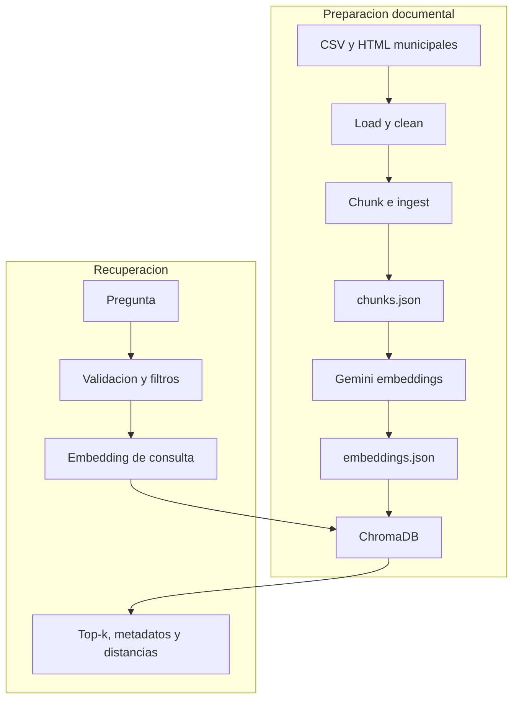

# 01. Pipeline documental y recuperación semántica

## 1. Objetivo

Definir el pipeline documental y el sistema de recuperación semántica de ReciclaTÍA.

El RAG deberá recuperar evidencia relevante, conservar su procedencia y permanecer independiente de LangGraph, FastAPI, Streamlit, PostgreSQL y los mecanismos de autenticación.

La preparación del corpus se realizará fuera del flujo conversacional.

## 2. Arquitectura



### 2.1. Responsabilidades

| Archivo | Responsabilidad |
|---|---|
| src/load.py | Carga documental |
| src/clean.py | Limpieza y normalización |
| src/chunk.py | Fragmentación |
| src/ingest.py | Preparación de chunks |
| src/embed.py | Generación de embeddings |
| src/index.py | Construcción y gestión del índice |
| src/retrieve.py | Recuperación semántica y filtros |
| src/retrieve_structured.py | Recuperación estructurada |
| src/input_validation.py | Validación compartida de consultas |

La recuperación no será responsable de generar respuestas finales ni gestionar conversaciones.

## 3. Configuración

Los parámetros se centralizarán en config.py.

| Parámetro | Valor |
|---|---|
| CHUNK_SIZE | 1000 caracteres |
| CHUNK_OVERLAP | 100 caracteres |
| EMBEDDING_MODEL | gemini-embedding-2 |
| EMBEDDING_DIMENSIONS | 768 |
| CHROMA_COLLECTION_NAME | residuos_madrid |
| CHROMA_DISTANCE | cosine |
| TOP_K | 5 |
| MAX_TOP_K_RETRIEVAL | 10 |
| MAX_PREGUNTA_CARACTERES | 500 |
| MAX_CONTEXTO_CARACTERES | 12000 |

FastAPI y Streamlit no mantendrán configuraciones alternativas de recuperación.

Los embeddings del corpus y de las consultas deberán utilizar configuraciones compatibles.

Modificar el modelo o las dimensiones requerirá regenerar los embeddings y reconstruir el índice. Modificar la métrica de distancia requerirá reconstruir la colección.

## 4. Preparación documental

### 4.1. Carga y fragmentación

Los documentos procederán exclusivamente del corpus autorizado en [09-datos-y-fuentes.md](09-datos-y-fuentes.md).

La limpieza y fragmentación deberán conservar:

- El significado de la información.
- Las relaciones entre residuos y destinos.
- Las condiciones y restricciones documentadas.
- Los metadatos de procedencia.

### 4.2. Embeddings

Los vectores se generarán mediante Gemini utilizando el modelo y las dimensiones configurados.

No se mezclarán embeddings incompatibles ni se generarán vectores simulados para ocultar fallos del proveedor.

### 4.3. Artefactos

| Artefacto | Contenido |
|---|---|
| output/chunks.json | Fragmentos y metadatos |
| output/embeddings.json | Vectores del corpus |
| output/chroma_db/ | Índice vectorial |

Los artefactos deberán mantener su coherencia documental y vectorial.

Las consultas ordinarias no modificarán estos recursos.

## 5. Recuperación semántica

### 5.1. Contrato público

Se conservará la firma existente:

```python
def buscar_chunks_relevantes(
    pregunta: str,
    top_k: int = TOP_K,
    *,
    query_embedding: list[float] | None = None,
) -> list[dict]:
    ...
```

query_embedding permitirá reutilizar un vector previamente calculado y evitar una nueva llamada a Gemini.

### 5.2. Flujo

1. Validar la pregunta y top_k.
2. Validar query_embedding cuando se proporcione.
3. Abrir la colección existente.
4. Construir los filtros correspondientes.
5. Comprobar si los filtros tienen registros.
6. Generar el embedding de consulta cuando sea necesario.
7. Consultar ChromaDB.
8. Validar y ordenar los resultados por distancia ascendente.

Cuando un filtro válido no tenga coincidencias, se devolverá una lista vacía sin generar el embedding de consulta.

Las estrategias adicionales se establecen en [02-mejoras-retrieval.md](02-mejoras-retrieval.md).

### 5.3. Contrato de resultados

```python
{
    "text": "...",
    "distance": 0.0,
    "metadata": {
        "source": "...",
        "path": "...",
    },
}
```

Se conservarán los metadatos adicionales del documento original.

El número de resultados no superará top_k.

### 5.4. Interpretación de la distancia

Con la métrica coseno, una distancia menor indica mayor similitud vectorial.

La distancia no constituye una probabilidad de veracidad ni garantiza la suficiencia documental.

La evaluación de evidencia corresponde a [03-generacion.md](03-generacion.md).

No se incorporarán nuevos umbrales de distancia ni mecanismos de reranking sin una evaluación previa que los justifique.

### 5.5. Recuperación estructurada

La recuperación semántica y estructurada constituyen mecanismos complementarios.

Los contratos de recuperación estructurada se desarrollan en [02-mejoras-retrieval.md](02-mejoras-retrieval.md).

La selección de estrategias según la consulta corresponde a [04-consultas-generales.md](04-consultas-generales.md).

## 6. Validación y errores

### 6.1. Entradas

La pregunta deberá ser una cadena no vacía de hasta 500 caracteres después de eliminar los espacios exteriores.

top_k deberá ser un entero entre 1 y MAX_TOP_K_RETRIEVAL, sin admitir valores booleanos.

Los embeddings deberán contener:

- Una lista de exactamente EMBEDDING_DIMENSIONS elementos.
- Valores numéricos finitos.
- Ningún valor booleano.

Las validaciones internas se conservarán independientemente de las realizadas por FastAPI.

### 6.2. Colección

La recuperación abrirá una colección existente.

No creará automáticamente una colección nueva cuando el índice no esté disponible.

Una colección inexistente, vacía o incompatible constituirá un fallo técnico de preparación o disponibilidad del índice.

### 6.3. Resultados

Se comprobará la correspondencia entre documentos, metadatos y distancias.

Los registros deberán contener texto utilizable, distancias numéricas finitas y metadatos compatibles con el contrato.

Los resultados técnicamente inválidos no deberán transformarse silenciosamente en búsquedas vacías.

### 6.4. Clasificación de resultados

| Situación | Tratamiento |
|---|---|
| Pregunta o parámetros inválidos | Error de validación |
| Embedding proporcionado inválido | Error de validación |
| Embedding inválido devuelto por Gemini | Error técnico |
| Colección inexistente o vacía | Error técnico |
| Fallo de Gemini o ChromaDB | Error técnico |
| Respuesta de recuperación inválida | Error técnico |
| Filtro válido sin coincidencias | Lista vacía válida |
| Búsqueda correctamente ejecutada sin resultados | Lista vacía válida |
| Evidencia insuficiente | Resultado semántico evaluado por generación |

El núcleo no utilizará excepciones HTTP.

La transformación de errores corresponderá al backend conforme a [12-contratos-http.md](12-contratos-http.md).

## 7. Reconstrucción del índice

### 7.1. Desde artefactos existentes

```bash
python main.py rag index --yes
```

Reconstruirá el índice utilizando los chunks y embeddings disponibles, sin generar nuevos vectores ni requerir credenciales de Gemini.

### 7.2. Reconstrucción completa

```bash
python main.py rag index --full --yes
```

Ejecutará la preparación documental y generación de embeddings correspondientes.

Esta operación podrá consumir recursos del proveedor.

### 7.3. Despliegue

La reconstrucción ordinaria durante la construcción de Docker utilizará los artefactos existentes.

No se regenerarán los embeddings del corpus durante cada consulta o despliegue.

La disponibilidad del índice se comprobará conforme a [15-robustez-observabilidad.md](15-robustez-observabilidad.md).

La estrategia de construcción se establece en [16-despliegue.md](16-despliegue.md).

## 8. Criterios de aceptación

- El pipeline y la recuperación funcionan independientemente de las interfaces.
- Los chunks conservan su procedencia.
- Los embeddings y la colección respetan la configuración.
- La recuperación conserva su contrato público.
- Los resultados respetan top_k y se ordenan por distancia.
- Los embeddings proporcionados se reutilizan.
- Los filtros sin coincidencias evitan llamadas innecesarias a Gemini.
- Los fallos técnicos se distinguen de las búsquedas legítimamente vacías.
- Las consultas no modifican el índice.
- El índice puede reconstruirse sin generar nuevos embeddings.
- No se introducen regresiones en el comportamiento del PB02.

Las pruebas correspondientes se establecen en [08-pruebas-y-validacion.md](08-pruebas-y-validacion.md).