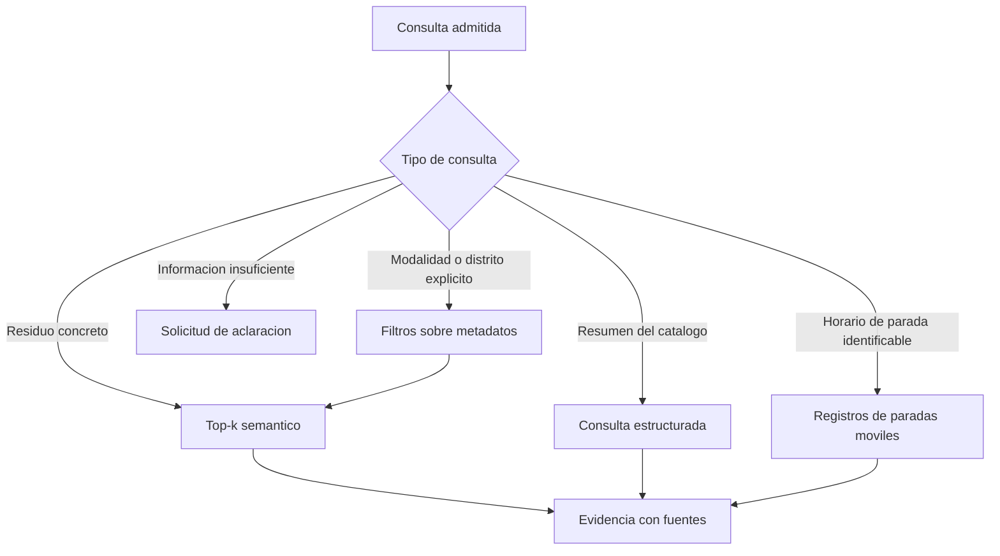

# 02. Recuperación filtrada y consultas estructuradas

## 1. Objetivo

Definir los mecanismos complementarios de recuperación que permiten obtener evidencia documental ajustada a las características de cada consulta.

La recuperación semántica deberá complementarse con filtros sobre metadatos y consultas estructuradas cuando la naturaleza de la petición lo requiera.

El objetivo es mejorar la pertinencia de los resultados sin comprometer la trazabilidad, la integridad documental ni el contrato público del RAG.

## 2. Principios

- Conservación de ChromaDB como sistema de almacenamiento vectorial.
- Utilización de los metadatos existentes.
- Separación entre recuperación semántica y recuperación estructurada.
- Aplicación de filtros fundamentados en la consulta.
- Preservación de la procedencia documental.
- Ausencia de sustituciones silenciosas de resultados.
- Independencia respecto a la interfaz y la capa HTTP.
- Prevención de llamadas innecesarias a servicios externos.

La similitud semántica no garantiza por sí sola que un documento corresponda a la modalidad, distrito o contexto solicitado.

## 3. Estrategias de recuperación

La estrategia de recuperación deberá seleccionarse según las características de la consulta.

Las consultas estructuradas no requerirán necesariamente una búsqueda vectorial.

No se sustituirá ChromaDB por un motor de búsqueda léxico ni se introducirá un nuevo sistema de ranking durante esta fase del desarrollo.

Los criterios de interpretación de las consultas se definen en [04-consultas-generales.md](04-consultas-generales.md).

## 4. Recuperación filtrada

### 4.1. Metadatos

La recuperación podrá restringirse mediante los metadatos existentes en ChromaDB.

Los principales campos utilizados serán:

- document_type.
- district.
- source.

| Petición | Metadato |
|---|---|
| Punto limpio fijo | document_type=punto_limpio_fijo |
| Punto limpio móvil | document_type=punto_limpio_movil |
| Punto limpio móvil de 24 horas | document_type=punto_limpio_movil_24h |
| Punto limpio de proximidad | document_type=punto_limpio_proximidad |
| Distrito municipal reconocido | district |
| Relaciones residuo-destino | source=tipos_residuos.csv |

La procedencia y estructura de los metadatos se definen en [09-datos-y-fuentes.md](09-datos-y-fuentes.md).

### 4.2. Identificación de modalidad

El sistema deberá reconocer las modalidades de recogida expresadas inequívocamente en la consulta.

Las expresiones específicas deberán evaluarse antes que las expresiones genéricas.

Por ejemplo, una consulta sobre un punto limpio móvil de 24 horas no deberá interpretarse automáticamente como una consulta sobre cualquier punto limpio móvil.

Las modalidades de recogida no se considerarán intercambiables.

### 4.3. Identificación de distrito

Los filtros por distrito se aplicarán cuando la consulta permita identificar inequívocamente un distrito municipal reconocido.

No se deducirá automáticamente un distrito a partir de un barrio, una dirección ambigua o una ubicación que no haya sido identificada correctamente.

Cuando la identificación resulte insuficiente para satisfacer la consulta, deberá solicitarse una aclaración o indicarse la limitación correspondiente.

### 4.4. Combinación de filtros

Los filtros de modalidad y distrito podrán combinarse cuando ambos se encuentren identificados de forma inequívoca.

La combinación deberá conservar todas las restricciones aplicables a la consulta.

No se eliminará una restricción únicamente para aumentar el número de resultados recuperados.

### 4.5. Ausencia de resultados

Una búsqueda filtrada puede no devolver resultados.

La ausencia de resultados no autoriza a sustituirlos silenciosamente por documentos correspondientes a:

- Otra modalidad de recogida.
- Otro distrito.
- Otra instalación.
- Otra fuente incompatible con la consulta.

El sistema deberá conservar la distinción entre ausencia de resultados compatibles, evidencia insuficiente y fallo técnico.

## 5. Consultas estructuradas

### 5.1. Finalidad

Las consultas estructuradas permitirán recuperar información cuya interpretación no pueda resolverse adecuadamente mediante una selección arbitraria de los fragmentos semánticamente más próximos.

Se utilizarán especialmente para:

- Consultas generales sobre el catálogo de residuos.
- Relaciones entre residuos y destinos.
- Agrupaciones por destinos documentados.
- Recuentos de registros.
- Consultas sobre paradas de puntos limpios móviles.
- Horarios asociados a instalaciones identificables.

### 5.2. Independencia de top-k

Las consultas que requieran recorrer o agregar un conjunto de registros no deberán limitarse artificialmente al valor TOP_K de la recuperación semántica.

Una selección parcial de documentos no podrá presentarse como una descripción exhaustiva del conjunto.

Los resultados deberán corresponder a los registros pertinentes disponibles en el corpus.

### 5.3. Procedencia

Las consultas estructuradas deberán conservar la identificación de las fuentes y los registros utilizados.

Las operaciones de filtrado, agrupación y agregación no deberán generar información que no pueda justificarse mediante los datos de origen.

## 6. Catálogo de residuos

### 6.1. Fuente documental

El archivo tipos_residuos.csv contiene relaciones entre residuos y destinos de depósito.

No constituye por sí mismo una taxonomía universal ni un inventario necesariamente exhaustivo de todos los residuos existentes.

Las respuestas deberán reflejar el alcance real de los registros disponibles.

### 6.2. Agrupaciones

Las consultas generales sobre categorías y destinos podrán resolverse mediante agrupaciones de los registros disponibles.

No se crearán categorías supuestamente oficiales basándose únicamente en similitudes lingüísticas o inferencias del modelo.

Las agrupaciones deberán preservar las relaciones documentadas entre los residuos y sus destinos.

### 6.3. Recuentos

Las cantidades deberán calcularse a partir de los registros correspondientes.

No se establecerán recuentos como constantes independientes de los datos del corpus.

El resultado deberá indicar qué conjunto de registros se ha utilizado para realizar el cálculo.

### 6.4. Ejemplos

Los ejemplos utilizados para describir categorías, residuos o destinos deberán estar respaldados por los registros disponibles.

No se inventarán ejemplos para completar artificialmente una agrupación.

### 6.5. Consultas sobre residuos concretos

Las consultas relativas a un residuo individual deberán utilizar la estrategia que permita obtener evidencia adecuada para ese objeto.

No se sustituirá una consulta específica por un resumen general del catálogo cuando este no permita responder correctamente.

## 7. Paradas móviles y horarios

### 7.1. Identificación de registros

Los horarios de los puntos limpios móviles pertenecen a paradas concretas.

La recuperación estructurada podrá utilizar los siguientes atributos cuando estén disponibles:

- Dirección.
- Distrito.
- Día.
- Modalidad.
- Franja horaria.

### 7.2. Asociación entre parada y horario

Cada horario deberá mantenerse asociado a la parada de la que procede.

No se combinarán horarios de instalaciones distintas como si correspondieran a una única instalación.

La información recuperada deberá permitir identificar correctamente la procedencia de cada horario.

### 7.3. Consultas ambiguas

Cuando una consulta no permita identificar la parada o instalación necesaria, deberá solicitarse información adicional.

La aclaración podrá requerir:

- Calle.
- Dirección.
- Nombre de la parada.
- Distrito.
- Modalidad de recogida.

No se seleccionará arbitrariamente una instalación para responder a una consulta ambigua.

### 7.4. Interpretación temporal

La recuperación de horarios documentados no constituye una comprobación de apertura física en tiempo real.

La interpretación de los horarios y su comparación con la hora de Madrid se definen en [04-consultas-generales.md](04-consultas-generales.md).

La búsqueda geográfica por coordenadas constituye una operación independiente, definida en [05-tools.md](05-tools.md).

## 8. Separación de responsabilidades

| Archivo | Responsabilidad |
|---|---|
| src/retrieve.py | Recuperación semántica y aplicación de filtros |
| src/retrieve_structured.py | Consultas estructuradas, agrupaciones y recuperación de registros |
| src/rag_intents.py | Identificación de consultas que requieren estrategias específicas |
| src/rag.py | Coordinación de las estrategias y construcción del resultado público |
| src/generate.py | Generación de respuestas fundamentadas cuando corresponda |

La capa de generación no consultará directamente ChromaDB.

La capa de recuperación no determinará por sí sola la suficiencia factual de una respuesta.

La presencia de una fuente recuperada no garantiza automáticamente que una recomendación sea correcta.

## 9. Integración con la arquitectura MLOps

Los mecanismos de recuperación filtrada y estructurada permanecerán dentro del núcleo RAG.

FastAPI utilizará las funciones públicas del asistente sin implementar una segunda estrategia de recuperación.

Streamlit no realizará consultas directas a ChromaDB ni interpretará independientemente los metadatos del corpus para construir recomendaciones.

Las reglas de autenticación, autorización y consumo se aplicarán en la capa correspondiente antes de admitir las operaciones del asistente.

El funcionamiento independiente del RAG no requerirá una conexión a PostgreSQL ni una sesión de usuario.

## 10. Gestión de resultados y errores

| Situación | Comportamiento esperado |
|---|---|
| Resultados compatibles con los filtros | Devolver evidencia y metadatos |
| Ausencia de resultados compatibles | Comunicar ausencia de evidencia adecuada |
| Modalidad ambigua | Solicitar aclaración cuando sea necesaria |
| Distrito no identificable | No aplicar restricciones geográficas arbitrarias |
| Parada no identificable | Solicitar información adicional |
| Catálogo parcialmente documentado | Indicar el alcance de los registros disponibles |
| Fallo durante la recuperación | Comunicar un error técnico |
| Colección vectorial no disponible | Comunicar un error técnico |

Las respuestas vacías o la ausencia de evidencia suficiente no deberán confundirse con un fallo de infraestructura.

La transformación de errores técnicos al contrato HTTP será responsabilidad de FastAPI.

El núcleo RAG conservará sus propios contratos de entrada y salida.

## 11. Eficiencia

El sistema deberá seleccionar la estrategia de recuperación adecuada evitando operaciones innecesarias.

En particular:

- No se realizará una búsqueda semántica cuando una consulta estructurada sea suficiente.
- No se generarán embeddings de consulta cuando la estrategia seleccionada no los necesite.
- No se ejecutarán búsquedas incompatibles con las restricciones identificadas.
- No se repetirán consultas sin una justificación funcional.
- No se utilizarán llamadas al modelo de lenguaje para sustituir operaciones deterministas de filtrado, agrupación o recuento.
- No se ejecutarán mecanismos de recuperación después de que una consulta haya sido rechazada por los controles previos de admisión del servicio HTTP.

Las optimizaciones deberán conservar la calidad y la trazabilidad de la evidencia.

## 12. Validación

Las pruebas deberán contemplar:

- Recuperación semántica sin filtros adicionales.
- Recuperación filtrada por modalidad.
- Recuperación filtrada por distrito.
- Combinación de filtros compatibles.
- Diferenciación entre puntos móviles ordinarios y móviles de 24 horas.
- Consultas ambiguas.
- Búsquedas sin resultados.
- Consultas generales sobre el catálogo.
- Agrupaciones y recuentos de residuos.
- Recuperación de horarios asociados a paradas concretas.
- Conservación de metadatos.
- Ausencia de sustituciones silenciosas.
- Preservación del contrato público del RAG.

La evaluación de recuperación deberá distinguir:

- Coincidencia de fuente mediante hit@k.
- Correspondencia de modalidad.
- Correspondencia de distrito.
- Ausencia de resultados.
- Pertinencia real de la evidencia.

La coincidencia de una fuente no se considerará por sí sola una garantía de corrección factual.

Los mecanismos generales de evaluación se definen en [08-pruebas-y-validacion.md](08-pruebas-y-validacion.md).

## 13. Criterios de aceptación

- La recuperación utiliza los metadatos disponibles cuando la consulta lo requiere.
- Los filtros se aplican únicamente cuando las restricciones son identificables.
- Las modalidades de recogida se mantienen diferenciadas.
- Los filtros de modalidad y distrito pueden combinarse correctamente.
- No se sustituyen silenciosamente resultados de una modalidad o distrito por otros incompatibles.
- Las consultas estructuradas no se limitan arbitrariamente al top-k semántico.
- Las agrupaciones conservan la procedencia documental.
- Los recuentos se calculan a partir de los registros disponibles.
- Los ejemplos están respaldados por los datos del corpus.
- Los horarios permanecen asociados a sus instalaciones correspondientes.
- Las consultas ambiguas reciben aclaraciones cuando son necesarias.
- La ausencia de resultados se distingue de un fallo técnico.
- No se generan embeddings cuando la estrategia de recuperación no los necesita.
- Se conserva el contrato público del RAG.
- FastAPI y Streamlit no duplican la lógica de recuperación.
- La incorporación de la capa MLOps no altera injustificadamente los mecanismos existentes.

## 14. Especificaciones relacionadas

| Documento | Responsabilidad |
|---|---|
| [01-retrieval.md](01-retrieval.md) | Pipeline documental y recuperación semántica |
| [03-generacion.md](03-generacion.md) | Generación y fundamentación de respuestas |
| [04-consultas-generales.md](04-consultas-generales.md) | Interpretación de intenciones y consultas |
| [05-tools.md](05-tools.md) | Herramientas y operaciones autorizadas |
| [08-pruebas-y-validacion.md](08-pruebas-y-validacion.md) | Evaluación y pruebas |
| [09-datos-y-fuentes.md](09-datos-y-fuentes.md) | Corpus, metadatos y procedencia |
| [11-arquitectura-mlops.md](11-arquitectura-mlops.md) | Separación arquitectónica |
| [15-robustez-observabilidad.md](15-robustez-observabilidad.md) | Control de recursos y admisión de consultas |