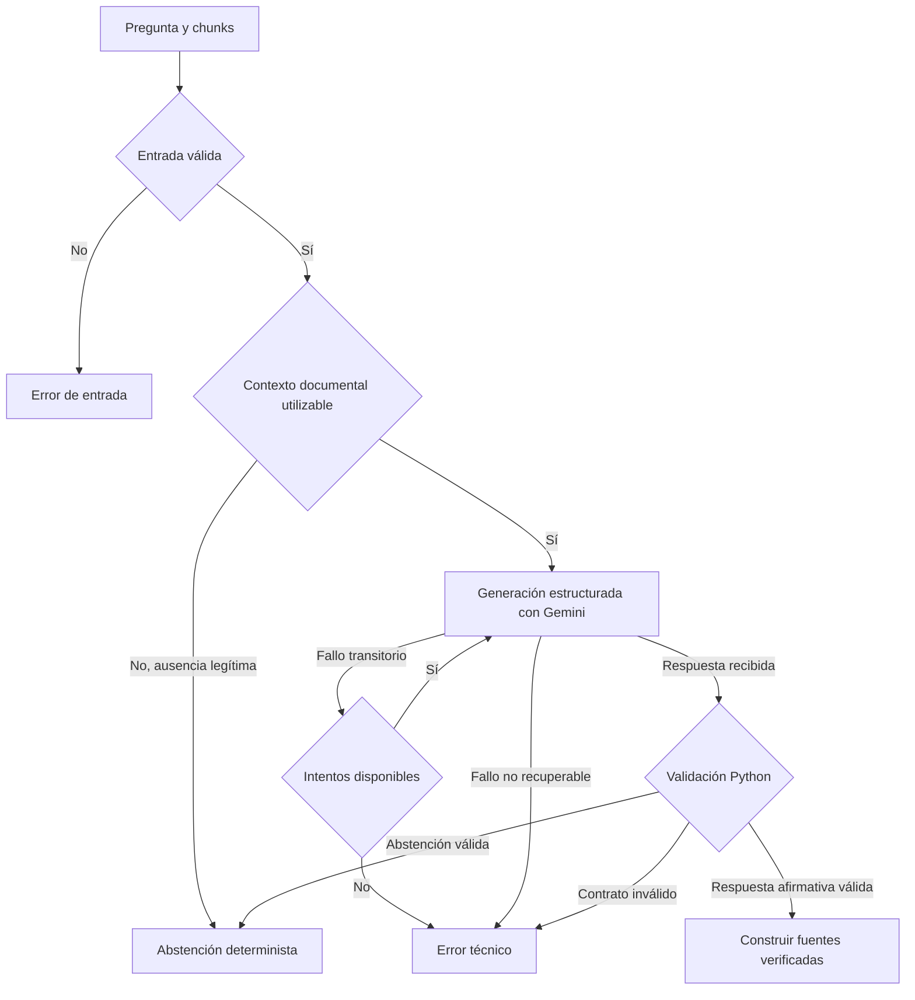

# 03. Generación de respuestas y control de evidencia

## 1. Objetivo

Definir los mecanismos de generación de respuestas fundamentadas en evidencia documental y los controles necesarios para garantizar su calidad, trazabilidad y coherencia.

La generación deberá transformar la información recuperada en respuestas comprensibles sin introducir afirmaciones, destinos, horarios o condiciones que no estén respaldados por la evidencia disponible.

La incorporación de la arquitectura MLOps deberá preservar los contratos y mecanismos de generación desarrollados durante el PB02.

No se reescribirá innecesariamente el núcleo RAG.

## 2. Principios

- Fundamentación documental de las recomendaciones.
- Utilización exclusiva de fuentes autorizadas.
- Conservación de la procedencia de la información.
- Validación determinista de las referencias.
- Abstención ante evidencia insuficiente.
- Diferenciación entre abstenciones y errores técnicos.
- Protección frente a instrucciones maliciosas.
- Reducción de llamadas innecesarias al modelo de lenguaje.
- Independencia respecto a las interfaces del producto.
- Separación entre generación documental y orquestación multiagente.
- Conservación del HITL obligatorio en LangGraph.

La generación no deberá compensar deficiencias de recuperación mediante información inventada o conocimiento general no contrastado.

La validación estructural de una respuesta no constituirá por sí sola una garantía de su exactitud factual.

## 3. Responsabilidad de los módulos

### 3.1. Generación

src/generate.py será responsable de:

- Validar la pregunta recibida.
- Preparar el contexto documental.
- Asignar identificadores a los fragmentos incluidos.
- Solicitar una respuesta estructurada a Gemini.
- Aplicar los mecanismos autorizados de recuperación ante fallos transitorios.
- Coordinar la validación del resultado.
- Gestionar el cliente de inferencia cuando corresponda.

### 3.2. Validación

src/generation_validation.py continuará siendo responsable de:

- Interpretar la salida estructurada de Gemini.
- Validar los campos de respuesta.
- Validar los motivos de abstención.
- Normalizar los marcadores de citas.
- Comprobar la correspondencia entre citas y contexto.
- Construir las referencias documentales verificadas.
- Comunicar incumplimientos del contrato mediante excepciones controladas.

### 3.3. Coordinación RAG

src/rag.py continuará siendo responsable de coordinar:

- Interpretación de la consulta.
- Recuperación semántica.
- Recuperación estructurada.
- Generación documental.
- Respuestas deterministas.
- Abstenciones.
- Empaquetado del resultado.
- Métricas de ejecución.

### 3.4. Responsabilidades excluidas

La capa de generación no será responsable de:

- Preparar o indexar documentos.
- Consultar directamente ChromaDB.
- Seleccionar especialistas.
- Ejecutar herramientas de LangGraph.
- Gestionar conversaciones.
- Generar identificadores de aprobación.
- Resolver HITL.
- Autenticar usuarios.
- Aplicar cuotas comerciales.
- Persistir mensajes en PostgreSQL.
- Implementar contratos HTTP.
- Gestionar Streamlit.

La generación deberá permanecer disponible independientemente de FastAPI, PostgreSQL y LangGraph.

## 4. Flujo de generación



La generación mediante Gemini únicamente se ejecutará cuando exista contexto documental utilizable y no proceda resolver previamente la consulta mediante mecanismos deterministas.

La ausencia legítima de contexto no deberá confundirse con una recuperación documental técnicamente fallida.

Los mecanismos de reintento deberán respetar los límites de ejecución establecidos.

## 5. Contratos

### 5.1. Contrato público de generación

Se conservará la firma existente:

```python
def generar_respuesta(
    pregunta: str,
    chunks: list[dict],
    *,
    client=None,
) -> dict:
    ...
```

| Parámetro | Responsabilidad |
|---|---|
| pregunta | Consulta que debe responderse |
| chunks | Fragmentos recuperados y sus metadatos |
| client | Cliente de Gemini opcional para ejecución controlada y pruebas |

La pregunta deberá respetar las validaciones existentes y el límite de 500 caracteres.

chunks deberá ser una lista.

No se introducirán parámetros relacionados con usuarios, API keys, cuotas comerciales, conversaciones HTTP ni persistencia.

### 5.2. Gestión del cliente de Gemini

Cuando client=None, el módulo podrá crear su propio cliente mediante los mecanismos existentes.

El cliente creado por la propia función deberá cerrarse al finalizar la operación, incluso cuando se produzcan excepciones.

Cuando el cliente haya sido proporcionado externamente, su ciclo de vida corresponderá al componente que lo haya creado.

Se conservará esta distinción para facilitar las pruebas y evitar cierres indebidos de clientes compartidos.

### 5.3. Contrato de salida de Gemini

El modelo devolverá una estructura JSON compatible con el esquema existente:

```json
{
    "respuesta": "Respuesta fundamentada [C1]",
    "abstencion": false,
    "motivo": "ninguno",
    "citas": ["C1"]
}
```

| Campo | Tipo |
|---|---|
| respuesta | str |
| abstencion | bool |
| motivo | str |
| citas | list[str] |

El atributo respuesta deberá contener una cadena no vacía.

Cuando abstencion=False:

- motivo deberá ser ninguno.
- citas deberá contener las referencias utilizadas.
- Los identificadores deberán existir en el contexto proporcionado.
- Las citas deberán corresponder a los marcadores presentes en la respuesta.

Cuando abstencion=True:

- motivo deberá pertenecer al conjunto de motivos semánticos autorizados.
- citas deberá ser una lista vacía.
- La respuesta no deberá presentar recomendaciones documentales no fundamentadas.

El modelo no será responsable de construir las fuentes finales ni de proporcionar rutas o enlaces oficiales.

### 5.4. Resultado validado del generador

Se conservará el contrato público existente:

```python
{
    "respuesta": "Respuesta fundamentada [C1]",
    "abstencion": False,
    "motivo": None,
    "fuentes": [
        {
            "chunk_id": "C1",
            "source": "tipos_residuos.csv",
            "path": "data/raw/csv/tipos_residuos.csv",
        }
    ],
}
```

| Campo | Responsabilidad |
|---|---|
| respuesta | Contenido generado o respuesta de abstención |
| abstencion | Indica si el sistema se abstiene de proporcionar una respuesta fundamentada |
| motivo | Motivo semántico de abstención o None |
| fuentes | Referencias documentales verificadas |

El valor ninguno proporcionado por Gemini se transformará en None cuando la respuesta sea afirmativa y válida.

Las fuentes se construirán mediante Python a partir de los metadatos correspondientes a las citas verificadas.

### 5.5. Resultado de abstención

Ejemplo:

```python
{
    "respuesta": (
        "No puedo responder con la información "
        "disponible en los documentos."
    ),
    "abstencion": True,
    "motivo": "evidencia_insuficiente",
    "fuentes": [],
}
```

La ausencia de fuentes será coherente con el contrato de abstención existente.

Cuando el motivo sea ambiguedad, podrá conservarse una solicitud concreta de aclaración.

No se atribuirán fuentes que no hayan sido utilizadas.

### 5.6. Contrato RAG de nivel superior

Se conservará la firma existente de src.rag.responder():

```python
def responder(
    pregunta: str,
    *,
    top_k: int = TOP_K,
    query_embedding: list[float] | None = None,
    client: Any = None,
) -> dict[str, Any]:
    ...
```

Su resultado conservará:

- pregunta.
- respuesta.
- abstencion.
- motivo.
- fuentes.
- chunks.
- metricas.

La función podrá utilizar recuperación semántica o estructurada según las necesidades de la consulta.

No todas las consultas RAG requerirán ejecutar generar_respuesta().

### 5.7. Separación de contratos

| Contrato | Responsabilidad |
|---|---|
| Salida de Gemini | Resultado estructurado todavía no validado |
| Resultado de generar_respuesta() | Respuesta documental validada |
| Resultado de responder() | Respuesta RAG y datos de recuperación |
| ResultadoTool | Resultado interno de una herramienta |
| EstadoGrafo | Estado operativo del agente |
| EstadoProducto | Estado interno utilizado por el orquestador |
| AskOut | Respuesta pública HTTP |
| ErrorOut | Comunicación pública de errores HTTP |

Los contratos no deberán utilizarse indistintamente.

La transformación entre capas deberá conservar la información necesaria sin exponer estructuras internas innecesarias.

## 6. Preparación del contexto

### 6.1. Validación de fragmentos

Los fragmentos utilizados durante la generación deberán contener:

- Una estructura válida.
- Texto no vacío.
- Metadatos utilizables.
- Un identificador de fuente válido.

Se conservarán los controles existentes de _preparar_contexto().

No se asignarán referencias a fragmentos descartados.

El contenido documental no deberá introducir instrucciones ejecutables.

### 6.2. Presupuesto de recuperación y contexto

La preparación del contexto respetará:

- TOP_K.
- MAX_CONTEXTO_CARACTERES.

Los valores se definen en [01-retrieval.md](01-retrieval.md).

Se conservará el mecanismo existente de incorporación de fragmentos completos dentro del presupuesto disponible.

No se incorporarán fragmentos adicionales que superen dicho presupuesto.

La reducción del contexto deberá preservar, cuando corresponda:

- Identificación de fuentes.
- Relaciones entre residuos y destinos.
- Condiciones de recogida.
- Excepciones.
- Modalidades de recogida.
- Restricciones geográficas.
- Horarios publicados.

No deberán alterarse fragmentos de manera que se modifique el significado de la información documental.

### 6.3. Identificación de fragmentos

Los fragmentos incorporados recibirán identificadores consecutivos:

- C1.
- C2.
- C3.
- Sucesivos, cuando corresponda.

Los identificadores tendrán alcance local dentro de la llamada de generación.

No serán identificadores persistentes de ChromaDB ni identificadores globales del corpus.

Solo se asignarán identificadores a fragmentos realmente incluidos en el contexto.

### 6.4. Construcción del mapa de referencias

Se conservará el mapa de referencias utilizado por la validación posterior.

Cada identificador permitirá recuperar:

- chunk_id.
- source.
- path, cuando esté disponible.

La información procederá de los metadatos de los fragmentos correspondientes.

La ausencia de una ruta opcional no autorizará inventarla.

### 6.5. Ausencia legítima de contexto

Cuando no exista contexto documental utilizable, el generador podrá devolver una abstención con motivo sin_contexto.

No se invocará a Gemini únicamente para redactar esta abstención.

Se conservará el comportamiento independiente del generador ante listas vacías y fragmentos descartados conforme a sus validaciones actuales.

### 6.6. Fallos de recuperación

La capa RAG y los mecanismos de recuperación deberán distinguir entre:

- Una recuperación correctamente ejecutada sin resultados relevantes.
- Una entrada independiente cuyos fragmentos no resulten utilizables.
- Una recuperación que haya fallado técnicamente.
- Una respuesta de recuperación incompatible con su contrato.

No se utilizará una lista vacía para representar silenciosamente una excepción de ChromaDB o del proveedor de embeddings.

Cuando la recuperación produzca datos estructuralmente inválidos debido a un fallo técnico, deberá tratarse dicho fallo en la capa correspondiente.

La política de descarte de fragmentos del generador no sustituirá la validación del contrato de recuperación.

### 6.7. Separación entre datos e instrucciones

Los fragmentos recuperados se presentarán al modelo como datos de referencia.

El contenido documental no podrá modificar:

- Las instrucciones del sistema.
- El dominio del producto.
- Los permisos.
- Las herramientas disponibles.
- Los límites internos.
- Las reglas de generación.
- La procedencia de la información.

## 7. Política de generación

### 7.1. Fundamentación documental

Las recomendaciones sobre destinos de residuos deberán estar respaldadas por la evidencia documental autorizada.

No se utilizará exclusivamente el conocimiento general del modelo para determinar destinos municipales.

Las condiciones específicas, excepciones y restricciones deberán conservarse cuando resulten relevantes.

### 7.2. Cobertura geográfica

Las respuestas respetarán el ámbito geográfico de Madrid ciudad.

No se extrapolarán las normas, destinos ni servicios municipales documentados a otros municipios.

Las consultas inequívocamente fuera de la cobertura geográfica podrán resolverse mediante una abstención determinista.

### 7.3. Claridad

Las respuestas deberán ser:

- Comprensibles.
- Coherentes con la pregunta.
- Proporcionadas a la información solicitada.
- Explícitas respecto a sus limitaciones.
- Redactadas en español.

La simplificación no deberá eliminar condiciones necesarias para interpretar correctamente la recomendación.

### 7.4. Ambigüedad

Cuando falte una característica decisiva para determinar el destino adecuado de un residuo, deberá solicitarse una aclaración.

No se asumirá arbitrariamente:

- Material.
- Composición.
- Estado del residuo.
- Tamaño.
- Modalidad de recogida.
- Ubicación.

La necesidad de aclaración dependerá de si la información ausente puede modificar sustancialmente la respuesta.

### 7.5. Información temporal

Los horarios deberán interpretarse conforme a la documentación disponible.

No se afirmará que una instalación se encuentra físicamente abierta únicamente porque disponga de un horario publicado.

Las reglas de interpretación temporal se establecen en [04-consultas-generales.md](04-consultas-generales.md).

### 7.6. Información contradictoria

Cuando existan contradicciones relevantes en la evidencia, el sistema deberá:

- Identificar las limitaciones.
- Conservar las condiciones documentadas.
- Solicitar aclaraciones cuando puedan resolver la consulta.
- Abstenerse cuando no sea posible fundamentar una recomendación.

No se resolverán contradicciones mediante afirmaciones inventadas.

### 7.7. Restricción de fuentes

Gemini no realizará búsquedas abiertas en Internet.

No se habilitarán funcionalidades de grounding mediante buscadores externos.

La generación documental utilizará exclusivamente el contexto procedente del corpus autorizado.

La síntesis multiagente podrá integrar adicionalmente:

- Resultados de ArcGIS.
- Resultados del respaldo geográfico local.
- Referencias normativas previamente autorizadas.
- Observaciones visuales.
- Información temporal.

Estas evidencias deberán obtenerse mediante los mecanismos establecidos en [05-tools.md](05-tools.md).

No se consultarán proveedores documentales o geográficos adicionales.

## 8. Referencias y citas

### 8.1. Identificadores

Las referencias incluidas en una respuesta generada deberán corresponder a identificadores existentes en el contexto de la llamada.

No se admitirán identificadores inventados por el modelo.

### 8.2. Normalización

Se conservará el mecanismo existente de normalización de citas agrupadas.

Por ejemplo:

```text
[C1, C2]
```

Podrá normalizarse como:

```text
[C1] [C2]
```

La normalización no deberá alterar el contenido argumentativo de la respuesta.

No se aceptarán identificadores malformados como referencias válidas.

### 8.3. Validación determinista

src/generation_validation.py comprobará:

- Que el resultado sea JSON interpretable.
- Que su estructura sea válida.
- Que respuesta sea una cadena no vacía.
- Que abstencion sea un booleano.
- Que motivo respete el contrato.
- Que citas sea una lista.
- Que los identificadores citados existan.
- Que los marcadores de la respuesta coincidan con el campo citas.
- Que las abstenciones no atribuyan referencias incompatibles con su contrato.

La validación no dependerá exclusivamente del modelo de lenguaje.

### 8.4. Construcción de fuentes

Las fuentes se construirán mediante Python a partir del mapa de referencias.

Se conservará la eliminación de citas duplicadas dentro de una misma llamada, manteniendo el orden correspondiente.

No se confiará en nombres de documentos, rutas o URL generados libremente por Gemini.

### 8.5. Ámbito de las citas

Los identificadores C1, C2 y sucesivos serán locales a cada llamada RAG.

Dos consultas realizadas durante un mismo turno podrán contener identificadores iguales asociados a fragmentos diferentes.

Durante la integración multiagente se conservará, cuando esté disponible:

- El rol del especialista.
- La herramienta correspondiente.
- El identificador de llamada.
- La referencia documental original.

No se eliminarán fuentes únicamente porque coincida su chunk_id.

### 8.6. Ambigüedad en respuestas integradas

La repetición de identificadores entre llamadas constituye una limitación potencial al combinar respuestas de diferentes especialistas.

Durante la validación deberá comprobarse que la síntesis no atribuye una afirmación a una referencia perteneciente a otra llamada.

Los resultados públicos conservarán la información de procedencia acordada.

No se incorporará inicialmente un nuevo sistema global de identificadores documentales ni se modificará la estructura fundamental del corpus.

Cuando una asociación documental no pueda justificarse, no deberá presentarse como una cita verificada.

### 8.7. Referencias normativas

Las referencias normativas incorporadas de forma determinista deberán proceder de documentación municipal previamente autorizada.

Se conservarán mecanismos existentes como FUENTE_HORARIO_VIDRIO.

Estas referencias no implicarán realizar búsquedas externas durante la consulta.

### 8.8. Transformación a FuenteOut

La capa de servicios transformará las referencias internas conforme al contrato FuenteOut.

Los campos públicos serán:

- chunk_id.
- source.
- url.
- rol.
- id_llamada.

url podrá contener una URL oficial autorizada o None.

Las URL oficiales se obtendrán mediante el catálogo estático de procedencia definido en [09-datos-y-fuentes.md](09-datos-y-fuentes.md).

No se solicitará a Gemini que construya dichos enlaces.

La transformación no realizará peticiones HTTP adicionales.

No se expondrán rutas locales ni estructuras internas innecesarias.

### 8.9. Limitaciones de la validación

La existencia de una referencia válida no garantiza que todas las afirmaciones estén respaldadas por su contenido.

Se distinguirá entre:

- Validez estructural.
- Correspondencia de identificadores.
- Procedencia documental.
- Pertinencia de la evidencia.
- Exactitud factual.
- Suficiencia de la respuesta.

La evaluación factual se realizará mediante los mecanismos definidos en [08-pruebas-y-validacion.md](08-pruebas-y-validacion.md).

## 9. Control de evidencia

### 9.1. Clasificación

La orquestación multiagente conservará los estados:

| Estado | Significado |
|---|---|
| suficiente | La evidencia permite responder a los aspectos requeridos |
| parcial | La evidencia permite resolver únicamente determinados aspectos |
| insuficiente | La evidencia no permite fundamentar la respuesta solicitada |

El contrato público del generador RAG no incorporará un nuevo campo estado_evidencia.

Esta clasificación corresponde a la integración del agente.

### 9.2. Evidencia suficiente

Una recomendación podrá presentarse cuando la información disponible permita fundamentarla.

Las restricciones y condiciones relevantes deberán incluirse en la respuesta.

### 9.3. Evidencia parcial

Cuando solo pueda responderse correctamente a una parte de la consulta, deberán comunicarse:

- Los aspectos fundamentados.
- Los aspectos que no puedan resolverse.
- Las limitaciones correspondientes.
- Las aclaraciones necesarias, cuando proceda.

No se completará la información ausente mediante inferencias no documentadas.

Una evidencia parcial legítima no equivale a un fallo técnico.

Sin embargo, no se utilizará estado_evidencia=parcial para ocultar un fallo técnico imprescindible no recuperado.

### 9.4. Evidencia insuficiente

Cuando no exista información suficiente para proporcionar una recomendación fundamentada, el sistema deberá abstenerse.

La abstención constituirá un resultado válido si la recuperación y las operaciones necesarias se han ejecutado correctamente.

### 9.5. Evidencia geográfica

Una búsqueda correctamente realizada que no encuentre instalaciones dentro del radio solicitado podrá constituir evidencia válida de ausencia de coincidencias.

No se confundirá con una búsqueda fallida.

La proximidad de una instalación no demostrará por sí sola que sea compatible con el residuo consultado.

La compatibilidad deberá fundamentarse mediante la información documental disponible.

### 9.6. Evidencia visual

Una observación visual validada podrá resultar suficiente para describir un objeto cuando la consulta sea exclusivamente descriptiva.

La descripción visual no será suficiente por sí sola para determinar el destino de reciclaje.

Las recomendaciones de clasificación deberán apoyarse en el corpus autorizado.

### 9.7. Distancia vectorial

La suficiencia de evidencia no se determinará exclusivamente mediante la distancia vectorial de los fragmentos recuperados.

Una distancia reducida no garantiza que un documento permita resolver correctamente la consulta.

Las reglas de recuperación se establecen en:

- [01-retrieval.md](01-retrieval.md).
- [02-mejoras-retrieval.md](02-mejoras-retrieval.md).

## 10. Abstenciones

### 10.1. Finalidad

La abstención evitará proporcionar respuestas que no puedan fundamentarse correctamente.

No se utilizará como mecanismo para ocultar fallos técnicos.

### 10.2. Motivos del generador

Se conservará MOTIVOS_ABSTENCION:

```python
MOTIVOS_ABSTENCION = {
    "sin_contexto",
    "evidencia_insuficiente",
    "fuera_de_dominio",
    "ambiguedad",
}
```

| Motivo | Significado |
|---|---|
| sin_contexto | No existe contexto documental utilizable |
| evidencia_insuficiente | Los documentos disponibles no permiten fundamentar la respuesta |
| fuera_de_dominio | La consulta no pertenece al ámbito cubierto |
| ambiguedad | Falta información necesaria para interpretar correctamente la consulta |

No se incorporarán errores técnicos a este conjunto de motivos semánticos.

### 10.3. Abstención sin inferencia

Cuando la abstención pueda determinarse mediante mecanismos existentes de Python, no se invocará a Gemini únicamente para redactarla.

Se conservará el mecanismo _abstenerse().

### 10.4. Abstenciones generadas por Gemini

El modelo podrá solicitar una abstención cuando el contexto no permita fundamentar una respuesta.

Python comprobará que el motivo y las citas respetan el contrato.

No se aceptará una estructura inválida como abstención satisfactoria.

### 10.5. Aclaraciones

Cuando motivo=ambiguedad, podrá conservarse una pregunta concreta que permita obtener la información ausente.

La aclaración no deberá introducir recomendaciones documentales no fundamentadas ni referencias sin verificar.

### 10.6. Filtrado previo HTTP

El backend podrá resolver consultas fuera de dominio o aclaraciones deterministas antes de ejecutar LangGraph.

Estas operaciones no deberán invocar generar_respuesta().

Tampoco deberán generar:

- Planes.
- Aprobaciones HITL.
- Turnos de LangGraph.
- Registros de turnos resueltos.
- Mensajes SQL.

El filtrado previo no sustituirá los controles posteriores de suficiencia documental.

### 10.7. Abstenciones dentro de LangGraph

Cuando el RAG se ejecute como herramienta de un especialista, una abstención válida deberá integrarse en el estado del agente.

Si el agente finaliza satisfactoriamente su procesamiento, deberá generar una respuesta y un plan válidos y alcanzar la interrupción HITL obligatoria.

La abstención no autorizará una finalización directa del grafo.

### 10.8. Ejecución independiente

La ejecución independiente de generar_respuesta() o responder() no requerirá HITL.

El mecanismo de aprobación pertenece a LangGraph.

No se incorporarán planes ni aprobaciones al contrato público del RAG.

## 11. Gestión de errores técnicos

### 11.1. Diferenciación

No constituirán motivos semánticos de abstención:

- Fallos de conexión con Gemini.
- Errores del SDK.
- Fallos de autenticación del proveedor.
- Agotamiento de cuotas del proveedor.
- Fallos de generación de embeddings.
- Fallos de recuperación.
- Timeouts.
- Respuestas JSON inválidas.
- Citas inexistentes.
- Incumplimientos del contrato.
- Excepciones internas inesperadas.

La imposibilidad técnica de generar una respuesta no demuestra que el corpus carezca de información suficiente.

### 11.2. Excepción de generación inválida

Se conservará la excepción existente en src/generation_validation.py:

```python
class SalidaGeneracionInvalida(RuntimeError):
    """Gemini respondió, pero su salida no supera la validación."""
```

Esta excepción representará incumplimientos del contrato de salida de Gemini.

No se transformará automáticamente en una abstención.

El mensaje de error no deberá contener el texto completo generado por el proveedor.

### 11.3. Fallos del proveedor

Se conservarán los mecanismos existentes de gestión de excepciones del proveedor.

Cuando la operación no pueda recuperarse, el fallo deberá propagarse hacia la capa correspondiente.

La información técnica necesaria para identificar su causa deberá conservarse de forma controlada.

No se dependerá exclusivamente de interpretar mensajes arbitrarios de error para determinar el tratamiento HTTP posterior.

### 11.4. Reintentos transitorios

Se conservará el mecanismo _es_error_transitorio().

Los reintentos podrán aplicarse a fallos temporales de conexión y a los estados recuperables contemplados por la implementación existente.

Se utilizarán los parámetros:

- GENERATION_MAX_RETRIES.
- GENERATION_RETRY_SECONDS.

En el código existente, GENERATION_MAX_RETRIES determina el número máximo de intentos, incluyendo el inicial.

Esta semántica deberá mantenerse mientras no exista una modificación expresamente autorizada.

Los tiempos de espera entre intentos serán limitados.

No se introducirán reintentos indefinidos.

### 11.5. Respuestas estructuradas inválidas

Una respuesta recibida correctamente del proveedor que incumpla el contrato deberá rechazarse mediante SalidaGeneracionInvalida.

No se incorporará automáticamente un nuevo ciclo de regeneración para corregir JSON o citas inválidas.

El comportamiento actual de propagación de estas excepciones se conservará.

La validación incorrecta de una salida no constituirá un motivo para realizar llamadas ilimitadas al modelo.

### 11.6. Timeouts

Las llamadas al proveedor deberán disponer de límites de espera razonables.

Los tiempos acumulados de ejecución y reintentos deberán ser compatibles con los presupuestos del asistente.

En el flujo HTTP, la generación formará parte del presupuesto temporal de la consulta.

No se asignará automáticamente un presupuesto completo adicional a cada llamada de generación.

La gestión del timeout global corresponderá a la capa de servicios.

### 11.7. Propagación

La capa de generación comunicará sus fallos mediante excepciones internas controladas.

No dependerá de HTTPException.

El RAG no transformará automáticamente estos fallos en resultados satisfactorios con fuentes vacías.

Los especialistas deberán conservar la información necesaria para determinar si existe una recuperación autorizada.

Si el fallo resulta imprescindible para resolver la consulta y no puede recuperarse, deberá propagarse hasta el backend.

### 11.8. Transformación HTTP

| Situación | Código HTTP correspondiente |
|---|---|
| Abstención documental válida | 200 |
| Aclaración válida | 200 |
| Salida de generación incompatible con el contrato | 500 |
| Fallo interno inesperado | 500 |
| Dependencia imprescindible temporalmente indisponible | 503 |
| Configuración imprescindible ausente | 503 |
| Timeout global de ejecución | 504 |

Los resultados válidos obtenidos dentro de LangGraph deberán respetar las condiciones HITL y de persistencia correspondientes.

Un código de error recibido desde Gemini no se trasladará automáticamente al consumidor utilizando el mismo código HTTP.

Por ejemplo, un límite del proveedor no deberá confundirse con el agotamiento de la cuota comercial de una API key ReciclaTÍA.

El catálogo público de errores se establece en [12-contratos-http.md](12-contratos-http.md).

### 11.9. Prevención de falsos éxitos

No se devolverá HTTP 200 cuando un fallo técnico imprescindible haya impedido completar correctamente la consulta.

No se presentarán como resultados satisfactorios:

- Abstenciones creadas para ocultar excepciones.
- Referencias documentales inventadas.
- Resultados de generación inválidos.
- Respuestas carentes de evidencia por un fallo técnico de recuperación.
- Planes generados para simular una ejecución válida.

Toda respuesta AskOut satisfactoria contendrá error=None.

## 12. Integración con la síntesis multiagente

### 12.1. Reutilización de respuestas

Cuando un especialista haya obtenido una respuesta RAG completa, fundamentada y suficiente para resolver la consulta, se reutilizará.

No se realizará una nueva llamada a Gemini únicamente para reformular una respuesta que ya satisface los requisitos del usuario.

La reutilización no eliminará la generación del plan correspondiente ni el HITL obligatorio.

### 12.2. Consultas compuestas

Cuando una consulta requiera integrar diferentes tipos de información, podrán combinarse:

- Clasificación documental.
- Destinos compatibles.
- Información geográfica.
- Distancias.
- Horarios publicados.
- Restricciones temporales.
- Observaciones visuales.
- Limitaciones.

La integración deberá respetar la procedencia y suficiencia de cada evidencia.

No se introducirán datos que no hayan sido obtenidos mediante mecanismos autorizados.

### 12.3. Integración determinista

Se conservarán los mecanismos de src/agent_resultado.py y src/agent_schedule.py.

Estos módulos podrán integrar la información disponible sin realizar nuevas llamadas a Gemini o a las herramientas cuando resulte suficiente.

Las reglas deterministas deberán mantener la procedencia, condiciones y limitaciones relevantes.

### 12.4. Síntesis mediante LLM

Cuando la integración determinista resulte insuficiente, podrá utilizarse Gemini para construir una respuesta integrada.

La síntesis deberá respetar:

- Las evidencias obtenidas.
- Las referencias documentales.
- Los resultados geográficos.
- Las condiciones temporales.
- Las observaciones visuales autorizadas.
- Las restricciones de seguridad.
- Los límites internos del asistente.

El modelo no podrá inventar resultados de herramientas ni modificar las evidencias originales.

### 12.5. Validación de la síntesis

La existencia de una respuesta RAG válida no garantiza automáticamente la validez de una síntesis posterior.

La síntesis deberá comprobarse antes de presentar una propuesta satisfactoria.

Se verificará:

- Que la respuesta no esté vacía.
- Que las referencias utilizadas sean coherentes.
- Que no se hayan introducido recomendaciones sin respaldo.
- Que los resultados respeten sus contratos.
- Que exista un plan válido.
- Que no existan fallos técnicos bloqueantes.

Las comprobaciones estructurales no sustituirán la evaluación factual.

### 12.6. Fallos bloqueantes

Se conservará el mecanismo de detección de fallos bloqueantes del agente, adaptándolo a las necesidades reales de cada consulta.

La existencia de resultados válidos de una herramienta no permitirá ocultar automáticamente un fallo imprescindible de otra.

La síntesis deberá distinguir entre:

- Evidencia legítimamente insuficiente.
- Fallos auxiliares que no impiden resolver la consulta.
- Fallos recuperados correctamente.
- Fallos técnicos imprescindibles no recuperados.

Las reglas de integración se establecen en [06-langgraph.md](06-langgraph.md).

## 13. Generación de planes y HITL

### 13.1. Responsabilidad

La generación de planes corresponderá a la capa de síntesis y orquestación de LangGraph.

No se incorporará al contrato de generar_respuesta() ni al contrato de responder().

### 13.2. HITL obligatorio

Toda ejecución satisfactoria de LangGraph deberá producir:

- Una respuesta válida.
- Un plan válido.
- Un identificador de aprobación.
- Una interrupción HITL real antes del nodo aplicar.

No se incorporarán rutas de finalización directa del grafo que eviten este mecanismo.

### 13.3. Requisitos del plan

El plan deberá:

- Ser una lista de cadenas.
- Contener al menos dos elementos.
- Contener pasos no vacíos.
- Ser comprensible.
- Ser coherente con la consulta.
- Respetar las evidencias disponibles.
- Mantenerse dentro del dominio del producto.
- Evitar recomendaciones no fundamentadas.
- Evitar acciones externas no autorizadas.

### 13.4. Consultas informativas

Las consultas informativas ejecutadas dentro de LangGraph también deberán generar un plan.

Cuando no exista una actuación material que recomendar, el plan podrá orientarse a:

- Revisar la información obtenida.
- Comprobar las condiciones documentadas.
- Verificar la aplicabilidad de la recomendación.
- Identificar información adicional necesaria.

La obligatoriedad del plan no autorizará inventar acciones o condiciones.

### 13.5. Abstenciones y aclaraciones

Las abstenciones y aclaraciones generadas dentro del agente conservarán el HITL obligatorio.

Su plan deberá ser coherente con las limitaciones detectadas.

Podrá orientarse a obtener información adicional o comprobar la evidencia necesaria antes de realizar una recomendación.

No se incluirán instrucciones de reciclaje que carezcan de respaldo.

### 13.6. Generación determinista del plan

Cuando los resultados disponibles permitan construir un plan válido mediante Python, se priorizará el mecanismo determinista.

No será obligatorio realizar una llamada adicional al modelo exclusivamente para generar el plan.

La reducción de llamadas externas no eliminará las validaciones correspondientes.

### 13.7. Validación y aprobación

Python comprobará la validez estructural del plan.

Una vez validada la propuesta, se generará approval_id mediante el mecanismo definido en [06-langgraph.md](06-langgraph.md).

El modelo no podrá:

- Generar identificadores de aprobación autorizados.
- Aprobar su propio plan.
- Simular una aprobación.
- Modificar la decisión HITL.
- Finalizar el turno evitando aplicar.

### 13.8. Respuestas anteriores al agente

Las respuestas deterministas previas a LangGraph no requerirán plan ni HITL.

Estas respuestas se construirán en la capa correspondiente.

No se generará una ejecución ficticia del agente para representar una respuesta previa.

### 13.9. Fallo de generación del plan

Si una ejecución de LangGraph no puede producir una propuesta válida, deberá comunicarse el fallo correspondiente.

No se construirá un plan ficticio para ocultar una excepción técnica.

No se considerará satisfactoria una ejecución que termine inesperadamente sin alcanzar la interrupción HITL requerida.

## 14. Integración multimodal

### 14.1. Identificación visual

Las consultas multimodales HTTP deberán superar la validación técnica y semántica antes de ejecutar LangGraph.

Se utilizará el contrato IdentificacionImagen.

Únicamente las identificaciones admitidas se incorporarán al agente.

### 14.2. Reutilización

La descripción visual previamente validada podrá utilizarse para:

- Interpretar el objeto.
- Identificar características relevantes.
- Construir consultas de recuperación.
- Seleccionar evidencia documental.
- Solicitar aclaraciones.

No se repetirá la llamada multimodal cuando ya exista una identificación admitida.

### 14.3. Clasificación documental

Gemini no determinará automáticamente el destino de un residuo basándose exclusivamente en la identificación visual.

La recomendación deberá fundamentarse mediante el corpus autorizado.

Cuando no pueda determinarse una característica decisiva, deberá comunicarse la limitación o solicitarse una aclaración.

### 14.4. Consultas exclusivamente descriptivas

Cuando la consulta únicamente solicite describir un objeto, podrá utilizarse la observación visual validada.

No será obligatorio ejecutar recuperación documental si no se realiza una recomendación sobre reciclaje.

La ejecución satisfactoria de LangGraph conservará el HITL obligatorio.

### 14.5. Imágenes no admitidas

Las imágenes rechazadas durante la identificación previa no activarán:

- Recuperación documental.
- Generación de respuestas RAG.
- Síntesis multiagente.
- Generación de planes.
- HITL.

Los fallos técnicos de identificación deberán comunicarse como errores, no como incertidumbre semántica.

Las reglas de procesamiento se establecen en:

- [05-tools.md](05-tools.md).
- [15-robustez-observabilidad.md](15-robustez-observabilidad.md).

## 15. Eficiencia y consumo de recursos

El sistema deberá minimizar las llamadas innecesarias al modelo de lenguaje.

Se conservarán las siguientes optimizaciones:

- Abstención determinista cuando no exista contexto utilizable.
- Respuestas estructuradas deterministas cuando corresponda.
- Reutilización de respuestas RAG completas.
- Integración determinista de resultados.
- Generación determinista de planes cuando resulte suficiente.
- Reutilización de identificaciones visuales.
- Limitación del contexto documental.
- Reintentos controlados.
- Selección justificada de especialistas y herramientas.

No se utilizará Gemini para operaciones que puedan resolverse correctamente mediante Python.

La reducción del consumo no deberá comprometer:

- La calidad documental.
- La suficiencia de evidencia.
- La trazabilidad.
- La seguridad.
- El HITL obligatorio.
- Los requisitos académicos.

Los controles HTTP y las cuotas comerciales serán responsabilidad de la capa de servicios.

El generador RAG no mantendrá contadores comerciales propios.

## 16. Seguridad

### 16.1. Datos no confiables

Se tratarán como información no confiable:

- Preguntas del consumidor.
- Fragmentos documentales.
- Respuestas del modelo.
- Resultados de herramientas.
- Descripciones visuales.
- Contenido externo incorporado a las evidencias.

### 16.2. Instrucciones maliciosas

El contenido recuperado o generado no podrá:

- Modificar las instrucciones del sistema.
- Cambiar el dominio.
- Elevar privilegios.
- Autorizar herramientas.
- Ampliar límites.
- Aprobar planes.
- Acceder a conversaciones ajenas.
- Exponer credenciales.
- Revelar prompts internos.
- Activar búsquedas no autorizadas.
- Introducir acciones ejecutables arbitrarias.

### 16.3. Controles deterministas

Las instrucciones proporcionadas al modelo constituirán una medida complementaria de protección.

No sustituirán:

- La validación de entradas.
- La validación de resultados.
- La comprobación de citas.
- Las restricciones de herramientas.
- Los presupuestos internos.
- La autorización del backend.
- La validación de aprobaciones.

### 16.4. Protección de registros

Los errores de generación deberán comunicarse de forma controlada.

Los registros operativos no deberán contener:

- Credenciales.
- Prompts internos completos.
- Preguntas completas del consumidor.
- Respuestas completas del modelo.
- Documentos recuperados completos.
- Información personal innecesaria.

Las reglas generales se establecen en [10-seguridad.md](10-seguridad.md) y [15-robustez-observabilidad.md](15-robustez-observabilidad.md).

## 17. Integración con la arquitectura MLOps

### 17.1. Núcleo RAG

El núcleo RAG conservará sus contratos y funcionamiento independiente.

No dependerá de FastAPI ni de PostgreSQL.

### 17.2. LangGraph

LangGraph coordinará la recuperación, generación e integración de evidencias.

El agente será responsable de construir propuestas válidas y alcanzar el HITL obligatorio.

### 17.3. FastAPI

El backend será responsable de:

- Admitir operaciones autorizadas.
- Coordinar la ejecución.
- Aplicar controles de consumo.
- Gestionar concurrencia y timeout.
- Validar los resultados del agente.
- Transformar las fuentes a FuenteOut.
- Construir AskOut.
- Comunicar errores mediante ErrorOut.
- Coordinar la persistencia de los turnos resueltos.

Los resultados técnicos inválidos no deberán presentarse mediante HTTP 200.

### 17.4. PostgreSQL

La capa de generación no realizará escrituras en PostgreSQL.

La persistencia se realizará exclusivamente desde la capa autorizada después de resolver correctamente el HITL.

No se persistirán mensajes de:

- Propuestas pendientes.
- Respuestas anteriores a LangGraph.
- Fallos técnicos.
- Timeouts.
- Resultados tardíos descartados.

Las reglas de persistencia se establecen en [13-persistencia.md](13-persistencia.md).

### 17.5. Streamlit

Streamlit representará los resultados recibidos mediante HTTP.

No implementará una segunda lógica de:

- Recuperación documental.
- Generación.
- Validación de evidencia.
- Clasificación de residuos.
- Construcción de citas.
- Síntesis.
- Generación de planes.

La interfaz tampoco realizará llamadas directas a Gemini para completar una respuesta del asistente.

## 18. Validación

### 18.1. Contrato de generación

- Preguntas válidas.
- Preguntas vacías.
- Preguntas de tipo incorrecto.
- Preguntas superiores al límite de caracteres.
- Entradas de recuperación que no sean listas.
- Fragmentos válidos.
- Fragmentos descartados.
- Ausencia de contexto utilizable.
- Respeto del presupuesto de contexto.
- Conservación del contrato de generar_respuesta().

### 18.2. Validación de referencias

- Identificadores válidos.
- Identificadores inexistentes.
- Citas duplicadas.
- Citas agrupadas.
- Marcadores malformados.
- Correspondencia entre texto y campo citas.
- Construcción de fuentes mediante metadatos reales.
- Conservación del orden de referencias.
- Exclusión de rutas internas en las respuestas HTTP.
- Conservación del ámbito de las citas entre llamadas.
- Detección de asociaciones ambiguas durante la síntesis.
- Ausencia de enlaces inventados.

### 18.3. Evidencia y abstenciones

- Evidencia suficiente.
- Evidencia parcial legítima.
- Evidencia insuficiente.
- Información contradictoria.
- Ausencia legítima de documentos.
- Consulta fuera de dominio.
- Consulta de otro municipio.
- Solicitud válida de aclaración.
- Abstención sin llamadas innecesarias a Gemini.
- Diferenciación entre ausencia de evidencia y fallos de recuperación.

### 18.4. Fallos técnicos

- JSON inválido.
- Campos obligatorios ausentes.
- Tipos de datos incompatibles.
- Motivos no autorizados.
- Citas ajenas al contexto.
- Respuesta afirmativa sin citas válidas.
- Abstención incompatible con su contrato.
- Fallos transitorios del proveedor.
- Fallos no recuperables.
- Reintentos limitados.
- Propagación de SalidaGeneracionInvalida.
- Fallos de ChromaDB.
- Fallos de embeddings.
- Timeout.
- Ausencia de falsos éxitos HTTP.

### 18.5. Integración multiagente

- Reutilización de respuestas RAG completas.
- Integración determinista de resultados.
- Síntesis de consultas compuestas.
- Conservación de condiciones documentadas.
- Conservación de procedencia.
- Diferenciación de fallos auxiliares y bloqueantes.
- Generación obligatoria de planes dentro de LangGraph.
- Planes estructuralmente válidos.
- Planes coherentes con la evidencia.
- HITL en consultas informativas.
- HITL en abstenciones del agente.
- HITL en aclaraciones del agente.
- Ausencia de salidas satisfactorias directas de LangGraph.

### 18.6. Multimodalidad

- Reutilización de una identificación visual admitida.
- Ausencia de llamadas multimodales duplicadas.
- Recuperación documental orientada mediante información visual.
- Clasificación fundamentada documentalmente.
- Consultas exclusivamente descriptivas.
- Ausencia de generación posterior a imágenes no admitidas.
- Conservación del HITL en las ejecuciones admitidas.

### 18.7. Seguridad

- Instrucciones maliciosas incorporadas al contexto.
- Intentos de introducir fuentes no autorizadas.
- Intentos de ampliar el dominio.
- Intentos de inventar referencias.
- Intentos de modificar permisos.
- Intentos de aprobar planes desde el modelo.
- Ausencia de secretos en errores y registros.

### 18.8. Regresión

Se conservarán y adaptarán cuando corresponda las pruebas existentes:

- tests/test_generate.py.
- tests/test_rag.py.
- tests/test_rag_domain.py.
- tests/test_rag_structured.py.
- tests/test_rag_tool.py.
- tests/test_agent_resultado.py.
- tests/test_agent_regression.py.
- tests/test_agent_schedule_integration.py.

Las pruebas utilizarán clientes simulados y dependencias controladas cuando resulte necesario evitar llamadas reales a Gemini.

No se modificarán pruebas únicamente para ocultar regresiones.

### 18.9. Evaluación factual

La evaluación factual deberá distinguirse de la validación estructural.

Se comprobará que las respuestas:

- Utilizan fuentes pertinentes.
- Conservan las condiciones documentadas.
- No contradicen las evidencias.
- No inventan recomendaciones.
- Comunican correctamente sus limitaciones.
- Se abstienen cuando corresponde.

La estrategia completa se establece en [08-pruebas-y-validacion.md](08-pruebas-y-validacion.md).

## 19. Criterios de aceptación

### 19.1. Contratos y arquitectura

- Se conserva la firma pública de generar_respuesta().
- Se conserva el contrato público de responder().
- Se diferencia la salida de Gemini del resultado validado.
- Se conserva SalidaGeneracionInvalida.
- El generador permanece independiente de LangGraph.
- El núcleo RAG permanece independiente de FastAPI y PostgreSQL.
- Streamlit no implementa lógica propia de generación.

### 19.2. Fundamentación y fuentes

- Las respuestas documentales se fundamentan en el corpus autorizado.
- No se utiliza conocimiento general como sustituto de evidencia.
- Se respeta el presupuesto de contexto.
- Las referencias corresponden a fragmentos realmente proporcionados.
- Las citas inválidas no se aceptan.
- Las fuentes se construyen mediante metadatos originales.
- No se inventan URL.
- No se realizan búsquedas abiertas en Internet.
- Se conserva la procedencia de referencias documentales y geográficas.

### 19.3. Evidencia y abstenciones

- La ausencia legítima de contexto produce una abstención sin generación innecesaria.
- La evidencia parcial se comunica junto con sus limitaciones.
- La evidencia insuficiente genera una abstención válida.
- Las consultas ambiguas reciben aclaraciones cuando corresponde.
- No se extrapolan servicios municipales a otros ámbitos geográficos.
- Los horarios publicados no se presentan como confirmaciones de apertura física.
- Los fallos técnicos no se presentan como insuficiencia documental.

### 19.4. HITL y síntesis

- Las respuestas RAG completas se reutilizan cuando corresponde.
- La integración conserva las evidencias autorizadas.
- Toda síntesis satisfactoria de LangGraph genera una respuesta y un plan válidos.
- Los planes contienen al menos dos pasos no vacíos.
- Las abstenciones y aclaraciones del agente conservan el HITL obligatorio.
- Las respuestas anteriores a LangGraph no requieren plan ni HITL.
- El modelo no puede aprobar planes.
- No se incorporan salidas satisfactorias del grafo que eviten aplicar.

### 19.5. Multimodalidad

- Las imágenes no admitidas no activan la generación posterior.
- Las identificaciones admitidas se reutilizan.
- La información visual no sustituye la evidencia documental para clasificar residuos.
- No se realizan identificaciones multimodales duplicadas.
- Las ejecuciones multimodales admitidas conservan el HITL obligatorio.

### 19.6. Robustez y consumo

- Los reintentos se encuentran limitados.
- Los incumplimientos del contrato se comunican mediante excepciones controladas.
- No se inventan resultados para ocultar fallos técnicos.
- Los fallos imprescindibles no recuperados se propagan.
- Los fallos técnicos no se devuelven mediante HTTP 200.
- Las respuestas satisfactorias respetan AskOut.
- Las llamadas externas innecesarias se evitan.
- Los resultados tardíos no generan mensajes persistidos.

## 20. Especificaciones relacionadas

| Documento | Responsabilidad |
|---|---|
| [00-producto.md](00-producto.md) | Alcance funcional |
| [01-retrieval.md](01-retrieval.md) | Recuperación semántica |
| [02-mejoras-retrieval.md](02-mejoras-retrieval.md) | Recuperación filtrada y estructurada |
| [04-consultas-generales.md](04-consultas-generales.md) | Interpretación de consultas y horarios |
| [05-tools.md](05-tools.md) | Herramientas y contratos internos |
| [06-langgraph.md](06-langgraph.md) | Orquestación, síntesis, estado y HITL |
| [07-streamlit.md](07-streamlit.md) | Cliente HTTP |
| [08-pruebas-y-validacion.md](08-pruebas-y-validacion.md) | Evaluación y pruebas |
| [09-datos-y-fuentes.md](09-datos-y-fuentes.md) | Corpus y procedencia documental |
| [10-seguridad.md](10-seguridad.md) | Seguridad del núcleo |
| [11-arquitectura-mlops.md](11-arquitectura-mlops.md) | Separación arquitectónica |
| [12-contratos-http.md](12-contratos-http.md) | Contratos públicos y errores HTTP |
| [13-persistencia.md](13-persistencia.md) | Persistencia de turnos |
| [15-robustez-observabilidad.md](15-robustez-observabilidad.md) | Límites, timeouts y control de recursos |