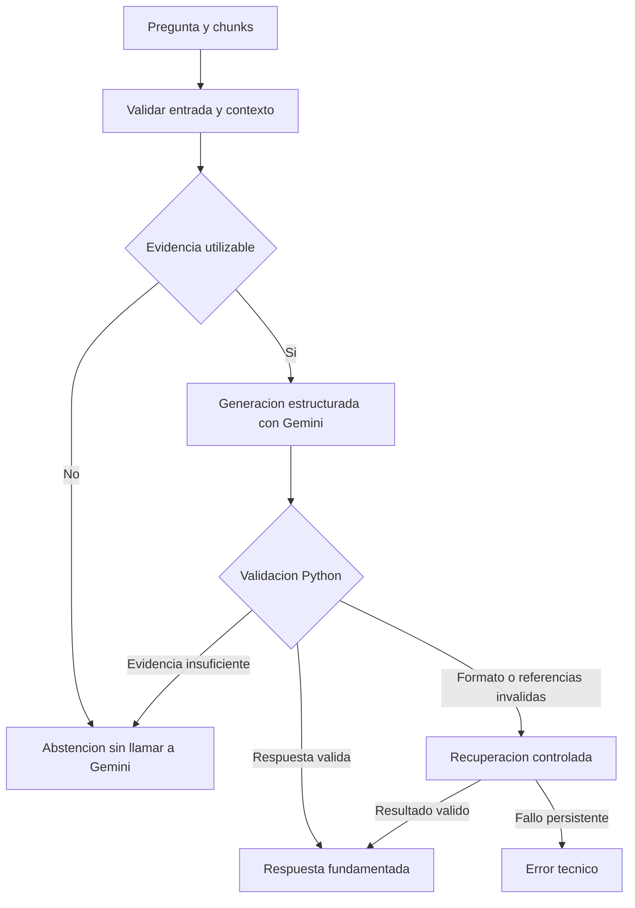

# 03. Generación de respuestas y control de evidencia

## 1. Objetivo

Definir los mecanismos de generación de respuestas fundamentadas en evidencia documental y los controles necesarios para garantizar su calidad, trazabilidad y coherencia.

La generación deberá transformar la información recuperada en respuestas comprensibles sin introducir afirmaciones, destinos, horarios o condiciones que no estén respaldados por la evidencia disponible.

## 2. Principios

- Fundamentación documental de las recomendaciones.
- Conservación de la procedencia de la información.
- Validación determinista de las referencias.
- Abstención ante evidencia insuficiente.
- Diferenciación entre abstenciones y errores técnicos.
- Protección frente a instrucciones maliciosas.
- Reducción de llamadas innecesarias al modelo de lenguaje.
- Independencia respecto a las interfaces del producto.

La generación no deberá utilizarse para compensar deficiencias de recuperación mediante información inventada o conocimiento general no contrastado.

## 3. Responsabilidad del módulo

El módulo src/generate.py será responsable de transformar la pregunta y los fragmentos documentales recuperados en una respuesta fundamentada.

No será responsable de:

- Preparar o indexar documentos.
- Consultar directamente ChromaDB.
- Seleccionar especialistas del agente.
- Ejecutar herramientas.
- Gestionar conversaciones.
- Autenticar usuarios.
- Aplicar cuotas comerciales.
- Persistir mensajes en PostgreSQL.
- Implementar contratos HTTP.
- Gestionar la interfaz Streamlit.

La generación deberá permanecer disponible independientemente de FastAPI, PostgreSQL y LangGraph.

## 4. Flujo de generación



La generación solo se ejecutará cuando exista contexto documental utilizable.

Los mecanismos de recuperación ante respuestas inválidas deberán respetar los límites de ejecución establecidos.

## 5. Contratos públicos

### 5.1. Contrato de generación

```python
generar_respuesta(
    pregunta: str,
    chunks: list[dict],
    *,
    client=None,
) -> dict
```

El parámetro client permitirá utilizar un cliente del proveedor de inferencia proporcionado externamente, facilitando las pruebas y la utilización controlada de dependencias.

### 5.2. Contrato de resultado

La estructura pública de una respuesta generada conservará:

```python
{
    "respuesta": "Texto sustentado [C1]",
    "abstencion": False,
    "motivo": None,
    "fuentes": [
        {
            "chunk_id": "C1",
            "source": "archivo.csv",
            "path": "data/raw/csv/archivo.csv"
        }
    ],
}
```

| Campo | Responsabilidad |
|---|---|
| respuesta | Contenido generado o respuesta de abstención |
| abstencion | Indica si no se proporciona una respuesta fundamentada |
| motivo | Identifica el motivo de la abstención cuando corresponda |
| fuentes | Referencias documentales verificadas |

Las fuentes deberán obtenerse de los metadatos de los fragmentos realmente utilizados.

### 5.3. Contrato RAG de nivel superior

La función src.rag.responder() conservará su contrato público, incorporando la pregunta, los resultados de recuperación y las métricas correspondientes.

El contrato de generación no deberá confundirse con:

- El contrato público del RAG.
- El estado del asistente multiagente.
- El contrato HTTP AskOut.

Cada capa deberá transformar la información necesaria sin exponer estructuras internas que no correspondan a su responsabilidad.

## 6. Preparación del contexto

### 6.1. Validación documental

Los fragmentos utilizados durante la generación deberán contener información válida y metadatos utilizables.

Se descartarán:

- Documentos vacíos.
- Fragmentos con estructuras inválidas.
- Información que no pueda incorporarse de forma segura al contexto.

La ausencia de contexto documental utilizable deberá provocar una abstención sin invocar al modelo de generación.

### 6.2. Presupuesto de contexto

Se respetará el límite establecido mediante MAX_CONTEXTO_CARACTERES.

La configuración de este parámetro se define en [01-retrieval.md](01-retrieval.md).

La preparación del contexto deberá preservar, en la medida necesaria:

- Identificación de las fuentes.
- Relaciones entre residuos y destinos.
- Condiciones de recogida.
- Excepciones documentadas.
- Modalidades de recogida.
- Restricciones geográficas.
- Horarios publicados.

No se eliminará información cuya ausencia pueda provocar una interpretación incorrecta de la evidencia.

### 6.3. Identificación de fragmentos

Los fragmentos incorporados al contexto recibirán identificadores que permitan relacionar las afirmaciones generadas con la evidencia proporcionada.

Los identificadores C1, C2 y sucesivos tendrán validez dentro de la llamada de generación correspondiente.

No se tratarán como identificadores documentales globales ni persistentes.

### 6.4. Separación entre datos e instrucciones

Los documentos recuperados deberán presentarse al modelo como datos de referencia.

El contenido documental no podrá modificar las instrucciones del sistema, los permisos disponibles ni las reglas de funcionamiento del asistente.

## 7. Política de generación

### 7.1. Fundamentación

Las recomendaciones sobre destinos de residuos deberán estar respaldadas por la evidencia documental disponible.

No se utilizará exclusivamente el conocimiento general del modelo para determinar un destino municipal.

Cuando existan condiciones específicas para depositar un residuo, estas deberán conservarse en la respuesta.

### 7.2. Cobertura geográfica

Las respuestas deberán respetar el ámbito geográfico de Madrid ciudad.

No se extrapolarán las normas, destinos ni servicios municipales documentados a otros municipios.

### 7.3. Claridad

La respuesta deberá proporcionar información comprensible y ajustada a la consulta.

No se introducirán explicaciones innecesarias que dificulten identificar la recomendación principal.

La simplificación del contenido no deberá eliminar condiciones o excepciones relevantes.

### 7.4. Ambigüedad

Cuando falte una característica decisiva para determinar el destino adecuado de un residuo, deberá solicitarse una aclaración.

No se asumirá arbitrariamente:

- El material del residuo.
- Su composición.
- Su estado.
- Su tamaño.
- Su modalidad de recogida.
- Su ubicación.

La necesidad de aclaración deberá determinarse según la influencia de la información ausente sobre la respuesta.

### 7.5. Información temporal

Los horarios deberán interpretarse conforme a la documentación disponible.

No se afirmará que una instalación se encuentra físicamente abierta por el mero hecho de disponer de un horario publicado.

Las reglas de interpretación temporal se definen en [04-consultas-generales.md](04-consultas-generales.md).

### 7.6. Información contradictoria

Cuando la evidencia disponible contenga contradicciones relevantes, el sistema deberá:

- Identificar la insuficiencia o incompatibilidad de la información.
- Solicitar una aclaración cuando permita resolver la consulta.
- Comunicar las limitaciones correspondientes.
- Abstenerse de recomendar un destino cuando no pueda fundamentarlo correctamente.

No se resolverán contradicciones mediante afirmaciones inventadas.

## 8. Referencias y citas

### 8.1. Identificadores de referencia

La generación utilizará identificadores asociados exclusivamente a los fragmentos incorporados al contexto.

Las referencias incluidas en la respuesta deberán corresponder a identificadores existentes.

No se admitirán referencias documentales inventadas por el modelo.

### 8.2. Validación determinista

Python comprobará:

- La estructura de la respuesta.
- La existencia de los identificadores utilizados.
- La correspondencia entre los identificadores y los fragmentos proporcionados.
- La validez de las referencias documentales.
- La coherencia estructural de los campos de respuesta y abstención.

La validación no dependerá exclusivamente del criterio del modelo de lenguaje.

### 8.3. Construcción de fuentes

La información de las fuentes se obtendrá de los metadatos originales de los fragmentos utilizados.

No se confiará en nombres de archivos, direcciones, rutas o referencias proporcionados libremente por Gemini.

Las fuentes públicas del servicio HTTP deberán transformarse conforme al contrato correspondiente, sin exponer rutas internas innecesarias.

### 8.4. Limitaciones de la validación

La existencia de una referencia válida no garantiza que todas las afirmaciones de la respuesta estén respaldadas por su contenido.

La validación estructural y la evaluación factual constituyen mecanismos diferentes.

No se considerará que una respuesta es correcta únicamente porque sus identificadores documentales sean válidos.

## 9. Control de evidencia

### 9.1. Evidencia suficiente

Una respuesta podrá proporcionar una recomendación cuando la información disponible permita fundamentarla correctamente.

Las condiciones y restricciones relevantes deberán quedar reflejadas en la respuesta.

### 9.2. Evidencia parcial

Cuando la información disponible permita responder únicamente a una parte de la consulta, se comunicarán los aspectos que puedan fundamentarse y las limitaciones correspondientes.

No se completará la información ausente mediante inferencias no documentadas.

### 9.3. Evidencia insuficiente

Cuando no exista información suficiente para proporcionar una recomendación fundamentada, el sistema deberá abstenerse.

La abstención constituye un comportamiento válido del asistente.

La clasificación suficiente, parcial o insuficiente del resultado integrado corresponde a la capa de orquestación y deberá respetar las reglas establecidas en [06-langgraph.md](06-langgraph.md).

### 9.4. Distancia vectorial

La suficiencia de evidencia no se determinará exclusivamente mediante la distancia vectorial de los fragmentos recuperados.

Una distancia reducida no garantiza que el documento permita responder correctamente a la consulta.

Los mecanismos de recuperación se definen en:

- [01-retrieval.md](01-retrieval.md).
- [02-mejoras-retrieval.md](02-mejoras-retrieval.md).

## 10. Abstenciones

### 10.1. Finalidad

La abstención permite evitar respuestas que no puedan fundamentarse correctamente.

No deberá utilizarse como mecanismo para ocultar errores técnicos.

### 10.2. Motivos semánticos

El sistema conservará los motivos semánticos existentes, entre ellos:

| Motivo | Significado |
|---|---|
| sin_contexto | No existe contexto documental utilizable |
| evidencia_insuficiente | La información disponible no permite fundamentar la respuesta |
| fuera_de_dominio | La consulta no pertenece al ámbito cubierto |
| ambiguedad | Falta información necesaria para interpretar correctamente la consulta |

Los motivos podrán proceder de diferentes componentes del RAG o del asistente.

No todos deberán generarse mediante una llamada al modelo de lenguaje.

### 10.3. Abstención sin inferencia

Cuando no exista contexto documental utilizable, la respuesta deberá construirse mediante mecanismos deterministas.

No se invocará al modelo únicamente para redactar una abstención que pueda resolverse de forma controlada.

### 10.4. Integración con el filtrado previo

El servicio HTTP podrá resolver consultas fuera del dominio y determinadas aclaraciones antes de ejecutar el RAG o el asistente.

Estas respuestas no deberán activar el módulo de generación.

El filtrado previo no sustituye las comprobaciones de suficiencia documental realizadas posteriormente por el RAG.

Las reglas de admisión se definen en [15-robustez-observabilidad.md](15-robustez-observabilidad.md).

## 11. Gestión de errores técnicos

### 11.1. Diferenciación

Los siguientes acontecimientos no deberán interpretarse como falta de evidencia documental:

- Fallos de conexión con Gemini.
- Errores del SDK.
- Agotamiento de cuotas del proveedor externo.
- Errores de autenticación con el proveedor.
- Timeouts.
- Respuestas estructuradas inválidas persistentes.
- Fallos inesperados durante el procesamiento.

La imposibilidad técnica de generar una respuesta no demuestra que el corpus carezca de información suficiente.

### 11.2. Respuestas inválidas

Cuando Gemini devuelva una respuesta que incumpla el contrato establecido, el sistema no deberá presentarla directamente al usuario.

Podrán aplicarse los mecanismos de recuperación y reintentos existentes.

Una vez agotadas las posibilidades de recuperación, un incumplimiento técnico persistente del contrato deberá comunicarse como fallo técnico.

### 11.3. Reintentos

Los reintentos deberán:

- Encontrarse limitados.
- Evitar ejecuciones indefinidas.
- Aplicarse cuando exista una posibilidad razonable de recuperación.
- Respetar los límites técnicos del asistente.
- Evitar consumos innecesarios.

Los mecanismos de reintento no deberán utilizarse para forzar una respuesta cuando exista evidencia documental insuficiente.

### 11.4. Propagación de errores

El módulo de generación deberá comunicar los fallos mediante los mecanismos internos correspondientes.

No dependerá de excepciones HTTP específicas de FastAPI.

La transformación de los fallos técnicos al contrato ErrorOut será responsabilidad del backend.

Los códigos y contratos HTTP se definen en [12-contratos-http.md](12-contratos-http.md).

## 12. Integración con la síntesis multiagente

### 12.1. Reutilización de respuestas

Cuando un único especialista haya obtenido una respuesta RAG completa, correctamente fundamentada y suficiente para resolver la consulta, el sistema deberá reutilizarla.

No se realizará una nueva llamada a Gemini únicamente para reformular una respuesta que ya satisface los requisitos del usuario.

### 12.2. Consultas compuestas

Cuando una consulta requiera integrar diferentes tipos de evidencia, el asistente podrá combinar:

- Clasificación documental del residuo.
- Destinos compatibles.
- Información geográfica.
- Distancias.
- Horarios publicados.
- Restricciones temporales.
- Limitaciones de la evidencia.

La integración no deberá introducir información que no haya sido obtenida mediante mecanismos autorizados.

### 12.3. Integración determinista

Los módulos src/agent_resultado.py y src/agent_schedule.py podrán integrar información previamente obtenida sin realizar nuevas llamadas al modelo ni a las herramientas cuando los datos disponibles sean suficientes.

La integración determinista deberá conservar la procedencia y las limitaciones de cada resultado.

### 12.4. Síntesis mediante LLM

Cuando la integración determinista no permita construir una respuesta adecuada, podrá utilizarse el modelo de lenguaje para realizar la síntesis.

La síntesis deberá respetar:

- La evidencia obtenida.
- Las fuentes disponibles.
- Los resultados de las herramientas.
- Los límites internos del asistente.
- Las restricciones de seguridad.

No podrá inventar resultados de herramientas ni modificar las evidencias originales.

## 13. Respuestas directas y planes

### 13.1. Respuestas directas

Cuando la consulta pueda resolverse correctamente sin generar un plan, el sistema deberá proporcionar una respuesta directa.

La existencia de una respuesta fundamentada no implica necesariamente la necesidad de un plan ni de una aprobación humana.

### 13.2. Generación de planes

Cuando la naturaleza de la consulta requiera un plan, los pasos deberán ser:

- Comprensibles.
- Coherentes con la consulta.
- Compatibles con la evidencia disponible.
- Válidos dentro del ámbito funcional del producto.
- Libres de acciones externas no autorizadas.

La generación del plan corresponde a la capa de síntesis y orquestación del asistente.

### 13.3. Validación de planes

La generación de un plan no implica su aprobación.

Python deberá verificar la validez estructural de los pasos antes de que el plan pueda presentarse como pendiente de HITL.

El modelo de lenguaje no podrá aprobar el plan ni modificar por sí mismo la decisión registrada.

### 13.4. Abstenciones y aclaraciones

Las abstenciones y aclaraciones que no requieran un plan deberán resolverse sin solicitar aprobación HITL.

No se generarán planes artificiales únicamente para mantener el recorrido ordinario del grafo.

Las reglas de transición del agente se definen en [06-langgraph.md](06-langgraph.md).

## 14. Integración con las consultas multimodales

La descripción visual de una imagen constituye información de entrada para el proceso de clasificación documental.

La identificación visual de un objeto no será suficiente para determinar automáticamente su destino de reciclaje.

Cuando una imagen haya superado la validación semántica, la información obtenida podrá utilizarse para recuperar evidencia documental relevante.

No se repetirá innecesariamente la identificación multimodal durante la generación o síntesis.

Las imágenes rechazadas antes de ejecutar el asistente no deberán activar los mecanismos posteriores de generación.

Las reglas de procesamiento multimodal se definen en:

- [05-tools.md](05-tools.md).
- [15-robustez-observabilidad.md](15-robustez-observabilidad.md).

## 15. Eficiencia y consumo de recursos

El sistema deberá minimizar las llamadas innecesarias al modelo de lenguaje.

En particular:

- No se generarán respuestas mediante Gemini cuando no exista contexto documental utilizable.
- Se reutilizarán respuestas RAG completas cuando resulte posible.
- Se priorizará la integración determinista cuando los datos disponibles sean suficientes.
- No se repetirán operaciones de identificación multimodal sin justificación.
- No se utilizará el modelo para realizar operaciones deterministas que puedan resolverse mediante Python.
- No se generarán planes innecesarios.
- Los reintentos estarán limitados.
- Se respetarán los presupuestos internos de contexto y ejecución.

La reducción del consumo no deberá comprometer la calidad, trazabilidad o suficiencia de las respuestas.

Los límites de consumo y ejecución se definen en [15-robustez-observabilidad.md](15-robustez-observabilidad.md).

## 16. Seguridad

Las entradas del usuario, los documentos recuperados, las respuestas del modelo y los resultados de las herramientas deberán tratarse como información no confiable.

El contenido generado no podrá:

- Modificar las instrucciones del sistema.
- Elevar privilegios.
- Autorizar herramientas.
- Alterar los límites de ejecución.
- Aprobar planes.
- Acceder a conversaciones ajenas.
- Exponer credenciales.
- Revelar prompts internos.
- Introducir instrucciones ejecutables no autorizadas.

Los controles deterministas deberán mantenerse independientemente de las instrucciones proporcionadas al modelo.

Las reglas generales de seguridad del núcleo se definen en [10-seguridad.md](10-seguridad.md).

## 17. Integración con la arquitectura MLOps

La capa de generación conservará su independencia respecto a los mecanismos de transporte y persistencia.

FastAPI será responsable de:

- Admitir las operaciones autorizadas.
- Coordinar la ejecución.
- Transformar los resultados al contrato público.
- Gestionar los errores HTTP.
- Persistir los turnos conforme a las reglas establecidas.

Streamlit representará las respuestas recibidas mediante HTTP.

No implementará una segunda lógica de generación, validación de evidencia o clasificación documental.

La incorporación de la capa MLOps no deberá modificar injustificadamente el contrato público del generador ni el comportamiento del núcleo RAG.

## 18. Validación

Las pruebas de generación deberán contemplar:

- Preguntas válidas con evidencia suficiente.
- Ausencia de contexto documental.
- Fragmentos vacíos o inválidos.
- Evidencia insuficiente.
- Evidencia parcial.
- Información contradictoria.
- Solicitudes de aclaración.
- Referencias documentales válidas.
- Referencias inexistentes.
- Respuestas estructuradas inválidas.
- Fallos del proveedor de inferencia.
- Reintentos limitados.
- Reutilización de respuestas RAG completas.
- Integración determinista de resultados.
- Consultas pertenecientes a otros municipios.
- Instrucciones maliciosas incorporadas al contexto.
- Generación de planes cuando sean necesarios.
- Respuestas directas sin planes innecesarios.
- Ausencia de llamadas duplicadas al modelo.

Las pruebas unitarias deberán utilizar dependencias controladas cuando sea necesario evitar llamadas reales a Gemini.

La evaluación factual deberá distinguirse de la validación estructural de las respuestas.

La estrategia general de evaluación se define en [08-pruebas-y-validacion.md](08-pruebas-y-validacion.md).

## 19. Criterios de aceptación

- Las respuestas se fundamentan en evidencia documental.
- Las recomendaciones no dependen exclusivamente del conocimiento general del modelo.
- El contexto conserva la procedencia de los fragmentos.
- Se respeta el límite de contexto configurado.
- La ausencia de contexto utilizable produce una abstención sin invocar Gemini.
- Las referencias documentales corresponden a fragmentos realmente proporcionados.
- Las fuentes se construyen a partir de los metadatos originales.
- Las referencias inexistentes no se aceptan.
- La evidencia parcial se comunica junto con sus limitaciones.
- La evidencia insuficiente genera una abstención fundamentada.
- Las consultas ambiguas reciben aclaraciones cuando sean necesarias.
- No se extrapolan los servicios municipales a otros ámbitos geográficos.
- Los horarios publicados no se presentan como garantías de apertura física.
- Los errores técnicos no se presentan como falta de evidencia.
- Los reintentos se encuentran limitados.
- Las respuestas RAG completas se reutilizan cuando corresponda.
- Las consultas compuestas conservan las evidencias utilizadas.
- No se fabrican resultados de herramientas.
- Las respuestas directas pueden resolverse sin generar un plan.
- Los planes se validan antes de presentarse como pendientes de HITL.
- El modelo de lenguaje no puede aprobar planes.
- Las imágenes rechazadas durante la validación previa no activan la generación.
- Se evita repetir innecesariamente la identificación multimodal.
- El módulo de generación funciona independientemente de FastAPI y PostgreSQL.
- Streamlit no implementa lógica propia de generación.
- La incorporación de MLOps conserva los contratos y requisitos de calidad del RAG.

## 20. Especificaciones relacionadas

| Documento | Responsabilidad |
|---|---|
| [01-retrieval.md](01-retrieval.md) | Pipeline documental y recuperación semántica |
| [02-mejoras-retrieval.md](02-mejoras-retrieval.md) | Recuperación filtrada y estructurada |
| [04-consultas-generales.md](04-consultas-generales.md) | Interpretación de consultas y horarios |
| [05-tools.md](05-tools.md) | Herramientas del asistente |
| [06-langgraph.md](06-langgraph.md) | Orquestación, síntesis, estado y HITL |
| [08-pruebas-y-validacion.md](08-pruebas-y-validacion.md) | Evaluación y pruebas |
| [09-datos-y-fuentes.md](09-datos-y-fuentes.md) | Corpus y procedencia documental |
| [10-seguridad.md](10-seguridad.md) | Seguridad del núcleo |
| [11-arquitectura-mlops.md](11-arquitectura-mlops.md) | Separación arquitectónica |
| [12-contratos-http.md](12-contratos-http.md) | Contratos públicos y errores HTTP |
| [13-persistencia.md](13-persistencia.md) | Persistencia de turnos |
| [15-robustez-observabilidad.md](15-robustez-observabilidad.md) | Límites, timeouts y control de recursos |