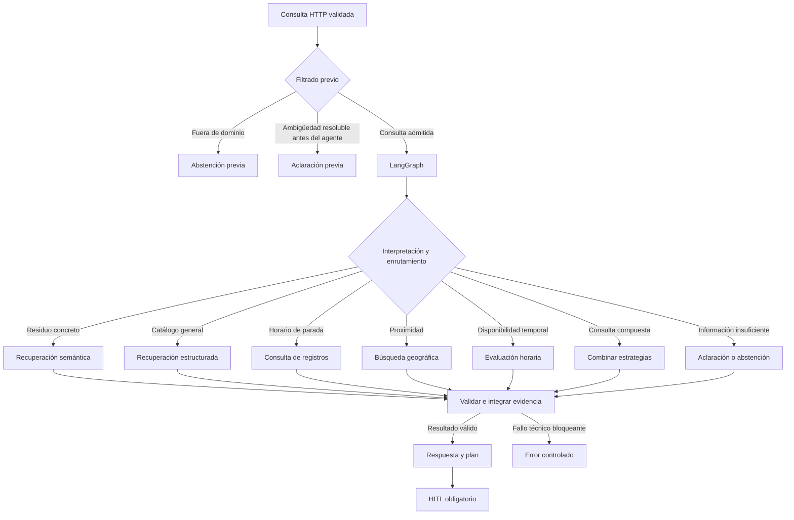

# 04. Interpretación de consultas y datos estructurados

## 1. Objetivo

Definir los mecanismos de interpretación de consultas que permiten seleccionar las estrategias adecuadas para satisfacer las necesidades del consumidor.

El asistente deberá distinguir entre:

- Consultas sobre residuos concretos.
- Consultas generales sobre el catálogo municipal.
- Consultas documentales específicas.
- Consultas geográficas.
- Consultas temporales.
- Consultas multimodales.
- Consultas compuestas.
- Reformulaciones.
- Solicitudes de aclaración.
- Consultas fuera de dominio.

La interpretación deberá permitir seleccionar los componentes necesarios sin ejecutar sistemáticamente todos los especialistas ni todas las herramientas disponibles.

La incorporación de la arquitectura MLOps deberá preservar los mecanismos desarrollados durante el PB02.

## 2. Principios

- Interpretación conservadora de las intenciones del consumidor.
- Selección de estrategias según la naturaleza de la consulta.
- Utilización del contexto conversacional autorizado.
- Separación entre clasificación documental, búsqueda geográfica e interpretación temporal.
- Utilización exclusiva de fuentes autorizadas.
- Priorización de operaciones deterministas cuando sean suficientes.
- Prevención de inferencias geográficas y temporales injustificadas.
- Conservación de las restricciones expresadas por el consumidor.
- Solicitud de aclaraciones cuando falte información decisiva.
- Diferenciación entre ausencia de evidencia y fallo técnico.
- Reducción de llamadas innecesarias a modelos y herramientas.
- Conservación del HITL obligatorio en LangGraph.
- Independencia del núcleo respecto a las interfaces del producto.

La interpretación de una consulta no constituye por sí sola una validación de la evidencia necesaria para responderla.

## 3. Niveles de interpretación

### 3.1. Filtrado previo del servicio HTTP

FastAPI aplicará un filtro determinista antes de ejecutar LangGraph.

Este filtro permitirá identificar:

- Consultas inequívocamente fuera del dominio.
- Consultas pertenecientes al ámbito funcional del producto.
- Consultas ambiguas que puedan requerir una aclaración previa.

Las consultas textuales resueltas mediante este filtro no invocarán Gemini, RAG, LangGraph ni herramientas.

Estas respuestas:

- No consumirán cuota comercial.
- No incrementarán turnos_consumidos.
- No modificarán checkpoints.
- No requerirán HITL.
- No generarán mensajes persistidos.
- No crearán una conversación cuando todavía no exista un hilo.

Continuarán sujetas al rate limiting HTTP y a los controles de seguridad correspondientes.

### 3.2. Restricciones del filtrado previo

La comprobación del dominio no sustituirá:

- La autenticación.
- La autorización.
- La comprobación de propiedad.
- Las restricciones de estado.
- Los límites de consumo.
- Las validaciones internas del RAG.

Cuando exista una conversación previa, el filtro deberá considerar su contexto operativo autorizado.

No se rechazará automáticamente una reformulación por carecer de términos explícitamente relacionados con los residuos.

### 3.3. Interpretación documental

src/rag_intents.py identificará las consultas que requieran estrategias documentales específicas.

src/rag.py seleccionará la estrategia correspondiente.

Esta interpretación continuará disponible independientemente de FastAPI y LangGraph.

### 3.4. Enrutamiento multiagente

El supervisor de LangGraph determinará:

- Los especialistas necesarios.
- Las operaciones que deben realizarse.
- La necesidad de recuperación documental.
- La necesidad de información geográfica.
- La necesidad de evaluación temporal.
- La necesidad de integrar diferentes evidencias.

La identificación de una intención no autoriza automáticamente la ejecución de una herramienta.

Las decisiones deberán respetar los permisos y límites internos.

### 3.5. Diferenciación de niveles

| Nivel | Responsabilidad |
|---|---|
| Filtrado HTTP | Determinar la admisibilidad inicial |
| Interpretación RAG | Seleccionar la estrategia documental |
| Supervisor | Coordinar especialistas y operaciones |
| Herramientas | Obtener información autorizada |
| Síntesis | Integrar evidencias y construir una propuesta |
| HITL | Resolver la propuesta del agente |

Estos niveles no constituyen sistemas de clasificación independientes que deban ejecutarse necesariamente mediante nuevas llamadas al modelo.

Se reutilizarán los mecanismos deterministas existentes.

## 4. Tipos de consultas

| Tipo | Ejemplo | Estrategia principal |
|---|---|---|
| Residuo concreto | ¿Dónde tiro una pila? | Recuperación documental |
| Catálogo general | ¿Qué tipos de residuos puedo reciclar? | Recuperación estructurada |
| Modalidad de recogida | ¿Qué residuos admite un punto limpio fijo? | Recuperación documental filtrada |
| Instalación concreta | ¿Qué horario tiene este punto limpio móvil? | Consulta de registros asociados |
| Proximidad | ¿Qué punto limpio tengo más cerca? | Búsqueda geográfica |
| Disponibilidad horaria | ¿Qué punto limpio está abierto ahora? | Información geográfica y evaluación temporal |
| Consulta compuesta | ¿Dónde tiro una pila y qué punto limpio me queda cerca? | Integración de evidencias |
| Reformulación | Prefiero uno que esté más cerca. | Contexto conversacional |
| Consulta multimodal | ¿Dónde puedo tirar esto? | Identificación visual y recuperación documental |
| Consulta descriptiva | ¿Qué objeto aparece en esta imagen? | Observación visual admitida |
| Aclaración | ¿De qué material está hecho? | Obtención de información necesaria |
| Consulta fuera de dominio | ¿Cómo se programa una aplicación? | Abstención controlada |

Los tipos de consultas no constituyen categorías necesariamente excluyentes.

Una misma petición podrá requerir diferentes estrategias.

Las consultas descriptivas mediante imágenes deberán pertenecer al ámbito funcional del producto y superar previamente los controles de admisibilidad multimodal.

## 5. Selección de estrategias



El diagrama representa las estrategias funcionales disponibles.

No constituye una nueva topología de LangGraph ni introduce nodos adicionales.

Las consultas multimodales deberán superar su identificación semántica previa antes de continuar hacia el agente.

La ejecución independiente del RAG conservará su funcionamiento sin HITL.

## 6. Interpretación dentro del RAG

### 6.1. Identificación de intenciones documentales

src/rag_intents.py continuará identificando las consultas que requieran estrategias específicas.

Se conservarán los mecanismos existentes para reconocer:

- Consultas generales sobre el catálogo.
- Consultas sobre horarios de puntos limpios móviles.
- Consultas sobre residuos concretos.
- Referencias explícitas a distritos o direcciones.
- Consultas ajenas al ámbito municipal.
- Solicitudes de reparación de dispositivos que no correspondan a la gestión de residuos.

La identificación deberá ser conservadora y evitar clasificaciones injustificadas.

### 6.2. Ambigüedad terminológica

La palabra móvil puede referirse tanto a un teléfono como a una instalación municipal itinerante.

La interpretación deberá considerar el contexto de la consulta.

No se rechazará automáticamente una pregunta sobre teléfonos móviles cuando esté relacionada con su reciclaje.

Tampoco se interpretará una solicitud de reparación de teléfonos como una consulta sobre puntos limpios móviles.

### 6.3. Coordinación de estrategias

src/rag.py conservará el contrato público de responder().

La función determinará si corresponde utilizar:

- Recuperación semántica.
- Recuperación estructurada.
- Respuestas deterministas.
- Abstenciones.
- Aclaraciones.

No todas las consultas requerirán generación mediante Gemini.

### 6.4. Recuperación semántica

Las consultas sobre residuos concretos podrán utilizar recuperación semántica cuando esta permita obtener evidencia adecuada.

La selección de fragmentos se realizará conforme a [01-retrieval.md](01-retrieval.md).

### 6.5. Recuperación filtrada y estructurada

Las consultas que requieran agrupaciones, recuentos, restricciones explícitas o registros concretos utilizarán los mecanismos correspondientes.

Las reglas se establecen en [02-mejoras-retrieval.md](02-mejoras-retrieval.md).

### 6.6. Independencia

La interpretación documental no dependerá de:

- FastAPI.
- PostgreSQL.
- Streamlit.
- Sesiones de usuarios.
- API keys del producto.
- Checkpoints de LangGraph.

La incorporación de MLOps no deberá duplicar las estrategias de recuperación existentes.

## 7. Consultas sobre el catálogo municipal

### 7.1. Alcance

El archivo tipos_residuos.csv contiene relaciones documentadas entre residuos y destinos de depósito.

No constituye necesariamente una clasificación universal ni exhaustiva de todos los residuos existentes.

### 7.2. Consultas generales

Cuando el consumidor solicite una visión general del catálogo, se utilizarán los registros estructurados disponibles.

Se conservará el comportamiento de _resultado_catalogo() en src/rag.py.

La respuesta podrá incluir:

- Número de relaciones documentadas.
- Número de destinos diferentes.
- Agrupaciones por destino.
- Ejemplos de residuos.
- Referencias documentales.

Los recuentos deberán calcularse a partir de los registros realmente disponibles.

No se establecerán cantidades fijas que puedan quedar obsoletas tras una actualización del corpus.

### 7.3. Recuperación exhaustiva del catálogo

No se utilizará un subconjunto arbitrario de resultados semánticos como si representase todo el catálogo.

Cuando la consulta requiera un resumen general, se utilizarán los mecanismos estructurados existentes.

La exhaustividad se limitará al conjunto de datos consultado.

No se afirmará que el corpus contiene todos los residuos reconocidos por el Ayuntamiento.

### 7.4. Consultas específicas

Cuando el consumidor pregunte por un residuo concreto, se deberá recuperar evidencia específica.

No se sustituirá una consulta concreta por un resumen general del catálogo cuando este no permita resolver la necesidad planteada.

### 7.5. Procedencia

Las respuestas deterministas conservarán las referencias documentales correspondientes.

Los resúmenes derivados deberán distinguirse de los documentos originales.

No se crearán categorías oficiales, cantidades ni relaciones que no estén respaldadas por el corpus.

### 7.6. Consumo y HITL

La consulta estructurada del catálogo podrá resolverse sin una nueva llamada de generación a Gemini.

Cuando se ejecute dentro de LangGraph, la respuesta deberá integrarse en una propuesta válida y alcanzar el HITL obligatorio.

La ausencia de una llamada al modelo no implica la ausencia de un turno del agente.

## 8. Interpretación de modalidades de recogida

### 8.1. Modalidades

El asistente deberá distinguir entre:

- Puntos limpios fijos.
- Puntos limpios móviles ordinarios.
- Puntos limpios móviles de 24 horas.
- Puntos limpios de proximidad.
- Otras modalidades documentadas en el corpus.

Las modalidades no se considerarán necesariamente equivalentes ni intercambiables.

### 8.2. Restricciones explícitas

Cuando el consumidor solicite una modalidad concreta, se conservará dicha restricción durante:

- La interpretación.
- La recuperación documental.
- La búsqueda geográfica.
- La selección de candidatos.
- La síntesis.

No se sustituirá silenciosamente la modalidad solicitada por otra diferente.

Si se presentan alternativas, deberán identificarse como tales.

### 8.3. Modalidades compatibles

La compatibilidad deberá fundamentarse mediante evidencia documental.

La mera aparición del nombre de una modalidad en una respuesta RAG no demuestra que el residuo pueda depositarse en ella.

Deberán distinguirse:

- Modalidades expresamente admitidas.
- Modalidades expresamente excluidas.
- Modalidades cuya compatibilidad no pueda determinarse.

### 8.4. Interpretación de negaciones

Se revisarán los mecanismos existentes de extracción de modalidades para evitar interpretar una prohibición como una autorización.

En particular, deberá comprobarse el comportamiento de:

- _tipos_admitidos().
- tipo_punto_documentado().
- debe_buscar_puntos_automaticamente().

Una expresión como no debe depositarse en un punto limpio fijo no podrá utilizarse como evidencia de compatibilidad con esa modalidad.

Cuando una respuesta contenga afirmaciones y negaciones sobre modalidades diferentes, el asistente deberá conservar su significado.

### 8.5. Puntos limpios móviles de 24 horas

La modalidad móvil de 24 horas deberá distinguirse de los puntos limpios móviles ordinarios.

No se deducirá automáticamente que ambas modalidades admiten los mismos residuos.

Se revisarán las reglas existentes que permiten incorporar instalaciones móviles de 24 horas a partir de referencias genéricas a puntos limpios móviles.

La compatibilidad deberá corresponder a la documentación autorizada.

### 8.6. Contrato geográfico

Se conservarán los valores admitidos por la herramienta geográfica:

- todos.
- fijo.
- movil.
- proximidad.

No se incorporará un nuevo parámetro público para cada modalidad adicional.

Cuando una modalidad específica requiera una distinción más precisa, se utilizarán los atributos documentados de los resultados y las reglas internas correspondientes.

## 9. Consultas sobre puntos limpios móviles

### 9.1. Identificación de paradas

Los horarios de los puntos limpios móviles deberán asociarse a las paradas concretas a las que correspondan.

Los registros podrán contener:

- Dirección.
- Distrito.
- Día.
- Franja horaria.
- Modalidad de recogida.

No se combinarán horarios correspondientes a instalaciones diferentes como si pertenecieran a una misma parada.

### 9.2. Extracción de criterios

Se conservarán los mecanismos de src/rag_intents.py destinados a extraer:

- Distrito.
- Calle o dirección.
- Día explícito.
- Modalidad solicitada.

La extracción no inventará datos ausentes.

No se seleccionará arbitrariamente un día cuando la consulta contenga referencias temporales incompatibles o ambiguas.

### 9.3. Ausencia de ubicación identificable

Cuando una consulta sobre horarios móviles no permita identificar el distrito ni la dirección, podrá solicitarse una aclaración.

No será necesario conocer las coordenadas del consumidor para consultar los horarios documentados de una parada concreta.

### 9.4. Varias paradas coincidentes

Cuando existan varias paradas compatibles con los criterios aportados, se deberá distinguir entre:

- Una solicitud sobre una parada específica.
- Una solicitud general sobre varias paradas.

Si el consumidor solicita una parada concreta y no puede identificarse, se solicitará una aclaración.

Si solicita un conjunto de horarios, podrán presentarse los registros correspondientes dentro de los límites establecidos.

### 9.5. Límite de presentación

Se conservará el comportamiento de _resultado_horario_movil().

Cuando el número de registros coincidentes supere top_k:

- Se comunicará el número total de registros encontrados.
- Se indicará cuántos se muestran.
- No se presentará la selección como una relación exhaustiva.
- Se podrá solicitar una calle o un día para concretar la búsqueda.

### 9.6. Ausencia legítima de registros

Si la consulta estructurada se ha ejecutado correctamente y no encuentra una parada compatible, se comunicará dicha circunstancia.

Un fallo técnico de recuperación no se presentará como ausencia legítima de paradas.

### 9.7. Diferenciación de modalidades

Las consultas sobre puntos limpios móviles de 24 horas no deberán confundirse automáticamente con consultas sobre paradas itinerantes ordinarias.

Se conservarán las reglas de identificación existentes.

### 9.8. Relación con las consultas geográficas

La consulta documental de horarios y la búsqueda por proximidad constituyen operaciones diferentes.

La primera podrá resolverse mediante el corpus.

La segunda corresponderá a buscar_puntos_limpios_cercanos().

No se utilizarán coordenadas inventadas para completar una consulta documental.

## 10. Interpretación geográfica

### 10.1. Ámbito municipal

El producto se limitará al municipio de Madrid.

Se conservarán los mecanismos de src/domain.py para identificar referencias geográficas explícitas.

Los distritos de Madrid no deberán confundirse automáticamente con municipios homónimos.

Por ejemplo, una referencia al distrito de Salamanca no deberá interpretarse necesariamente como una consulta sobre la ciudad de Salamanca.

### 10.2. Limitaciones del filtro geográfico

El filtro textual no constituye un sistema completo de reconocimiento de entidades geográficas.

No garantiza detectar correctamente todas las localidades o referencias posibles.

Cuando exista ambigüedad relevante, deberá solicitarse una aclaración o comunicarse la limitación correspondiente.

En producción no se incorporará un resolutor externo de lugares.

### 10.3. Coordenadas autorizadas

Las operaciones que requieran calcular proximidad deberán utilizar coordenadas proporcionadas explícitamente por el consumidor.

Las coordenadas deberán superar las validaciones correspondientes.

No se utilizarán:

- Coordenadas predeterminadas no autorizadas.
- Coordenadas inventadas por Gemini.
- Ubicaciones deducidas arbitrariamente.
- Resultados de geocodificación externa.

La validación del rango de latitud y longitud no constituye por sí sola una comprobación de que el consumidor se encuentra físicamente en Madrid.

### 10.4. Ausencia de coordenadas

Cuando una consulta requiera calcular proximidad y no se disponga de coordenadas válidas:

- No se ejecutará la herramienta geográfica.
- Se solicitará la información necesaria o se comunicará la limitación.
- Podrá proporcionarse información documental que sí pueda fundamentarse.

La ausencia de coordenadas opcionales no constituye necesariamente un error HTTP.

Una entrada que contenga coordenadas inválidas o incompletas incumplirá el contrato correspondiente.

### 10.5. Fuentes geográficas

La búsqueda geográfica utilizará exclusivamente:

- ArcGIS municipal.
- El respaldo local autorizado del corpus.

No se utilizarán otros servicios cartográficos para obtener información sobre instalaciones.

No se realizará navegación abierta por Internet.

### 10.6. Distancia geográfica

Las distancias se calcularán mediante Haversine.

Representarán distancias en línea recta entre las coordenadas del consumidor y las instalaciones recuperadas.

No se presentarán como:

- Distancias por carretera.
- Tiempos de desplazamiento.
- Rutas a pie.
- Garantías de accesibilidad.

### 10.7. Radio de búsqueda

La herramienta respetará el radio autorizado.

La ausencia de instalaciones dentro del radio solicitado no permitirá afirmar que no existen instalaciones en todo Madrid.

No se ampliará arbitrariamente el radio para presentar una respuesta aparentemente satisfactoria.

### 10.8. Compatibilidad de instalaciones

La proximidad de una instalación no demuestra que admita el residuo consultado.

Cuando la consulta incluya un residuo concreto, la recomendación deberá considerar:

- Su clasificación documental.
- Las modalidades de recogida admitidas.
- Las restricciones documentadas.
- Los candidatos geográficos disponibles.

Cuando no pueda comprobarse la compatibilidad, deberá indicarse expresamente.

### 10.9. Modalidades sin cobertura geográfica

El corpus podrá contener modalidades de recogida cuyas ubicaciones no estén disponibles mediante ArcGIS.

Por ejemplo, determinadas referencias a contenedores de pilas situados en marquesinas de autobús.

En estos casos:

- Podrá comunicarse la modalidad si está respaldada documentalmente.
- No se inventarán ubicaciones.
- No se calcularán distancias inexistentes.
- No se garantizará que otra instalación sea la opción más cercana de todas las modalidades posibles.

### 10.10. Respaldo local

Cuando ArcGIS sufra un fallo técnico recuperable, podrá utilizarse el corpus local.

Se conservarán el radio, las coordenadas y las restricciones correspondientes.

Se identificará expresamente la procedencia corpus_local.

Se comunicará la posibilidad de que los datos estén desactualizados.

### 10.11. Diferenciación de resultados

| Situación | Interpretación |
|---|---|
| ArcGIS devuelve resultados válidos | Búsqueda satisfactoria |
| ArcGIS devuelve una lista válida vacía | Ausencia legítima de coincidencias |
| Los registros válidos están fuera del radio | Ausencia legítima dentro del radio |
| Todos los registros recibidos son inválidos | Fallo de procesamiento de la fuente |
| ArcGIS falla y el respaldo funciona | Resultado válido con limitaciones |
| ArcGIS y el respaldo fallan | Fallo técnico |

No se activará el respaldo únicamente porque una búsqueda válida no encuentre instalaciones.

Las reglas detalladas se establecen en [05-tools.md](05-tools.md).

## 11. Interpretación temporal

### 11.1. Responsabilidad

src/agent_schedule.py realizará las comprobaciones temporales deterministas.

No se delegará exclusivamente en Gemini la comparación de intervalos horarios.

### 11.2. Fuente temporal

La herramienta hora_actual() proporcionará la fecha y hora de Madrid.

No se utilizará la hora supuesta por el modelo.

La información temporal deberá proceder de una ejecución válida de la herramienta autorizada.

### 11.3. Necesidad de consultar la hora

Se utilizará la hora actual cuando resulte necesaria para:

- Determinar si una instalación se encuentra dentro de su horario publicado.
- Evaluar una consulta que haga referencia al momento actual.
- Priorizar instalaciones para acudir en ese momento.
- Evaluar restricciones temporales documentadas, incluida la regla de envases de vidrio cuando corresponda.

No será necesario consultar la hora actual cuando el consumidor únicamente solicite conocer un horario publicado y no requiera una evaluación temporal.

Se revisará requiere_hora() para mantener esta distinción.

### 11.4. Zona horaria

Las comprobaciones utilizarán Europe/Madrid.

Las fechas y horas deberán conservar la información necesaria de zona horaria.

Se contemplarán los cambios de horario de verano e invierno.

No se utilizará indiscriminadamente la zona horaria local del servidor.

### 11.5. Intervalos horarios

Se conservará la interpretación de:

- Intervalos diarios.
- Horarios asociados a días concretos.
- Horarios semanales.
- Varias franjas dentro de un mismo día.
- Intervalos que atraviesan la medianoche.
- Horarios de 24 horas cuando estén documentados.

### 11.6. Límites de los intervalos

Para los intervalos ordinarios, se conservará el criterio:

```python
apertura <= hora_actual < cierre
```

La hora inicial estará incluida.

La hora final quedará excluida.

En los intervalos que atraviesen la medianoche se comprobará también si el horario corresponde al día anterior.

Un intervalo cuya apertura y cierre coincidan no se interpretará automáticamente como disponibilidad durante 24 horas.

La disponibilidad durante 24 horas deberá estar respaldada por la modalidad o por información horaria explícita.

### 11.7. Estados horarios

Se conservarán los siguientes estados internos:

| Estado | Significado |
|---|---|
| dentro | La hora evaluada se encuentra dentro del intervalo publicado |
| fuera | La hora evaluada se encuentra fuera del intervalo publicado |
| desconocido | No existe información suficiente para determinar la situación horaria |

Estos estados representan una comparación con los horarios documentados.

No constituyen una comprobación de apertura física.

### 11.8. Horario desconocido

Cuando no se disponga de información horaria suficiente, se utilizará desconocido.

No se presentará un horario desconocido como una instalación abierta o cerrada.

La ausencia de un horario en los datos municipales no implica disponibilidad permanente.

### 11.9. Fechas futuras y referencias relativas

Las consultas podrán contener expresiones como:

- Mañana.
- El próximo lunes.
- Este fin de semana.

El asistente no utilizará automáticamente la hora actual como si correspondiera a la fecha solicitada.

Cuando pueda determinarse la fecha de referencia y exista documentación adecuada, podrán interpretarse los horarios publicados correspondientes.

Cuando los mecanismos existentes no permitan resolver de forma fiable la referencia temporal, se solicitará una aclaración o se mostrarán los horarios documentados sin afirmar una disponibilidad futura concreta.

No se incorporará un sistema externo de gestión de calendarios durante el PB03.

### 11.10. Festivos e incidencias

Los horarios publicados podrán verse afectados por:

- Festivos.
- Cambios temporales.
- Incidencias.
- Modificaciones municipales.
- Circunstancias no reflejadas en las fuentes disponibles.

No se afirmará que una instalación se encuentra físicamente abierta.

### 11.11. Fallo de la herramienta temporal

Se distinguirán dos situaciones:

- La información temporal era complementaria y su ausencia no impide resolver la consulta principal.
- La información temporal era imprescindible para satisfacer la consulta.

En el primer caso podrá comunicarse una limitación válida.

En el segundo, un fallo técnico no recuperado de hora_actual() deberá propagarse como fallo técnico.

No se afirmará que no existen instalaciones disponibles únicamente porque no haya podido obtenerse la hora.

### 11.12. Ejecución determinista

Las comparaciones temporales deberán reutilizar las evidencias ya obtenidas.

No se realizarán nuevas llamadas al modelo para comparar intervalos que puedan evaluarse correctamente mediante Python.

## 12. Priorización de instalaciones

### 12.1. Criterios diferenciados

El asistente deberá distinguir entre:

- Menor distancia geográfica.
- Situación dentro del horario publicado.
- Compatibilidad documental.
- Restricciones expresadas por el consumidor.

La selección deberá respetar conjuntamente los requisitos aplicables.

### 12.2. Prioridad por distancia

Cuando el consumidor solicite expresamente las instalaciones más cercanas, la distancia constituirá el criterio principal entre los candidatos que satisfagan sus restricciones.

Podrá mostrarse información horaria complementaria.

No se sustituirá una instalación cercana por otra más lejana sin explicar el criterio utilizado.

### 12.3. Prioridad por disponibilidad horaria

Cuando el consumidor solicite una instalación para acudir en ese momento, se priorizarán las opciones que se encuentren dentro de su horario publicado.

Dentro de las opciones compatibles con este requisito, se conservará el criterio de menor distancia.

Las instalaciones con horario desconocido no se presentarán como alternativas cuya disponibilidad esté confirmada.

### 12.4. Consultas con varios requisitos

Si el consumidor solicita el punto limpio compatible más cercano que se encuentre dentro de su horario publicado:

1. Determinar las modalidades compatibles.
2. Identificar los candidatos geográficos.
3. Evaluar sus horarios.
4. Seleccionar los candidatos que satisfagan los requisitos.
5. Ordenarlos por distancia.

No se considerará suficiente cumplir únicamente uno de los requisitos.

### 12.5. Comportamiento predeterminado

Se conservará el comportamiento existente de respuesta_geografica_integrada().

Cuando el consumidor no exija un orden exclusivo por distancia y resulte pertinente evaluar la disponibilidad actual, podrá presentarse:

- La opción compatible más cercana dentro de su horario publicado.
- Una alternativa adicional dentro de horario cuando esté disponible.
- Otras instalaciones próximas, identificando su situación horaria.

El criterio empleado deberá resultar comprensible.

### 12.6. Compatibilidad previa

Cuando la consulta se refiera a un residuo concreto, la priorización deberá considerar la clasificación documental.

No se recomendarán instalaciones únicamente por encontrarse más cerca o dentro de su horario publicado.

### 12.7. Agrupación de registros

Se conservará la agrupación realizada por src/agent_resultado.py.

Los registros de una misma instalación podrán agruparse cuando correspondan a:

- Una dirección compatible.
- Una modalidad coincidente.
- Coordenadas correspondientes a la misma ubicación.
- Diferentes días o franjas de servicio.

No se fusionarán instalaciones distintas únicamente porque compartan una dirección similar.

### 12.8. Resultados públicos e internos

| Campo | Responsabilidad |
|---|---|
| puntos | Hasta diez registros de búsqueda ordenados por proximidad |
| puntos_candidatos | Hasta sesenta registros utilizados internamente |
| total_encontrados | Número de registros válidos encontrados |
| respuesta | Recomendaciones y explicaciones integradas |
| geografia | Representación pública de las búsquedas efectuadas |

La respuesta integrada podrá considerar candidatos que no estén incluidos entre los diez registros públicos de proximidad.

La interfaz no presentará la tabla o el mapa de proximidad como una reproducción exacta de todas las recomendaciones del agente.

Los resultados públicos tampoco deberán confundirse con el número de instalaciones únicas, puesto que una instalación puede disponer de varios registros horarios.

### 12.9. Limitación de candidatos

Cuando la selección utilice un conjunto limitado de candidatos, se comunicará dicha circunstancia cuando afecte a la interpretación del resultado.

No se afirmará haber evaluado exhaustivamente todas las instalaciones posibles cuando existan registros no incluidos.

### 12.10. Ausencia de opciones compatibles

Cuando no pueda identificarse una instalación que satisfaga todos los requisitos, se comunicará la limitación correspondiente.

Podrán presentarse alternativas claramente diferenciadas.

No se presentarán alternativas como si cumplieran las restricciones originales.

### 12.11. Transformación HTTP

FastAPI transformará las búsquedas geográficas mediante PuntoLimpioOut y GeografiaOut.

No repetirá los cálculos de compatibilidad, distancia ni interpretación temporal.

Streamlit tampoco realizará una nueva clasificación de disponibilidad.

Las reglas de los contratos públicos se establecen en [12-contratos-http.md](12-contratos-http.md).

## 13. Regla específica para envases de vidrio

### 13.1. Finalidad

Se conservará la regla documentada relacionada con la franja horaria municipal para el depósito de envases de vidrio en contenedores verdes de la vía pública.

La referencia correspondiente se identifica mediante FUENTE_HORARIO_VIDRIO.

### 13.2. Configuración existente

src/agent_schedule.py contiene:

```python
VIDRIO_INICIO = time(8, 0)
VIDRIO_FIN = time(22, 30)
```

La franja documentada incorporada al núcleo es de 08:00 a 22:30.

La evaluación temporal conservará el criterio:

```python
VIDRIO_INICIO <= hora_actual < VIDRIO_FIN
```

Esta regla deberá interpretarse conforme a la documentación autorizada.

### 13.3. Procedencia documental

Se conservará la referencia existente:

```text
https://www.madrid.es/portales/munimadrid/es/Recogida-de-vidrio/?vgnextchannel=f81379ed268fe410VgnVCM1000000b205a0aRCRD&vgnextoid=e3ab6c9c78eb2910VgnVCM2000001f4a900aRCRD
```

La referencia se identificará internamente mediante:

```python
{
    "chunk_id": "NORMA-VIDRIO",
    "source": "Ayuntamiento de Madrid — Recogida de vidrio",
    "path": FUENTE_HORARIO_VIDRIO,
}
```

No se realizará una nueva consulta HTTP a esta página durante cada petición.

La actualización de la referencia normativa constituirá una operación controlada de mantenimiento de las fuentes.

### 13.4. Condiciones de activación

Se conservará es_vidrio_envase_confirmado().

La regla deberá aplicarse únicamente cuando exista evidencia documental válida que permita determinar que el residuo corresponde a un envase de vidrio destinado al contenedor verde.

No bastará con detectar la palabra vidrio.

Una referencia negativa al contenedor verde no constituirá evidencia de que su utilización esté permitida.

### 13.5. Exclusiones

La regla no se extenderá automáticamente a:

- Vasos.
- Copas.
- Espejos.
- Cristales de ventanas.
- Vitrocerámicas.
- Otros objetos cuya clasificación no corresponda a envases de vidrio destinados al contenedor verde.

La clasificación deberá proceder del RAG.

### 13.6. Evaluación horaria

Cuando corresponda evaluar la situación actual, se comparará la hora de Madrid con la franja documentada.

No se inventarán restricciones adicionales.

Cuando la consulta únicamente solicite conocer la franja autorizada, podrá comunicarse la información documental sin realizar una comparación temporal innecesaria.

### 13.7. Ausencia de información temporal

Si no puede obtenerse la hora actual, no se afirmará que el consumidor se encuentra dentro o fuera de la franja permitida.

Si la información temporal resulta imprescindible y existe un fallo técnico no recuperado, se aplicará el tratamiento correspondiente.

### 13.8. Reutilización

La regla no requerirá una nueva llamada a Gemini para comparar las horas.

Se conservará su integración determinista mediante anexos_temporales().

## 14. Consultas compuestas

### 14.1. Identificación

Una consulta compuesta podrá requerir diferentes tipos de evidencia.

Por ejemplo, identificar dónde depositar un residuo y localizar una instalación cercana podrá requerir:

- Clasificación documental.
- Identificación de modalidades compatibles.
- Búsqueda geográfica.
- Cálculo de distancias.
- Evaluación temporal cuando corresponda.

### 14.2. Selección de especialistas

El supervisor determinará qué especialistas deben intervenir.

No se ejecutarán ambos especialistas sistemáticamente cuando uno de ellos permita resolver correctamente la consulta.

Tampoco se omitirá una especialidad necesaria.

### 14.3. Búsqueda automática de puntos limpios

Se conservará debe_buscar_puntos_automaticamente().

Cuando la clasificación documental indique un destino compatible con puntos limpios y existan coordenadas autorizadas, podrá activarse la búsqueda geográfica correspondiente.

La activación deberá considerar:

- La intención del consumidor.
- La clasificación documental.
- La ausencia de prohibiciones incompatibles.
- La disponibilidad de coordenadas.
- Las modalidades admitidas.
- Los límites internos.

No se activará una búsqueda geográfica a partir de una prohibición documental.

### 14.4. Integración de evidencias

La respuesta deberá distinguir entre:

- Clasificación documental.
- Observación visual.
- Compatibilidad de instalaciones.
- Resultados geográficos.
- Distancias calculadas.
- Situaciones horarias.
- Limitaciones.

Cada evidencia deberá conservar su procedencia.

### 14.5. Evidencia parcial legítima

Cuando únicamente pueda resolverse una parte de la consulta por ausencia legítima de información, se comunicarán los aspectos fundamentados y las limitaciones correspondientes.

No se inventarán resultados para completar artificialmente la petición.

### 14.6. Fallos técnicos

La disponibilidad de evidencia parcial no permitirá ocultar un fallo técnico imprescindible.

Por ejemplo, si el consumidor requiere una búsqueda geográfica y no puede completarse ni mediante ArcGIS ni mediante el respaldo local, no se presentará la clasificación documental como si toda la consulta se hubiera resuelto satisfactoriamente.

El agente deberá comunicar el fallo correspondiente.

### 14.7. HITL

Toda consulta compuesta ejecutada satisfactoriamente dentro de LangGraph deberá generar una respuesta y un plan válidos.

La integración determinista no eliminará la interrupción HITL.

## 15. Contexto conversacional

### 15.1. Reformulaciones

El asistente deberá interpretar las consultas que dependan de información expresada anteriormente dentro de la misma conversación.

Ejemplos:

- ¿Y si es de plástico?
- Mejor en otro distrito.
- ¿Hay alguno más cerca?
- ¿Y mañana?
- Prefiero un punto limpio fijo.

Estas consultas no deberán rechazarse únicamente por carecer de términos explícitamente relacionados con los residuos.

### 15.2. Contexto autorizado

La interpretación únicamente podrá utilizar el contexto correspondiente al checkpoint autorizado.

No se utilizarán mensajes, evidencias ni resultados de otros hilos.

### 15.3. Conservación de restricciones

Las restricciones anteriores podrán conservarse cuando sigan siendo aplicables.

Las modificaciones expresadas por el consumidor sustituirán las restricciones correspondientes.

No se ignorará una modificación explícita de la modalidad, ubicación o criterio de selección.

### 15.4. Coordenadas e imágenes

No se reutilizarán automáticamente coordenadas ni archivos anteriores como entradas activas.

Las coordenadas deberán proporcionarse expresamente mediante el contrato correspondiente.

Las imágenes HTTP previamente analizadas podrán aportar contexto descriptivo, pero el agente no volverá a acceder a archivos temporales eliminados.

### 15.5. Contexto frente a evidencia

La utilización del contexto anterior no implica que todas las evidencias previas continúen siendo pertinentes.

Las nuevas recomendaciones deberán disponer de evidencia adecuada.

No se reutilizarán resultados temporales obsoletos como si representasen la situación actual.

### 15.6. Reformulación posterior al rechazo

Cuando el consumidor rechace un plan, podrá formular una nueva consulta mientras la conversación continúe disponible.

Se conservará el contexto de revisión autorizado.

El rechazo no autorizará una reutilización indiscriminada de evidencias anteriores.

### 15.7. Respuestas anteriores al agente

Las aclaraciones deterministas previas a LangGraph no se incorporarán al historial operativo.

Cuando una respuesta previa solicite información adicional, el consumidor deberá proporcionar una consulta suficientemente completa.

No se reconstruirá el contexto mediante mensajes mantenidos exclusivamente en Streamlit.

### 15.8. Restricciones conversacionales

La interpretación contextual respetará:

- La existencia del checkpoint.
- La ausencia de HITL pendiente.
- La ausencia de ejecuciones concurrentes.
- El estado de finalización.
- El límite de turnos.

La existencia de contexto no permite eludir estas restricciones.

Las reglas se establecen en [06-langgraph.md](06-langgraph.md).

## 16. Consultas multimodales

### 16.1. Identificación previa

Las consultas HTTP con imágenes deberán superar la validación técnica y la identificación semántica estructurada.

Se utilizará IdentificacionImagen.

Únicamente las identificaciones con estado=allowed podrán incorporarse al agente.

### 16.2. Interpretación conjunta

La pregunta textual y la identificación visual validada deberán interpretarse conjuntamente.

La descripción podrá utilizarse para:

- Identificar características observables.
- Seleccionar la estrategia documental.
- Formular consultas de recuperación.
- Detectar información ausente.
- Construir solicitudes de aclaración.

### 16.3. Clasificación documental

La identificación visual no determinará automáticamente el destino del residuo.

La clasificación deberá fundamentarse en el corpus autorizado.

No se asumirá una composición o un material que no pueda identificarse con suficiente certeza.

### 16.4. Consultas descriptivas

Cuando la consulta únicamente solicite describir un objeto y pertenezca al dominio del producto, podrá utilizarse la observación visual admitida.

No será necesario ejecutar recuperación documental si no se realiza una recomendación de reciclaje.

La ejecución satisfactoria de LangGraph conservará el HITL obligatorio.

### 16.5. Incertidumbre previa

Cuando la identificación visual resulte uncertain, se solicitará una nueva imagen mediante una respuesta controlada anterior al agente.

No se ejecutará LangGraph.

No se generarán planes ni HITL.

No se incrementará turnos_consumidos.

La identificación visual ya realizada consumirá la cuota comercial correspondiente.

### 16.6. Incertidumbre dentro del agente

Una imagen admitida podrá seguir presentando ambigüedades relevantes para la clasificación documental.

Por ejemplo, podrá reconocerse el objeto sin determinar una característica que modifique su destino de depósito.

En este caso, el agente podrá generar una aclaración fundamentada.

La ejecución satisfactoria deberá conservar su respuesta, plan e interrupción HITL.

### 16.7. Reutilización

Se utilizará identificacion_imagen para incorporar al agente la observación previamente obtenida.

No se proporcionará simultáneamente ruta_imagen para volver a ejecutar la identificación.

No se repetirán llamadas multimodales innecesarias.

### 16.8. Fallos técnicos

Una excepción de Gemini o una identificación estructuralmente inválida no se presentarán como incertidumbre semántica.

Las reglas completas se establecen en:

- [05-tools.md](05-tools.md).
- [06-langgraph.md](06-langgraph.md).
- [15-robustez-observabilidad.md](15-robustez-observabilidad.md).

## 17. Solicitudes de aclaración

### 17.1. Finalidad

Las aclaraciones deberán utilizarse cuando falte información cuya ausencia impida responder correctamente.

No se solicitarán datos que no sean necesarios.

### 17.2. Aclaraciones previas a LangGraph

Cuando la ambigüedad pueda identificarse determinísticamente antes del agente, se podrá devolver una aclaración controlada.

Esta respuesta:

- No ejecutará LangGraph.
- No invocará Gemini.
- No generará un plan.
- No requerirá HITL.
- No consumirá cuota comercial.
- No incrementará turnos_consumidos.
- No generará mensajes SQL.

Las aclaraciones derivadas de una identificación visual previa constituyen una excepción respecto al consumo: la identificación ejecutada sí consumirá cuota comercial.

### 17.3. Aclaraciones durante la ejecución

El agente podrá detectar necesidades adicionales de información después de ejecutar operaciones de recuperación, clasificación o interpretación.

Estas aclaraciones constituirán resultados semánticos del turno.

Cuando la ejecución sea satisfactoria, deberá generar una respuesta y un plan válidos y alcanzar el HITL obligatorio.

No se finalizará directamente el grafo.

### 17.4. Plan asociado a una aclaración

El plan podrá orientarse a:

- Identificar la información necesaria.
- Verificar las características del residuo.
- Consultar la documentación pertinente una vez obtenida la información.
- Revisar las restricciones aplicables.

No se inventarán recomendaciones de reciclaje para completar el plan.

### 17.5. Continuidad

Una aclaración generada dentro de LangGraph podrá continuar mediante el mecanismo de revisión posterior al rechazo del plan.

La aprobación conservará el comportamiento del PB02 y finalizará la conversación.

No se introducirá una excepción adicional al ciclo de vida del agente para las aclaraciones.

### 17.6. Aclaraciones del RAG independiente

Cuando responder() o generar_respuesta() se utilicen independientemente de LangGraph, podrán devolver aclaraciones sin generar planes ni HITL.

Se conservarán sus contratos públicos.

### 17.7. Diferenciación

| Situación | LangGraph | HITL | Turno del agente |
|---|---|---|---|
| Aclaración textual previa | No | No | No |
| Nueva imagen solicitada antes del agente | No | No | No |
| Aclaración del RAG independiente | No | No | No |
| Aclaración obtenida dentro del agente | Sí | Sí | Sí |
| Fallo técnico | Según fase afectada | No constituye una propuesta válida | Según fase afectada |

Las reglas de contabilización se establecen en [15-robustez-observabilidad.md](15-robustez-observabilidad.md).

## 18. Integración determinista de resultados

### 18.1. Responsabilidad

src/agent_resultado.py integrará las evidencias obtenidas mediante especialistas y herramientas.

Podrá utilizar:

- Clasificaciones documentales.
- Destinos de depósito.
- Modalidades compatibles.
- Instalaciones.
- Direcciones.
- Distancias.
- Horarios publicados.
- Evaluaciones temporales.
- Fuentes.
- Limitaciones.

### 18.2. Reutilización

Se conservarán los mecanismos existentes para integrar resultados sin repetir llamadas externas.

No se volverán a ejecutar herramientas únicamente para reproducir información válida disponible.

### 18.3. Selección de evidencias

La integración utilizará únicamente evidencias auténticas del turno o información contextual expresamente admitida.

No se tratarán como evidencias válidas:

- Resultados inventados por Gemini.
- Herramientas fallidas.
- Referencias sin verificar.
- Datos de otros consumidores.
- Observaciones visuales no admitidas.
- Información geográfica obtenida de proveedores no autorizados.

### 18.4. Construcción de la respuesta

La respuesta integrada deberá preservar:

- El significado de la clasificación original.
- Las condiciones documentadas.
- La procedencia de los datos.
- Las restricciones del consumidor.
- Las limitaciones de cobertura.
- La interpretación correcta de horarios.
- La distinción entre distancia y compatibilidad.

### 18.5. Construcción del plan

Cuando la información disponible permita construir una propuesta válida mediante Python, se priorizará esta estrategia.

El plan deberá cumplir los requisitos establecidos en [03-generacion.md](03-generacion.md) y [06-langgraph.md](06-langgraph.md).

No se realizará una llamada adicional a Gemini únicamente para generar un plan que pueda construirse correctamente mediante mecanismos deterministas.

### 18.6. Fallos bloqueantes

La integración no se utilizará para ocultar un fallo técnico imprescindible.

Cuando no pueda completarse correctamente la operación, deberá propagarse el fallo correspondiente.

## 19. Separación de responsabilidades

| Componente | Responsabilidad |
|---|---|
| src/domain.py | Interpretación del ámbito geográfico |
| src/rag_intents.py | Identificación de intenciones documentales |
| src/rag.py | Selección de estrategias RAG |
| src/retrieve.py | Recuperación semántica y filtrada |
| src/retrieve_structured.py | Consultas estructuradas |
| src/generate.py | Generación documental |
| src/generation_validation.py | Validación de respuestas y referencias |
| src/agent_routing.py | Enrutamiento del sistema multiagente |
| src/agent_tool_loop.py | Ejecución controlada de herramientas |
| src/agent_schedule.py | Interpretación y comprobación temporal |
| src/agent_resultado.py | Integración determinista |
| src/nodes.py | Ejecución de los nodos y síntesis |
| api/service.py | Admisión, coordinación y transformación HTTP |

La incorporación de MLOps no deberá duplicar las reglas de interpretación.

FastAPI no implementará una segunda lógica de clasificación documental, búsqueda geográfica ni evaluación horaria.

Streamlit no determinará de manera independiente los especialistas ni las herramientas que deben intervenir.

## 20. Gestión de situaciones especiales

| Situación | Comportamiento esperado |
|---|---|
| Consulta inequívocamente fuera de dominio | Abstención controlada anterior al agente |
| Ambigüedad identificada antes del agente | Aclaración determinista |
| Residuo insuficientemente identificado | Solicitar información adicional |
| Distrito ambiguo | Solicitar aclaración cuando corresponda |
| Parada no identificable | Solicitar criterios adicionales |
| Ausencia de coordenadas necesarias | Comunicar limitación o solicitar coordenadas |
| Coordenadas inválidas | Rechazar la entrada conforme al contrato HTTP |
| Ausencia legítima de instalaciones | Informar del alcance de la búsqueda |
| Compatibilidad no comprobada | No recomendar la instalación como compatible |
| Horario desconocido | Comunicar incertidumbre horaria |
| Evidencia parcial legítima | Responder los aspectos fundamentados |
| Evidencia insuficiente | Abstención |
| Identificación visual incierta | Solicitar una nueva imagen antes del agente |
| Contenido visual no permitido | Rechazo mediante error HTTP |
| Fallo técnico de identificación | Error técnico |
| Fallo recuperable de ArcGIS | Utilizar el respaldo autorizado |
| Fallo de ArcGIS y del respaldo | Error técnico |
| Fallo de recuperación documental | No presentar como ausencia de evidencia |
| Fallo de hora_actual imprescindible | Error técnico |
| Fallo de hora_actual auxiliar | Comunicar limitación cuando proceda |
| HITL pendiente | Impedir nuevas consultas ordinarias |
| Conversación finalizada | Solicitar una nueva conversación |
| Checkpoint perdido | Comunicar THREAD_STATE_LOST |

Los resultados semánticos válidos obtenidos dentro de LangGraph deberán conservar el HITL obligatorio.

Los fallos técnicos no deberán ocultarse mediante HTTP 200.

Los contratos públicos se establecen en [12-contratos-http.md](12-contratos-http.md).

## 21. Eficiencia

La interpretación deberá reducir la ejecución de operaciones innecesarias.

En particular:

- No se ejecutará LangGraph cuando el filtro previo resuelva legítimamente la consulta.
- No se utilizará recuperación semántica cuando una consulta estructurada resulte suficiente.
- No se consultará ArcGIS sin coordenadas válidas.
- No se consultará la hora actual cuando no resulte necesaria.
- No se ejecutarán ambos especialistas cuando uno sea suficiente.
- No se repetirán llamadas a herramientas sin justificación.
- No se repetirá una identificación multimodal previamente validada.
- No se realizará una nueva síntesis mediante Gemini cuando exista información suficiente para una integración determinista.
- No se realizarán búsquedas externas adicionales.
- No se utilizará el modelo para ejecutar comparaciones deterministas.
- Se respetarán los límites internos de contexto y herramientas.

Las optimizaciones deberán preservar:

- La calidad documental.
- La procedencia de las evidencias.
- Las restricciones del consumidor.
- La seguridad.
- La diferenciación de fallos técnicos.
- El HITL obligatorio.

No se eliminará la generación del plan dentro de LangGraph como medida de ahorro de recursos.

## 22. Validación

### 22.1. Interpretación documental

Se comprobarán:

- Consultas sobre residuos concretos.
- Consultas generales sobre el catálogo.
- Recuperación estructurada.
- Recuperación semántica.
- Diferenciación entre consultas de reciclaje y reparación.
- Identificación de distritos.
- Identificación de direcciones.
- Consultas sobre paradas móviles.
- Consultas fuera del ámbito municipal.
- Conservación del contrato de responder().

### 22.2. Modalidades y compatibilidad

Se comprobarán:

- Identificación de modalidades autorizadas.
- Identificación de modalidades excluidas.
- Respuestas RAG con varias modalidades.
- Respuestas RAG con afirmaciones y negaciones.
- Diferenciación entre puntos limpios móviles ordinarios y de 24 horas.
- Conservación de restricciones explícitas.
- Ausencia de inferencias de compatibilidad no documentadas.
- Búsqueda automática únicamente cuando corresponda.

### 22.3. Geografía

Se comprobarán:

- Ausencia de coordenadas.
- Coordenadas válidas.
- Coordenadas inválidas.
- Búsqueda dentro del radio permitido.
- Distancias calculadas mediante Haversine.
- Ordenación de proximidad.
- Ausencia legítima de resultados.
- Registros inválidos.
- Respaldo local.
- Fallo del respaldo.
- Identificación de procedencia.
- Limitaciones geográficas.
- Modalidades documentadas sin ubicaciones disponibles.

### 22.4. Horarios

Se comprobarán:

- Zona horaria Europe/Madrid.
- Horarios diarios.
- Horarios semanales.
- Varias franjas en un mismo día.
- Intervalos que atraviesan la medianoche.
- Inicio exacto de un intervalo.
- Final exacto de un intervalo.
- Horarios desconocidos.
- Horarios de 24 horas documentados.
- Intervalos ambiguos.
- Consultas sobre horarios publicados sin evaluación actual.
- Consultas que requieren conocer la hora actual.
- Referencias temporales futuras.
- Fallos auxiliares de hora_actual().
- Fallos imprescindibles de hora_actual().

### 22.5. Priorización

Se comprobarán:

- Prioridad por menor distancia.
- Prioridad por situación horaria.
- Combinación de compatibilidad, horario y distancia.
- Agrupación de registros de una misma instalación.
- Candidatos internos frente a resultados públicos.
- Recomendaciones situadas fuera de los diez registros públicos.
- Ausencia de opciones compatibles.
- Comunicación de límites de cobertura.

### 22.6. Regla para envases de vidrio

Se comprobarán:

- Envases de vidrio documentalmente confirmados.
- Exclusión de vasos.
- Exclusión de espejos.
- Exclusión de cristales.
- Exclusión de vitrocerámicas.
- Referencias negativas al contenedor verde.
- Inicio de la franja permitida.
- Final de la franja permitida.
- Conservación de FUENTE_HORARIO_VIDRIO.
- Ausencia de información temporal.
- Ausencia de nuevas peticiones documentales externas.

### 22.7. Consultas compuestas

Se comprobarán:

- Integración de clasificación y proximidad.
- Integración de clasificación y horarios.
- Integración de evidencias documentales, geográficas y temporales.
- Selección justificada de especialistas.
- Evidencia parcial legítima.
- Fallos imprescindibles no recuperados.
- Integración determinista.
- Conservación de referencias.
- Generación de planes válidos.

### 22.8. Contexto y aclaraciones

Se comprobarán:

- Reformulaciones después de rechazar un plan.
- Consultas sin palabras clave explícitas.
- Modificación de restricciones anteriores.
- Ausencia de reutilización de evidencias obsoletas.
- Aclaraciones deterministas previas.
- Aclaraciones dentro del agente.
- Ausencia de HITL en respuestas anteriores a LangGraph.
- Conservación del HITL en aclaraciones del agente.
- Ausencia de persistencia de respuestas previas.
- Respeto de las restricciones de conversaciones existentes.

### 22.9. Multimodalidad

Se comprobarán:

- Identificación visual admitida.
- Reutilización de la descripción.
- Ausencia de identificaciones duplicadas.
- Clasificación documental del objeto.
- Consulta exclusivamente descriptiva.
- Incertidumbre visual previa.
- Ambigüedad documental posterior.
- Fallos técnicos de identificación.
- Ausencia de ejecución posterior cuando la imagen no es admitida.
- HITL obligatorio en ejecuciones admitidas y satisfactorias.

### 22.10. Regresión

Se conservarán y adaptarán cuando corresponda:

- tests/test_rag_structured.py.
- tests/test_rag_domain.py.
- tests/test_retrieve_structured.py.
- tests/test_api_puntos_limpios.py.
- tests/test_agent_schedule.py.
- tests/test_agent_schedule_integration.py.
- tests/test_agent_resultado.py.
- tests/test_agent_regression.py.

Las adaptaciones deberán corresponder a cambios expresamente autorizados o correcciones verificadas.

No se modificarán pruebas únicamente para ocultar regresiones.

Las pruebas deberán utilizar fechas, coordenadas y respuestas simuladas cuando corresponda.

La estrategia general se establece en [08-pruebas-y-validacion.md](08-pruebas-y-validacion.md).

## 23. Criterios de aceptación

### 23.1. Interpretación

- El sistema distingue los tipos de consultas contemplados.
- El filtrado previo permanece separado de la interpretación RAG.
- La selección de especialistas responde a las necesidades de la consulta.
- No se ejecutan componentes innecesarios.
- Las restricciones expresadas por el consumidor se conservan.
- El núcleo RAG permanece independiente de FastAPI y PostgreSQL.

### 23.2. Catálogo y modalidades

- Las consultas generales utilizan mecanismos estructurados cuando corresponde.
- Los recuentos proceden de registros reales.
- No se presenta el catálogo como una clasificación universal exhaustiva.
- Las modalidades de recogida permanecen diferenciadas.
- Las prohibiciones no se interpretan como compatibilidades.
- No se deduce automáticamente la equivalencia entre puntos limpios móviles ordinarios y de 24 horas.

### 23.3. Geografía

- No se extrapolan datos municipales a otras localidades.
- Las búsquedas utilizan coordenadas autorizadas.
- ArcGIS y el corpus local constituyen las únicas fuentes geográficas.
- Las distancias se identifican como distancias en línea recta.
- La proximidad no se confunde con compatibilidad.
- Los resultados públicos conservan su procedencia.
- Se diferencia la ausencia legítima de resultados de un fallo técnico.
- Los resultados limitados no se presentan como búsquedas exhaustivas.
- No se inventan ubicaciones de modalidades sin cobertura geográfica.

### 23.4. Horarios

- Las comprobaciones utilizan Europe/Madrid.
- La hora actual se consulta cuando resulta necesaria.
- Los intervalos diarios y semanales se interpretan correctamente.
- Los intervalos que atraviesan la medianoche se gestionan correctamente.
- Los límites de apertura y cierre se aplican consistentemente.
- Los horarios desconocidos no se confunden con apertura o cierre.
- Las referencias temporales futuras no se evalúan como si correspondieran al momento actual.
- No se afirma apertura física basándose únicamente en horarios publicados.
- Los fallos temporales imprescindibles no se ocultan mediante resultados aparentemente satisfactorios.

### 23.5. Priorización

- La distancia y la situación horaria constituyen criterios diferenciados.
- Las recomendaciones respetan la compatibilidad documental.
- Las restricciones explícitas del consumidor tienen prioridad.
- Los candidatos internos se distinguen de los resultados públicos.
- Las alternativas que incumplen algún requisito se identifican como tales.

### 23.6. Envases de vidrio

- La regla únicamente se activa cuando existe una clasificación documental compatible.
- No se aplica indiscriminadamente a cualquier objeto de vidrio.
- Se conserva la procedencia normativa autorizada.
- La comparación temporal se realiza mediante Python.
- No se realizan consultas web adicionales.

### 23.7. Contexto y multimodalidad

- Las reformulaciones utilizan contexto autorizado.
- Las evidencias anteriores no se reutilizan injustificadamente.
- Las imágenes admitidas reutilizan su identificación.
- No se realizan identificaciones visuales duplicadas.
- La descripción visual no sustituye la evidencia documental de clasificación.
- Las imágenes no admitidas no ejecutan LangGraph.

### 23.8. HITL y persistencia

- Las aclaraciones anteriores a LangGraph no requieren HITL.
- Las aclaraciones del RAG independiente no requieren HITL.
- Las aclaraciones obtenidas dentro del agente conservan el HITL obligatorio.
- Las abstenciones válidas del agente conservan el HITL obligatorio.
- Las respuestas integradas satisfactoriamente generan un plan válido.
- Las respuestas anteriores al agente no incrementan turnos_consumidos.
- Las respuestas anteriores al agente no generan mensajes persistidos.
- No se eliminan planes obligatorios para reducir consumo.

### 23.9. Robustez y arquitectura

- Las abstenciones legítimas se distinguen de los fallos técnicos.
- La evidencia parcial no oculta fallos imprescindibles.
- Los errores técnicos no se presentan mediante HTTP 200.
- La integración determinista evita llamadas externas innecesarias.
- FastAPI no duplica las reglas del núcleo.
- Streamlit no realiza una segunda clasificación documental ni temporal.
- Se conservan los contratos públicos del RAG.
- No se incorporan nuevas fuentes de conocimiento ni servicios externos de búsqueda.

## 24. Especificaciones relacionadas

| Documento | Responsabilidad |
|---|---|
| [00-producto.md](00-producto.md) | Alcance funcional y geográfico |
| [01-retrieval.md](01-retrieval.md) | Recuperación semántica |
| [02-mejoras-retrieval.md](02-mejoras-retrieval.md) | Recuperación filtrada y estructurada |
| [03-generacion.md](03-generacion.md) | Generación y control de evidencia |
| [05-tools.md](05-tools.md) | Herramientas y contratos internos |
| [06-langgraph.md](06-langgraph.md) | Orquestación, contexto y HITL |
| [07-streamlit.md](07-streamlit.md) | Representación de resultados |
| [08-pruebas-y-validacion.md](08-pruebas-y-validacion.md) | Evaluación y pruebas |
| [09-datos-y-fuentes.md](09-datos-y-fuentes.md) | Corpus y procedencia |
| [10-seguridad.md](10-seguridad.md) | Seguridad del núcleo |
| [12-contratos-http.md](12-contratos-http.md) | Contratos públicos |
| [13-persistencia.md](13-persistencia.md) | Persistencia de turnos |
| [15-robustez-observabilidad.md](15-robustez-observabilidad.md) | Admisión, consumo y ejecución |