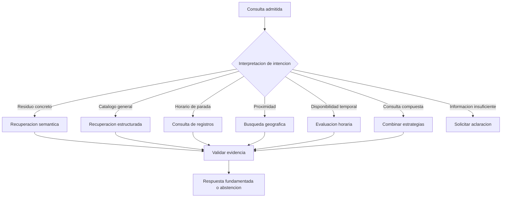

# 04. Interpretación de consultas y datos estructurados

## 1. Objetivo

Definir los mecanismos de interpretación de consultas que permiten seleccionar las estrategias adecuadas para satisfacer las necesidades del usuario.

El asistente deberá distinguir entre consultas sobre residuos concretos, peticiones generales de información, consultas geográficas, consultas temporales y solicitudes que requieran combinar diferentes tipos de evidencia.

La interpretación deberá permitir seleccionar los componentes necesarios sin ejecutar sistemáticamente todos los especialistas ni todas las herramientas disponibles.

## 2. Principios

- Interpretación conservadora de las intenciones del usuario.
- Selección de estrategias según la naturaleza de la consulta.
- Utilización del contexto conversacional cuando sea necesario.
- Separación entre clasificación documental, búsqueda geográfica e interpretación temporal.
- Priorización de operaciones deterministas cuando sean suficientes.
- Prevención de inferencias geográficas y temporales injustificadas.
- Conservación de las restricciones expresadas por el usuario.
- Solicitud de aclaraciones cuando falte información decisiva.
- Reducción de llamadas innecesarias a modelos de lenguaje y herramientas.

La interpretación de una consulta no constituye por sí sola una validación de la evidencia necesaria para responderla.

## 3. Niveles de interpretación

### 3.1. Validación previa de dominio

El servicio HTTP deberá comprobar si la consulta pertenece al ámbito funcional y geográfico del producto antes de ejecutar el asistente.

Esta comprobación permitirá identificar:

- Consultas pertenecientes al dominio.
- Consultas inequívocamente fuera del dominio.
- Consultas ambiguas que requieran una aclaración previa.

Las consultas rechazadas durante esta fase no deberán continuar hacia el RAG ni hacia el sistema multiagente.

Las reglas de filtrado previo y contabilización del consumo se definen en [15-robustez-observabilidad.md](15-robustez-observabilidad.md).

### 3.2. Interpretación de intenciones

Una vez admitida la consulta, el sistema deberá determinar qué información necesita el usuario.

La identificación de intenciones permitirá seleccionar entre recuperación semántica, recuperación estructurada, búsqueda geográfica, interpretación temporal o una combinación de estas operaciones.

La identificación de una intención no autoriza automáticamente la ejecución de una herramienta.

### 3.3. Enrutamiento del asistente

El supervisor del sistema multiagente determinará los especialistas que deben intervenir y las operaciones necesarias para resolver la consulta.

Las decisiones deberán respetar:

- La intención identificada.
- El contexto conversacional.
- Los permisos de las herramientas.
- Los límites internos de ejecución.
- La evidencia obtenida durante el turno.

Las reglas de orquestación se definen en [06-langgraph.md](06-langgraph.md).

## 4. Tipos de consultas

| Tipo | Ejemplo | Estrategia principal |
|---|---|---|
| Residuo concreto | ¿Dónde tiro una pila? | Recuperación documental |
| Catálogo general | ¿Qué tipos de residuos puedo reciclar? | Recuperación estructurada |
| Modalidad de recogida | ¿Qué residuos admite un punto limpio fijo? | Recuperación documental filtrada |
| Instalación concreta | ¿Qué horario tiene este punto limpio móvil? | Consulta de registros asociados |
| Proximidad | ¿Qué punto limpio tengo más cerca? | Búsqueda geográfica |
| Disponibilidad horaria | ¿Qué punto limpio está dentro de su horario ahora? | Información geográfica o documental e interpretación temporal |
| Consulta compuesta | ¿Dónde tiro este objeto y qué punto limpio me queda cerca? | Combinación de evidencias |
| Reformulación | Mejor uno que esté en otro distrito. | Interpretación mediante contexto conversacional |
| Consulta multimodal | ¿Dónde puedo tirar esto? | Identificación visual y recuperación documental |
| Consulta fuera de dominio | ¿Cómo se programa una aplicación? | Respuesta controlada |

Los tipos de consultas no constituyen categorías necesariamente excluyentes.

Una misma petición podrá requerir diferentes estrategias para responder correctamente.

## 5. Selección de estrategias

El diagrama representa las estrategias funcionales disponibles, no un nuevo grafo de ejecución independiente de LangGraph.

La selección de estrategias deberá evitar operaciones que no contribuyan a resolver la consulta.

## 6. Interpretación dentro del RAG

### 6.1. Identificación de intenciones documentales

El módulo src/rag_intents.py será responsable de identificar las consultas que requieran estrategias específicas de recuperación documental.

La identificación deberá ser conservadora y evitar clasificaciones injustificadas.

### 6.2. Coordinación de estrategias

El módulo src/rag.py seleccionará la estrategia de recuperación correspondiente y conservará el contrato público de responder().

La interpretación documental deberá permanecer disponible independientemente del sistema multiagente y de la capa HTTP.

### 6.3. Recuperación semántica

Las consultas sobre residuos concretos y otras preguntas documentales podrán utilizar la recuperación semántica cuando esta permita obtener evidencia adecuada.

Los mecanismos de recuperación semántica se definen en [01-retrieval.md](01-retrieval.md).

### 6.4. Recuperación filtrada y estructurada

Las consultas que requieran restricciones explícitas, agrupaciones, recuentos o registros concretos utilizarán los mecanismos correspondientes.

Las reglas de filtrado y recuperación estructurada se definen en [02-mejoras-retrieval.md](02-mejoras-retrieval.md).

## 7. Consultas sobre el catálogo municipal

### 7.1. Alcance del catálogo

El archivo tipos_residuos.csv contiene relaciones documentadas entre residuos y destinos de depósito.

No constituye necesariamente una clasificación universal ni exhaustiva de todos los residuos existentes.

### 7.2. Consultas generales

Cuando el usuario solicite una visión general del catálogo, el sistema deberá utilizar los registros estructurados disponibles.

Las respuestas podrán incluir:

- Destinos de depósito documentados.
- Agrupaciones de residuos.
- Relaciones entre residuos y destinos.
- Ejemplos respaldados por el corpus.
- Recuentos calculados a partir de los registros.

No se presentará un subconjunto arbitrario de resultados semánticos como un catálogo completo.

### 7.3. Consultas específicas

Cuando el usuario pregunte por un residuo concreto, la estrategia deberá permitir obtener evidencia específica sobre dicho residuo.

No se sustituirá una consulta concreta por una descripción general del catálogo cuando esta no permita resolver la necesidad planteada.

### 7.4. Procedencia

Las respuestas deberán identificar la procedencia documental y el alcance de los registros utilizados.

No se crearán categorías oficiales, cantidades ni relaciones que no estén respaldadas por el corpus.

## 8. Interpretación de modalidades de recogida

El asistente deberá distinguir entre:

- Puntos limpios fijos.
- Puntos limpios móviles.
- Puntos limpios móviles de 24 horas.
- Puntos limpios de proximidad.
- Otras modalidades de recogida documentadas en el corpus.

Las modalidades no se considerarán equivalentes ni intercambiables.

Cuando el usuario solicite una modalidad concreta, las operaciones de recuperación y búsqueda deberán conservar dicha restricción.

Si no se dispone de resultados compatibles, el sistema deberá comunicar esta circunstancia.

No se sustituirá silenciosamente la modalidad solicitada por otra diferente.

## 9. Consultas sobre puntos limpios móviles

### 9.1. Identificación de paradas

Los horarios de los puntos limpios móviles deberán asociarse a las paradas concretas a las que correspondan.

Los registros podrán contener:

- Calle o dirección.
- Distrito.
- Día.
- Franja horaria.
- Modalidad de recogida.

### 9.2. Consultas ambiguas

Una consulta genérica sobre el horario de un punto limpio móvil no implica necesariamente que pueda identificarse una parada concreta.

Cuando la información disponible sea insuficiente, el asistente deberá solicitar los datos necesarios para identificarla.

No se seleccionará arbitrariamente una parada ni se combinarán horarios de ubicaciones diferentes.

### 9.3. Consultas geográficas

La búsqueda de puntos limpios cercanos mediante coordenadas constituye una operación independiente de la recuperación documental.

Esta operación será responsabilidad de la herramienta buscar_puntos_limpios_cercanos.

Las reglas de ejecución de la herramienta se definen en [05-tools.md](05-tools.md).

## 10. Interpretación geográfica

### 10.1. Ámbito municipal

Las consultas deberán interpretarse dentro del ámbito geográfico de Madrid ciudad.

El sistema no extrapolará los servicios, las normas ni las instalaciones municipales a otras localidades.

Esta restricción deberá mantenerse en el RAG incluso cuando la consulta haya superado el filtrado previo del servicio HTTP.

### 10.2. Coordenadas

Las operaciones que requieran calcular proximidad deberán utilizar coordenadas proporcionadas explícitamente por el consumidor.

No se utilizarán coordenadas deducidas de forma arbitraria ni valores predeterminados que el usuario no haya autorizado.

La recuperación documental de información sobre un distrito o una instalación no requerirá necesariamente coordenadas.

### 10.3. Ausencia de coordenadas

Cuando una consulta requiera calcular proximidad y no se disponga de coordenadas válidas, el asistente deberá solicitar la información necesaria o comunicar la limitación correspondiente.

No se ejecutará la herramienta geográfica utilizando una ubicación supuesta.

### 10.4. Distancia geográfica

Las distancias devueltas por la herramienta deberán interpretarse conforme a su método de cálculo.

No se presentarán distancias geográficas en línea recta como:

- Distancias por carretera.
- Tiempos de desplazamiento.
- Rutas a pie.
- Garantías de accesibilidad.

### 10.5. Compatibilidad de instalaciones

La proximidad de una instalación no constituye evidencia suficiente de que admita un residuo concreto.

La recomendación deberá considerar las restricciones documentadas del residuo y de la modalidad de recogida.

Cuando no pueda comprobarse dicha compatibilidad, deberá indicarse expresamente.

## 11. Interpretación temporal

### 11.1. Responsabilidad

El módulo src/agent_schedule.py será responsable de las comprobaciones temporales deterministas necesarias para interpretar los horarios publicados.

Las decisiones sobre intervalos horarios no deberán depender exclusivamente de inferencias del modelo de lenguaje.

### 11.2. Necesidad de información temporal

El sistema deberá determinar si la consulta requiere conocer la hora local de Madrid.

La herramienta hora_actual se utilizará cuando la interpretación de la consulta dependa de información temporal actual.

Las consultas que únicamente soliciten un horario documentado no requerirán necesariamente consultar la hora actual.

### 11.3. Zona horaria

Las comprobaciones temporales deberán utilizar la zona horaria Europe/Madrid.

La interpretación deberá contemplar los cambios de horario aplicables a dicha zona.

No se utilizará una hora local del servidor que pueda resultar incompatible con la ubicación de las instalaciones municipales.

### 11.4. Interpretación de intervalos

El sistema deberá interpretar:

- Intervalos horarios diarios.
- Horarios asociados a días concretos.
- Intervalos semanales.
- Intervalos que atraviesen la medianoche.

Las comprobaciones deberán respetar las condiciones documentadas.

No se asumirán horarios adicionales cuando falte información suficiente.

### 11.5. Estados horarios

La comparación entre la hora correspondiente y el horario publicado podrá producir los siguientes estados:

| Estado | Significado |
|---|---|
| dentro | La hora evaluada se encuentra dentro del intervalo publicado |
| fuera | La hora evaluada se encuentra fuera del intervalo publicado |
| desconocido | No existe información suficiente para determinar la situación horaria |

Estos estados representan una comparación con la documentación disponible.

No constituyen una comprobación de apertura física en tiempo real.

### 11.6. Limitaciones

El asistente deberá comunicar las limitaciones cuando:

- No se disponga de horarios documentados.
- El horario no pueda interpretarse correctamente.
- No pueda identificarse la instalación.
- No esté disponible la información temporal necesaria.
- Exista incertidumbre relevante sobre los datos utilizados.

Un horario desconocido no deberá presentarse como una instalación cerrada ni abierta.

## 12. Priorización de instalaciones

### 12.1. Criterio de proximidad

Cuando el usuario solicite instalaciones ordenadas por cercanía, la distancia geográfica deberá constituir el criterio principal.

La información horaria podrá incorporarse como información complementaria.

No se sustituirá silenciosamente la preferencia expresada por el usuario.

### 12.2. Criterio de disponibilidad horaria

Cuando el usuario solicite instalaciones que se encuentren dentro de su horario publicado, el sistema deberá considerar la evaluación temporal al priorizar los resultados.

La distancia geográfica seguirá siendo un dato verificable que deberá conservarse.

### 12.3. Conservación de restricciones

La priorización deberá respetar las restricciones identificadas en la consulta.

No se recomendarán instalaciones incompatibles únicamente por presentar una distancia inferior o encontrarse dentro de su horario publicado.

### 12.4. Resultados insuficientes

Cuando no pueda identificarse una instalación que satisfaga todos los requisitos, el sistema deberá comunicar las limitaciones correspondientes.

Los resultados alternativos no deberán presentarse como si cumplieran las restricciones originales.

## 13. Regla específica para envases de vidrio

### 13.1. Finalidad

El sistema conservará la regla específica relacionada con la franja horaria municipal para el depósito de envases de vidrio.

La información documental correspondiente se identificará mediante FUENTE_HORARIO_VIDRIO.

### 13.2. Condiciones de activación

La regla únicamente deberá aplicarse cuando la clasificación documental permita determinar que el residuo corresponde a un envase de vidrio destinado al contenedor verde.

La activación requerirá evidencia documental suficiente.

No se activará exclusivamente por detectar la palabra vidrio en la consulta.

### 13.3. Exclusiones

La regla no se extenderá automáticamente a otros objetos que puedan contener vidrio o presentar características similares.

En particular:

- Vasos.
- Espejos.
- Cristales.
- Vitrocerámicas.
- Otros objetos cuya clasificación documental no corresponda a envases de vidrio destinados al contenedor verde.

### 13.4. Interpretación horaria

Cuando la consulta requiera evaluar temporalmente el depósito del residuo, el sistema comparará la hora de Madrid con la franja municipal documentada.

La recomendación deberá conservar la procedencia de la información y las limitaciones correspondientes.

No se inventarán restricciones horarias adicionales.

## 14. Consultas compuestas

### 14.1. Identificación

Una consulta compuesta podrá requerir diferentes tipos de evidencia para proporcionar una respuesta completa.

Por ejemplo, una pregunta sobre dónde depositar un objeto y qué punto limpio queda más cerca requiere normalmente:

- Identificar el residuo.
- Determinar su destino documentado.
- Identificar las modalidades compatibles.
- Localizar instalaciones.
- Calcular distancias.
- Evaluar horarios cuando corresponda.

### 14.2. Selección de especialistas

El supervisor deberá determinar qué especialistas necesitan intervenir.

No se ejecutarán ambos especialistas sistemáticamente cuando uno de ellos pueda resolver correctamente la consulta.

La composición de una respuesta no podrá omitir una especialidad necesaria para satisfacer la petición.

### 14.3. Integración de evidencias

Las evidencias documentales, geográficas y temporales deberán conservar sus respectivas procedencias.

La respuesta final deberá distinguir entre:

- Clasificación documental del residuo.
- Compatibilidad documentada de las instalaciones.
- Resultados geográficos.
- Distancias calculadas.
- Evaluaciones horarias.
- Limitaciones de la información.

### 14.4. Evidencia parcial

Cuando solo pueda resolverse una parte de la consulta, el sistema podrá proporcionar la información fundamentada disponible.

Deberá identificar expresamente los aspectos que no hayan podido resolverse.

No se fabricarán resultados para completar artificialmente una consulta compuesta.

## 15. Contexto conversacional

### 15.1. Reformulaciones

El asistente deberá interpretar las consultas que dependan de información expresada anteriormente dentro de la misma conversación.

Ejemplos:

- ¿Y si es de plástico?
- Mejor en otro distrito.
- ¿Hay alguno más cerca?
- ¿Y mañana?
- Prefiero un punto limpio fijo.

Estas consultas no deberán rechazarse únicamente por carecer de términos explícitos relacionados con los residuos.

### 15.2. Contexto autorizado

La interpretación únicamente podrá utilizar el contexto correspondiente a la conversación autorizada.

No se utilizarán mensajes ni resultados de otros hilos para completar información ausente.

### 15.3. Restricciones anteriores

Las restricciones previamente establecidas podrán conservarse cuando sigan siendo aplicables al nuevo pedido.

Las modificaciones expresadas por el usuario deberán sustituir las restricciones anteriores correspondientes.

### 15.4. Evidencias anteriores

La utilización del contexto conversacional no autoriza a reutilizar automáticamente las evidencias anteriores como prueba de una nueva recomendación.

La evidencia deberá seguir siendo pertinente y compatible con la consulta actual.

Las reglas de continuidad y gestión del estado se definen en [06-langgraph.md](06-langgraph.md).

## 16. Consultas multimodales

### 16.1. Identificación visual

Las consultas con imágenes deberán utilizar el resultado de la identificación multimodal previamente admitida.

La descripción visual podrá aportar características observables del objeto, pero no constituirá por sí sola una clasificación documental válida.

### 16.2. Interpretación conjunta

Cuando exista una pregunta textual acompañada de una imagen, el sistema deberá interpretar ambos elementos de forma conjunta.

La descripción obtenida podrá utilizarse para seleccionar la estrategia documental necesaria.

### 16.3. Incertidumbre

Cuando las características del objeto no puedan determinarse con suficiente certeza, deberá solicitarse una aclaración o una nueva imagen según corresponda.

No se asumirá una composición o un destino de depósito sin evidencia suficiente.

### 16.4. Reutilización de la identificación

La identificación visual obtenida durante la validación semántica deberá reutilizarse durante la ejecución posterior del asistente.

No se repetirá la llamada multimodal únicamente para reconstruir información ya disponible.

Las reglas de admisión, procesamiento y validación de imágenes se definen en [15-robustez-observabilidad.md](15-robustez-observabilidad.md).

## 17. Solicitudes de aclaración

### 17.1. Finalidad

Las aclaraciones deberán utilizarse cuando falte información cuya ausencia impida responder correctamente.

No se solicitarán datos adicionales que no sean necesarios para resolver la consulta.

### 17.2. Aclaraciones previas

Cuando la ambigüedad pueda identificarse mediante mecanismos deterministas antes de ejecutar el asistente, podrá devolverse una aclaración controlada sin continuar con la ejecución.

### 17.3. Aclaraciones durante la ejecución

El asistente podrá identificar necesidades adicionales de información durante las operaciones de recuperación, clasificación o interpretación.

Estas aclaraciones deberán distinguirse de las generadas antes de ejecutar el asistente.

### 17.4. Resolución sin HITL

Las solicitudes de aclaración que no requieran un plan deberán resolverse directamente.

No se generará un plan artificial para solicitar información adicional al usuario.

### 17.5. Consumo

Las reglas de contabilización de las aclaraciones previas y de las producidas durante la ejecución se definen en [15-robustez-observabilidad.md](15-robustez-observabilidad.md).

## 18. Integración determinista de resultados

El módulo src/agent_resultado.py podrá integrar las evidencias obtenidas por los especialistas y las herramientas.

La integración podrá utilizar:

- Clasificaciones documentales.
- Destinos de depósito.
- Instalaciones compatibles.
- Direcciones.
- Distancias.
- Horarios publicados.
- Evaluaciones temporales.
- Fuentes.
- Limitaciones.

Cuando la información disponible sea suficiente, la integración deberá realizarse sin nuevas llamadas a herramientas o modelos de lenguaje.

No se utilizará la síntesis para introducir datos que no hayan sido obtenidos durante las operaciones autorizadas.

Las reglas de generación y fundamentación se definen en [03-generacion.md](03-generacion.md).

## 19. Separación de responsabilidades

| Componente | Responsabilidad |
|---|---|
| src/rag_intents.py | Identificación de intenciones documentales |
| src/rag.py | Selección de estrategias dentro del RAG |
| src/retrieve.py | Recuperación semántica y filtrada |
| src/retrieve_structured.py | Consultas estructuradas |
| src/agent_routing.py | Enrutamiento del sistema multiagente |
| src/agent_schedule.py | Interpretación y comprobación temporal |
| src/agent_resultado.py | Integración de evidencias y resultados |
| src/generate.py | Generación de respuestas fundamentadas |
| Capa de servicios HTTP | Admisión, autorización y coordinación de las operaciones |

La incorporación de la capa MLOps no deberá duplicar las reglas de interpretación existentes.

FastAPI no implementará una segunda lógica de clasificación documental, interpretación horaria o búsqueda geográfica.

Streamlit no determinará de manera independiente los especialistas ni las herramientas que deben intervenir.

## 20. Gestión de situaciones especiales

| Situación | Comportamiento esperado |
|---|---|
| Consulta inequívocamente fuera de dominio | Respuesta controlada sin ejecutar el asistente |
| Consulta ambigua identificada antes de la ejecución | Aclaración determinista |
| Residuo no identificado suficientemente | Solicitar información adicional |
| Distrito ambiguo | Solicitar aclaración cuando sea necesaria |
| Parada no identificable | Solicitar información adicional |
| Ausencia de coordenadas necesarias | Solicitar coordenadas o comunicar la limitación |
| Ausencia de instalaciones compatibles | Informar del resultado |
| Horario desconocido | Comunicar incertidumbre temporal |
| Evidencia documental parcial | Responder los aspectos fundamentados |
| Evidencia insuficiente | Abstención |
| Imagen no identificable con suficiente certeza | Solicitar una nueva imagen según el contrato |
| Fallo de un servicio externo | Aplicar el tratamiento técnico correspondiente |
| Fallo de recuperación | No presentar el fallo como falta de evidencia |

Las situaciones semánticas válidas deberán distinguirse de los errores técnicos.

Los contratos y códigos HTTP se definen en [12-contratos-http.md](12-contratos-http.md).

## 21. Eficiencia

La interpretación de consultas deberá reducir la ejecución de operaciones innecesarias.

En particular:

- No se ejecutará el asistente cuando el filtro previo rechace la consulta.
- No se utilizará recuperación semántica cuando una consulta estructurada sea suficiente.
- No se ejecutará la herramienta geográfica sin coordenadas válidas.
- No se consultará la hora actual cuando la respuesta no requiera una evaluación temporal.
- No se ejecutarán ambos especialistas cuando uno sea suficiente.
- No se repetirán llamadas a herramientas sin justificación funcional.
- No se repetirá la identificación multimodal cuando su resultado ya esté disponible.
- No se invocará el modelo para resolver operaciones deterministas que puedan ejecutarse mediante Python.
- No se generarán planes cuando la consulta pueda resolverse adecuadamente mediante una respuesta directa.

Las optimizaciones deberán preservar la calidad, la suficiencia y la trazabilidad de las respuestas.

## 22. Validación

Las pruebas deberán contemplar:

- Consultas sobre residuos concretos.
- Consultas generales sobre el catálogo.
- Consultas que requieran recuperación estructurada.
- Identificación de modalidades de recogida.
- Identificación de distritos.
- Consultas sobre paradas móviles.
- Horarios asociados a instalaciones concretas.
- Consultas pertenecientes a otros municipios.
- Ausencia de coordenadas.
- Coordenadas válidas proporcionadas voluntariamente.
- Interpretación de intervalos diarios.
- Interpretación de intervalos semanales.
- Intervalos que atraviesan la medianoche.
- Horarios desconocidos.
- Priorización por distancia.
- Priorización por situación horaria.
- Compatibilidad entre residuos e instalaciones.
- Aplicación de la regla específica para envases de vidrio.
- Exclusión de objetos que no correspondan a envases de vidrio.
- Consultas compuestas.
- Reformulaciones dependientes del contexto.
- Solicitudes de aclaración.
- Consultas multimodales admitidas.
- Integración determinista de resultados.
- Ausencia de llamadas innecesarias a herramientas y modelos.
- Diferenciación entre evidencia insuficiente y fallo técnico.

Se conservarán las pruebas de regresión existentes relacionadas con:

- tests/test_rag_structured.py.
- tests/test_rag_domain.py.
- tests/test_agent_schedule.py.
- tests/test_agent_schedule_integration.py.
- tests/test_agent_resultado.py.

Estas pruebas deberán adaptarse únicamente cuando cambien de forma expresa los contratos o comportamientos correspondientes.

La estrategia general de evaluación se define en [08-pruebas-y-validacion.md](08-pruebas-y-validacion.md).

## 23. Criterios de aceptación

- El sistema distingue diferentes tipos de consultas.
- El filtrado previo de dominio se mantiene separado de la interpretación de intenciones.
- Las consultas generales sobre el catálogo no se limitan arbitrariamente a un top-k semántico.
- Las consultas específicas recuperan evidencia adecuada al residuo.
- Las modalidades de recogida se mantienen diferenciadas.
- Las restricciones expresadas por el usuario se conservan.
- Los horarios permanecen asociados a sus instalaciones correspondientes.
- Las consultas ambiguas no reciben horarios mezclados de distintas paradas.
- No se extrapolan datos municipales de Madrid a otros municipios.
- La búsqueda por proximidad únicamente utiliza coordenadas autorizadas.
- Las distancias geográficas no se presentan como rutas o tiempos de desplazamiento.
- La cercanía no constituye por sí sola evidencia de compatibilidad.
- La hora local se consulta cuando resulta necesaria.
- Los intervalos horarios diarios y semanales se interpretan correctamente.
- Los intervalos que atraviesan la medianoche se gestionan correctamente.
- Los estados horarios se limitan a la comparación con los horarios publicados.
- La situación horaria desconocida se comunica expresamente.
- La prioridad por distancia y la prioridad por situación horaria constituyen comportamientos diferenciados.
- La regla de horario para envases de vidrio solo se aplica cuando existe una clasificación documental compatible.
- Las consultas compuestas utilizan los especialistas necesarios.
- Las evidencias parciales se presentan junto con sus limitaciones.
- Las reformulaciones pueden interpretarse mediante contexto autorizado.
- Las evidencias anteriores no se reutilizan injustificadamente.
- La identificación multimodal admitida puede reutilizarse.
- Las aclaraciones que no requieren un plan se resuelven sin HITL.
- La integración determinista evita llamadas externas innecesarias.
- Se conserva el contrato público de responder(), incluyendo respuesta, abstención, motivo, fuentes, chunks y métricas.
- FastAPI y Streamlit no duplican las reglas de interpretación.
- El RAG continúa funcionando independientemente de PostgreSQL y de la capa HTTP.

## 24. Especificaciones relacionadas

| Documento | Responsabilidad |
|---|---|
| [00-producto.md](00-producto.md) | Alcance funcional y geográfico |
| [01-retrieval.md](01-retrieval.md) | Recuperación semántica |
| [02-mejoras-retrieval.md](02-mejoras-retrieval.md) | Recuperación filtrada y estructurada |
| [03-generacion.md](03-generacion.md) | Generación y control de evidencia |
| [05-tools.md](05-tools.md) | Herramientas documentales, geográficas, temporales y multimodales |
| [06-langgraph.md](06-langgraph.md) | Enrutamiento, especialistas y contexto conversacional |
| [08-pruebas-y-validacion.md](08-pruebas-y-validacion.md) | Evaluación y pruebas |
| [09-datos-y-fuentes.md](09-datos-y-fuentes.md) | Corpus y procedencia de los datos |
| [10-seguridad.md](10-seguridad.md) | Seguridad del núcleo del asistente |
| [12-contratos-http.md](12-contratos-http.md) | Contratos públicos y tipos de resultado |
| [15-robustez-observabilidad.md](15-robustez-observabilidad.md) | Filtrado previo, admisión y consumo de recursos |