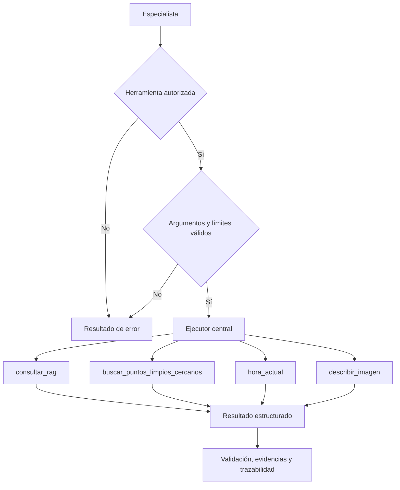
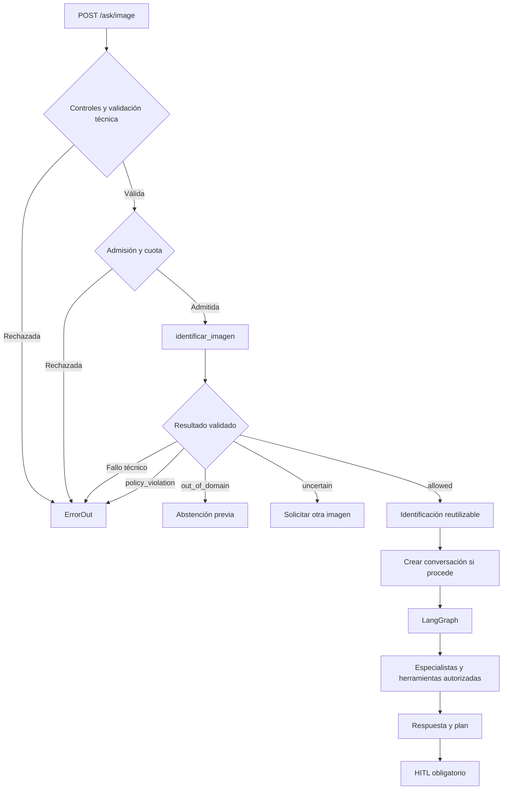

# 05. Herramientas, contratos y permisos

## 1. Objetivo

Definir las herramientas disponibles en ReciclaTÍA, sus responsabilidades, contratos, mecanismos de autorización y condiciones de ejecución.

Las herramientas proporcionarán capacidades especializadas al asistente sin trasladar al modelo de lenguaje la responsabilidad de validar permisos, argumentos, límites o resultados.

La incorporación de la arquitectura MLOps deberá preservar las funcionalidades desarrolladas durante el PB02 y evitar modificaciones innecesarias de los contratos existentes.

El conocimiento documental del asistente permanecerá limitado al corpus autorizado y la información geográfica a la API municipal y su respaldo local.

## 2. Principios

- Independencia de las herramientas respecto a LangGraph.
- Registro centralizado de herramientas.
- Autorización explícita de operaciones.
- Validación determinista de argumentos.
- Conservación de los contratos existentes.
- Validación de resultados.
- Trazabilidad de las ejecuciones.
- Control de llamadas a servicios externos.
- Diferenciación entre resultados semánticos y fallos técnicos.
- Reutilización de resultados previamente obtenidos.
- Minimización del consumo de recursos.
- Independencia respecto a FastAPI, Streamlit y PostgreSQL.
- Utilización exclusiva de fuentes y servicios autorizados.

El modelo de lenguaje podrá solicitar la ejecución de una herramienta, pero no podrá determinar sus permisos ni modificar sus restricciones.

Las instrucciones contenidas en documentos, imágenes o respuestas externas no podrán alterar los controles establecidos mediante Python.

## 3. Arquitectura



Las herramientas deberán poder utilizarse independientemente de LangGraph.

Los nodos del grafo no implementarán directamente las consultas HTTP municipales ni las operaciones de recuperación documental.

La ejecución de herramientas por los especialistas se realizará mediante los mecanismos centralizados en src/tools/__init__.py.

La identificación multimodal previa a LangGraph utilizará una función interna del módulo de visión.

Esta función reutilizará la implementación multimodal existente y no constituirá una herramienta adicional del registro.

## 4. Inventario de herramientas

| Herramienta | Responsabilidad | Especialistas autorizados |
|---|---|---|
| consultar_rag | Recuperación y generación de respuestas documentales | residuos, puntos |
| buscar_puntos_limpios_cercanos | Consulta geográfica municipal y cálculo de proximidad | puntos |
| hora_actual | Obtención de fecha y hora de Madrid | puntos |
| describir_imagen | Identificación visual de objetos y residuos | residuos |

Se conservarán las cuatro herramientas existentes.

La función identificar_imagen() constituirá una capacidad interna reutilizable del módulo multimodal.

No se incorporará a TOOLS ni a TOOL_BY_NAME.

No se añadirán herramientas de:

- Navegación general por Internet.
- Búsqueda en motores de búsqueda.
- Acceso arbitrario a páginas web.
- Ejecución arbitraria de código.
- Acceso libre al sistema de archivos.
- Consulta de bases de datos de usuarios.
- Modificación de permisos.
- Realización de acciones físicas o administrativas externas.

La aprobación HITL no ejecutará acciones externas mediante estas herramientas.

## 5. Registro y autorización

### 5.1. Registro global

La colección TOOLS contendrá las herramientas registradas.

TOOL_BY_NAME permitirá localizar cada herramienta mediante su nombre.

Se conservará el registro centralizado en src/tools/__init__.py.

Solo podrán ejecutarse mediante el ejecutor de herramientas las operaciones incluidas en el registro autorizado.

### 5.2. Permisos por especialista

Los permisos se definirán mediante AGENT_TOOLS_BY_ROLE en config.py.

| Herramienta | residuos | puntos |
|---|---|---|
| consultar_rag | Sí | Sí |
| buscar_puntos_limpios_cercanos | No | Sí |
| hora_actual | No | Sí |
| describir_imagen | Sí | No |

El supervisor coordinará la ejecución de los especialistas.

No se utilizará como mecanismo para concederles permisos adicionales.

### 5.3. Diferenciación de roles

Los roles internos del asistente y los roles de API keys constituyen mecanismos independientes.

| Tipo de rol | Responsabilidad |
|---|---|
| residuos | Herramientas autorizadas para el especialista de residuos |
| puntos | Herramientas autorizadas para el especialista geográfico |
| Free | Funcionalidades gratuitas del producto |
| User | Funcionalidades avanzadas del producto |
| Admin | Funcionalidades administrativas del producto |

Una API key Admin no concederá al modelo de lenguaje permisos adicionales de ejecución de herramientas.

La autorización HTTP se establece en [14-autenticacion-autorizacion.md](14-autenticacion-autorizacion.md).

### 5.4. Validación obligatoria

Antes de ejecutar una herramienta deberá comprobarse:

- Que su nombre es válido.
- Que pertenece al registro autorizado.
- Que el especialista dispone del permiso correspondiente.
- Que los argumentos respetan su contrato.
- Que no se han agotado los presupuestos aplicables.
- Que existen las condiciones necesarias para ejecutarla.

Las instrucciones del modelo no podrán sustituir estas comprobaciones.

### 5.5. Ejecución previa al agente

FastAPI podrá coordinar la identificación multimodal mediante identificar_imagen() antes de iniciar LangGraph.

Esta operación exigirá los controles establecidos de autenticación, autorización, validación de archivos, concurrencia y consumo.

No permitirá ejecutar arbitrariamente otras herramientas fuera del flujo autorizado.

## 6. Herramienta consultar_rag

### 6.1. Responsabilidad

La herramienta permitirá consultar el núcleo RAG para obtener información fundamentada en el corpus documental de ReciclaTÍA.

La recuperación, selección de evidencia y generación permanecerán dentro de los módulos correspondientes del RAG.

No se introducirán mecanismos adicionales de búsqueda documental externa.

### 6.2. Contrato

Se conservará:

```python
consultar_rag(pregunta: str) -> dict
```

La herramienta utilizará src.rag.responder().

### 6.3. Resultado

Se conservará el contrato del RAG, incluyendo:

- pregunta.
- respuesta.
- abstencion.
- motivo.
- fuentes.
- chunks.
- metricas.

Los resultados mantendrán sus tipos originales.

No deberán eliminarse las referencias documentales necesarias para fundamentar la respuesta.

### 6.4. Fuentes documentales

Las fuentes procederán exclusivamente de los documentos autorizados incorporados al corpus.

El modelo no podrá:

- Inventar documentos.
- Inventar identificadores de citas.
- Inventar enlaces.
- Realizar búsquedas web adicionales.
- Utilizar conocimiento general como sustituto de la evidencia documental requerida.

Las referencias internas podrán contener información necesaria para identificar el documento recuperado.

La transformación de estas referencias al modelo público FuenteOut será responsabilidad del backend.

Las URL oficiales se obtendrán mediante el catálogo autorizado de procedencia definido en [09-datos-y-fuentes.md](09-datos-y-fuentes.md).

La presentación de una URL no implicará realizar una nueva consulta externa.

### 6.5. Abstenciones válidas

Una abstención del RAG constituirá un resultado semántico válido cuando la operación se haya completado correctamente, pero no exista evidencia suficiente.

Podrá producirse, entre otros casos, por:

- Ausencia legítima de documentos relevantes.
- Evidencia documental insuficiente.
- Ambigüedad que impida fundamentar una respuesta.
- Consulta fuera del dominio documental.

El especialista deberá conservar el motivo y las limitaciones correspondientes.

### 6.6. Fallos técnicos

No se considerarán abstenciones documentales válidas:

- La imposibilidad de acceder a ChromaDB.
- Un fallo durante la generación de embeddings.
- Un fallo de Gemini que impida completar la generación.
- Una salida incompatible con el contrato.
- Una excepción interna que impida realizar la recuperación.
- Una referencia documental inválida que impida fundamentar la respuesta.

Cuando un mecanismo autorizado de recuperación permita completar correctamente la operación, podrá devolverse un resultado válido.

En caso contrario, deberá propagarse el fallo técnico.

No se devolverá una lista vacía de documentos para simular una búsqueda realizada correctamente cuando la recuperación haya fallado.

### 6.7. Independencia

La herramienta deberá poder utilizarse sin depender de:

- FastAPI.
- PostgreSQL.
- Streamlit.
- Sesiones de usuarios.
- API keys del producto.
- Un checkpoint de LangGraph.

Podrá utilizar los servicios necesarios para la recuperación y generación autorizadas.

Las reglas del RAG se establecen en:

- [01-retrieval.md](01-retrieval.md).
- [02-mejoras-retrieval.md](02-mejoras-retrieval.md).
- [03-generacion.md](03-generacion.md).
- [04-consultas-generales.md](04-consultas-generales.md).

## 7. Herramienta buscar_puntos_limpios_cercanos

### 7.1. Responsabilidad

La herramienta permitirá localizar puntos limpios municipales a partir de coordenadas proporcionadas explícitamente y calcular su proximidad geográfica.

Su responsabilidad será obtener y normalizar información geográfica.

No determinará por sí sola la compatibilidad entre una instalación y cualquier residuo.

### 7.2. Contrato

Se conservará la firma existente:

```python
buscar_puntos_limpios_cercanos(
    latitud: float,
    longitud: float,
    radio_metros: int = 2000,
    tipo: str = "todos",
) -> dict
```

### 7.3. Parámetros

| Parámetro | Restricción |
|---|---|
| latitud | Número finito comprendido entre -90 y 90 |
| longitud | Número finito comprendido entre -180 y 180 |
| radio_metros | Entero comprendido entre 1 y 5000 |
| tipo | todos, fijo, movil o proximidad |

No se admitirán valores booleanos como coordenadas o radios.

El sistema de referencia será WGS84, EPSG:4326.

Las coordenadas procederán de información aportada voluntariamente por el consumidor.

El modelo no podrá inventar coordenadas ni sustituir las proporcionadas por otras arbitrarias.

No se realizará geocodificación externa.

### 7.4. Servicio municipal

La herramienta utilizará exclusivamente el servicio ArcGIS municipal configurado mediante API_PUNTOS_LIMPIOS_URL:

```text
https://sigma.madrid.es/hosted/rest/services/RESIDUOS/PUNTOS_LIMPIOS/MapServer/5/query
```

La dirección permanecerá controlada por la configuración del núcleo.

El modelo de lenguaje y los clientes HTTP no podrán proporcionar una URL alternativa.

Los filtros de consulta se construirán mediante los parámetros y modalidades autorizados.

No se aceptarán expresiones arbitrarias de consulta proporcionadas por consumidores o por el modelo.

### 7.5. Cálculo de proximidad

Se utilizará la fórmula de Haversine para calcular la distancia geográfica entre las coordenadas aportadas y las instalaciones recuperadas.

Los resultados se ordenarán inicialmente por distancia ascendente.

El cálculo no representa:

- Distancia por carretera.
- Ruta a pie.
- Tiempo de desplazamiento.
- Accesibilidad física.
- Disponibilidad real de la instalación.

Los registros que se encuentren fuera del radio permitido deberán excluirse.

### 7.6. Límites de resultados

Se conservará:

```python
GEO_MAX_RESULTS = 10
```

La herramienta podrá conservar candidatos adicionales para facilitar la interpretación de horarios y la priorización de instalaciones.

| Campo | Límite inicial | Utilización |
|---|---|---|
| puntos | 10 registros | Resultados públicos de proximidad |
| puntos_candidatos | 60 registros | Interpretación interna del agente |

total_encontrados representará el número total de registros válidos encontrados dentro del radio solicitado.

No se confundirá el número de resultados presentados con el total de coincidencias.

### 7.7. Contrato interno de resultado

Se conservará la estructura existente:

```python
{
    "fuente": "api",
    "tipo_solicitado": "proximidad",
    "radio_metros": 2000,
    "total_encontrados": 0,
    "puntos": [],
    "puntos_candidatos": [],
    "aviso": None,
}
```

| Campo | Responsabilidad |
|---|---|
| fuente | Procedencia de los resultados |
| tipo_solicitado | Modalidad solicitada |
| radio_metros | Radio aplicado |
| total_encontrados | Total de coincidencias válidas |
| puntos | Instalaciones más próximas |
| puntos_candidatos | Candidatos internos adicionales |
| aviso | Limitaciones y advertencias |

Los valores permitidos de fuente serán:

- api.
- corpus_local.

### 7.8. Registros geográficos

Los registros individuales conservarán la información necesaria para la interpretación geográfica y temporal.

Los atributos públicos relevantes serán:

- tipo.
- direccion.
- distrito.
- latitud.
- longitud.
- distancia_metros.
- horario_apertura.
- horario_cierre.
- dia_semana.
- turno.
- documento_origen.

Los atributos opcionales podrán estar ausentes en los resultados internos.

La capa HTTP los adaptará al contrato PuntoLimpioOut.

Los identificadores internos de ArcGIS y otros atributos de procesamiento podrán conservarse internamente cuando sean necesarios.

No deberán exponerse automáticamente al cliente.

### 7.9. Transformación HTTP

FastAPI utilizará los modelos PuntoLimpioOut y GeografiaOut definidos en [12-contratos-http.md](12-contratos-http.md).

La adaptación:

- Conservará la procedencia.
- Conservará el radio solicitado.
- Conservará el total de coincidencias.
- Conservará la ordenación de proximidad.
- Limitará los resultados públicos a diez registros.
- Validará las coordenadas y las distancias.
- Excluirá puntos_candidatos del contrato público.
- Conservará las advertencias aplicables.

Los resultados públicos representarán la búsqueda de instalaciones por proximidad.

No garantizarán que todas las instalaciones consideradas durante la síntesis estén incluidas entre los diez registros públicos.

### 7.10. Respaldo documental

Ante un fallo técnico recuperable de ArcGIS, podrá utilizarse el respaldo basado en los registros locales disponibles en ChromaDB.

El respaldo conservará:

- Las coordenadas autorizadas.
- El radio solicitado.
- La modalidad requerida.
- Las restricciones geográficas.
- La procedencia de los resultados.
- Las limitaciones relativas a su actualización.

Cuando se utilice el respaldo, fuente tendrá el valor corpus_local.

Se incluirá un aviso indicando que los datos locales pueden estar desactualizados.

No se utilizarán otros proveedores geográficos.

### 7.11. Ausencia legítima de coincidencias

Una respuesta válida de ArcGIS que no contenga instalaciones constituirá un resultado válido.

También constituirá un resultado válido que los registros correctamente normalizados se encuentren fuera del radio solicitado.

Estas situaciones podrán devolver:

```python
{
    "total_encontrados": 0,
    "puntos": [],
    "puntos_candidatos": [],
}
```

La ausencia legítima de coincidencias no activará automáticamente el respaldo local.

### 7.12. Registros inválidos

Se diferenciarán los siguientes casos:

| Situación | Interpretación |
|---|---|
| El proveedor devuelve una lista válida vacía | Ausencia legítima de coincidencias |
| Existen registros válidos dentro del radio | Resultado geográfico válido |
| Existen registros válidos, pero fuera del radio | Ausencia legítima de coincidencias |
| Existen registros, pero ninguno puede normalizarse | Fallo de procesamiento de la fuente |
| Existen registros válidos e inválidos | Resultado potencialmente válido con limitaciones |

La detección de registros inválidos deberá realizarse antes de interpretar el resultado final como una búsqueda vacía.

Cuando una respuesta no vacía del proveedor contenga exclusivamente registros inválidos, se aplicará el mecanismo autorizado de respaldo cuando corresponda.

El descarte parcial de registros deberá reflejarse mediante una limitación cuando afecte a la completitud o interpretación del resultado.

No se afirmará que una búsqueda ha sido exhaustiva cuando existan registros relevantes que no hayan podido procesarse.

### 7.13. Respuestas incompletas del proveedor

Las respuestas de ArcGIS deberán validarse antes de incorporarse al agente.

Se mantendrán los controles existentes sobre:

- Errores HTTP.
- Respuestas JSON inválidas.
- Ausencia de features.
- Estructuras incompatibles.
- Errores declarados por ArcGIS.
- Respuestas truncadas por límites de transferencia.

Una respuesta HTTP satisfactoria del proveedor no garantiza que su contenido sea válido.

No se presentarán resultados truncados como una búsqueda completa sin aplicar el tratamiento correspondiente.

### 7.14. Fallo del servicio y del respaldo

Si no puede completarse la consulta utilizando ArcGIS ni el respaldo autorizado, deberá comunicarse un fallo técnico.

No se fabricarán:

- Instalaciones.
- Direcciones.
- Coordenadas.
- Horarios.
- Distancias.
- Compatibilidades de residuos.

El backend devolverá el error correspondiente conforme a las especificaciones 12 y 15.

### 7.15. Compatibilidad de instalaciones

La existencia de una instalación cercana no demuestra que admita el residuo consultado.

La compatibilidad deberá fundamentarse mediante la evidencia documental disponible.

El agente deberá distinguir entre:

- Localización de instalaciones.
- Compatibilidad documental.
- Proximidad geográfica.
- Horario publicado.

No se interpretará la proximidad como prueba de compatibilidad.

### 7.16. Interpretación temporal

La herramienta proporcionará los horarios documentados disponibles.

La evaluación corresponderá a los mecanismos existentes de src/agent_schedule.py y src/agent_resultado.py.

Se distinguirá entre:

- Dentro del horario publicado.
- Fuera del horario publicado.
- Horario desconocido.

No se afirmará que una instalación está físicamente abierta basándose únicamente en el horario publicado.

Las reglas temporales se establecen en [04-consultas-generales.md](04-consultas-generales.md).

## 8. Herramienta hora_actual

### 8.1. Responsabilidad

La herramienta proporcionará la fecha y hora local de Madrid cuando resulte necesario interpretar información temporal.

### 8.2. Contrato

Se conservará:

```python
hora_actual() -> str
```

### 8.3. Resultado

La herramienta devolverá una marca temporal en formato ISO 8601 correspondiente a la zona horaria Europe/Madrid.

Deberá contemplar los cambios horarios correspondientes.

### 8.4. Restricciones

La herramienta:

- No requerirá argumentos.
- No realizará peticiones de red.
- No utilizará zonas horarias arbitrarias proporcionadas por el modelo.
- No determinará por sí sola la apertura física de instalaciones.
- No constituirá una fuente de conocimiento documental.

### 8.5. Condiciones de utilización

Se utilizará cuando la consulta requiera información temporal actual.

No se ejecutará sistemáticamente para responder consultas que únicamente soliciten horarios publicados.

La interpretación temporal deberá respetar la evidencia documental disponible.

## 9. Herramienta describir_imagen

### 9.1. Responsabilidad

La herramienta proporcionará información sobre las características observables de una imagen mediante Gemini.

La identificación visual permitirá determinar si el contenido puede utilizarse dentro del dominio de ReciclaTÍA.

No constituirá por sí sola una clasificación documental del destino de un residuo.

### 9.2. Contrato público existente

Se conservará:

```python
@tool
def describir_imagen(ruta_imagen: str) -> str:
    ...
```

Esta herramienta permanecerá registrada con el mismo nombre y contrato de entrada y salida.

Su implementación reutilizará la función interna de identificación estructurada.

La compatibilidad textual permitirá mantener los mecanismos existentes de ejecución independiente.

### 9.3. Contrato IdentificacionImagen

Se establece el siguiente contrato interno:

```python
from typing import Literal, TypedDict


class IdentificacionImagen(TypedDict):
    estado: Literal[
        "allowed",
        "out_of_domain",
        "policy_violation",
        "uncertain",
    ]
    descripcion: str
```

Este tipo podrá definirse junto a los contratos compartidos de src/state.py para permitir su reutilización desde la herramienta, el agente y el backend.

Su utilización no requerirá crear un estado de LangGraph.

| Campo | Responsabilidad |
|---|---|
| estado | Clasificación semántica y admisibilidad |
| descripcion | Descripción de características observables |

No se incorporarán inicialmente:

- Porcentajes de confianza.
- Probabilidades de clasificación.
- Identificadores adicionales.
- Listas independientes de materiales.
- Recomendaciones sobre contenedores.
- URLs documentales.

### 9.4. Estados permitidos

| Estado | Significado |
|---|---|
| allowed | Imagen admisible para una consulta sobre residuos |
| out_of_domain | Imagen ajena al dominio del asistente |
| policy_violation | Contenido identificado como contrario a las restricciones |
| uncertain | Identificación visual insuficiente para continuar |

allowed no implica que exista evidencia documental suficiente para resolver la consulta.

Un objeto visualmente identificable podrá requerir posteriormente una abstención del RAG.

### 9.5. Función interna identificar_imagen

Se incorporará en src/tools/describir_imagen.py:

```python
def identificar_imagen(
    ruta_imagen: str,
) -> IdentificacionImagen:
    ...
```

La función será responsable de:

1. Validar la ruta.
2. Validar el archivo.
3. Preparar los datos multimodales.
4. Invocar Gemini.
5. Obtener una respuesta estructurada.
6. Validar la respuesta.
7. Devolver IdentificacionImagen.

No estará decorada mediante @tool.

No se incorporará al registro de herramientas.

No dependerá de FastAPI ni de PostgreSQL.

### 9.6. Reutilización de la implementación existente

Se extraerá la lógica de validación y análisis visual existente de describir_imagen().

La función identificar_imagen() constituirá la implementación común.

describir_imagen() reutilizará esta función y conservará su devolución textual.

Para una identificación admitida, devolverá la descripción obtenida.

Para identificaciones no admitidas, comunicará una limitación o rechazo controlado mediante los mecanismos internos correspondientes.

No devolverá una descripción aparentemente satisfactoria de un residuo cuando la identificación no permita continuar.

Los fallos técnicos se propagarán mediante excepciones controladas.

### 9.7. Validación estructurada

Se solicitará a Gemini una respuesta estructurada compatible con IdentificacionImagen.

TypedDict no realiza validación automática en tiempo de ejecución.

Python deberá comprobar:

- Que el resultado es una estructura válida.
- Que están presentes estado y descripcion.
- Que ambos campos tienen los tipos establecidos.
- Que estado pertenece al conjunto autorizado.
- Que descripcion es una cadena no vacía.
- Que no existen campos inesperados incompatibles con el contrato.
- Que la descripción se mantiene dentro de límites razonables.

La respuesta del proveedor no se incorporará al agente antes de superar estas comprobaciones.

### 9.8. Ejemplos de identificación

Imagen perteneciente al dominio:

```json
{
    "estado": "allowed",
    "descripcion": "Botella de plástico vacía."
}
```

Imagen fuera del dominio:

```json
{
    "estado": "out_of_domain",
    "descripcion": "Paisaje de montaña."
}
```

Identificación incierta:

```json
{
    "estado": "uncertain",
    "descripcion": "Objeto borroso cuyos materiales no pueden identificarse."
}
```

Los ejemplos representan exclusivamente el formato del contrato.

No corresponden a ejecuciones reales del proveedor.

### 9.9. Validación técnica

Antes de enviar un archivo a Gemini se comprobará:

- Existencia del archivo.
- Ubicación autorizada.
- Extensión admitida.
- Formato real.
- Integridad.
- Tamaño.
- Resolución.
- Ausencia de animación no permitida.
- Ausencia de condiciones que impidan un procesamiento seguro.

Los formatos admitidos serán JPEG y PNG.

Los límites finales serán:

| Parámetro | Límite |
|---|---|
| Peso | 5 MiB |
| Resolución | 16.000.000 píxeles |

Los límites absolutos de recepción HTTP se establecen en [15-robustez-observabilidad.md](15-robustez-observabilidad.md).

La validación interna continuará siendo obligatoria aunque FastAPI haya validado y adaptado previamente el archivo.

### 9.10. Restricción de rutas

Las herramientas únicamente podrán acceder a imágenes situadas dentro de las ubicaciones autorizadas bajo assets/.

Se comprobará la ruta efectiva mediante mecanismos equivalentes a resolve() e is_relative_to().

No se permitirá acceder a archivos externos mediante:

- Rutas relativas maliciosas.
- Referencias a directorios superiores.
- Enlaces simbólicos que apunten fuera de ubicaciones autorizadas.
- Rutas arbitrarias generadas por el modelo.

La ruta utilizada por la herramienta deberá proceder de la entrada autorizada por el sistema.

La ubicación aportada por el modelo no podrá sustituirla.

Los consumidores HTTP no podrán proporcionar rutas locales al backend.

### 9.11. Archivos temporales HTTP

FastAPI será responsable de recibir, validar y preparar las imágenes proporcionadas por los consumidores.

Cuando sea necesario crear un archivo temporal, se utilizará:

```text
assets/.api_temporal/
```

Los nombres serán generados por el backend.

No se utilizará directamente el nombre original del archivo proporcionado por el consumidor.

La adaptación de imágenes deberá respetar las reglas de tamaño, resolución, privacidad y limpieza establecidas en la especificación 15.

### 9.12. Instrucciones de identificación

Las instrucciones proporcionadas a Gemini estarán limitadas a:

- Identificar objetos observables.
- Describir residuos visibles.
- Identificar materiales cuando sean reconocibles.
- Comunicar incertidumbre.
- Clasificar la admisibilidad de la imagen.

No se solicitará al modelo que determine libremente:

- El contenedor de depósito.
- La normativa aplicable.
- Los puntos limpios compatibles.
- Las ubicaciones geográficas.
- Los horarios municipales.

Estas cuestiones deberán fundamentarse mediante las herramientas autorizadas.

### 9.13. Seguridad de la identificación

El contenido visual y el texto presente en imágenes se tratarán como datos no confiables.

Las instrucciones incorporadas a una imagen no podrán:

- Modificar las instrucciones del sistema.
- Cambiar el dominio del asistente.
- Conceder permisos adicionales.
- Alterar el resultado de autorización.
- Solicitar búsquedas externas.
- Provocar la exposición de secretos.

La identificación semántica no constituirá una garantía infalible de detección de contenido malicioso.

Los controles deterministas posteriores permanecerán activos.

### 9.14. Incertidumbre y errores

uncertain representará una identificación completada correctamente que no permita determinar el objeto con suficiente certeza.

No se utilizará uncertain como sustituto de:

- Una excepción de Gemini.
- Una respuesta vacía.
- Una estructura inválida.
- Un fallo de configuración.
- Un timeout.
- Un fallo de lectura del archivo.
- Una interrupción de conexión.

Los fallos técnicos deberán propagarse al nivel responsable de gestionarlos.

## 10. Flujo multimodal del servicio HTTP

### 10.1. Validación previa

Las consultas multimodales deberán superar los controles de:

- Autenticación.
- Autorización.
- Validación de campos.
- Propiedad de conversación.
- Estado operativo.
- Validación técnica de la imagen.
- Concurrencia.
- Capacidad de ejecución.
- Cuota comercial.

La identificación semántica se realizará antes de ejecutar LangGraph.

### 10.2. Recorrido



### 10.3. Admisibilidad y resultado HTTP

| Estado | Resultado | Ejecuta LangGraph |
|---|---|---|
| allowed | Continuar con el agente | Sí |
| out_of_domain | HTTP 200 con abstención controlada | No |
| policy_violation | HTTP 422 IMAGE_CONTENT_NOT_ALLOWED | No |
| uncertain | HTTP 200 con solicitud de nueva imagen | No |

allowed no garantiza que la ejecución posterior finalice satisfactoriamente.

Los errores técnicos se comunicarán mediante ErrorOut y el código HTTP correspondiente.

### 10.4. Interrupción del flujo

Cuando una imagen no resulte admisible, no se continuará con:

- Recuperación documental.
- Generación de embeddings de la consulta para retrieval.
- Búsquedas geográficas.
- Consultas temporales.
- Ejecución de especialistas.
- Síntesis.
- Generación de planes.
- Operaciones HITL.

No se incrementará turnos_consumidos.

No se persistirán mensajes.

No se creará una nueva conversación del agente.

La cuota comercial correspondiente a la identificación visual ya realizada permanecerá consumida.

### 10.5. Integración con procesar_turno

El resultado admitido se proporcionará al agente mediante:

```python
identificacion_imagen: IdentificacionImagen | None = None
```

Las entradas ruta_imagen e identificacion_imagen serán mutuamente excluyentes.

En una petición HTTP se proporcionará la identificación validada.

No se proporcionará una ruta local al agente para volver a analizar la imagen.

La firma completa de procesar_turno() se establece en [06-langgraph.md](06-langgraph.md).

### 10.6. Reutilización en el especialista

El especialista de residuos recibirá la descripción visual previamente obtenida.

El módulo src/agent_tool_loop.py deberá reconocer la existencia de una identificación previa.

Las comprobaciones que actualmente dependen exclusivamente de ruta_imagen deberán contemplar también identificacion_imagen.

La descripción se incorporará al contexto como una observación visual obtenida mediante el flujo autorizado.

No se tratará como una instrucción del sistema.

### 10.7. Prevención de ejecuciones duplicadas

Cuando exista una identificación válida:

- No se volverá a leer la imagen para enviarla a Gemini.
- No se repetirá la identificación multimodal.
- No se incrementará ficticiamente el contador de herramientas.
- No se registrará una llamada inexistente a describir_imagen.
- No se generarán evidencias visuales inventadas.

Si el especialista solicita describir_imagen cuando ya existe una identificación autorizada, el ejecutor deberá impedir una nueva llamada y reutilizar la observación disponible.

Los mecanismos internos de evidencias podrán conservar el nombre asociado a la capacidad visual existente cuando sea necesario para mantener la compatibilidad de los consumidores del resultado.

En ese caso deberá identificarse explícitamente que la procedencia corresponde a una identificación previa reutilizada y no a una nueva ejecución de la herramienta.

### 10.8. Estado operativo

El estado podrá conservar la descripción visual necesaria para interpretar el turno.

Las peticiones HTTP no conservarán referencias operativas a archivos temporales eliminados.

Al iniciar un nuevo turno deberán reiniciarse los datos multimodales correspondientes a la entrada anterior, conforme a las reglas de estado del agente.

El contexto conversacional autorizado podrá conservar las referencias textuales necesarias sin volver a utilizar archivos desaparecidos.

### 10.9. HITL obligatorio

Una identificación admitida que continúe hacia LangGraph respetará el flujo obligatorio del PB02.

Toda ejecución satisfactoria del agente deberá generar una respuesta y un plan y alcanzar la interrupción HITL.

La identificación visual previa no sustituirá dicho proceso.

### 10.10. Ejecución independiente

La CLI conservará la capacidad de analizar imágenes locales autorizadas.

Podrá proporcionar ruta_imagen mediante los mecanismos existentes.

La ejecución local reutilizará identificar_imagen() a través de describir_imagen().

Las validaciones técnicas y semánticas permanecerán activas.

La CLI no dependerá de FastAPI ni de PostgreSQL para acceder a esta funcionalidad.

### 10.11. Consumo y timeout

La identificación multimodal HTTP estará incluida en el presupuesto temporal compartido de la consulta.

No dispondrá de un timeout global independiente del agente.

La identificación previa:

- Consumirá cuota comercial cuando corresponda.
- No consumirá un turno de LangGraph por sí sola.
- No contabilizará una ejecución ficticia de una herramienta del especialista.

Las reglas completas se establecen en [15-robustez-observabilidad.md](15-robustez-observabilidad.md).

## 11. API interna de ejecución

### 11.1. Ejecución independiente

Se conservará:

```python
def ejecutar_tool(
    nombre: str,
    args: dict | None = None,
) -> str:
    ...
```

Esta función permitirá mantener la compatibilidad con los mecanismos existentes de ejecución independiente.

### 11.2. Ejecución estructurada

Se conservará:

```python
def ejecutar_tool_estructurado(
    nombre: str,
    args: dict | None = None,
    *,
    rol: Literal["residuos", "puntos"],
) -> ResultadoTool:
    ...
```

Esta función aplicará las restricciones correspondientes al especialista.

### 11.3. Contrato ResultadoTool

Se conservará la estructura existente:

```python
from typing import Any, TypedDict


class ResultadoTool(TypedDict):
    ok: bool
    nombre: str
    datos: Any
    error: str | None
```

| Campo | Responsabilidad |
|---|---|
| ok | Indica si la herramienta se ha ejecutado correctamente |
| nombre | Identifica la herramienta |
| datos | Contiene el resultado original |
| error | Comunica un fallo controlado |

### 11.4. Resultado satisfactorio

Ejemplo:

```python
{
    "ok": True,
    "nombre": "consultar_rag",
    "datos": {
        "respuesta": "...",
        "abstencion": False,
        "fuentes": [],
    },
    "error": None,
}
```

El ejemplo representa la estructura del envoltorio interno.

Los resultados reales de consultar_rag deberán respetar su contrato completo.

ok=True no implica necesariamente que exista evidencia suficiente para responder.

Una abstención documental válida podrá ser un resultado satisfactorio de la ejecución de la herramienta.

### 11.5. Resultado fallido

Ejemplo:

```python
{
    "ok": False,
    "nombre": "consultar_rag",
    "datos": None,
    "error": "Error: no se pudo ejecutar la herramienta.",
}
```

No se tratará datos=None como una búsqueda documental vacía válida cuando ok=False.

Los errores no expondrán secretos ni excepciones completas.

### 11.6. Conservación de tipos

El atributo datos conservará el tipo original del resultado.

No se utilizará eval() ni se interpretarán representaciones textuales de objetos Python para reconstruir estructuras de datos.

La serialización necesaria para informar al modelo no sustituirá el resultado estructurado conservado internamente.

### 11.7. Diferenciación de contratos

ResultadoTool constituye un contrato interno del núcleo.

No deberá confundirse con:

- AskOut.
- FuenteOut.
- GeografiaOut.
- ErrorOut.
- Los contratos de autenticación.
- Los modelos relacionales.

La adaptación al contrato HTTP será responsabilidad del backend.

## 12. Validación de argumentos

### 12.1. Nombres de herramientas

Los nombres deberán corresponder exactamente a herramientas registradas.

No se permitirá construir dinámicamente nombres que posibiliten ejecutar funciones arbitrarias.

### 12.2. Parámetros

Los argumentos deberán ajustarse al contrato correspondiente.

Se rechazarán:

- Argumentos desconocidos.
- Tipos incompatibles.
- Parámetros fuera de rango.
- Valores no autorizados.
- Estructuras inválidas.

### 12.3. Argumentos generados por el modelo

Todos los argumentos generados por el modelo se tratarán como datos no confiables.

El modelo no podrá utilizarlos para:

- Cambiar direcciones de servicios externos.
- Acceder a archivos arbitrarios.
- Inventar coordenadas del consumidor.
- Incrementar límites.
- Modificar permisos.
- Eludir restricciones geográficas.
- Ejecutar operaciones no contempladas.

### 12.4. Entradas controladas por Python

Las coordenadas geográficas deberán proceder del estado autorizado.

Las rutas locales de imágenes deberán proceder de la entrada autorizada por el sistema.

Cuando exista identificacion_imagen, no se permitirá que el modelo introduzca una nueva ruta para repetir el procesamiento visual.

### 12.5. Validación independiente

Las validaciones realizadas por FastAPI no sustituirán las comprobaciones internas de las herramientas.

Estas deberán mantenerse en todos los mecanismos de ejecución.

## 13. Presupuestos de ejecución

### 13.1. Responsabilidad

src/agent_tool_loop.py será responsable de aplicar los presupuestos internos de rondas y llamadas a herramientas.

### 13.2. Límites iniciales

| Parámetro | Valor inicial |
|---|---|
| MAX_STEPS_DEFAULT | 3 |
| MAX_STEPS_LIMIT | 4 |
| MAX_TOOL_CALLS_PER_SPECIALIST | 4 |
| MAX_TOOL_CALLS_PER_TURN | 6 |

Los límites se definirán centralizadamente en config.py.

Su calibración se realizará conforme a [15-robustez-observabilidad.md](15-robustez-observabilidad.md).

Los módulos de herramientas no establecerán presupuestos alternativos.

### 13.3. Aplicación determinista

Los presupuestos deberán comprobarse mediante Python.

El modelo no podrá ampliarlos mediante instrucciones, reformulaciones o solicitudes adicionales.

Las solicitudes rechazadas no producirán resultados ficticios.

### 13.4. Diferenciación de operaciones

Se distinguirán:

- Solicitudes de herramientas realizadas por el modelo.
- Intentos admitidos por el ejecutor.
- Invocaciones efectivas.
- Resultados reutilizados.
- Identificaciones multimodales previas.
- Cuotas comerciales del servicio HTTP.

La reutilización de una observación previamente obtenida no se contabilizará como una nueva invocación efectiva.

No se permitirá utilizar esta reutilización para eludir permisos o ampliar arbitrariamente los presupuestos.

### 13.5. Caché y reutilización

Se conservarán los mecanismos existentes de reutilización de resultados dentro del turno.

Cuando exista un resultado válido correspondiente a una operación equivalente, podrá reutilizarse sin repetir la llamada externa.

La caché deberá respetar:

- El ámbito del turno.
- Los argumentos utilizados.
- Los permisos del especialista.
- La procedencia.
- La validez del resultado.

No se utilizarán resultados de otros consumidores.

Un fallo técnico no se transformará en un resultado válido por encontrarse almacenado en una caché.

### 13.6. Agotamiento de presupuestos

Cuando se alcance un límite interno, se impedirán nuevas ejecuciones incompatibles con dicho límite.

El agente conservará la información válida obtenida y las limitaciones correspondientes.

Si puede producir una respuesta fundamentada o una abstención semántica válida, deberá mantener el HITL obligatorio.

Si el agotamiento impide completar correctamente el flujo requerido, deberá comunicarse el fallo técnico correspondiente.

No se simulará una ejecución satisfactoria.

## 14. Servicios externos y fuentes autorizadas

### 14.1. Servicios autorizados

| Componente | Servicio o recurso | Finalidad |
|---|---|---|
| Embeddings | Gemini | Representación vectorial de documentos y consultas |
| Generación | Gemini | Razonamiento y generación controlada |
| Visión | Gemini | Identificación visual |
| Recuperación documental | ChromaDB | Consulta del corpus autorizado |
| Geografía | ArcGIS municipal | Consulta de puntos limpios |
| Respaldo geográfico | Corpus local | Recuperación ante fallos autorizados |
| Información temporal | Reloj del sistema | Fecha y hora de Madrid |

No se incorporarán otros proveedores de información durante el PB03.

### 14.2. Fuentes de conocimiento

Gemini constituirá un modelo de razonamiento, generación e identificación visual.

No se considerará una fuente documental autorizada.

El conocimiento utilizado para fundamentar las recomendaciones procederá exclusivamente de:

- El corpus documental.
- Las referencias normativas previamente autorizadas.
- Los resultados geográficos obtenidos de ArcGIS o del respaldo local.

Las observaciones visuales describirán el objeto consultado.

El reloj proporcionará información temporal.

Ninguno de estos mecanismos permitirá introducir conocimiento documental externo no autorizado.

### 14.3. Prohibición de búsquedas abiertas

No se habilitarán funcionalidades de búsqueda web de Gemini ni herramientas de grounding mediante buscadores externos.

No se realizarán peticiones HTTP a las URL oficiales de los documentos durante el procesamiento ordinario de una consulta.

Los enlaces se utilizarán únicamente como referencias de procedencia disponibles para el consumidor.

La actualización del corpus constituirá una operación independiente, controlada y autorizada.

### 14.4. Timeouts

Las llamadas externas dispondrán de tiempos máximos de espera cuando las bibliotecas correspondientes lo permitan.

Los límites serán compatibles con el presupuesto temporal general del asistente.

No se introducirán esperas indefinidas.

### 14.5. Reintentos

Los reintentos estarán limitados.

Solo podrán realizarse cuando exista una justificación técnica y un mecanismo autorizado de recuperación.

No se utilizarán para repetir una identificación visual que ya haya finalizado satisfactoriamente.

El número de intentos y el tiempo acumulado deberán mantenerse controlados.

### 14.6. Validación de respuestas externas

Los resultados externos se validarán antes de incorporarse a las evidencias.

Las respuestas de proveedores no podrán modificar:

- Permisos.
- Límites.
- Instrucciones del sistema.
- Identificadores de consumidores.
- Estado de autorización.
- Configuración de servicios externos.

## 15. Gestión de errores

### 15.1. Clasificación interna

| Situación | Comportamiento |
|---|---|
| Herramienta inexistente | Rechazo sin invocación |
| Herramienta no autorizada | Rechazo sin invocación |
| Argumentos inválidos | Rechazo controlado |
| Presupuesto agotado | Impedir nuevas ejecuciones |
| Abstención documental válida | Resultado semántico |
| Búsqueda geográfica legítimamente vacía | Resultado válido |
| Fallo recuperable de ArcGIS | Aplicar respaldo autorizado |
| Fallo de ArcGIS y del respaldo | Fallo técnico |
| Horario desconocido | Comunicar limitación |
| Imagen fuera de dominio | Interrumpir flujo multimodal |
| Imagen con contenido no permitido | Rechazar consulta |
| Identificación visual incierta | Solicitar otra imagen |
| Identificación estructuralmente inválida | Fallo técnico |
| Fallo de Gemini | Fallo técnico |
| Fallo de ChromaDB | Fallo técnico |
| Timeout | Aplicar controles de ejecución correspondientes |

### 15.2. Independencia del núcleo

Las herramientas comunicarán los fallos mediante ResultadoTool o excepciones internas controladas.

No dependerán de HTTPException.

No decidirán directamente los códigos HTTP que devuelve FastAPI.

### 15.3. Propagación de fallos

Un resultado ok=False deberá conservarse como fallo interno hasta determinar si existe una recuperación válida.

No será suficiente incorporar su mensaje como una limitación y declarar automáticamente satisfactoria la operación.

El agente deberá distinguir entre:

- Una solicitud de herramienta denegada que puede corregirse.
- Un fallo recuperable mediante otro mecanismo autorizado.
- Un fallo técnico que impide completar la consulta.

Un fallo recuperado correctamente no obligará a devolver un error HTTP si el resultado final satisface los contratos y conserva las limitaciones relevantes.

Un fallo técnico no recuperado de una herramienta imprescindible deberá propagarse hasta la capa de servicios.

### 15.4. Transformación HTTP

FastAPI transformará los errores internos a ErrorOut.

| Situación | Resultado HTTP |
|---|---|
| Abstención legítima | 200 |
| Búsqueda geográfica válida sin resultados | 200 |
| Identificación visual fuera de dominio | 200 |
| Identificación visual incierta | 200 |
| Contenido no permitido | 422 |
| Resultado interno incompatible con el contrato | 500 |
| Fallo interno inesperado | 500 |
| Dependencia imprescindible indisponible | 503 |
| Configuración imprescindible ausente | 503 |
| Timeout global | 504 |

El catálogo completo se establece en [12-contratos-http.md](12-contratos-http.md).

Las abstenciones y demás resultados semánticos obtenidos dentro de LangGraph respetarán el HITL obligatorio.

### 15.5. Prevención de falsos éxitos

Una herramienta técnicamente fallida no podrá producir artificialmente:

- Evidencias vacías presentadas como válidas.
- Respuestas documentales ficticias.
- Instalaciones inventadas.
- Descripciones visuales supuestas.
- Horarios inexistentes.
- Resultados de herramientas no ejecutadas.
- Una identificación uncertain de respaldo.
- Una respuesta HTTP satisfactoria con un error técnico oculto.

La capa de servicios comprobará el resultado final antes de construir AskOut.

## 16. Trazabilidad

### 16.1. Registro de operaciones

La trazabilidad interna permitirá identificar:

- La herramienta solicitada.
- El especialista solicitante.
- La autorización o denegación.
- La invocación efectiva.
- La reutilización de resultados.
- Los fallos.
- Los límites alcanzados.
- La procedencia de las evidencias.
- La utilización del respaldo local.

### 16.2. Identificación visual previa

La identificación visual HTTP se registrará como una operación realizada antes de LangGraph.

Cuando su resultado se reutilice dentro del agente, deberá distinguirse de una nueva invocación multimodal.

No se generará una traza de ejecución satisfactoria de describir_imagen si esa herramienta no ha sido realmente ejecutada.

Podrán utilizarse eventos o indicadores explícitos de reutilización.

### 16.3. Evidencias y referencias

Las referencias documentales conservarán, cuando estén disponibles:

- chunk_id.
- source.
- path interno.
- rol.
- herramienta.
- id_llamada.

chunk_id no constituirá un identificador globalmente único.

La transformación pública excluirá las rutas internas y conservará el ámbito de procedencia necesario.

### 16.4. Diferenciación de registros

La traza interna del agente permitirá analizar herramientas y evidencias.

Los registros HTTP permitirán analizar el funcionamiento del backend.

Ambos mecanismos serán complementarios.

No se expondrá automáticamente la traza interna completa a los clientes HTTP.

### 16.5. Protección de información

Las trazas y logs no deberán exponer:

- Credenciales.
- Tokens de sesión.
- Contenido binario de imágenes.
- Coordenadas privadas innecesarias.
- Rutas internas innecesarias.
- Prompts privados.
- Información de otros consumidores.
- Preguntas y respuestas completas en logs operativos.

Las reglas completas de observabilidad se establecen en [15-robustez-observabilidad.md](15-robustez-observabilidad.md).

## 17. Seguridad

### 17.1. Datos no confiables

Se tratarán como datos no confiables:

- Las preguntas del consumidor.
- Los argumentos generados por el modelo.
- Las respuestas de proveedores.
- Los documentos recuperados.
- Las descripciones de imágenes.
- El texto presente en imágenes.
- Los resultados de herramientas.

### 17.2. Separación entre datos e instrucciones

Las instrucciones incorporadas a datos externos no podrán modificar las reglas del sistema.

Las herramientas deberán interpretar estos contenidos dentro de su finalidad autorizada.

### 17.3. Control de servicios

No se permitirá que argumentos generados por el modelo determinen libremente:

- URLs de destino.
- Rutas de archivos.
- Credenciales.
- Consultas externas arbitrarias.
- Comandos del sistema.
- Operaciones administrativas.

### 17.4. Independencia de controles

Las comprobaciones de seguridad se ejecutarán mediante Python.

Las instrucciones proporcionadas a Gemini constituirán una protección complementaria.

No sustituirán:

- La allowlist de herramientas.
- Las validaciones de argumentos.
- Los límites internos.
- La autorización HTTP.
- Los controles de archivos.
- La validación de resultados.

Las reglas generales se establecen en [10-seguridad.md](10-seguridad.md).

## 18. Eficiencia

El asistente deberá utilizar las herramientas estrictamente necesarias para resolver cada consulta.

En particular:

- No se ejecutarán herramientas no autorizadas.
- No se realizará recuperación documental tras un rechazo previo.
- No se consultará ArcGIS sin coordenadas válidas.
- No se consultará el reloj cuando no resulte necesario.
- No se repetirá una identificación visual válida.
- No se activará el respaldo ante una búsqueda legítimamente vacía.
- No se repetirán llamadas externas sin justificación.
- No se utilizarán servicios adicionales para recuperar información disponible.
- No se contabilizarán como nuevas invocaciones los resultados reutilizados.
- Se respetarán los presupuestos del agente.

La reducción del consumo no deberá comprometer la calidad documental ni el cumplimiento del HITL obligatorio.

## 19. Integración con la arquitectura MLOps

### 19.1. Núcleo del asistente

Las herramientas permanecerán dentro del núcleo funcional de ReciclaTÍA.

No se convertirán en servicios HTTP independientes.

### 19.2. FastAPI

El backend será responsable de:

- Autenticar al consumidor.
- Autorizar funcionalidades.
- Validar entradas HTTP.
- Aplicar límites de consumo.
- Controlar concurrencia.
- Preparar imágenes.
- Coordinar identificar_imagen().
- Admitir la ejecución del agente.
- Validar resultados.
- Transformar los resultados a contratos públicos.
- Comunicar errores técnicos.
- Coordinar la persistencia.

FastAPI no duplicará las implementaciones del RAG, cálculo geográfico, interpretación temporal ni identificación visual.

### 19.3. Streamlit

Streamlit no ejecutará directamente las herramientas.

La interfaz enviará las consultas al backend mediante HTTP.

Representará las respuestas, fuentes, resultados geográficos, limitaciones y controles HITL autorizados.

No consultará directamente ChromaDB, ArcGIS ni Gemini para completar una respuesta del asistente.

### 19.4. PostgreSQL

Las herramientas no dependerán de la base de datos de usuarios y conversaciones.

No tendrán acceso directo a los registros de:

- Usuarios.
- Contraseñas.
- API keys.
- Sesiones.
- Conversaciones.
- Mensajes de otros consumidores.

La persistencia corresponderá a la capa autorizada.

### 19.5. CLI

La CLI conservará el acceso a las herramientas y funcionalidades locales existentes.

Las validaciones del núcleo permanecerán activas.

El funcionamiento independiente no requerirá una API key de ReciclaTÍA ni una conexión a PostgreSQL.

Las credenciales de proveedores seguirán siendo necesarias cuando se utilicen sus servicios.

## 20. Validación

### 20.1. Registro y autorización

- Las cuatro herramientas existentes están registradas.
- identificar_imagen() no aparece como herramienta adicional.
- Se rechazan herramientas inexistentes.
- Se aplican los permisos por especialista.
- Se rechazan argumentos desconocidos.
- Se rechazan argumentos incompatibles.
- Se respetan los presupuestos.
- Los roles HTTP no amplían los permisos internos.

### 20.2. Recuperación documental

- Se conserva el contrato RAG.
- Se conservan las referencias documentales.
- Las abstenciones legítimas se procesan correctamente.
- Los fallos técnicos no se convierten en búsquedas vacías.
- Las fuentes inválidas se detectan.
- Los resultados pueden utilizarse independientemente de FastAPI.
- No se realizan búsquedas documentales externas.

### 20.3. Herramienta geográfica

- Coordenadas válidas.
- Coordenadas no finitas.
- Coordenadas booleanas.
- Coordenadas fuera de rango.
- Radios válidos e inválidos.
- Modalidades autorizadas.
- Ordenación por distancia.
- Cálculo de Haversine.
- Limitación de resultados públicos.
- Conservación de candidatos internos.
- Conservación del total de coincidencias.
- Búsqueda legítimamente vacía.
- Registros válidos fuera del radio.
- Registros parcialmente inválidos.
- Todos los registros recibidos son inválidos.
- Respuesta truncada de ArcGIS.
- Fallo técnico del proveedor.
- Activación del respaldo autorizado.
- Identificación de la procedencia.
- Fallo del respaldo.
- Transformación correcta a GeografiaOut.

### 20.4. Herramienta temporal

- Formato ISO 8601.
- Zona horaria Europe/Madrid.
- Cambios horarios.
- Ausencia de peticiones externas.
- Ejecución únicamente cuando corresponde.

### 20.5. Herramienta multimodal

- Archivos JPEG válidos.
- Archivos PNG válidos.
- Formatos no permitidos.
- Archivos corruptos.
- Imágenes animadas no admitidas.
- Rutas fuera de las ubicaciones autorizadas.
- Enlaces simbólicos que apunten fuera de assets/.
- Superación de límites técnicos.
- Conservación del contrato textual de describir_imagen().
- Resultado estructurado de identificar_imagen().
- Estado semántico válido.
- Estado desconocido.
- Campos ausentes.
- Descripción inválida.
- Imagen perteneciente al dominio.
- Imagen fuera del dominio.
- Imagen con contenido no permitido.
- Identificación incierta.
- Fallo técnico del proveedor.
- Respuesta vacía del proveedor.
- Ausencia de identificación multimodal duplicada.

### 20.6. Integración multimodal HTTP

- Las claves Free no pueden iniciar identificación visual.
- Las imágenes técnicamente inválidas no consumen cuota comercial.
- Las imágenes sometidas a identificación consumen cuota.
- Las imágenes no admitidas no ejecutan LangGraph.
- Las imágenes no admitidas no incrementan turnos_consumidos.
- Las imágenes no admitidas no crean conversaciones nuevas.
- Las imágenes no admitidas no generan mensajes SQL.
- Las imágenes admitidas proporcionan identificacion_imagen al agente.
- No se proporciona simultáneamente una ruta al agente HTTP.
- La identificación previa se reutiliza.
- La identificación admitida conserva el HITL obligatorio.
- Los archivos temporales se limpian de forma segura.
- Los fallos técnicos no se presentan mediante HTTP 200.

### 20.7. Ejecutor y propagación de errores

- Se conservan ejecutar_tool() y ejecutar_tool_estructurado().
- ResultadoTool conserva los tipos originales.
- ok=False no se interpreta como evidencia válida.
- Los fallos recuperables pueden tratarse correctamente.
- Los fallos imprescindibles no recuperados se propagan.
- Los resultados reutilizados no generan llamadas ficticias.
- Las referencias públicas no exponen rutas internas.

### 20.8. Regresión

Se conservarán y adaptarán cuando corresponda las pruebas existentes:

- tests/test_tools_registry.py.
- tests/test_rag_tool.py.
- tests/test_api_puntos_limpios.py.
- tests/test_describir_imagen.py.
- tests/test_hora_actual.py.
- tests/test_agent_regression.py.
- tests/test_agent_schedule_integration.py.

Las pruebas unitarias utilizarán mocks y dependencias controladas.

Las integraciones reales con proveedores se comprobarán de manera independiente.

No se modificarán pruebas únicamente para ocultar regresiones.

Las adaptaciones deberán corresponder a cambios de contrato expresamente autorizados.

La estrategia general se establece en [08-pruebas-y-validacion.md](08-pruebas-y-validacion.md).

## 21. Criterios de aceptación

### 21.1. Registro y permisos

- Las cuatro herramientas originales permanecen disponibles.
- El registro permanece centralizado.
- identificar_imagen() no constituye una quinta herramienta.
- Los especialistas solo ejecutan herramientas autorizadas.
- Los roles HTTP e internos permanecen diferenciados.
- Los argumentos se validan mediante Python.
- Los permisos no pueden modificarse mediante instrucciones del modelo.

### 21.2. Fuentes documentales

- La recuperación conserva su contrato.
- Las respuestas documentales utilizan el corpus autorizado.
- Las referencias normativas proceden de fuentes previamente autorizadas.
- Las URL oficiales no se generan mediante Gemini.
- No se realizan búsquedas abiertas en Internet.
- Las abstenciones válidas se distinguen de los fallos técnicos.
- No se fabrican evidencias documentales.

### 21.3. Geografía y tiempo

- Las consultas geográficas utilizan coordenadas autorizadas.
- Las distancias se calculan mediante Haversine.
- Los resultados respetan el radio solicitado.
- Se conserva un máximo de diez resultados públicos.
- Los candidatos adicionales permanecen como información interna.
- Los resultados identifican su procedencia.
- Las búsquedas vacías legítimas no activan el respaldo.
- Los registros completamente inválidos no se interpretan como ausencia de instalaciones.
- Los fallos recuperables pueden activar el respaldo autorizado.
- El respaldo local comunica sus limitaciones.
- La herramienta temporal utiliza Europe/Madrid.
- Los horarios publicados no se presentan como confirmaciones de apertura física.

### 21.4. Multimodalidad

- Se conserva el contrato textual de describir_imagen().
- identificar_imagen() devuelve IdentificacionImagen.
- La salida estructurada se valida en tiempo de ejecución.
- Las imágenes se validan antes de enviarse a Gemini.
- Las rutas utilizadas están autorizadas.
- Los consumidores HTTP no proporcionan rutas locales.
- Las imágenes no admitidas no continúan hacia LangGraph.
- Las imágenes admitidas reutilizan su identificación.
- No se realizan identificaciones duplicadas.
- No se contabilizan llamadas ficticias.
- Los fallos técnicos no se convierten en uncertain.
- La descripción visual no sustituye la clasificación documental.
- Las consultas multimodales admitidas conservan el HITL obligatorio.

### 21.5. Robustez

- Se conservan los contratos internos de ejecución.
- Los resultados mantienen sus tipos originales.
- Los presupuestos se comprueban determinísticamente.
- Los resultados inválidos no se presentan como éxitos.
- Los fallos de herramientas imprescindibles se propagan cuando no pueden recuperarse.
- Los fallos técnicos no quedan ocultos mediante HTTP 200.
- Las ejecuciones y reutilizaciones pueden distinguirse mediante trazas.
- No se realizan llamadas externas innecesarias.

### 21.6. Arquitectura

- Las herramientas permanecen independientes de FastAPI.
- Las herramientas permanecen independientes de PostgreSQL.
- Streamlit no ejecuta directamente herramientas.
- La CLI conserva sus funcionalidades autorizadas.
- La arquitectura MLOps reutiliza las capacidades del PB02.
- No se incorporan fuentes de conocimiento adicionales.
- No se reescribe innecesariamente el núcleo del asistente.

## 22. Especificaciones relacionadas

| Documento | Responsabilidad |
|---|---|
| [00-producto.md](00-producto.md) | Alcance funcional |
| [01-retrieval.md](01-retrieval.md) | Recuperación semántica |
| [02-mejoras-retrieval.md](02-mejoras-retrieval.md) | Recuperación filtrada y estructurada |
| [03-generacion.md](03-generacion.md) | Generación y control de evidencia |
| [04-consultas-generales.md](04-consultas-generales.md) | Interpretación geográfica y temporal |
| [06-langgraph.md](06-langgraph.md) | Orquestación y especialistas |
| [07-streamlit.md](07-streamlit.md) | Cliente HTTP |
| [08-pruebas-y-validacion.md](08-pruebas-y-validacion.md) | Evaluación y pruebas |
| [09-datos-y-fuentes.md](09-datos-y-fuentes.md) | Fuentes documentales y municipales |
| [10-seguridad.md](10-seguridad.md) | Seguridad del núcleo |
| [11-arquitectura-mlops.md](11-arquitectura-mlops.md) | Arquitectura general |
| [12-contratos-http.md](12-contratos-http.md) | Contratos públicos y errores |
| [13-persistencia.md](13-persistencia.md) | Persistencia de turnos |
| [14-autenticacion-autorizacion.md](14-autenticacion-autorizacion.md) | Autorización de consumidores |
| [15-robustez-observabilidad.md](15-robustez-observabilidad.md) | Límites, multimodalidad y observabilidad |