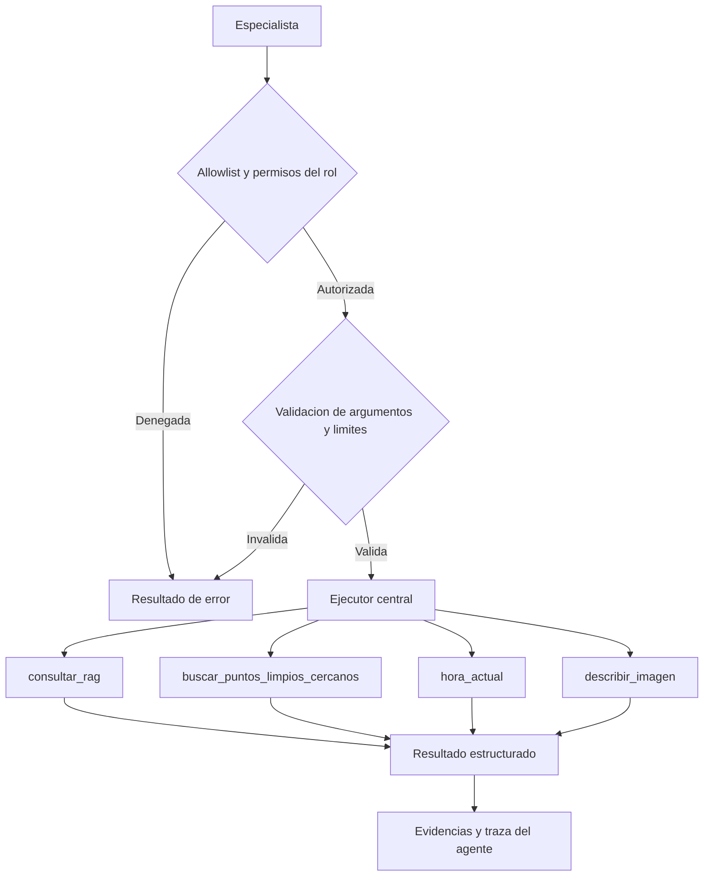
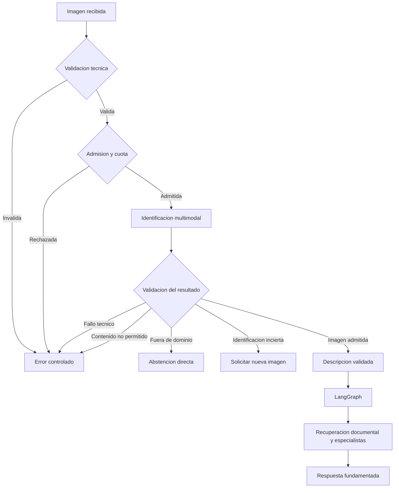

# 05. Herramientas, contratos y permisos

## 1. Objetivo

Definir las herramientas disponibles en ReciclaTÍA, sus responsabilidades, contratos, mecanismos de autorización y condiciones de ejecución.

Las herramientas proporcionarán capacidades especializadas al asistente sin trasladar al modelo de lenguaje la responsabilidad de validar permisos, argumentos, límites o resultados.

## 2. Principios

- Independencia de las herramientas respecto al grafo.
- Registro centralizado de herramientas.
- Autorización explícita de operaciones.
- Validación determinista de argumentos.
- Conservación de los contratos de entrada y salida.
- Trazabilidad de las ejecuciones.
- Control de llamadas a servicios externos.
- Diferenciación entre resultados válidos y fallos técnicos.
- Reutilización de resultados previamente obtenidos.
- Independencia respecto a FastAPI, Streamlit y PostgreSQL.

El modelo de lenguaje podrá solicitar la ejecución de una herramienta, pero no podrá determinar libremente sus permisos ni modificar sus restricciones.

## 3. Arquitectura



Las herramientas deberán poder utilizarse independientemente de LangGraph.

Los nodos del grafo no implementarán directamente las consultas HTTP municipales ni las operaciones de recuperación documental.

La ejecución de herramientas por parte de los especialistas se realizará mediante los mecanismos centralizados en src/tools/__init__.py.

La validación multimodal previa a LangGraph podrá utilizar la capacidad de identificación visual mediante una operación controlada por Python.

## 4. Inventario de herramientas

| Herramienta | Responsabilidad | Especialistas autorizados |
|---|---|---|
| consultar_rag | Recuperación y generación de respuestas documentales | residuos, puntos |
| buscar_puntos_limpios_cercanos | Consulta geográfica municipal y cálculo de proximidad | puntos |
| hora_actual | Obtención de fecha y hora de Madrid | puntos |
| describir_imagen | Identificación visual de objetos y residuos | residuos |

La herramienta describir_imagen también podrá utilizarse mediante el flujo controlado de validación multimodal previo a LangGraph.

Esta utilización no implica conceder permisos adicionales a los especialistas.

No se incorporarán herramientas de ejecución arbitraria de código, acceso libre al sistema de archivos ni navegación general por Internet.

## 5. Registro y autorización

### 5.1. Registro global

La colección TOOLS contendrá las herramientas registradas.

TOOL_BY_NAME permitirá identificar cada herramienta mediante su nombre.

Solo podrán ejecutarse herramientas incluidas en el registro autorizado.

### 5.2. Permisos por especialista

Los permisos de los especialistas se definirán mediante AGENT_TOOLS_BY_ROLE en config.py.

| Herramienta | residuos | puntos |
|---|---|---|
| consultar_rag | Sí | Sí |
| buscar_puntos_limpios_cercanos | No | Sí |
| hora_actual | No | Sí |
| describir_imagen | Sí | No |

### 5.3. Diferenciación de roles

Los roles internos del asistente y los roles de las API keys constituyen mecanismos independientes.

Los roles residuos y puntos determinan qué herramientas puede utilizar cada especialista.

Los roles Free, User y Admin determinan las funcionalidades del producto a las que puede acceder un consumidor.

Una API key Admin no concede al modelo de lenguaje permisos adicionales de ejecución de herramientas.

La autorización de los consumidores se define en [14-autenticacion-autorizacion.md](14-autenticacion-autorizacion.md).

### 5.4. Validación obligatoria

Antes de ejecutar una herramienta deberá comprobarse:

- Que la herramienta existe.
- Que pertenece al registro autorizado.
- Que el especialista dispone de permiso para utilizarla.
- Que los argumentos son válidos.
- Que no se han agotado los límites correspondientes.
- Que se cumplen las condiciones específicas de ejecución.

Las instrucciones del modelo no podrán sustituir estas comprobaciones.

## 6. Herramienta consultar_rag

### 6.1. Responsabilidad

La herramienta permitirá consultar el núcleo RAG para obtener información fundamentada en el corpus documental.

La recuperación, selección de evidencia y generación permanecerán dentro de los módulos correspondientes del RAG.

### 6.2. Contrato

```python
consultar_rag(pregunta: str) -> dict
```

La herramienta utilizará src.rag.responder().

### 6.3. Resultado

Se conservará el contrato público del RAG, incluyendo:

- pregunta.
- respuesta.
- abstencion.
- motivo.
- fuentes.
- chunks.
- metricas.

La herramienta no deberá eliminar las referencias documentales necesarias para fundamentar la respuesta.

### 6.4. Abstenciones

Una abstención del RAG constituye un resultado semántico válido.

No deberá interpretarse automáticamente como un fallo técnico de la herramienta.

Cuando el RAG no disponga de evidencia suficiente, el especialista deberá conservar esta limitación.

### 6.5. Independencia

La herramienta deberá poder utilizarse sin depender de:

- FastAPI.
- PostgreSQL.
- Streamlit.
- Sesiones de usuario.
- API keys del producto.
- Estado de LangGraph.

La herramienta podrá depender de los servicios externos necesarios para realizar la recuperación y generación.

Las reglas del RAG se definen en:

- [01-retrieval.md](01-retrieval.md).
- [02-mejoras-retrieval.md](02-mejoras-retrieval.md).
- [03-generacion.md](03-generacion.md).
- [04-consultas-generales.md](04-consultas-generales.md).

## 7. Herramienta buscar_puntos_limpios_cercanos

### 7.1. Responsabilidad

La herramienta permitirá localizar puntos limpios municipales a partir de coordenadas explícitamente proporcionadas y calcular su proximidad geográfica.

### 7.2. Contrato

```python
buscar_puntos_limpios_cercanos(
    latitud,
    longitud,
    radio_metros=2000,
    tipo="todos",
) -> dict
```

### 7.3. Parámetros

| Parámetro | Restricción |
|---|---|
| latitud | Coordenada numérica finita comprendida entre -90 y 90 |
| longitud | Coordenada numérica finita comprendida entre -180 y 180 |
| radio_metros | Número entero comprendido entre 1 y 5000 |
| tipo | todos, fijo, movil o proximidad |

El sistema de referencia de coordenadas será WGS84, EPSG:4326.

Las coordenadas deberán proceder de información proporcionada explícitamente por el consumidor.

No se utilizarán coordenadas predeterminadas sin autorización.

### 7.4. Servicio municipal

La herramienta utilizará el servicio ArcGIS municipal:

```text
https://sigma.madrid.es/hosted/rest/services/RESIDUOS/PUNTOS_LIMPIOS/MapServer/5/query
```

La dirección del servicio deberá estar controlada por el código de la herramienta.

El modelo de lenguaje y los clientes HTTP no podrán proporcionar direcciones arbitrarias para sustituir el servicio autorizado.

### 7.5. Cálculo de proximidad

La herramienta utilizará la fórmula de Haversine para calcular la distancia geográfica entre las coordenadas proporcionadas y las instalaciones recuperadas.

Los resultados se ordenarán inicialmente por distancia ascendente.

El cálculo no representa:

- Distancia por carretera.
- Ruta a pie.
- Tiempo de desplazamiento.
- Accesibilidad física.
- Disponibilidad real de la instalación.

### 7.6. Límites de resultados

Se conservará el límite máximo de presentación de 10 puntos limpios.

La herramienta deberá informar del número total de coincidencias encontradas, aunque la cantidad de instalaciones devueltas esté limitada.

### 7.7. Contrato de resultado

```python
{
    "fuente": "api",
    "tipo_solicitado": "proximidad",
    "radio_metros": 2000,
    "total_encontrados": 0,
    "puntos": [],
    "aviso": None,
}
```

| Campo | Responsabilidad |
|---|---|
| fuente | Procedencia de los resultados |
| tipo_solicitado | Modalidad solicitada |
| radio_metros | Radio aplicado durante la búsqueda |
| total_encontrados | Número total de coincidencias |
| puntos | Instalaciones devueltas |
| aviso | Limitaciones o advertencias correspondientes |

Los valores admitidos para fuente serán api y corpus_local.

Se conservará la estructura existente de los registros individuales incluidos en puntos.

La adaptación al contrato HTTP será responsabilidad del backend.

### 7.8. Respaldo documental

Cuando se produzca un fallo técnico durante la consulta al servicio municipal, podrá utilizarse el mecanismo de respaldo basado en los registros locales disponibles en ChromaDB.

El respaldo deberá conservar:

- Las coordenadas autorizadas.
- El radio solicitado.
- Las restricciones aplicables.
- La procedencia de los resultados.
- Las limitaciones relativas a la actualización de los datos.

Cuando se utilice el respaldo, fuente tendrá el valor corpus_local.

El consumidor deberá ser informado de que los datos locales pueden encontrarse desactualizados.

### 7.9. Ausencia de coincidencias

Una respuesta válida del servicio municipal que contenga cero instalaciones constituye un resultado válido.

No deberá activar automáticamente el mecanismo de respaldo.

No se utilizará el respaldo para ocultar una ausencia real de coincidencias.

### 7.10. Fallo del servicio y del respaldo

Si no puede obtenerse una respuesta válida mediante el servicio municipal ni mediante el respaldo autorizado, deberá comunicarse un fallo técnico.

No se fabricarán instalaciones, direcciones, coordenadas, horarios ni distancias.

### 7.11. Compatibilidad de instalaciones

La herramienta geográfica proporciona información de proximidad.

La existencia de una instalación cercana no demuestra por sí sola que admita el residuo consultado.

La comprobación de compatibilidad documental corresponde a las operaciones de recuperación e integración del asistente.

### 7.12. Interpretación temporal

La herramienta podrá devolver los horarios documentados disponibles.

La evaluación de estos horarios corresponde a los mecanismos establecidos en [04-consultas-generales.md](04-consultas-generales.md).

La herramienta no garantizará que las instalaciones estén físicamente abiertas.

## 8. Herramienta hora_actual

### 8.1. Responsabilidad

La herramienta proporcionará la fecha y hora local de Madrid cuando resulte necesario interpretar información temporal.

### 8.2. Contrato

```python
hora_actual() -> str
```

### 8.3. Resultado

La herramienta devolverá una marca temporal en formato ISO con la información correspondiente a la zona horaria Europe/Madrid.

### 8.4. Restricciones

La herramienta:

- No requerirá argumentos.
- No realizará peticiones de red.
- No utilizará una zona horaria arbitraria proporcionada por el modelo.
- Deberá contemplar los cambios horarios correspondientes a Europe/Madrid.
- No determinará por sí sola la apertura física de una instalación.

### 8.5. Condiciones de utilización

La herramienta se ejecutará cuando la consulta requiera información temporal actual.

No deberá utilizarse sistemáticamente en consultas que únicamente soliciten horarios documentados.

La interpretación temporal se define en [04-consultas-generales.md](04-consultas-generales.md).

## 9. Herramienta describir_imagen

### 9.1. Responsabilidad

La herramienta proporcionará información sobre las características observables de una imagen mediante Gemini.

La identificación visual deberá permitir determinar si el contenido puede utilizarse dentro del dominio de ReciclaTÍA.

No constituirá por sí sola una clasificación documental del destino de un residuo.

### 9.2. Contrato existente

El contrato público original de la herramienta es:

```python
describir_imagen(ruta_imagen: str) -> str
```

Este contrato permite obtener una descripción textual de una imagen local validada.

La funcionalidad existente deberá conservarse para mantener la compatibilidad con los mecanismos de ejecución independiente del asistente.

### 9.3. Validación semántica estructurada

La integración multimodal con el servicio HTTP requerirá que la capacidad de identificación visual proporcione un resultado estructurado.

El resultado deberá permitir diferenciar:

| Clasificación semántica | Significado |
|---|---|
| Imagen perteneciente al dominio | El contenido puede utilizarse para consultas sobre residuos |
| Imagen fuera del dominio | El contenido no corresponde al ámbito del asistente |
| Contenido no permitido | El contenido vulnera las restricciones establecidas |
| Identificación incierta | No puede determinarse el contenido con suficiente certeza |

La salida deberá incluir una descripción utilizable cuando la identificación permita continuar con el asistente.

Python deberá validar la estructura y los valores devueltos por Gemini.

No se interpretará una respuesta estructuralmente inválida como una clasificación válida de la imagen.

El contrato interno concreto de esta identificación deberá definirse antes de su implementación, manteniendo la compatibilidad del contrato textual existente.

### 9.4. Validación técnica

La capacidad multimodal deberá validar los archivos antes de enviarlos al proveedor externo.

Se comprobarán:

- Existencia del archivo.
- Ubicación autorizada.
- Formato real.
- Integridad.
- Tamaño.
- Resolución.
- Ausencia de condiciones que impidan un procesamiento seguro.

Los formatos admitidos y los límites técnicos se definen en [15-robustez-observabilidad.md](15-robustez-observabilidad.md).

La validación interna seguirá siendo obligatoria aunque FastAPI haya validado previamente el archivo.

### 9.5. Restricción de rutas

La herramienta únicamente podrá acceder a imágenes situadas dentro de las ubicaciones autorizadas bajo assets/.

No se permitirá acceder a archivos arbitrarios del sistema.

La validación deberá comprobar la ruta efectiva del archivo para impedir que rutas relativas, referencias a directorios superiores o enlaces simbólicos permitan acceder fuera de las ubicaciones autorizadas.

Los clientes HTTP no podrán proporcionar directamente rutas locales al backend.

### 9.6. Archivos temporales del servicio HTTP

FastAPI será responsable de recibir, validar y preparar las imágenes proporcionadas por los consumidores.

Cuando resulte necesario crear archivos temporales, se utilizará la ubicación:

```text
assets/.api_temporal/
```

Los nombres de los archivos serán generados por el backend.

Streamlit no deberá transferir rutas locales al servicio HTTP.

Las reglas de almacenamiento temporal, limpieza y tratamiento de imágenes durante un timeout se definen en [15-robustez-observabilidad.md](15-robustez-observabilidad.md).

### 9.7. Tratamiento mediante Gemini

El análisis visual implica enviar el contenido de la imagen al proveedor externo autorizado.

La herramienta deberá proporcionar al modelo las instrucciones necesarias para identificar características observables del contenido.

No se permitirá que el modelo determine libremente el destino de depósito sin evidencia documental.

La información visual deberá tratarse como evidencia descriptiva, no como una recomendación municipal validada.

### 9.8. Incertidumbre

La herramienta no deberá presentar como verificadas características que no puedan determinarse visualmente con suficiente certeza.

Cuando resulte necesario, deberá identificarse la incertidumbre sobre:

- El objeto.
- Su composición.
- Sus materiales.
- Su estado.
- Otros atributos relevantes para su clasificación.

La identificación visual no garantizará una clasificación infalible.

## 10. Flujo multimodal del servicio HTTP

### 10.1. Validación previa

Las consultas multimodales deberán superar los controles de autorización, validación técnica y admisión correspondientes.

La identificación semántica deberá realizarse antes de ejecutar LangGraph.

### 10.2. Recorrido



### 10.3. Interrupción del flujo

Cuando el resultado de identificación determine que la imagen no puede admitirse, el asistente no deberá continuar con:

- Recuperación documental.
- Búsquedas geográficas.
- Consultas temporales.
- Síntesis.
- Generación de planes.
- Operaciones HITL.

La respuesta correspondiente deberá ajustarse al contrato HTTP establecido.

### 10.4. Reutilización de resultados

Cuando una imagen haya sido admitida, el resultado de la identificación deberá proporcionarse al asistente.

No se repetirá la llamada a Gemini para describir la misma imagen durante la ejecución del turno.

La integración deberá impedir que el especialista vuelva a ejecutar innecesariamente la herramienta multimodal cuando ya disponga de una identificación válida.

### 10.5. Independencia del estado operativo

El estado del asistente podrá conservar la descripción visual necesaria para interpretar la consulta y sus reformulaciones.

No deberá depender de que el archivo temporal continúe existiendo después de finalizar su utilización.

No se conservarán referencias operativas a archivos temporales eliminados.

### 10.6. Ejecución independiente

Los mecanismos de ejecución local del asistente mediante terminal deberán conservar la capacidad de analizar imágenes autorizadas.

El procesamiento multimodal deberá reutilizar la misma lógica de identificación y validación, evitando implementar mecanismos independientes e incompatibles.

### 10.7. Consumo y límites

La identificación multimodal constituye una operación que puede consumir recursos del proveedor externo.

Las condiciones de admisión, contabilización comercial y límites de ejecución se definen en [15-robustez-observabilidad.md](15-robustez-observabilidad.md).

El rechazo semántico de una imagen después de haber ejecutado la identificación no implica que la llamada al proveedor haya sido gratuita.

## 11. API interna de ejecución

### 11.1. Ejecución independiente

Se conservará el contrato:

```python
ejecutar_tool(
    nombre: str,
    args: dict | None = None,
) -> str
```

Esta función permitirá mantener la compatibilidad con los mecanismos existentes de ejecución independiente.

### 11.2. Ejecución estructurada

El sistema multiagente utilizará el contrato:

```python
ejecutar_tool_estructurado(
    nombre: str,
    args: dict | None = None,
    *,
    rol: Literal["residuos", "puntos"],
) -> ResultadoTool
```

La ejecución deberá aplicar las restricciones correspondientes al especialista.

### 11.3. Contrato de resultado

```python
{
    "ok": True,
    "nombre": "consultar_rag",
    "datos": {
        "respuesta": "...",
        "fuentes": []
    },
    "error": None,
}
```

| Campo | Responsabilidad |
|---|---|
| ok | Indica si la herramienta se ha ejecutado correctamente |
| nombre | Identifica la herramienta |
| datos | Contiene el resultado original |
| error | Contiene información controlada del fallo cuando corresponda |

El campo datos deberá conservar el tipo original del resultado.

No se utilizará eval() ni se interpretarán representaciones textuales de objetos Python para reconstruir estructuras de datos.

### 11.4. Diferenciación de contratos

ResultadoTool constituye un contrato interno del asistente.

No deberá confundirse con:

- AskOut.
- ErrorOut.
- Los contratos de autenticación.
- Los modelos de persistencia.

La transformación de los resultados internos a las respuestas HTTP será responsabilidad del backend.

## 12. Validación de argumentos

### 12.1. Nombres de herramientas

Los nombres deberán corresponder exactamente a herramientas registradas.

No se permitirá construir dinámicamente nombres que posibiliten la ejecución de funciones arbitrarias.

### 12.2. Parámetros

Los parámetros deberán ajustarse al contrato de la herramienta correspondiente.

Los argumentos desconocidos, incompatibles o inválidos deberán rechazarse antes de la invocación.

### 12.3. Argumentos proporcionados por el modelo

Todos los argumentos generados por el modelo de lenguaje deberán tratarse como datos no confiables.

El modelo no podrá utilizar argumentos para:

- Cambiar la dirección de un servicio autorizado.
- Acceder a archivos arbitrarios.
- Incrementar los límites de ejecución.
- Modificar los permisos de un especialista.
- Eludir restricciones geográficas.
- Ejecutar operaciones no contempladas.

### 12.4. Validación independiente

La validación de cada herramienta deberá mantenerse aunque las entradas hayan sido previamente comprobadas por otras capas del sistema.

La validación realizada por FastAPI no sustituye la validación de los contratos internos.

## 13. Presupuestos de ejecución

### 13.1. Responsabilidad

El módulo src/agent_tool_loop.py será responsable de aplicar los presupuestos internos correspondientes a las rondas de razonamiento y llamadas a herramientas del agente.

### 13.2. Límites

Los valores de los presupuestos y límites internos se definen en [15-robustez-observabilidad.md](15-robustez-observabilidad.md).

No se establecerán valores alternativos en los módulos de las herramientas.

### 13.3. Aplicación determinista

Los presupuestos deberán comprobarse mediante Python.

El modelo de lenguaje no podrá ampliarlos mediante instrucciones, reformulaciones o solicitudes de herramientas adicionales.

### 13.4. Diferenciación de operaciones

Los límites internos de herramientas y las cuotas comerciales del servicio HTTP constituyen controles diferentes.

Una consulta comercial puede requerir varias llamadas internas a herramientas.

Una llamada a una herramienta no constituye automáticamente una nueva consulta comercial.

La identificación multimodal previa a LangGraph estará sujeta a los controles del flujo HTTP, sin contabilizarse ficticiamente como una llamada realizada por un especialista.

### 13.5. Agotamiento de presupuestos

Cuando se alcance un límite interno, el asistente deberá impedir nuevas ejecuciones incompatibles con dicho límite.

La respuesta deberá reflejar la información obtenida, las limitaciones y los fallos correspondientes.

No se fabricarán resultados de herramientas que no hayan llegado a ejecutarse.

## 14. Servicios externos

### 14.1. Servicios autorizados

Las herramientas podrán utilizar los servicios externos necesarios para:

- Generación de embeddings.
- Generación de respuestas.
- Identificación multimodal.
- Consulta de información geográfica municipal.

### 14.2. Timeouts

Las llamadas a servicios externos deberán disponer de tiempos de espera limitados cuando la biblioteca o el servicio correspondiente lo permita.

Los timeouts deberán ser compatibles con los límites generales de ejecución del asistente.

Las reglas de timeout del servicio HTTP se definen en [15-robustez-observabilidad.md](15-robustez-observabilidad.md).

### 14.3. Reintentos

Los mecanismos de reintento deberán estar limitados.

No se realizarán reintentos indefinidos ni se utilizarán para repetir operaciones que no puedan recuperarse razonablemente.

### 14.4. Respuestas externas

Los resultados de servicios externos deberán validarse antes de incorporarse a las evidencias del asistente.

La respuesta de un proveedor externo no podrá modificar las reglas de autorización, los presupuestos de ejecución ni las instrucciones del sistema.

## 15. Gestión de errores

### 15.1. Clasificación

| Situación | Comportamiento esperado |
|---|---|
| Herramienta inexistente | Rechazo sin ejecución |
| Herramienta no autorizada | Rechazo sin ejecución |
| Argumentos inválidos | Rechazo sin ejecución |
| Presupuesto agotado | Impedir nuevas ejecuciones |
| Abstención del RAG | Resultado semántico válido |
| Búsqueda geográfica sin coincidencias | Resultado válido |
| Fallo técnico de la API municipal | Utilizar el respaldo autorizado cuando corresponda |
| Fallo del servicio municipal y del respaldo | Error técnico |
| Horario desconocido | Comunicar la limitación |
| Imagen fuera del dominio | Interrumpir el flujo multimodal |
| Imagen con contenido no permitido | Rechazar la consulta conforme al contrato |
| Identificación visual incierta | Solicitar una nueva imagen |
| Respuesta multimodal estructuralmente inválida | Fallo técnico controlado |
| Fallo de Gemini | Fallo técnico controlado |
| Timeout | Aplicar los mecanismos técnicos correspondientes |

### 15.2. Errores internos

Las herramientas deberán comunicar los fallos mediante sus contratos internos o mecanismos de excepciones correspondientes.

No dependerán de HTTPException ni de los manejadores de excepciones de FastAPI.

### 15.3. Transformación al contrato HTTP

FastAPI será responsable de transformar los errores internos a los códigos HTTP y al contrato ErrorOut cuando corresponda.

El catálogo de errores se define en [12-contratos-http.md](12-contratos-http.md).

### 15.4. Resultados simulados

Los fallos técnicos no podrán sustituirse por:

- Evidencias inventadas.
- Respuestas satisfactorias ficticias.
- Instalaciones inexistentes.
- Descripciones visuales no obtenidas.
- Horarios supuestos.
- Resultados de herramientas no ejecutadas.

## 16. Trazabilidad

### 16.1. Registro de operaciones

El asistente deberá conservar información interna suficiente para identificar:

- La herramienta solicitada.
- El especialista solicitante, cuando corresponda.
- El resultado de la validación.
- La ejecución o denegación de la operación.
- Los fallos producidos.
- Los límites alcanzados.
- La procedencia de los resultados.
- La utilización de mecanismos de respaldo.

### 16.2. Diferenciación de trazas

La traza interna de herramientas y los registros de acceso HTTP constituyen mecanismos diferentes.

La traza permitirá analizar el comportamiento del asistente.

Los registros HTTP permitirán analizar el comportamiento del servicio.

### 16.3. Protección de información

Las trazas y registros no deberán exponer:

- Credenciales.
- Tokens de sesión.
- Contenido binario de imágenes.
- Rutas internas innecesarias.
- Prompts privados.
- Información de otros consumidores.
- Datos personales innecesarios.

Las restricciones de logging se definen en [15-robustez-observabilidad.md](15-robustez-observabilidad.md).

## 17. Seguridad

Las herramientas deberán tratar como datos no confiables:

- Las preguntas del usuario.
- Los argumentos generados por el modelo.
- Las respuestas de proveedores externos.
- Los documentos recuperados.
- Las descripciones de imágenes.
- Los resultados de otras herramientas.

Las instrucciones incorporadas a estos datos no podrán modificar los permisos ni provocar ejecuciones no autorizadas.

Los controles deberán aplicarse mediante código Python independientemente de las instrucciones proporcionadas al modelo.

Las reglas generales de seguridad del núcleo se definen en [10-seguridad.md](10-seguridad.md).

## 18. Eficiencia

El asistente deberá utilizar las herramientas estrictamente necesarias para resolver cada consulta.

En particular:

- No se ejecutarán herramientas sin autorización.
- No se realizará recuperación documental cuando el flujo haya sido rechazado.
- No se consultará la API municipal sin coordenadas válidas y autorizadas.
- No se utilizará la herramienta temporal cuando la consulta no requiera información actual.
- No se repetirá la identificación multimodal cuando exista un resultado válido reutilizable.
- No se activará el respaldo local ante una respuesta geográfica válida sin coincidencias.
- No se repetirán llamadas sin justificación funcional.
- No se utilizarán herramientas para realizar operaciones que puedan resolverse con resultados ya disponibles.
- Se respetarán los presupuestos internos del agente.

La reducción de llamadas no deberá comprometer la calidad ni la suficiencia de la evidencia.

## 19. Integración con la arquitectura MLOps

### 19.1. Núcleo del asistente

Las herramientas permanecerán dentro del núcleo funcional de ReciclaTÍA.

No se convertirán en servicios HTTP independientes durante esta fase del desarrollo.

### 19.2. FastAPI

El backend será responsable de:

- Autenticar al consumidor.
- Autorizar la funcionalidad solicitada.
- Validar la entrada HTTP.
- Aplicar los límites correspondientes.
- Preparar las imágenes recibidas.
- Coordinar la validación multimodal previa.
- Admitir la ejecución del asistente.
- Transformar los resultados a los contratos públicos.

FastAPI no deberá duplicar las implementaciones de recuperación documental, cálculo geográfico, interpretación temporal ni identificación visual.

### 19.3. Streamlit

Streamlit no ejecutará directamente herramientas del asistente.

La interfaz enviará las consultas al backend y representará los resultados autorizados recibidos mediante HTTP.

### 19.4. PostgreSQL

Las herramientas no dependerán directamente de la base de datos de usuarios y conversaciones.

La persistencia de los turnos será responsabilidad de la capa correspondiente.

### 19.5. CLI

La ejecución independiente mediante terminal conservará el acceso a las herramientas y funcionalidades locales existentes.

Las validaciones internas deberán permanecer activas independientemente de la interfaz utilizada.

## 20. Validación

Las pruebas deberán contemplar:

### 20.1. Registro y autorización

- Herramientas registradas.
- Herramientas inexistentes.
- Permisos de cada especialista.
- Intentos de utilizar herramientas no autorizadas.
- Argumentos desconocidos.
- Argumentos incompatibles.
- Agotamiento de presupuestos.

### 20.2. Recuperación documental

- Conservación del contrato RAG.
- Conservación de fuentes.
- Abstenciones válidas.
- Fallos técnicos.
- Utilización independiente del agente.

### 20.3. Herramienta geográfica

- Coordenadas válidas.
- Coordenadas no finitas.
- Coordenadas fuera de rango.
- Radios válidos e inválidos.
- Modalidades autorizadas.
- Ordenación por distancia.
- Cálculo de Haversine.
- Limitación del número de resultados.
- Conservación del total de coincidencias.
- Respuesta válida sin instalaciones.
- Fallo técnico del servicio municipal.
- Activación del respaldo local.
- Identificación de la procedencia.
- Fallo del respaldo.

### 20.4. Herramienta temporal

- Formato de resultado.
- Zona horaria Europe/Madrid.
- Cambios horarios.
- Ausencia de peticiones de red.

### 20.5. Herramienta multimodal

- Archivos JPEG y PNG válidos.
- Archivos de formatos no permitidos.
- Archivos corruptos.
- Archivos fuera de las ubicaciones autorizadas.
- Imágenes que superan los límites técnicos.
- Validación de resultados estructurados.
- Imágenes pertenecientes al dominio.
- Imágenes fuera del dominio.
- Imágenes con contenido no permitido.
- Identificaciones inciertas.
- Fallos del proveedor.
- Interrupción del flujo ante imágenes no admisibles.
- Reutilización de una identificación válida.
- Ausencia de llamadas multimodales duplicadas.

### 20.6. Integración

- Ejecución de herramientas desde el asistente.
- Conservación de sus contratos internos.
- Transformación correcta de resultados.
- Diferenciación entre errores técnicos y resultados válidos.
- Ausencia de accesos directos a herramientas desde Streamlit.
- Funcionamiento independiente de PostgreSQL.

Las pruebas existentes que deberán conservarse y adaptarse cuando corresponda incluyen:

- tests/test_tools_registry.py.
- tests/test_rag_tool.py.
- tests/test_api_puntos_limpios.py.
- tests/test_describir_imagen.py.
- tests/test_hora_actual.py.

Las pruebas unitarias deberán utilizar mocks o dependencias controladas.

Las integraciones reales con proveedores externos se verificarán de forma independiente.

La estrategia general de evaluación se define en [08-pruebas-y-validacion.md](08-pruebas-y-validacion.md).

## 21. Criterios de aceptación

- Las cuatro herramientas existentes permanecen disponibles.
- El registro de herramientas se mantiene centralizado.
- Los especialistas únicamente ejecutan herramientas autorizadas.
- Los roles de especialistas y API keys permanecen diferenciados.
- Los argumentos se validan antes de ejecutar herramientas.
- Se conservan los contratos internos de ejecución.
- Los resultados estructurados mantienen sus tipos originales.
- Las abstenciones del RAG no se interpretan como fallos técnicos.
- La recuperación documental conserva sus fuentes.
- Las búsquedas geográficas utilizan coordenadas autorizadas.
- Los parámetros geográficos respetan sus restricciones.
- Las distancias se calculan mediante Haversine.
- Los resultados geográficos identifican su procedencia.
- Las respuestas válidas sin coincidencias no activan el respaldo.
- Los fallos técnicos pueden activar el respaldo autorizado.
- Los resultados locales identifican sus limitaciones.
- La herramienta temporal utiliza Europe/Madrid.
- Las imágenes se validan antes de enviarse a Gemini.
- Los clientes HTTP no pueden proporcionar rutas locales arbitrarias.
- La identificación multimodal previa proporciona información estructurada validable.
- Las imágenes no admisibles no continúan hacia LangGraph.
- Las imágenes admitidas reutilizan el resultado de identificación.
- No se realizan llamadas multimodales duplicadas para el mismo turno.
- La descripción visual no sustituye la clasificación documental.
- Los presupuestos internos se comprueban mediante Python.
- Las herramientas no ejecutadas no generan resultados ficticios.
- Los errores técnicos no se presentan como resultados satisfactorios.
- Las ejecuciones pueden analizarse mediante trazas internas.
- Las herramientas permanecen independientes de FastAPI y PostgreSQL.
- Streamlit no ejecuta directamente herramientas.
- La incorporación de MLOps conserva las funcionalidades existentes del asistente, salvo las adaptaciones expresamente establecidas.

## 22. Especificaciones relacionadas

| Documento | Responsabilidad |
|---|---|
| [00-producto.md](00-producto.md) | Alcance funcional |
| [01-retrieval.md](01-retrieval.md) | Recuperación semántica |
| [02-mejoras-retrieval.md](02-mejoras-retrieval.md) | Recuperación filtrada y estructurada |
| [03-generacion.md](03-generacion.md) | Generación y control de evidencia |
| [04-consultas-generales.md](04-consultas-generales.md) | Interpretación geográfica y temporal |
| [06-langgraph.md](06-langgraph.md) | Orquestación y ejecución de especialistas |
| [07-streamlit.md](07-streamlit.md) | Interfaz web |
| [08-pruebas-y-validacion.md](08-pruebas-y-validacion.md) | Evaluación y pruebas |
| [09-datos-y-fuentes.md](09-datos-y-fuentes.md) | Fuentes documentales y municipales |
| [10-seguridad.md](10-seguridad.md) | Seguridad del núcleo |
| [11-arquitectura-mlops.md](11-arquitectura-mlops.md) | Separación arquitectónica |
| [12-contratos-http.md](12-contratos-http.md) | Contratos públicos y errores HTTP |
| [14-autenticacion-autorizacion.md](14-autenticacion-autorizacion.md) | Autorización de consumidores |
| [15-robustez-observabilidad.md](15-robustez-observabilidad.md) | Límites, validación multimodal y observabilidad |