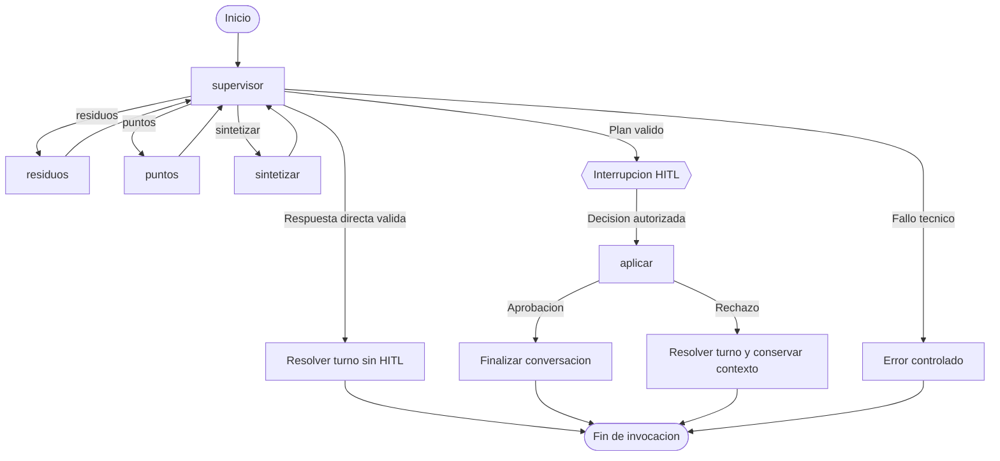
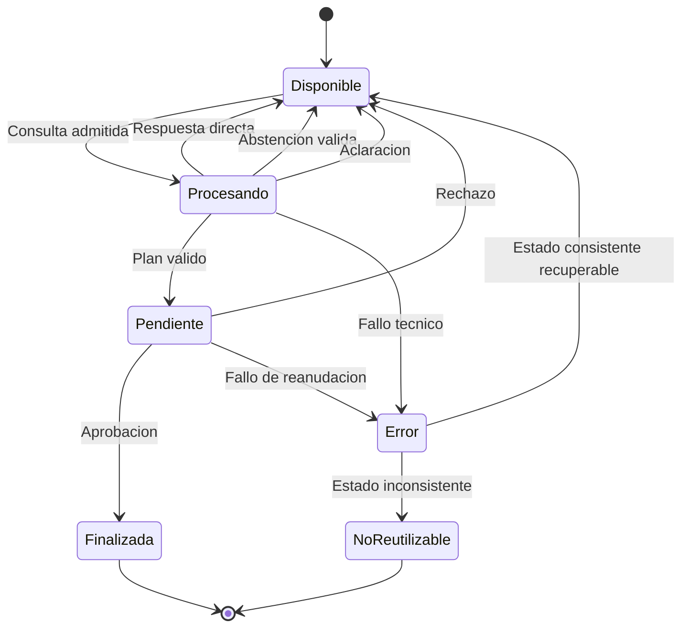

# 06. LangGraph, estado y aprobación humana

## 1. Objetivo

Definir la arquitectura del sistema multiagente de ReciclaTÍA, sus mecanismos de orquestación, gestión de estado, continuidad conversacional, ejecución de especialistas y supervisión humana.

El sistema deberá coordinar las capacidades del RAG y las herramientas disponibles, seleccionando únicamente las operaciones necesarias para resolver cada consulta.

La incorporación de la capa MLOps deberá preservar las funcionalidades existentes del asistente, salvo aquellas modificaciones expresamente establecidas en las especificaciones.

## 2. Principios arquitectónicos

- Independencia del núcleo RAG.
- Separación entre orquestación y ejecución de herramientas.
- Enrutamiento controlado.
- Gestión del estado por conversación.
- Aislamiento entre conversaciones.
- Validación determinista de las decisiones del modelo.
- Control de los presupuestos de ejecución.
- Reutilización de evidencias y resultados.
- Supervisión humana cuando corresponda.
- Resolución directa de consultas que no requieran aprobación.
- Separación entre estado operativo e historial persistente.
- Independencia respecto a las interfaces del producto.

LangGraph no será responsable de autenticar consumidores, aplicar cuotas comerciales ni persistir directamente los mensajes en PostgreSQL.

## 3. Arquitectura del grafo

### 3.1. Nodos

Se conservarán los cinco nodos existentes:

| Nodo | Responsabilidad |
|---|---|
| supervisor | Seleccionar la siguiente operación y controlar el progreso |
| residuos | Obtener evidencia documental sobre residuos |
| puntos | Obtener información geográfica, documental y temporal |
| sintetizar | Integrar evidencias y construir la respuesta |
| aplicar | Registrar la aprobación o el rechazo de un plan |

No se ejecutarán sistemáticamente todos los nodos para resolver cada consulta.

### 3.2. Flujo de ejecución



El diagrama representa las transiciones funcionales del sistema.

La resolución directa, la finalización y el tratamiento de errores no representan necesariamente nodos adicionales.

El enrutamiento deberá garantizar que únicamente los planes que requieran aprobación alcancen la interrupción previa al nodo aplicar.

### 3.3. Construcción

El módulo src/graph.py será responsable de:

- Construir StateGraph mediante EstadoGrafo.
- Registrar los nodos.
- Definir las aristas.
- Configurar el enrutamiento condicional.
- Establecer los puntos de entrada y salida.
- Configurar el checkpointer.
- Establecer la interrupción HITL.
- Proporcionar la configuración de cada conversación.

Se conservará MemorySaver como mecanismo de almacenamiento de checkpoints.

La interrupción se mantendrá antes del nodo aplicar:

```python
interrupt_before=["aplicar"]
```

Las respuestas directas deberán disponer de una salida válida que no requiera atravesar esta interrupción.

### 3.4. Instancia compartida

La función get_app() proporcionará una instancia compilada compartida del grafo durante la vida del proceso.

La función build_graph() permitirá construir instancias independientes, especialmente para pruebas aisladas.

No se creará una nueva instancia del grafo para cada petición HTTP.

## 4. Separación de responsabilidades

| Módulo | Responsabilidad |
|---|---|
| src/state.py | Contratos, creación, transformación y preparación del estado |
| src/agent_routing.py | Interpretación de intenciones, enrutamiento y fallback |
| src/agent_prompts.py | Instrucciones de los especialistas |
| src/agent_tool_loop.py | Ejecución de herramientas y aplicación de presupuestos |
| src/nodes.py | Implementación de los nodos |
| src/agent_schedule.py | Interpretación temporal |
| src/agent_resultado.py | Integración determinista de resultados |
| src/graph.py | Construcción, compilación y configuración del grafo |
| src/agent.py | Orquestación pública de consultas y aprobaciones |
| config.py | Configuración centralizada del asistente |

La capa de servicios del backend coordinará el acceso al núcleo del asistente desde la API.

FastAPI no implementará directamente los nodos, especialistas ni mecanismos de recuperación documental.

Streamlit no accederá directamente al estado de LangGraph.

## 5. Contratos públicos del orquestador

### 5.1. Procesamiento de turnos

El contrato existente del PB02 es:

```python
procesar_turno(
    estado: EstadoProducto,
    mensaje: str,
    thread_id: str,
    *,
    max_steps: int | None = None,
    ubicacion: Ubicacion | None = None,
    ruta_imagen: str | None = None,
) -> EstadoProducto
```

La adaptación deberá permitir:

- Resolver turnos sin HITL.
- Devolver planes pendientes de aprobación.
- Incorporar identificaciones multimodales previamente validadas.
- Mantener la continuidad conversacional.
- Diferenciar los errores técnicos de los resultados semánticos válidos.

La firma definitiva deberá concretarse conjuntamente con el contrato interno de identificación multimodal.

Se conservará la compatibilidad con los mecanismos de ejecución independiente cuando resulte posible.

### 5.2. Resolución de aprobaciones

El contrato existente del PB02 es:

```python
aprobar_plan(
    thread_id: str,
    aprobado: bool,
    estado: EstadoProducto,
) -> EstadoProducto
```

La adaptación deberá incorporar la comprobación de la aprobación pendiente mediante approval_id.

El backend obtendrá el estado operativo desde el checkpoint correspondiente.

Los clientes HTTP no proporcionarán directamente EstadoProducto ni EstadoGrafo.

La comprobación de una aprobación deberá utilizar el estado almacenado y no únicamente la información visible en el cliente.

### 5.3. Identificación de conversaciones

Se conservará:

```python
nuevo_thread_id() -> str
```

La función generará identificadores UUID.

Las condiciones de creación, propiedad y autorización de conversaciones mediante HTTP se definen en [12-contratos-http.md](12-contratos-http.md).

### 5.4. Funciones auxiliares

Se conservarán las responsabilidades de:

| Función | Responsabilidad |
|---|---|
| crear_estado_grafo() | Construir el estado interno inicial |
| crear_estado_producto() | Construir el estado público interno de una conversación |
| preparar_nuevo_turno() | Preparar el estado correspondiente a una nueva consulta |
| estado_desde_grafo() | Transformar el checkpoint en EstadoProducto |
| config_hilo() | Configurar la ejecución de una conversación |
| hay_hitl_pendiente() | Comprobar la existencia de una interrupción real |

Estas funciones deberán adaptarse a las nuevas posibilidades del ciclo conversacional.

## 6. Identificación y aislamiento

### 6.1. Identificador de conversación

Cada conversación dispondrá de un thread_id único.

La configuración de LangGraph asociará cada ejecución a dicho identificador.

### 6.2. Configuración del hilo

La configuración incorporará:

- El identificador de conversación.
- El límite de recursión correspondiente.

No se utilizarán identificadores predeterminados compartidos por diferentes consumidores.

### 6.3. Aislamiento

Un thread_id no podrá heredar automáticamente:

- Mensajes de otras conversaciones.
- Resultados de herramientas.
- Evidencias.
- Planes.
- Coordenadas.
- Identificaciones multimodales.
- Decisiones HITL.
- Contadores de ejecución.

### 6.4. Autorización

El identificador de conversación no constituye una credencial.

La capa de servicios verificará la propiedad y autorización de la conversación antes de permitir el acceso al estado operativo.

Las reglas correspondientes se definen en [14-autenticacion-autorizacion.md](14-autenticacion-autorizacion.md).

## 7. Contratos de estado

### 7.1. EstadoGrafo

EstadoGrafo representa el estado interno utilizado por LangGraph.

Contendrá la información necesaria para coordinar los nodos, conservar evidencias, aplicar límites y resolver las consultas.

### 7.2. EstadoProducto

EstadoProducto representa el estado utilizado por los mecanismos internos de orquestación y ejecución independiente del asistente.

No constituye el contrato HTTP público.

FastAPI transformará EstadoProducto en los modelos de respuesta correspondientes.

No se serializará directamente la totalidad del estado interno del agente.

### 7.3. Pedido y contexto

Se conservarán los campos relacionados con:

- pedido.
- pedido_original.
- contexto_revision.
- ubicacion.
- Información multimodal autorizada.

El campo ruta_imagen deberá adaptarse para evitar que el flujo HTTP dependa de referencias a archivos temporales después de su eliminación.

### 7.4. Selección de especialistas

Se conservarán:

- necesita_residuos.
- necesita_puntos.
- residuos_completado.
- puntos_completado.
- siguiente.
- iteracion.

Estos campos permitirán determinar las especialidades necesarias y controlar el progreso del turno.

### 7.5. Evidencias

Se conservarán:

- notas_residuos.
- notas_puntos.
- evidencias.
- fuentes.
- abstencion.
- motivo.
- limitaciones.
- estado_evidencia.

La información recuperada deberá permanecer asociada al turno correspondiente.

### 7.6. Respuesta y control conversacional

Se conservarán:

- respuesta.
- plan.
- plan_aprobado.
- pendiente_hitl.
- done.
- error.

Se incorporará:

| Campo | Tipo | Responsabilidad |
|---|---|---|
| approval_id | str o None | Identificador UUID del plan pendiente de aprobación |

approval_id únicamente tendrá valor mientras exista una aprobación pendiente válida.

### 7.7. Límites

Se conservarán:

- max_steps.
- max_turns.
- turnos_consumidos.
- tool_calls_turno.

Los valores y condiciones de utilización se ajustarán a [15-robustez-observabilidad.md](15-robustez-observabilidad.md).

### 7.8. Trazabilidad

Se conservarán:

- log.
- traza_tools.
- historial_turnos.

La información de trazabilidad interna no se expondrá automáticamente mediante los contratos HTTP.

### 7.9. Registro interno de turnos

El contrato RegistroTurno deberá admitir turnos resueltos con y sin aprobación HITL.

El campo aprobado deberá admitir los valores:

```python
bool | None
```

Su significado será:

| Valor | Significado |
|---|---|
| True | Plan aprobado |
| False | Plan rechazado |
| None | Turno resuelto sin necesidad de HITL |

La ausencia de una decisión HITL no deberá confundirse con un rechazo.

### 7.10. Independencia de estructuras

Las estructuras mutables de cada conversación deberán ser independientes.

Las listas de evidencias, fuentes, planes e historial no deberán compartirse entre conversaciones.

Se conservará la política de sobrescritura controlada de los campos de estado.

No se introducirán reducers de concatenación indiscriminada que puedan provocar duplicación de información o acumulación de evidencias obsoletas.

## 8. Ciclo de vida de una conversación

### 8.1. Conversación nueva

Una conversación nueva dispondrá de un estado inicial independiente.

No contendrá planes pendientes ni evidencias procedentes de otras conversaciones.

### 8.2. Inicio de un turno

Antes de iniciar una nueva ejecución deberá comprobarse:

- Que la consulta es válida.
- Que la conversación corresponde al identificador utilizado.
- Que no existe una aprobación pendiente.
- Que no existe una ejecución anterior incompleta.
- Que la conversación no ha finalizado.
- Que se respetan los límites establecidos.
- Que el estado operativo es consistente.

En el servicio HTTP se aplicarán adicionalmente los controles de autenticación, autorización, concurrencia y consumo correspondientes.

### 8.3. Preparación del estado

Al iniciar un nuevo turno deberán limpiarse los campos transitorios correspondientes a la ejecución anterior.

Entre ellos:

- Resultados de especialistas.
- Evidencias.
- Fuentes.
- Plan anterior.
- Identificador de aprobación anterior.
- Errores transitorios.
- Contadores correspondientes al turno.
- Datos temporales de herramientas.

Se conservarán los elementos de contexto necesarios para interpretar la nueva petición.

### 8.4. Resolución del turno

Un turno podrá resolverse mediante:

- Respuesta directa.
- Aclaración.
- Abstención válida.
- Aprobación de un plan.
- Rechazo de un plan.

La existencia de una aprobación pendiente implica que el turno todavía no se encuentra resuelto.

Un fallo técnico no constituye una resolución satisfactoria.

### 8.5. Finalización de la conversación

La resolución de un turno no implica necesariamente la finalización de la conversación.

El atributo done indicará que la conversación ha finalizado.

No deberá utilizarse como indicador único de que un turno está resuelto.

## 9. Supervisor y enrutamiento

### 9.1. Responsabilidad

El supervisor determinará la siguiente operación necesaria para satisfacer la consulta.

Podrá seleccionar los especialistas, solicitar la síntesis o concluir el flujo conforme a las transiciones autorizadas.

### 9.2. Decisiones del modelo

Las decisiones generadas por Gemini deberán ajustarse a las opciones permitidas por el sistema.

No podrán utilizarse para:

- Ejecutar nodos inexistentes.
- Saltar comprobaciones de seguridad.
- Superar presupuestos.
- Aprobar planes.
- Acceder a conversaciones ajenas.
- Finalizar artificialmente una consulta incompleta.

### 9.3. Fallback determinista

Cuando el modelo no proporcione una decisión válida, se utilizarán las reglas controladas de src/agent_routing.py.

El fallback deberá seleccionar una transición segura y compatible con el estado existente.

No se ejecutarán especialistas adicionales únicamente como consecuencia de una respuesta inválida del modelo.

### 9.4. Consultas simples

Cuando una única especialidad sea suficiente, el supervisor no deberá ejecutar la especialidad restante sin justificación.

### 9.5. Consultas compuestas

Cuando una consulta requiera ambas especialidades, deberán completarse las operaciones necesarias antes de presentar una respuesta final.

Si alguna especialidad no puede satisfacer su responsabilidad, se comunicarán las limitaciones o el fallo correspondiente.

### 9.6. Finalización del enrutamiento

La finalización del enrutamiento deberá distinguir entre:

- Respuesta directa válida.
- Plan válido que requiere aprobación.
- Abstención válida.
- Solicitud de aclaración.
- Fallo técnico.

La decisión FINISH no deberá provocar automáticamente una transición hacia aplicar.

La transición dependerá de la existencia de un plan válido que requiera HITL.

## 10. Especialista residuos

### 10.1. Responsabilidad

El especialista residuos obtendrá evidencia documental relacionada con la clasificación, tratamiento y destino de los residuos consultados.

### 10.2. Herramientas

Podrá utilizar:

- consultar_rag.
- describir_imagen, conforme a las condiciones del flujo correspondiente.

Los permisos y contratos se definen en [05-tools.md](05-tools.md).

### 10.3. Clasificación documental

Las recomendaciones deberán fundamentarse en la evidencia obtenida mediante el RAG.

No se utilizará exclusivamente la inferencia del modelo para recomendar un destino.

### 10.4. Consultas multimodales

Cuando el backend proporcione una identificación visual previamente validada, el especialista deberá utilizar dicha información.

No deberá volver a describir la misma imagen mediante una nueva llamada a Gemini.

## 11. Especialista puntos

### 11.1. Responsabilidad

El especialista puntos obtendrá información relacionada con instalaciones municipales, modalidades de recogida, proximidad y horarios.

### 11.2. Herramientas

Podrá utilizar:

- consultar_rag.
- buscar_puntos_limpios_cercanos.
- hora_actual.

### 11.3. Restricciones

La búsqueda geográfica únicamente se ejecutará cuando existan coordenadas válidas proporcionadas explícitamente.

La herramienta temporal únicamente se utilizará cuando resulte necesaria para interpretar la consulta.

### 11.4. Procedencia

Los resultados deberán conservar su procedencia.

Se distinguirá entre:

- Información obtenida del servicio municipal.
- Información obtenida del corpus local.
- Evidencia documental.
- Resultados derivados de cálculos geográficos.
- Interpretaciones de horarios publicados.

## 12. Ejecución de herramientas

### 12.1. Ruta directa

Se conservarán las rutas deterministas que permitan resolver una operación mediante una herramienta concreta sin requerir rondas adicionales de razonamiento.

### 12.2. Ruta mediante modelo de lenguaje

Cuando la consulta requiera una selección menos evidente de herramientas, el especialista podrá utilizar el modelo de lenguaje para determinar las operaciones necesarias.

### 12.3. Controles comunes

Ambas rutas deberán respetar:

- Registro autorizado de herramientas.
- Permisos del especialista.
- Validación de argumentos.
- Presupuestos internos.
- Restricciones de seguridad.
- Trazabilidad.
- Validación de resultados.

### 12.4. Presupuestos

El módulo src/agent_tool_loop.py será responsable de impedir ejecuciones que superen los límites establecidos.

La generación de varias llamadas a herramientas en una misma respuesta del modelo no permitirá superar dichos presupuestos.

Las reglas correspondientes se definen en [05-tools.md](05-tools.md) y [15-robustez-observabilidad.md](15-robustez-observabilidad.md).

## 13. Síntesis y control de evidencia

### 13.1. Responsabilidad

El nodo sintetizar integrará las evidencias obtenidas durante la ejecución.

No deberá generar información que no pueda fundamentarse mediante las operaciones autorizadas.

### 13.2. Reutilización de respuestas

Cuando exista una respuesta RAG completa, citada y suficiente, deberá reutilizarse.

No se invocará nuevamente al modelo únicamente para reformular información que ya satisface la consulta.

### 13.3. Integración determinista

Se conservarán los mecanismos de integración de:

- Clasificaciones documentales.
- Resultados geográficos.
- Distancias.
- Horarios.
- Fuentes.
- Limitaciones.

La integración podrá realizarse mediante src/agent_resultado.py y src/agent_schedule.py sin nuevas llamadas externas cuando resulte suficiente.

### 13.4. Síntesis mediante Gemini

Cuando la integración determinista no permita construir una respuesta adecuada, podrá utilizarse Gemini.

El resultado deberá superar las validaciones correspondientes.

### 13.5. Estado de evidencia

Se conservará el contrato:

```python
EstadoEvidencia = Literal[
    "suficiente",
    "parcial",
    "insuficiente",
]
```

| Estado | Significado |
|---|---|
| suficiente | La evidencia permite resolver adecuadamente la consulta |
| parcial | La evidencia permite resolver únicamente determinados aspectos |
| insuficiente | No existe evidencia suficiente para fundamentar la recomendación |

La existencia de evidencia insuficiente no implica necesariamente un fallo técnico.

### 13.6. Planificación

La síntesis deberá determinar si la consulta requiere un plan conforme a las necesidades funcionales del producto.

No se generará un plan únicamente para alcanzar la interrupción HITL.

Los planes deberán conservar las validaciones estructurales y de evidencia correspondientes.

Las reglas de generación se definen en [03-generacion.md](03-generacion.md).

## 14. Respuestas directas

### 14.1. Finalidad

El asistente deberá poder resolver consultas que no requieran una aprobación humana.

### 14.2. Situaciones aplicables

Podrán resolverse directamente:

- Consultas informativas.
- Aclaraciones que no requieran un plan.
- Abstenciones válidas.
- Resultados documentales suficientes que no necesiten una decisión HITL.
- Otros resultados compatibles con el alcance funcional establecido.

### 14.3. Estado resultante

Una respuesta directa que resuelva correctamente un turno mantendrá:

| Campo | Valor |
|---|---|
| respuesta | Respuesta válida |
| plan | Lista vacía |
| plan_aprobado | None |
| pendiente_hitl | False |
| approval_id | None |
| done | False |
| error | None |

La conversación podrá continuar mientras cumpla las condiciones correspondientes.

### 14.4. Finalización válida del grafo

La ausencia de una interrupción HITL no constituirá automáticamente un error.

procesar_turno() deberá distinguir entre:

- Ejecución finalizada correctamente sin plan.
- Ejecución interrumpida antes de aplicar.
- Ejecución incompleta.
- Fallo técnico.

No se considerará satisfactoria una ejecución que termine sin una respuesta válida ni un resultado explícitamente resuelto.

### 14.5. Registro del turno

Los turnos directos deberán incorporarse al historial interno cuando corresponda.

El registro se realizará una única vez.

No se utilizará el nodo aplicar para simular una aprobación que no ha sido necesaria.

## 15. Supervisión humana — HITL

### 15.1. Finalidad

HITL permitirá al consumidor revisar, aprobar o rechazar los planes generados por el asistente.

La aprobación constituye una decisión registrada dentro del producto.

No supone ejecutar acciones físicas ni operaciones externas.

### 15.2. Condiciones de interrupción

El grafo únicamente deberá interrumpirse antes del nodo aplicar cuando:

- Exista un plan válido.
- El plan requiera una decisión HITL.
- El turno todavía no se encuentre resuelto.
- No exista un fallo técnico que impida continuar.

### 15.3. Estado pendiente

Cuando exista una aprobación pendiente:

| Campo | Valor |
|---|---|
| plan | Plan válido |
| plan_aprobado | None |
| pendiente_hitl | True |
| approval_id | UUID válido |
| done | False |
| error | None |

La interrupción deberá existir realmente en el checkpoint.

Un flag almacenado por el cliente no será suficiente para acreditar la existencia de HITL.

### 15.4. Identificador de aprobación

Cada plan pendiente dispondrá de un approval_id único.

El identificador deberá generarse mediante código Python.

Se encontrará asociado exclusivamente a la aprobación pendiente correspondiente.

No podrá reutilizarse para resolver un plan posterior.

### 15.5. Bloqueo conversacional

Mientras exista una aprobación pendiente, no se admitirán nuevas consultas ordinarias dentro de la misma conversación.

Podrá resolverse la aprobación correspondiente o iniciarse otra conversación independiente.

### 15.6. Validación de la decisión

Antes de reanudar el grafo deberá comprobarse:

- La existencia del checkpoint.
- La consistencia del estado.
- La existencia de una interrupción HITL real.
- La validez del plan.
- La coincidencia de approval_id.
- La validez de la decisión.
- La autorización de la operación cuando proceda del servicio HTTP.

La comprobación y modificación del estado deberán realizarse dentro de los mecanismos de exclusión correspondientes.

### 15.7. Reanudación

Una vez validada la decisión, el orquestador actualizará el estado y reanudará el grafo.

Se conservará el mecanismo de reanudación compatible con la interrupción estática:

```python
app.invoke(
    None,
    config=configuracion,
)
```

El cliente HTTP no manipulará directamente el checkpoint ni invocará LangGraph.

## 16. Nodo aplicar

### 16.1. Responsabilidad

El nodo aplicar registrará la decisión correspondiente al plan pendiente.

No ejecutará herramientas adicionales ni realizará operaciones externas.

### 16.2. Aprobación

Cuando la decisión sea favorable:

| Campo | Valor |
|---|---|
| plan_aprobado | True |
| pendiente_hitl | False |
| approval_id | None |
| done | True |

El turno quedará resuelto y la conversación finalizará.

### 16.3. Rechazo

Cuando la decisión sea desfavorable:

| Campo | Valor |
|---|---|
| plan_aprobado | False |
| pendiente_hitl | False |
| approval_id | None |
| done | False |

El turno quedará resuelto.

El usuario podrá reformular la consulta mientras se mantengan las condiciones de continuidad.

### 16.4. Contexto posterior al rechazo

El rechazo permitirá conservar el contexto necesario para interpretar la siguiente consulta.

El plan rechazado no deberá permanecer como aprobación pendiente.

Las evidencias anteriores no se considerarán automáticamente válidas para fundamentar una nueva recomendación.

### 16.5. Fallos durante la reanudación

Cuando la reanudación no pueda completarse correctamente, no se comunicará una aprobación o rechazo satisfactorio.

El estado deberá evaluarse para determinar si puede reutilizarse de manera segura.

## 17. Modalidades de aprobación

### 17.1. Aprobación manual

Streamlit y el modo interactivo de terminal requerirán una decisión explícita cuando exista HITL pendiente.

### 17.2. Aprobación automática mediante HTTP

El contrato HTTP permitirá utilizar auto_aprobar conforme a [12-contratos-http.md](12-contratos-http.md).

Cuando auto_aprobar=True y exista un plan válido pendiente, la capa de servicios podrá resolverlo automáticamente.

La resolución automática deberá utilizar las mismas comprobaciones y transiciones que una aprobación manual.

No se omitirá el nodo aplicar.

No se permitirá que Gemini determine por sí mismo si debe aprobarse un plan.

### 17.3. Respuestas sin plan

Cuando una consulta se resuelva directamente, auto_aprobar no deberá provocar la creación de un plan artificial ni la ejecución de aplicar.

### 17.4. Modo de demostración

Se conservará la opción explícita --auto-aprobar de la interfaz de terminal.

## 18. Transiciones del estado conversacional



### 18.1. Estado disponible

Permite iniciar una nueva consulta si se cumplen los límites y requisitos de autorización.

### 18.2. Estado procesando

Existe una operación en ejecución que puede modificar el estado.

No se admitirán otras modificaciones simultáneas de la misma conversación.

### 18.3. Estado pendiente

Existe una interrupción HITL real y un approval_id válido.

### 18.4. Estado finalizado

La conversación ha sido aprobada y no admite nuevas consultas ordinarias.

### 18.5. Estado no reutilizable

El estado operativo no puede considerarse consistente.

La conversación no podrá continuar mediante el checkpoint afectado.

El historial previamente persistido seguirá disponible conforme a los permisos correspondientes.

### 18.6. Agotamiento de turnos

El agotamiento del límite de turnos impedirá iniciar nuevas consultas.

No deberá confundirse con una aprobación satisfactoria de un plan.

Un plan pendiente generado durante el último turno permitido podrá resolverse conforme a las reglas HITL.

## 19. Continuidad conversacional

### 19.1. Contexto autorizado

El asistente utilizará únicamente el contexto perteneciente a la conversación correspondiente.

### 19.2. Reformulaciones

Las consultas que dependan de mensajes anteriores podrán interpretarse mediante el contexto conservado.

Por ejemplo:

- ¿Y si es de plástico?
- Mejor uno más cercano.
- ¿Y mañana?
- Prefiero otro distrito.

### 19.3. Historial interno

El historial interno permitirá conservar información relevante de los turnos resueltos.

Su tamaño permanecerá limitado conforme a MAX_HISTORY_TURNS.

El historial deberá admitir turnos directos, aprobados y rechazados.

### 19.4. Contexto frente a evidencia

El contexto conversacional podrá ayudar a interpretar la intención.

No constituirá automáticamente evidencia documental válida para una nueva respuesta.

### 19.5. Restricciones modificadas

Cuando el usuario modifique una condición anterior, el nuevo turno deberá utilizar las restricciones actualizadas.

### 19.6. Independencia de evidencias

Cada turno deberá obtener o validar las evidencias necesarias para resolver su consulta.

No se reutilizarán resultados anteriores cuando hayan perdido pertinencia, validez o compatibilidad.

## 20. Integración multimodal

### 20.1. Validación previa

Las imágenes recibidas mediante HTTP deberán superar la validación técnica y semántica antes de ejecutar LangGraph.

Las reglas correspondientes se definen en [15-robustez-observabilidad.md](15-robustez-observabilidad.md).

### 20.2. Identificación reutilizable

La información multimodal previamente validada deberá incorporarse al contexto de la consulta.

Su estructura definitiva se establecerá conjuntamente con el contrato interno definido en [05-tools.md](05-tools.md).

### 20.3. Ausencia de llamadas duplicadas

El asistente no deberá solicitar nuevamente a Gemini la descripción de una imagen cuya identificación válida ya se encuentra disponible.

### 20.4. Clasificación documental

La identificación visual permitirá orientar la recuperación documental.

No sustituirá la evidencia necesaria para recomendar un destino de depósito.

### 20.5. Imágenes no admitidas

Las imágenes rechazadas antes de ejecutar el asistente no deberán provocar una invocación de LangGraph.

### 20.6. Archivos temporales

Los checkpoints no deberán depender de archivos temporales eliminados.

La continuidad de la conversación deberá utilizar la información descriptiva que pueda conservarse legítimamente en el estado.

### 20.7. Ejecución independiente

La interfaz de terminal conservará la posibilidad de proporcionar imágenes mediante los mecanismos locales autorizados.

La adaptación deberá evitar duplicar la lógica de identificación multimodal.

## 21. Filtrado previo de dominio

El filtrado previo de dominio del servicio HTTP constituye una operación anterior a LangGraph.

Su finalidad será impedir ejecuciones innecesarias del asistente.

Las consultas inequívocamente fuera del dominio y las aclaraciones deterministas previas podrán resolverse sin invocar:

- El supervisor.
- Los especialistas.
- Las herramientas.
- El RAG.
- Gemini.
- La síntesis.
- HITL.

El filtrado previo no sustituirá las reglas de interpretación, seguridad y alcance geográfico existentes dentro del núcleo RAG.

La coordinación del contexto, la numeración y la persistencia de las respuestas generadas antes de LangGraph deberá respetar la política conjunta de los documentos 12, 13 y 15.

## 22. Límites internos de ejecución

### 22.1. Configuración

Los valores de los límites internos se definen en [15-robustez-observabilidad.md](15-robustez-observabilidad.md).

Esta especificación no establecerá valores alternativos.

Se conservarán los controles relacionados con:

- MAX_ITER.
- MAX_STEPS_DEFAULT.
- MAX_STEPS_LIMIT.
- MAX_TOOL_CALLS_PER_SPECIALIST.
- MAX_TOOL_CALLS_PER_TURN.
- MAX_TURNS_DEFAULT.
- MAX_TURNS_LIMIT.
- MAX_HISTORY_TURNS.
- GRAPH_RECURSION_LIMIT.

### 22.2. Aplicación

Los límites deberán aplicarse mediante código Python.

El modelo de lenguaje no podrá ampliarlos.

### 22.3. Contador de turnos

El agente mantendrá el contador turnos_consumidos conforme a las reglas de ejecución establecidas.

La aprobación o el rechazo de un plan no incrementarán nuevamente el contador correspondiente a la consulta que originó el plan.

La contabilización de respuestas generadas antes de ejecutar LangGraph deberá resolverse de forma coherente con el modelo de persistencia y el ciclo conversacional.

### 22.4. Diferenciación de contadores

El contador de turnos de una conversación no deberá confundirse con:

- Cuotas comerciales.
- Rate limiting HTTP.
- Iteraciones del supervisor.
- Rondas de razonamiento de los especialistas.
- Número de llamadas a herramientas.
- Número de llamadas facturables a servicios externos.

### 22.5. Agotamiento de límites

Cuando se alcance un límite interno, deberán impedirse nuevas operaciones que lo superen.

No se fabricarán resultados para completar una consulta que no haya podido resolverse dentro de los presupuestos establecidos.

## 23. MemorySaver y checkpoints

### 23.1. Responsabilidad

MemorySaver conservará los checkpoints necesarios para la continuidad operativa de las conversaciones.

### 23.2. Alcance

Los checkpoints permanecerán almacenados en la memoria del proceso.

No se conservarán automáticamente después de un reinicio o redeploy.

### 23.3. Fuente de estado operativo

El checkpoint real tendrá prioridad sobre cualquier representación del estado conservada por el cliente.

No se confiará en estados proporcionados externamente para determinar si una conversación puede continuar.

### 23.4. Estado incompleto

Una ejecución anterior incompleta no deberá considerarse automáticamente un estado válido para iniciar un nuevo turno.

El orquestador deberá comprobar la consistencia del checkpoint.

### 23.5. Pérdida de estado

Cuando una operación requiera un checkpoint que ya no se encuentra disponible, deberá impedirse la continuación insegura de la conversación.

No se reconstruirá automáticamente el estado de LangGraph utilizando únicamente los mensajes persistidos en PostgreSQL.

### 23.6. Fuera de alcance

La persistencia durable de checkpoints en PostgreSQL u otros sistemas de almacenamiento no forma parte de esta fase del desarrollo.

## 24. Persistencia de turnos

### 24.1. Separación de responsabilidades

LangGraph será responsable del estado operativo.

PostgreSQL será responsable del almacenamiento de los datos relacionales y del historial persistente.

El núcleo del asistente no escribirá directamente en PostgreSQL.

### 24.2. Resultado del orquestador

El resultado devuelto por el orquestador deberá permitir distinguir:

- Turno resuelto directamente.
- Turno pendiente de aprobación.
- Turno aprobado.
- Turno rechazado.
- Fallo técnico.

### 24.3. Criterio de persistencia

La capa de servicios determinará si el turno debe persistirse conforme a [13-persistencia.md](13-persistencia.md).

No se utilizará únicamente done=True como condición de persistencia.

### 24.4. Aprobación pendiente

Un turno pendiente de aprobación no deberá registrarse como resuelto.

### 24.5. Consistencia

Cuando el estado operativo avance correctamente pero falle la persistencia SQL, deberán aplicarse los mecanismos de protección establecidos.

No se permitirá continuar una conversación desde un estado cuya consistencia no pueda garantizarse.

### 24.6. Independencia de la ejecución local

La ejecución independiente mediante terminal no requerirá una conexión a PostgreSQL.

## 25. Concurrencia

### 25.1. Exclusión por conversación

Las operaciones que puedan modificar un mismo checkpoint deberán ejecutarse bajo los mecanismos de exclusión establecidos.

No podrán modificarse simultáneamente los estados de una misma conversación.

### 25.2. Capacidad global

La configuración inicial utilizará un único worker para las operaciones del asistente.

El backend podrá atender peticiones HTTP concurrentes sin ejecutar simultáneamente varias operaciones del agente.

### 25.3. Aprobaciones concurrentes

Cuando varias peticiones intenten resolver una misma aprobación, únicamente una podrá modificar válidamente el estado correspondiente.

Las peticiones posteriores deberán comprobar nuevamente el estado real.

### 25.4. Aprobaciones obsoletas

Una aprobación correspondiente a un approval_id anterior no podrá resolver un plan posterior.

### 25.5. Responsabilidad

Los bloqueos, mecanismos de admisión y límites globales serán coordinados por la capa de servicios.

Las condiciones específicas se definen en [15-robustez-observabilidad.md](15-robustez-observabilidad.md).

## 26. Timeout y resultados tardíos

La ejecución del asistente estará sujeta al límite temporal definido en el documento de robustez.

Cuando una petición HTTP finalice por timeout, la ejecución subyacente podrá continuar activa.

En estas circunstancias:

- No se considerará resuelto el turno.
- No se persistirá automáticamente el resultado tardío.
- No se permitirá una modificación concurrente del checkpoint afectado.
- No se liberarán prematuramente los recursos utilizados.
- Se comprobará la consistencia del estado antes de autorizar una posible continuación.

La devolución de un timeout no implica que la ejecución del agente haya sido cancelada.

Las reglas completas se definen en [15-robustez-observabilidad.md](15-robustez-observabilidad.md).

## 27. Gestión de errores

### 27.1. Resultados semánticos

Se considerarán resultados válidos, cuando corresponda:

- Abstención por evidencia insuficiente.
- Respuesta con evidencia parcial.
- Solicitud de aclaración.
- Ausencia de instalaciones compatibles.
- Horario desconocido.
- Respuesta directa.

### 27.2. Fallos técnicos

Los fallos técnicos deberán distinguirse de los resultados semánticos válidos.

Entre ellos:

- Fallos del modelo de lenguaje.
- Fallos de herramientas.
- Errores de ejecución del grafo.
- Transiciones incompatibles.
- Respuestas estructuradas inválidas persistentes.
- Fallos durante la reanudación de checkpoints.
- Timeouts.

### 27.3. Estado de error

Un fallo técnico no deberá provocar:

- Una aprobación ficticia.
- Una respuesta satisfactoria inventada.
- La creación de un plan ficticio.
- La finalización satisfactoria de la conversación.
- El registro de un turno como resuelto.

### 27.4. Recuperación

Cuando un fallo deje el checkpoint en un estado cuya consistencia no pueda garantizarse, la conversación no podrá reutilizarse.

### 27.5. Contrato HTTP

La transformación de los errores internos al contrato ErrorOut será responsabilidad de FastAPI.

Los códigos HTTP se definen en [12-contratos-http.md](12-contratos-http.md).

## 28. Observabilidad

El asistente deberá conservar información suficiente para analizar:

- Decisiones del supervisor.
- Especialistas seleccionados.
- Herramientas solicitadas.
- Herramientas ejecutadas.
- Operaciones denegadas.
- Presupuestos alcanzados.
- Evidencias obtenidas.
- Rutas deterministas.
- Síntesis mediante modelo.
- Interrupciones HITL.
- Reanudaciones.
- Errores técnicos.

Las trazas internas deberán distinguirse de los registros HTTP.

No se expondrá directamente la totalidad del estado de LangGraph mediante los endpoints públicos.

Las restricciones de observabilidad se definen en [15-robustez-observabilidad.md](15-robustez-observabilidad.md).

## 29. Seguridad

El modelo de lenguaje no podrá:

- Modificar los permisos de las herramientas.
- Ampliar los límites internos.
- Alterar los identificadores de conversación.
- Acceder a checkpoints ajenos.
- Generar decisiones HITL autorizadas por sí mismo.
- Saltarse la interrupción de un plan que requiere aprobación.
- Ejecutar código arbitrario.
- Modificar las reglas de autenticación.
- Autorizar operaciones administrativas.
- Persistir directamente información en PostgreSQL.

Las decisiones críticas deberán comprobarse mediante código Python.

Las reglas generales de seguridad del núcleo se definen en [10-seguridad.md](10-seguridad.md).

## 30. Validación

### 30.1. Enrutamiento

Las pruebas deberán verificar:

- Consultas que únicamente requieren residuos.
- Consultas que únicamente requieren puntos.
- Consultas que requieren ambas especialidades.
- Fallback ante decisiones inválidas.
- Ausencia de ejecuciones innecesarias.

### 30.2. Estado

Las pruebas deberán verificar:

- Creación de estados independientes.
- Aislamiento entre conversaciones.
- Limpieza de campos transitorios.
- Conservación del contexto necesario.
- Ausencia de evidencias obsoletas.
- Prioridad del checkpoint sobre representaciones del cliente.

### 30.3. Respuestas directas

Las pruebas deberán verificar:

- Resolución de una consulta sin plan.
- Abstención válida sin HITL.
- Solicitud de aclaración sin HITL.
- Registro único del turno directo.
- Continuación de la conversación.
- Ausencia de aprobación ficticia.
- Diferenciación entre finalización válida y ejecución incompleta.

### 30.4. HITL

Las pruebas deberán verificar:

- Interrupción real antes de aplicar.
- Generación de approval_id.
- Aprobación válida.
- Rechazo válido.
- Aprobación automática autorizada.
- Aprobación sin interrupción pendiente.
- Rechazo de aprobaciones obsoletas.
- Resolución concurrente de una aprobación.
- Limpieza de approval_id después de resolver el turno.
- Reformulación después del rechazo.
- Imposibilidad de continuar una conversación finalizada.
- Resolución de un plan pendiente en el último turno permitido.

### 30.5. Límites

Las pruebas deberán verificar:

- Límite de iteraciones del supervisor.
- Límites de rondas de los especialistas.
- Presupuesto por especialista.
- Presupuesto global por turno.
- Límites de conversación.
- Tamaño máximo del historial.
- Límite de recursión.

### 30.6. Consultas multimodales

Las pruebas deberán verificar:

- Incorporación de una identificación visual válida.
- Ausencia de llamadas multimodales duplicadas.
- Exclusión de imágenes no admitidas.
- Independencia respecto a archivos temporales eliminados.

### 30.7. Robustez

Las pruebas deberán verificar:

- Fallos técnicos del agente.
- Fallos durante la reanudación.
- Ausencia de aprobaciones ficticias.
- Pérdida de checkpoints.
- Timeouts.
- Resultados tardíos.
- Conversaciones no reutilizables.
- Fallos de persistencia posteriores a una ejecución válida.

### 30.8. Regresión

Se conservarán las pruebas existentes relacionadas con:

- tests/test_agent_regression.py.
- tests/test_agent_resultado.py.
- tests/test_agent_schedule.py.
- tests/test_agent_schedule_integration.py.

Las pruebas deberán adaptarse cuando cambien expresamente los contratos y las transiciones correspondientes.

Las modificaciones no deberán eliminar comprobaciones válidas únicamente para obtener resultados satisfactorios.

La estrategia general de pruebas se define en [08-pruebas-y-validacion.md](08-pruebas-y-validacion.md).

## 31. Criterios de aceptación

- El núcleo RAG permanece independiente de LangGraph.
- Se conservan las responsabilidades de los cinco nodos existentes.
- El supervisor selecciona únicamente los especialistas necesarios.
- Las consultas compuestas utilizan las evidencias correspondientes.
- Las decisiones inválidas del modelo disponen de fallback controlado.
- Las herramientas respetan sus permisos.
- Los presupuestos internos se aplican mediante Python.
- Los estados permanecen aislados por conversación.
- El checkpoint real tiene prioridad sobre el estado del cliente.
- Los campos transitorios se reinician correctamente.
- El contexto conversacional no se confunde con evidencia documental.
- Las respuestas directas pueden finalizar correctamente una invocación sin HITL.
- Las respuestas directas no generan aprobaciones ficticias.
- Los turnos resueltos sin HITL pueden incorporarse al historial interno.
- Los planes que requieren aprobación alcanzan una interrupción real.
- Cada aprobación pendiente dispone de un approval_id único.
- Una aprobación obsoleta no puede resolver un plan posterior.
- El nodo aplicar registra únicamente decisiones válidas.
- La aprobación finaliza la conversación.
- El rechazo permite una reformulación.
- Las aprobaciones no incrementan nuevamente el contador de consultas.
- La resolución de un turno se distingue de la finalización de una conversación.
- La identificación multimodal admitida puede reutilizarse.
- No se repiten innecesariamente las llamadas multimodales.
- Los checkpoints no dependen de archivos temporales eliminados.
- Las consultas rechazadas antes de LangGraph no ejecutan el grafo.
- Los errores técnicos se distinguen de las abstenciones válidas.
- Los fallos técnicos no generan aprobaciones ni respuestas ficticias.
- No se permiten modificaciones simultáneas del mismo checkpoint.
- Los resultados tardíos no se persisten automáticamente.
- Los estados inconsistentes no se reutilizan.
- MemorySaver conserva el estado únicamente durante la vida del proceso.
- El núcleo del asistente no depende directamente de PostgreSQL.
- La pérdida de checkpoints se distingue de la pérdida del historial persistente.
- La interfaz de terminal conserva su funcionamiento independiente.
- FastAPI transforma los resultados internos conforme a los contratos públicos.
- Streamlit no manipula directamente los checkpoints.
- La incorporación de MLOps conserva las funcionalidades y los requisitos de calidad establecidos.

## 32. Especificaciones relacionadas

| Documento | Responsabilidad |
|---|---|
| [00-producto.md](00-producto.md) | Alcance funcional |
| [01-retrieval.md](01-retrieval.md) | Recuperación semántica |
| [03-generacion.md](03-generacion.md) | Generación y control de evidencia |
| [04-consultas-generales.md](04-consultas-generales.md) | Interpretación de consultas |
| [05-tools.md](05-tools.md) | Herramientas, contratos y permisos |
| [07-streamlit.md](07-streamlit.md) | Interfaz del consumidor |
| [08-pruebas-y-validacion.md](08-pruebas-y-validacion.md) | Evaluación y pruebas |
| [10-seguridad.md](10-seguridad.md) | Seguridad del núcleo |
| [11-arquitectura-mlops.md](11-arquitectura-mlops.md) | Separación arquitectónica |
| [12-contratos-http.md](12-contratos-http.md) | Contratos HTTP y operaciones HITL |
| [13-persistencia.md](13-persistencia.md) | Historial persistente y consistencia |
| [14-autenticacion-autorizacion.md](14-autenticacion-autorizacion.md) | Autorización y propiedad |
| [15-robustez-observabilidad.md](15-robustez-observabilidad.md) | Límites, concurrencia, timeout y observabilidad |
| [16-despliegue.md](16-despliegue.md) | Infraestructura y despliegue |