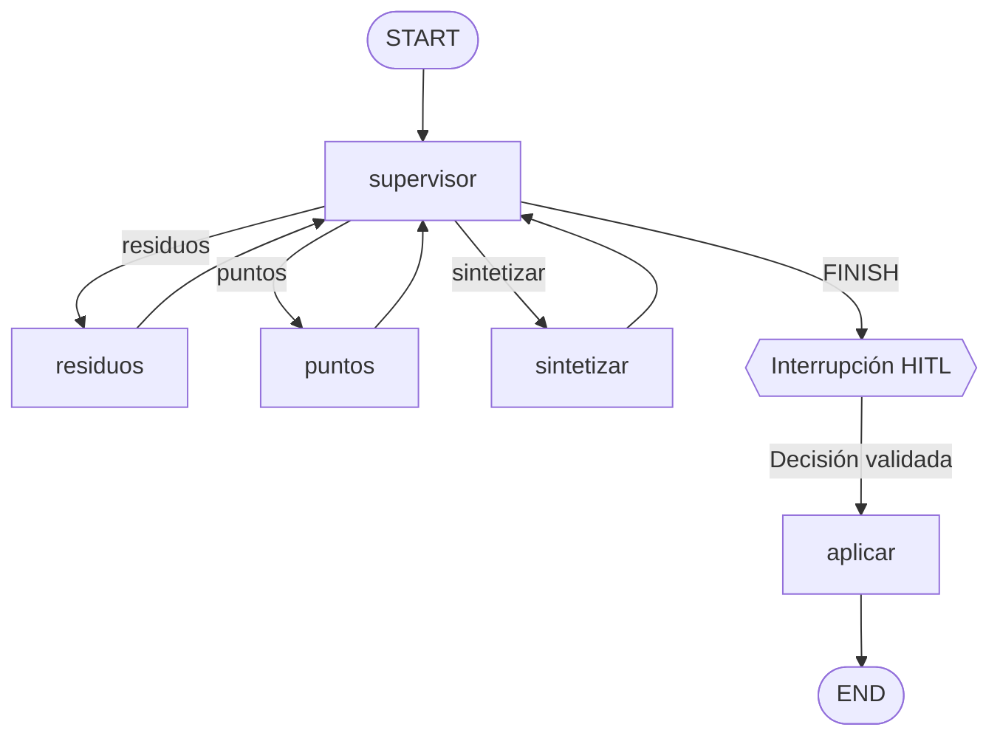
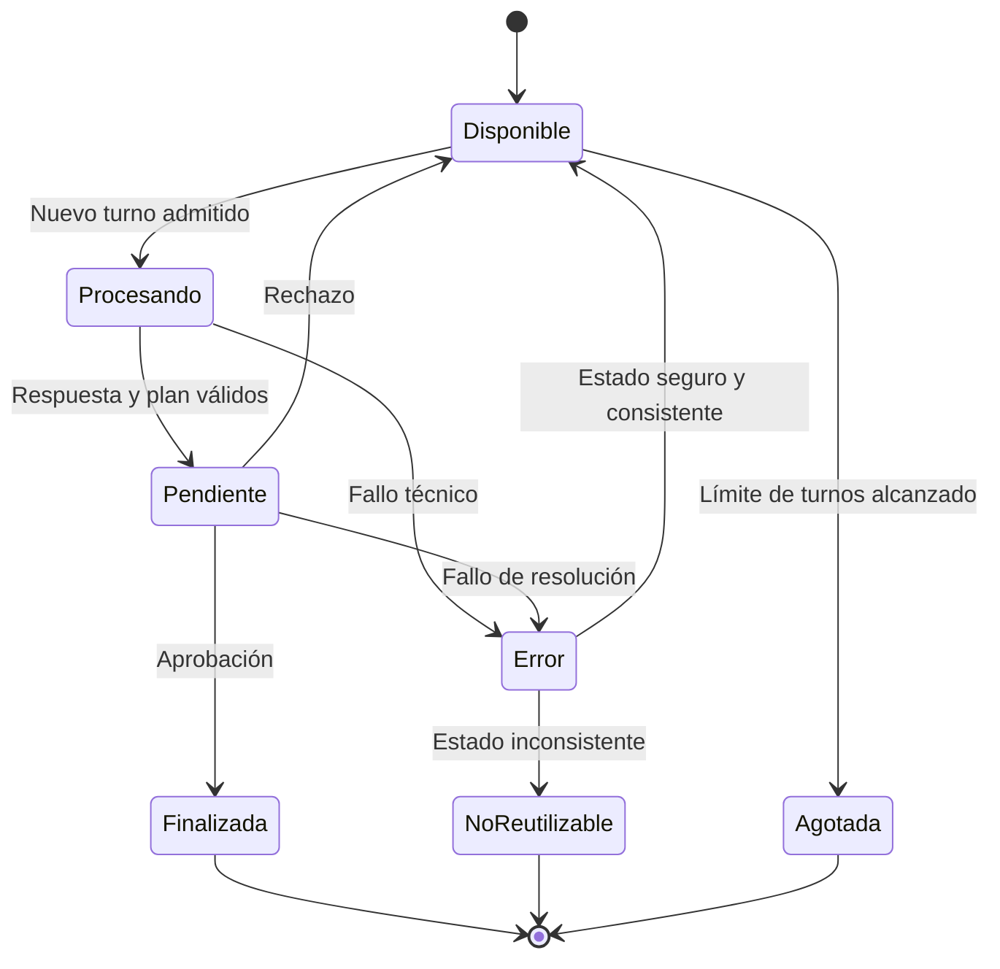

# 06. LangGraph, estado y aprobación humana

## 1. Objetivo

Definir la arquitectura del sistema multiagente de ReciclaTÍA, sus mecanismos de orquestación, gestión de estado, continuidad conversacional, ejecución de especialistas y supervisión humana.

El sistema coordinará las capacidades del RAG y las herramientas disponibles, seleccionando únicamente las operaciones necesarias para resolver cada consulta.

La incorporación de MLOps deberá preservar las funcionalidades desarrolladas durante el PB02 y satisfacer los requisitos académicos del Project Break 03.

Se conservará el HITL obligatorio del agente existente.

No se reescribirá la arquitectura del grafo para incorporar FastAPI.

## 2. Principios arquitectónicos

- Independencia del núcleo RAG.
- Separación entre orquestación y ejecución de herramientas.
- Enrutamiento controlado mediante Python.
- Gestión del estado por conversación.
- Aislamiento entre conversaciones.
- Validación determinista de las decisiones del modelo.
- Control de los presupuestos de ejecución.
- Reutilización de evidencias y resultados.
- HITL obligatorio en las ejecuciones satisfactorias del agente.
- Diferenciación entre respuestas previas al agente y resultados de LangGraph.
- Separación entre estado operativo e historial persistente.
- Independencia respecto a las interfaces del producto.
- Utilización exclusiva de herramientas y fuentes autorizadas.
- Diferenciación entre resultados semánticos y fallos técnicos.

LangGraph no será responsable de autenticar consumidores, aplicar cuotas comerciales ni persistir directamente mensajes en PostgreSQL.

## 3. Arquitectura del grafo

### 3.1. Nodos

Se conservarán los cinco nodos existentes:

| Nodo | Responsabilidad |
|---|---|
| supervisor | Seleccionar la siguiente operación y controlar el progreso |
| residuos | Obtener evidencia documental sobre residuos e interpretar información visual |
| puntos | Obtener información geográfica, documental y temporal |
| sintetizar | Integrar evidencias y construir una respuesta y un plan |
| aplicar | Registrar la aprobación o el rechazo del plan |

No se ejecutarán sistemáticamente ambos especialistas.

La selección dependerá de las necesidades de la consulta.

### 3.2. Topología



HITL representa una interrupción estática del grafo y no un nodo adicional.

Se conservarán las aristas existentes.

La decisión FINISH continuará conduciendo al nodo aplicar.

No se incorporarán rutas de finalización directa que permitan resolver satisfactoriamente un turno de LangGraph sin atravesar el HITL.

### 3.3. Construcción

src/graph.py continuará siendo responsable de:

- Construir StateGraph mediante EstadoGrafo.
- Registrar los cinco nodos.
- Definir las aristas.
- Configurar el enrutamiento condicional.
- Establecer el punto de entrada.
- Establecer el punto de salida.
- Configurar MemorySaver.
- Establecer la interrupción HITL.
- Proporcionar la configuración de cada conversación.

La interrupción se mantendrá:

```python
interrupt_before=["aplicar"]
```

Las excepciones técnicas podrán impedir la finalización normal de una ejecución.

No se añadirá una ruta de éxito alternativa para ocultar dichos fallos.

### 3.4. Instancia compartida

get_app() proporcionará una instancia compilada compartida durante la vida del proceso.

Se conservará el mecanismo existente de caché de la instancia.

build_graph() permitirá construir instancias independientes con sus propios checkpointers, especialmente para pruebas aisladas.

No se creará un grafo nuevo por cada petición HTTP.

## 4. Separación de responsabilidades

| Módulo | Responsabilidad |
|---|---|
| src/state.py | Contratos, creación, preparación y transformación del estado |
| src/agent_routing.py | Interpretación de intenciones, enrutamiento y fallback |
| src/agent_prompts.py | Instrucciones del supervisor y especialistas |
| src/agent_tool_loop.py | Ejecución de herramientas y presupuestos |
| src/nodes.py | Implementación de los nodos |
| src/agent_schedule.py | Interpretación temporal |
| src/agent_resultado.py | Integración determinista de resultados |
| src/graph.py | Construcción, compilación y configuración del grafo |
| src/agent.py | API interna de consultas y aprobaciones |
| src/cli_agent.py | Interacción independiente mediante terminal |
| config.py | Configuración centralizada del núcleo |
| api/service.py | Coordinación entre FastAPI y el asistente |

FastAPI no implementará directamente los nodos ni duplicará la lógica de recuperación documental.

Streamlit no accederá directamente a LangGraph.

La CLI conservará su funcionamiento independiente mediante la API interna del agente.

## 5. Contratos públicos del orquestador

### 5.1. Procesamiento de turnos

Se conservará la función procesar_turno(), ampliando su contrato mediante un parámetro opcional para reutilizar identificaciones multimodales.

La firma definitiva será:

```python
def procesar_turno(
    estado: EstadoProducto,
    mensaje: str,
    thread_id: str,
    *,
    max_steps: int | None = None,
    ubicacion: Ubicacion | None = None,
    ruta_imagen: str | None = None,
    identificacion_imagen: IdentificacionImagen | None = None,
) -> EstadoProducto:
    ...
```

| Parámetro | Responsabilidad |
|---|---|
| estado | Estado base interno de la conversación |
| mensaje | Consulta original |
| thread_id | Identificador de conversación |
| max_steps | Límite opcional de rondas |
| ubicacion | Coordenadas proporcionadas por el consumidor |
| ruta_imagen | Ruta local autorizada para ejecución independiente |
| identificacion_imagen | Identificación visual previamente validada |

ruta_imagen e identificacion_imagen serán mutuamente excluyentes.

Cuando exista identificacion_imagen, deberá ser válida y tener estado=allowed.

La función no realizará autenticación HTTP ni aplicará cuotas comerciales.

La función tampoco persistirá mensajes en PostgreSQL.

### 5.2. Resultado de procesar_turno

La función ejecutará el agente hasta alcanzar:

- Una interrupción HITL válida.
- Un fallo técnico.

Una ejecución satisfactoria deberá devolver:

- Una respuesta no vacía.
- Un plan válido.
- Una interrupción HITL real.
- Un approval_id válido.
- error=None.

No se considerará satisfactoria una ejecución que termine sin alcanzar la interrupción requerida.

La aprobación automática no se incorporará como responsabilidad interna de procesar_turno().

Su coordinación corresponderá a la capa de servicios o a los mecanismos de demostración.

### 5.3. Resolución de aprobaciones

Se sustituirá el contrato anterior de aprobar_plan(), que recibía EstadoProducto como argumento.

La firma definitiva será:

```python
def aprobar_plan(
    thread_id: str,
    aprobado: bool,
    *,
    approval_id: str,
) -> EstadoProducto:
    ...
```

| Parámetro | Responsabilidad |
|---|---|
| thread_id | Conversación que contiene la aprobación |
| aprobado | Decisión booleana de aprobación o rechazo |
| approval_id | Identificador del plan pendiente concreto |

La función obtendrá el estado operativo desde el checkpoint real.

No dependerá de una copia de EstadoProducto proporcionada por la interfaz.

El plan mostrado anteriormente por el cliente no constituirá la referencia autorizada para resolver la aprobación.

La coincidencia entre approval_id y el identificador almacenado será obligatoria.

### 5.4. Identificación de conversaciones

Se conservará:

```python
def nuevo_thread_id() -> str:
    ...
```

La implementación continuará generando identificadores UUID mediante uuid4().

En el flujo HTTP únicamente se generará un nuevo thread_id cuando corresponda iniciar una conversación de LangGraph.

Los clientes no podrán elegir el identificador de una conversación nueva.

Las reglas de creación y propiedad se establecen en [12-contratos-http.md](12-contratos-http.md).

### 5.5. Funciones auxiliares

Se conservarán las responsabilidades de:

| Función | Responsabilidad |
|---|---|
| crear_estado_grafo() | Construir el estado interno inicial |
| crear_estado_producto() | Construir el estado interno de orquestación |
| preparar_nuevo_turno() | Preparar una nueva consulta |
| registrar_turno() | Registrar un turno resuelto en el historial interno |
| estado_desde_grafo() | Transformar los valores del checkpoint |
| config_hilo() | Configurar la ejecución de una conversación |
| hay_hitl_pendiente() | Comprobar la interrupción real |
| _estado_actual() | Obtener EstadoProducto a partir del checkpoint |

Las funciones de creación y preparación incorporarán los nuevos campos correspondientes.

_estado_actual() deberá poder utilizarse durante aprobar_plan() sin depender de un estado proporcionado por el cliente.

### 5.6. Contratos HTTP

EstadoProducto no constituirá el contrato HTTP público.

FastAPI transformará los resultados mediante AskOut.

Los clientes HTTP no podrán enviar:

- EstadoProducto.
- EstadoGrafo.
- Checkpoints.
- Evidencias arbitrarias.
- Identificaciones visuales supuestamente validadas.
- Planes completos para su aprobación.
- Contadores internos del agente.

El backend construirá las entradas internas autorizadas.

## 6. Identificación y aislamiento

### 6.1. Identificador de conversación

Cada conversación dispondrá de un thread_id único.

LangGraph asociará sus checkpoints a este identificador.

En el servicio HTTP se utilizará el mismo identificador en PostgreSQL.

### 6.2. Configuración del hilo

config_hilo() incorporará:

- configurable.thread_id.
- recursion_limit.

No se utilizarán identificadores predeterminados compartidos entre consumidores.

### 6.3. Aislamiento

Un hilo no podrá heredar automáticamente de otro:

- Mensajes.
- Contexto.
- Resultados de herramientas.
- Evidencias.
- Fuentes.
- Planes.
- Coordenadas.
- Identificaciones multimodales.
- Decisiones HITL.
- Contadores de ejecución.

Las estructuras mutables deberán ser independientes.

### 6.4. Autorización

thread_id no constituye una credencial.

La capa de servicios comprobará la existencia y propiedad de la conversación antes de permitir operaciones sobre su checkpoint.

Los permisos se establecen en [14-autenticacion-autorizacion.md](14-autenticacion-autorizacion.md).

LangGraph no deberá utilizarse directamente como mecanismo de autorización HTTP.

## 7. Contratos de estado

### 7.1. Ubicacion

Se conservará el contrato interno:

```python
class Ubicacion(TypedDict):
    latitud: float
    longitud: float
```

Las coordenadas deberán proceder de una entrada autorizada.

El modelo no podrá inventarlas ni modificar su origen.

### 7.2. IdentificacionImagen

Se incorporará en src/state.py:

```python
class IdentificacionImagen(TypedDict):
    estado: Literal[
        "allowed",
        "out_of_domain",
        "policy_violation",
        "uncertain",
    ]
    descripcion: str
```

Este contrato será compartido por:

- src/tools/describir_imagen.py.
- src/agent.py.
- src/agent_tool_loop.py.
- La capa de servicios HTTP.

La validación en tiempo de ejecución se realizará conforme a [05-tools.md](05-tools.md).

La existencia de un TypedDict no sustituye dicha validación.

### 7.3. EstadoGrafo

EstadoGrafo representa el estado interno utilizado por LangGraph.

Se conservarán los campos actuales y se incorporarán:

| Campo | Tipo | Valor inicial |
|---|---|---|
| identificacion_imagen | IdentificacionImagen o None | None |
| approval_id | str o None | None |

Los campos estarán disponibles para las funciones que necesiten utilizarlos.

No se introducirán campos destinados a duplicar los contadores comerciales o las decisiones de autorización HTTP.

### 7.4. EstadoProducto

EstadoProducto continuará extendiendo EstadoGrafo.

Conservará adicionalmente:

- thread_id.
- traza.

Este contrato será utilizado por el orquestador, la CLI y la capa interna de servicios.

No se serializará directamente como respuesta pública de FastAPI.

### 7.5. Petición y contexto

| Campo | Tipo | Responsabilidad |
|---|---|---|
| pedido | str | Consulta utilizada por el agente |
| pedido_original | str | Consulta original del consumidor |
| contexto_revision | str | Contexto conservado para reformulaciones |
| ubicacion | Ubicacion o None | Coordenadas autorizadas |
| ruta_imagen | str o None | Imagen local para ejecución independiente |
| identificacion_imagen | IdentificacionImagen o None | Identificación visual previamente obtenida |

pedido_original no deberá sustituirse por una reformulación interna.

El flujo HTTP utilizará identificacion_imagen cuando exista información visual admitida.

ruta_imagen permanecerá en None para estas operaciones.

### 7.6. Selección y progreso de especialistas

Se conservarán:

| Campo | Tipo |
|---|---|
| necesita_residuos | bool |
| necesita_puntos | bool |
| residuos_completado | bool |
| puntos_completado | bool |
| siguiente | str |
| iteracion | int |

Estos campos permitirán determinar qué operaciones se necesitan y controlar el progreso del agente.

### 7.7. Resultados y evidencias

Se conservarán:

| Campo | Tipo |
|---|---|
| notas_residuos | str |
| notas_puntos | str |
| evidencias | list[dict] |
| fuentes | list[dict] |
| abstencion | bool |
| motivo | str o None |
| limitaciones | list[str] |
| estado_evidencia | EstadoEvidencia |

Las evidencias deberán mantener su procedencia.

Las observaciones visuales reutilizadas deberán distinguirse de las nuevas ejecuciones de herramientas.

### 7.8. Respuesta y control conversacional

| Campo | Tipo | Valor inicial |
|---|---|---|
| respuesta | str | Cadena vacía |
| plan | list[str] | Lista vacía |
| plan_aprobado | bool o None | None |
| pendiente_hitl | bool | False |
| approval_id | str o None | None |
| done | bool | False |
| error | str o None | None |

approval_id identificará la propuesta concreta pendiente de resolución.

Se generará después de construir y validar la respuesta y el plan, antes de alcanzar la interrupción HITL.

Durante la transición entre síntesis e interrupción podrá existir un approval_id todavía no expuesto al consumidor.

En las respuestas públicas satisfactorias, approval_id únicamente tendrá valor cuando pendiente_hitl=True.

### 7.9. Límites

Se conservarán:

- max_steps.
- max_turns.
- turnos_consumidos.
- tool_calls_turno.

Los valores se ajustarán conforme a [15-robustez-observabilidad.md](15-robustez-observabilidad.md).

### 7.10. Trazabilidad

Se conservarán:

- log.
- traza_tools.
- historial_turnos.

Las trazas internas no se expondrán automáticamente mediante los contratos HTTP.

### 7.11. RegistroTurno

Se conservará el contrato existente:

```python
class RegistroTurno(TypedDict):
    pedido: str
    respuesta: str
    plan: list[str]
    aprobado: bool
```

El campo aprobado seguirá siendo bool.

| Valor | Significado |
|---|---|
| True | Plan aprobado |
| False | Plan rechazado |

No se incorporará None como valor de un turno resuelto.

Los planes todavía pendientes no formarán parte del historial de turnos resueltos.

Las respuestas previas a LangGraph tampoco generarán registros de este tipo.

### 7.12. Independencia de estructuras

Las listas de cada conversación deberán ser independientes.

Se conservará la política de sobrescritura controlada del estado.

No se introducirán reducers de concatenación indiscriminada.

Las operaciones de transformación y preparación deberán evitar la modificación accidental de estructuras pertenecientes a checkpoints anteriores.

Se utilizarán copias independientes cuando corresponda.

## 8. Ciclo de vida de una conversación

### 8.1. Conversación nueva

Una conversación nueva comenzará con:

- Estado independiente.
- turnos_consumidos=0.
- tool_calls_turno=0.
- iteracion=0.
- plan=[].
- plan_aprobado=None.
- pendiente_hitl=False.
- approval_id=None.
- done=False.
- error=None.
- Historial vacío.

En el flujo HTTP, la conversación SQL se creará únicamente cuando corresponda iniciar LangGraph.

### 8.2. Inicio de un turno

Antes de iniciar una consulta deberán comprobarse:

- La validez del mensaje.
- La correspondencia entre estado y thread_id.
- La disponibilidad del checkpoint cuando exista una conversación previa.
- La ausencia de otra ejecución incompleta.
- La ausencia de una aprobación pendiente.
- Que la conversación no haya finalizado.
- Que el límite de turnos no esté agotado.
- La validez de las entradas multimodales.

FastAPI aplicará adicionalmente autenticación, autorización, concurrencia y consumo.

### 8.3. Preparación del estado

preparar_nuevo_turno() continuará construyendo un estado limpio para la nueva consulta.

Se reiniciarán:

- Resultados transitorios de especialistas.
- Evidencias.
- Fuentes.
- Notas.
- Limitaciones.
- Respuesta anterior.
- Plan anterior.
- Decisión HITL anterior.
- approval_id.
- Errores transitorios.
- Iteraciones del supervisor.
- Contador de herramientas del turno.
- Trazas específicas del turno.
- Información multimodal de la entrada anterior.
- Ubicación de la entrada anterior, salvo que el backend vuelva a proporcionarla expresamente.

Se conservarán:

- El límite de conversación.
- La configuración permitida de rondas.
- El historial interno acotado.
- El contexto de revisión.
- El contador acumulado de turnos.

### 8.4. Contabilización

preparar_nuevo_turno() incrementará turnos_consumidos una única vez.

La preparación de un turno deberá realizarse inmediatamente antes de iniciar su ejecución en LangGraph.

No se utilizará esta función para contabilizar respuestas previas al agente.

### 8.5. Resultado pendiente

Una ejecución satisfactoria de procesar_turno() devolverá una propuesta pendiente de HITL.

El turno todavía no estará resuelto.

No se registrará en el historial interno de turnos resueltos.

No se persistirán sus mensajes en PostgreSQL.

### 8.6. Resolución del turno

Un turno del agente quedará resuelto cuando:

- Su plan se apruebe correctamente.
- Su plan se rechace correctamente.

La aprobación o rechazo deberán ejecutarse mediante el nodo aplicar.

Las abstenciones y aclaraciones generadas dentro del agente también deberán atravesar este proceso.

Un fallo técnico no constituirá una resolución válida.

### 8.7. Finalización de la conversación

La resolución de un turno no implica necesariamente la finalización de la conversación.

done=True indicará que el plan ha sido aprobado y que la conversación ha finalizado.

done=False podrá corresponder a:

- Conversación nueva.
- Turno en ejecución.
- HITL pendiente.
- Turno rechazado.
- Conversación disponible para reformulación.
- Ejecución fallida.

Por tanto, done no se utilizará como único indicador de que un turno está resuelto.

## 9. Supervisor y enrutamiento

### 9.1. Responsabilidad

El supervisor determinará las operaciones necesarias para resolver la consulta.

Seleccionará especialistas, solicitará la síntesis y finalizará el enrutamiento cuando exista una respuesta y un plan válidos.

### 9.2. Rutas autorizadas

Se conservarán las opciones existentes:

```python
Ruta = Literal[
    "residuos",
    "puntos",
    "sintetizar",
    "FINISH",
]
```

El modelo no podrá generar rutas ejecutables arbitrarias.

### 9.3. Validación determinista

src/agent_routing.py continuará verificando:

- Las necesidades de la consulta.
- Los especialistas requeridos.
- Los especialistas pendientes.
- El orden de ejecución.
- Los límites de iteraciones.
- La existencia de una respuesta válida.
- La existencia de un plan válido.

La decisión final de enrutamiento será responsabilidad de Python.

### 9.4. Fallback

Cuando el supervisor no proporcione una decisión válida, podrán utilizarse las reglas deterministas existentes.

El fallback deberá conservar la seguridad, el progreso y las restricciones del estado.

Una recuperación determinista válida no constituye por sí sola un fallo técnico.

No se utilizará el fallback para ocultar fallos imprescindibles que impidan resolver la consulta.

### 9.5. Consultas simples

Si una única especialidad resulta suficiente, no deberá ejecutarse la restante sin justificación.

Las rutas deterministas se conservarán para reducir el consumo.

### 9.6. Consultas compuestas

Cuando ambas especialidades resulten necesarias, deberán ejecutarse las operaciones correspondientes antes de sintetizar.

Se integrarán sus evidencias conforme a la naturaleza de la consulta.

La ausencia legítima de evidencia podrá generar limitaciones.

Un fallo técnico imprescindible no recuperado deberá impedir la finalización satisfactoria.

### 9.7. Finalización del enrutamiento

Se conservará la transición existente:

```python
return "aplicar" if ruta == "FINISH" else ruta
```

FINISH únicamente podrá utilizarse cuando:

- Se hayan completado las operaciones necesarias.
- Exista una respuesta no vacía.
- Exista un plan estructuralmente válido.
- Exista un approval_id válido asociado a la propuesta.
- No exista un fallo técnico bloqueante.

La función de validación de salida deberá incorporar las comprobaciones adicionales que correspondan.

No se añadirá una transición FINISH hacia END que evite aplicar.

### 9.8. Presupuesto del supervisor

MAX_ITER tendrá inicialmente el valor 4.

Una consulta que requiera ambos especialistas podrá utilizar la siguiente secuencia:

1. Supervisor selecciona residuos.
2. Supervisor selecciona puntos.
3. Supervisor selecciona sintetizar.
4. Supervisor selecciona FINISH.

La interrupción y posterior ejecución de aplicar no constituyen nuevas decisiones del supervisor.

La suficiencia del límite deberá verificarse mediante pruebas de regresión.

## 10. Especialista residuos

### 10.1. Responsabilidad

El especialista residuos obtendrá evidencia documental relacionada con:

- Identificación.
- Clasificación.
- Materiales.
- Tratamiento.
- Destino de depósito.
- Restricciones documentadas.

### 10.2. Herramientas

Podrá utilizar:

- consultar_rag.
- describir_imagen.

Los permisos se establecen en [05-tools.md](05-tools.md).

No podrá acceder directamente a herramientas geográficas no autorizadas para su rol.

### 10.3. Clasificación documental

Las recomendaciones deberán fundamentarse exclusivamente en la evidencia documental autorizada.

No se utilizará conocimiento general de Gemini como sustituto del corpus.

La descripción visual podrá orientar la recuperación documental.

No constituirá evidencia suficiente por sí sola para recomendar un contenedor.

### 10.4. Consultas multimodales

Cuando exista identificacion_imagen admitida, deberá reutilizarse.

El especialista no enviará nuevamente la imagen a Gemini.

Podrá utilizar la descripción validada para:

- Interpretar el objeto.
- Identificar la intención.
- Construir una consulta documental.
- Comunicar características observables.
- Solicitar aclaraciones cuando corresponda.

Una solicitud exclusivamente descriptiva podrá fundamentarse en la observación visual.

Una recomendación de reciclaje requerirá evidencia documental.

## 11. Especialista puntos

### 11.1. Responsabilidad

El especialista puntos obtendrá información relacionada con:

- Instalaciones municipales.
- Modalidades de recogida.
- Proximidad.
- Compatibilidad documentada.
- Horarios.
- Restricciones temporales.

### 11.2. Herramientas

Podrá utilizar:

- consultar_rag.
- buscar_puntos_limpios_cercanos.
- hora_actual.

### 11.3. Restricciones

La búsqueda geográfica únicamente se ejecutará cuando existan coordenadas válidas y autorizadas.

La herramienta temporal únicamente se utilizará cuando la consulta requiera interpretar información temporal actual.

No se consultarán proveedores geográficos adicionales.

### 11.4. Procedencia

Se distinguirá entre:

- Información de ArcGIS.
- Información del corpus local.
- Evidencia documental.
- Resultados derivados de Haversine.
- Interpretaciones de horarios publicados.

Una instalación cercana no se considerará automáticamente compatible con el residuo consultado.

Un horario publicado no constituye confirmación de apertura física.

## 12. Ejecución de herramientas

### 12.1. Ruta determinista

Se conservarán las rutas que permitan ejecutar una herramienta concreta sin rondas adicionales de razonamiento.

Esta optimización reducirá llamadas innecesarias al modelo.

La ruta determinista no implica finalizar el turno sin HITL.

### 12.2. Ruta mediante modelo

Cuando la selección de herramientas requiera razonamiento adicional, el especialista podrá solicitar las operaciones necesarias mediante el modelo.

Las solicitudes deberán superar las comprobaciones deterministas correspondientes.

### 12.3. Controles comunes

Ambas rutas respetarán:

- Registro autorizado.
- Permisos del especialista.
- Validación de argumentos.
- Presupuestos internos.
- Restricciones de seguridad.
- Trazabilidad.
- Validación de resultados.

### 12.4. Presupuestos

src/agent_tool_loop.py continuará aplicando los límites establecidos.

Una respuesta del modelo que solicite múltiples herramientas no permitirá superar los presupuestos.

Las reglas se establecen en [05-tools.md](05-tools.md) y [15-robustez-observabilidad.md](15-robustez-observabilidad.md).

### 12.5. Reutilización

Podrán reutilizarse resultados válidos obtenidos dentro del mismo turno.

La reutilización deberá mantener su procedencia y respetar los permisos.

No se contabilizará como una nueva invocación efectiva.

No se utilizarán evidencias procedentes de conversaciones ajenas.

### 12.6. Errores de herramientas

Los fallos internos deberán conservarse hasta determinar si existe una recuperación válida.

Un error de una herramienta auxiliar podrá tratarse como limitación cuando no impida satisfacer la consulta.

Por ejemplo, una consulta de horarios publicados no necesita necesariamente conocer la hora actual.

Un fallo técnico de una herramienta imprescindible no podrá ocultarse mediante una respuesta parcial aparentemente satisfactoria.

La necesidad de la herramienta deberá evaluarse según la consulta.

## 13. Síntesis y control de evidencia

### 13.1. Responsabilidad

El nodo sintetizar integrará las evidencias y construirá:

- Una respuesta.
- Un plan.
- El estado de evidencia.
- Las referencias autorizadas.
- Las limitaciones.
- El motivo de abstención, cuando corresponda.
- El identificador de aprobación.

No deberá producir información carente de respaldo.

### 13.2. Reutilización de respuestas

Cuando exista una respuesta RAG completa, citada y suficiente, se reutilizará.

No se invocará nuevamente a Gemini únicamente para reformular información que ya satisface la consulta.

La reutilización incluirá la construcción del plan correspondiente mediante mecanismos deterministas cuando resulte suficiente.

### 13.3. Integración determinista

Se conservarán los mecanismos existentes de integración de:

- Clasificaciones documentales.
- Resultados geográficos.
- Distancias.
- Horarios.
- Fuentes.
- Limitaciones.

src/agent_resultado.py y src/agent_schedule.py permitirán integrar estos resultados sin nuevas llamadas externas cuando resulte posible.

### 13.4. Síntesis mediante Gemini

Cuando la integración determinista resulte insuficiente, podrá utilizarse Gemini.

La respuesta generada deberá superar las validaciones correspondientes.

No se habilitarán búsquedas abiertas en Internet ni mecanismos externos de grounding.

### 13.5. Estado de evidencia

Se conservará:

```python
EstadoEvidencia = Literal[
    "suficiente",
    "parcial",
    "insuficiente",
]
```

| Estado | Significado |
|---|---|
| suficiente | La evidencia permite resolver los aspectos requeridos |
| parcial | Solo pueden resolverse determinados aspectos |
| insuficiente | No existe evidencia suficiente para fundamentar la respuesta solicitada |

La insuficiencia documental no constituye necesariamente un fallo técnico.

Una búsqueda geográfica legítimamente vacía podrá aportar evidencia suficiente para afirmar que no se han encontrado instalaciones dentro del radio consultado.

Una observación visual podrá ser suficiente para una solicitud exclusivamente descriptiva.

### 13.6. Fallos bloqueantes

Antes de concluir satisfactoriamente la síntesis deberá verificarse la ausencia de fallos técnicos bloqueantes.

Se revisará el comportamiento de _hay_fallo_bloqueante() para que considere:

- Errores del estado.
- Errores de herramientas imprescindibles.
- Recuperaciones autorizadas.
- Información multimodal previamente identificada.
- Necesidades temporales reales de la consulta.

Un fallo técnico bloqueante no deberá transformarse en una respuesta satisfactoria por existir alguna evidencia parcial.

La existencia de datos válidos de otra herramienta no demuestra que la operación completa haya podido realizarse correctamente.

### 13.7. Plan obligatorio

Se conservará la generación de planes del PB02.

Toda síntesis satisfactoria deberá producir un plan válido.

El plan deberá cumplir:

- Ser una lista de cadenas.
- Contener al menos dos elementos.
- No contener pasos vacíos.
- Ser coherente con la respuesta.
- Respetar las evidencias disponibles.
- No recomendar acciones no fundamentadas.
- No afirmar que se han ejecutado acciones externas.

Las consultas informativas conservarán un plan de comprobación, verificación o actuación coherente con la respuesta.

Las abstenciones y aclaraciones podrán generar un plan orientado a obtener la información necesaria y verificar posteriormente la consulta.

La generación del plan no autoriza inventar recomendaciones.

### 13.8. Identificador de aprobación

Una vez validadas la respuesta y el plan, se generará mediante Python:

```python
approval_id = str(uuid4())
```

El identificador se almacenará en el estado de LangGraph.

No será generado por Gemini.

Cada nueva propuesta pendiente dispondrá de un identificador diferente.

No se reutilizará approval_id de turnos anteriores.

## 14. Respuestas anteriores a LangGraph

### 14.1. Finalidad

El backend podrá resolver determinadas situaciones antes de ejecutar el agente.

Este mecanismo permitirá evitar consumo innecesario y aplicar controles de admisibilidad.

No constituye una ruta adicional de LangGraph.

### 14.2. Situaciones aplicables

Podrán finalizar antes del agente:

- Consultas inequívocamente fuera del dominio.
- Aclaraciones deterministas previas.
- Imágenes identificadas como fuera del dominio.
- Imágenes cuya identificación resulte incierta.
- Imágenes con contenido no permitido.
- Entradas rechazadas por los controles correspondientes.

Los fallos técnicos y las entradas inválidas devolverán el error HTTP aplicable.

### 14.3. Respuesta semántica válida

Una respuesta previa válida podrá representarse mediante AskOut.

Cuando no exista una conversación anterior:

| Campo | Valor |
|---|---|
| thread_id | None |
| plan | [] |
| plan_aprobado | None |
| pendiente_hitl | False |
| approval_id | None |
| done | False |
| turnos_consumidos | 0 |
| abstencion | True |
| estado_evidencia | insuficiente |
| error | None |

El backend construirá esta respuesta sin ejecutar LangGraph.

No se generará un EstadoProducto ficticio para aparentar una ejecución satisfactoria del agente.

### 14.4. Conversación existente

Si existe un hilo autorizado y operativamente disponible, la respuesta previa conservará:

- El thread_id.
- El contador de turnos correspondiente.

No modificará su checkpoint.

Deberán comprobarse previamente las restricciones de estado de la conversación.

### 14.5. Contabilización y persistencia

Las respuestas anteriores a LangGraph:

- No incrementarán turnos_consumidos.
- No generarán RegistroTurno.
- No generarán mensajes persistidos.
- No requerirán HITL.
- No crearán una conversación nueva.

Las consultas textuales resueltas determinísticamente no consumirán cuota comercial.

Las identificaciones multimodales ejecutadas sí consumirán la cuota correspondiente, aunque no continúen hacia LangGraph.

### 14.6. Diferenciación

Una respuesta anterior a LangGraph no equivale a una salida directa del grafo.

Dentro de LangGraph no existirán turnos resueltos satisfactoriamente sin HITL.

## 15. Supervisión humana — HITL

### 15.1. Finalidad

HITL permitirá revisar, aprobar o rechazar las propuestas generadas por el asistente.

Se conservará el comportamiento obligatorio desarrollado durante el PB02.

La aprobación constituye una decisión registrada dentro del producto.

No supone ejecutar acciones físicas, realizar reservas ni efectuar operaciones administrativas externas.

### 15.2. Interrupción

El grafo alcanzará la interrupción antes del nodo aplicar cuando exista una propuesta válida.

La interrupción se comprobará mediante el checkpoint real.

Se conservará hay_hitl_pendiente() como mecanismo de comprobación.

La posición esperada será:

```python
tuple(snapshot.next) == ("aplicar",)
```

El valor de pendiente_hitl almacenado o mostrado por una interfaz no será suficiente por sí solo.

### 15.3. Estado pendiente

Una propuesta pendiente válida deberá presentar:

| Campo | Valor |
|---|---|
| respuesta | Cadena no vacía |
| plan | Lista válida de pasos |
| plan_aprobado | None |
| pendiente_hitl | True |
| approval_id | UUID válido |
| done | False |
| error | None |

La interrupción real deberá corresponder a la propuesta presentada.

La existencia de un checkpoint pausado con errores o con un plan inválido no autorizará su aprobación.

### 15.4. Identificador de aprobación

approval_id identificará exclusivamente la propuesta actualmente pendiente.

Se conservará dentro del checkpoint.

El consumidor deberá devolverlo al aprobar o rechazar.

Conocer approval_id no sustituye la autenticación ni la autorización.

### 15.5. Bloqueo conversacional

Mientras exista un HITL pendiente, no podrán iniciarse nuevas consultas ordinarias en ese hilo.

El consumidor podrá:

- Aprobar la propuesta.
- Rechazar la propuesta.
- Consultar el historial autorizado.
- Iniciar otra conversación independiente.

No se mantendrá reservado el worker mientras el consumidor decide.

### 15.6. Validación de la decisión

aprobar_plan() deberá comprobar:

1. La validez de thread_id.
2. La validez de aprobado.
3. La validez de approval_id.
4. La existencia de un checkpoint real.
5. La consistencia del estado.
6. La existencia de una interrupción HITL.
7. La ausencia de errores bloqueantes.
8. La validez del plan pendiente.
9. La coincidencia de approval_id.
10. Que la propuesta todavía no esté resuelta.

En el flujo HTTP, la autorización y exclusión mutua deberán haberse comprobado previamente.

No se utilizará un estado proporcionado por el cliente para completar campos ausentes del checkpoint.

### 15.7. Reanudación

Una vez validada la decisión, se actualizará el checkpoint:

```python
app.update_state(
    configuracion,
    {"plan_aprobado": aprobado},
)
```

Posteriormente se reanudará la ejecución:

```python
app.invoke(
    None,
    config=configuracion,
)
```

Se conservará el mecanismo existente de interrupción estática.

La reanudación no constituirá un nuevo turno.

### 15.8. Confirmación de resolución

Después de reanudar el grafo deberá comprobarse:

- Que existe un checkpoint final.
- Que no quedan nodos pendientes de ejecución.
- Que no existe HITL pendiente.
- Que approval_id ha sido eliminado.
- Que plan_aprobado coincide con la decisión.
- Que done coincide con el resultado esperado.
- Que el registro añadido al historial corresponde al turno actual.
- Que no existen errores técnicos.
- Que turnos_consumidos no ha aumentado.

No será suficiente encontrar un registro anterior con la misma decisión booleana.

La comprobación deberá identificar que aplicar se ha ejecutado correctamente para la propuesta actual.

Se tendrá en cuenta que el historial interno puede haber alcanzado su longitud máxima.

### 15.9. Errores

| Situación | Código HTTP correspondiente |
|---|---|
| No existe HITL pendiente | 409 NO_PENDING_APPROVAL |
| approval_id no coincide con la propuesta pendiente | 409 STALE_APPROVAL |
| Estado operativo perdido o inconsistente | 409 THREAD_STATE_LOST |
| Conversación ocupada | 409 THREAD_BUSY |
| Decisión estructuralmente inválida | 422 VALIDATION_ERROR |
| Fallo interno durante la reanudación | 500 o 503, según la causa |
| Timeout de ejecución | 504 AGENT_TIMEOUT |

El núcleo comunicará los errores mediante mecanismos internos controlados.

FastAPI será responsable de transformarlos a ErrorOut.

## 16. Nodo aplicar

### 16.1. Responsabilidad

El nodo aplicar continuará registrando la decisión correspondiente al plan pendiente.

No ejecutará herramientas adicionales.

No llamará a Gemini.

No realizará escrituras directas en PostgreSQL.

### 16.2. Registro interno

Antes de retirar o modificar una propuesta rechazada, se reutilizará registrar_turno().

El registro conservará:

- pedido_original.
- respuesta original.
- plan original.
- aprobado.

El turno se incorporará una única vez al historial interno.

No se añadirá un segundo registro por la propia petición de aprobación.

### 16.3. Aprobación

Cuando aprobado=True:

| Campo | Valor resultante |
|---|---|
| respuesta | Respuesta aprobada |
| plan | Plan aprobado |
| plan_aprobado | True |
| pendiente_hitl | False |
| approval_id | None |
| done | True |
| error | None |

El turno quedará resuelto.

La conversación finalizará.

### 16.4. Rechazo

Cuando aprobado=False:

| Campo | Valor resultante |
|---|---|
| respuesta | Mensaje controlado de rechazo |
| plan | [] |
| plan_aprobado | False |
| pendiente_hitl | False |
| approval_id | None |
| done | False |
| error | None |

Se conservará el mensaje existente:

```text
Plan rechazado. Puedes reformular tu consulta.
```

El rechazo resolverá el turno.

La conversación podrá continuar mientras respete sus límites y condiciones de estado.

### 16.5. Contexto posterior al rechazo

Se conservará el contexto necesario para interpretar una reformulación.

El plan rechazado no permanecerá como propuesta pendiente.

Las evidencias activas, fuentes y notas anteriores se limpiarán conforme al comportamiento existente.

El historial interno conservará la propuesta original y la decisión de rechazo.

Las evidencias anteriores no se considerarán automáticamente válidas para una nueva recomendación.

### 16.6. Persistencia del rechazo

La capa de servicios recuperará el RegistroTurno correspondiente para conservar la propuesta original.

La respuesta persistente deberá identificar expresamente que el plan fue rechazado.

Se conservará también el mensaje final de rechazo cuando corresponda.

Esta transformación se realizará de forma determinista, conforme a [13-persistencia.md](13-persistencia.md).

### 16.7. Fallos de resolución

Si aplicar no puede completar correctamente la resolución, no se comunicará una aprobación o rechazo satisfactorio.

El estado deberá evaluarse para determinar si puede reutilizarse.

No se generarán registros SQL de turnos fallidos.

## 17. Modalidades de aprobación

### 17.1. Aprobación manual mediante HTTP

Cuando auto_aprobar=False:

- Se ejecutará procesar_turno().
- Se comprobará el HITL real.
- Se validará el resultado.
- Se devolverá AskOut con pendiente_hitl=True.
- No se persistirán los mensajes del turno.
- Se liberarán los recursos de ejecución.

El consumidor resolverá posteriormente la propuesta mediante POST /approve.

### 17.2. Aprobación automática mediante HTTP

Cuando auto_aprobar=True:

1. Ejecutar procesar_turno().
2. Confirmar que no existe error.
3. Confirmar una interrupción HITL válida.
4. Obtener approval_id del estado interno.
5. Ejecutar aprobar_plan() con aprobado=True.
6. Validar el estado resultante.
7. Persistir el turno correctamente resuelto.
8. Devolver AskOut.

La aprobación automática utilizará el mismo mecanismo que la aprobación manual.

No se modificará done directamente para simular una aprobación.

No se omitirá aplicar.

La ejecución conservará el bloqueo correspondiente sin intentar adquirir nuevamente el mismo bloqueo conversacional.

### 17.3. Respuestas anteriores al agente

auto_aprobar no provocará ninguna operación HITL cuando la petición haya sido resuelta antes de LangGraph.

No se creará un plan artificial para estas respuestas.

### 17.4. CLI

La interfaz de terminal conservará sus modalidades de aprobación interactiva y automática.

Se adaptará la función _decidir() de src/cli_agent.py para utilizar la firma definitiva de aprobar_plan().

Conceptualmente:

```python
aprobar_plan(
    estado["thread_id"],
    aprobado,
    approval_id=estado["approval_id"],
)
```

Antes de realizar la llamada se comprobará que approval_id existe y que el turno no contiene errores.

### 17.5. run_demo

run_demo() conservará su responsabilidad de coordinar una demostración del agente.

Se adaptará a la nueva firma de aprobar_plan().

No realizará aprobación automática cuando:

- Exista error.
- No exista una interrupción HITL real.
- El plan no sea válido.
- approval_id no esté disponible.

Se conservará la opción explícita --auto-aprobar.

## 18. Transiciones del estado conversacional



Las transiciones representan estados funcionales y no nuevos nodos de LangGraph.

La aprobación o el rechazo del último turno permitido se resolverá antes de determinar la disponibilidad posterior de la conversación.

### 18.1. Disponible

Permite iniciar una consulta cuando se cumplen las restricciones de autorización, estado y consumo.

### 18.2. Procesando

Existe una ejecución activa que puede modificar el checkpoint.

No se permitirán modificaciones simultáneas del mismo hilo.

### 18.3. Pendiente

Existe una interrupción HITL real y una propuesta válida identificada mediante approval_id.

### 18.4. Finalizada

El plan ha sido aprobado y done=True.

No se admitirán nuevas consultas ordinarias.

### 18.5. Agotada

Se ha alcanzado el límite de turnos y no existe un HITL pendiente que pueda resolverse.

No se admitirán nuevas consultas.

### 18.6. Error

La operación no ha podido completarse satisfactoriamente.

No se considerará automáticamente una conversación disponible.

Deberá comprobarse la consistencia del estado.

### 18.7. No reutilizable

El checkpoint se ha perdido o no puede considerarse consistente.

La conversación no podrá continuar desde ese estado.

El historial SQL permanecerá disponible conforme a los permisos correspondientes.

### 18.8. Respuestas previas

Las respuestas deterministas anteriores a LangGraph no producirán transiciones en su estado.

La existencia de una conversación disponible no implica que todas las peticiones deban ejecutar el agente.

## 19. Continuidad conversacional

### 19.1. Contexto autorizado

El asistente utilizará únicamente el contexto perteneciente al hilo correspondiente.

No incorporará información de otros consumidores.

### 19.2. Reformulaciones

Tras rechazar un plan, el consumidor podrá formular consultas relacionadas con el contexto anterior.

Ejemplos:

- ¿Y si es de plástico?
- Mejor uno más cercano.
- ¿Y mañana?
- Prefiero otro distrito.

La interpretación deberá respetar las nuevas condiciones aportadas.

### 19.3. Historial interno

historial_turnos conservará exclusivamente registros de turnos aprobados o rechazados.

Su tamaño máximo se establecerá mediante MAX_HISTORY_TURNS.

El historial interno no constituirá una copia íntegra del historial SQL.

### 19.4. Contexto frente a evidencia

El contexto permitirá interpretar referencias a consultas anteriores.

No constituirá automáticamente evidencia documental válida.

Cada nueva consulta deberá disponer de la evidencia necesaria para fundamentar su resultado.

### 19.5. Restricciones modificadas

Cuando el consumidor modifique una condición anterior, el agente utilizará las restricciones actualizadas.

No se conservarán coordenadas o archivos anteriores como entradas activas sin autorización.

### 19.6. Respuestas anteriores a LangGraph

Las respuestas previas al agente no se incorporarán a historial_turnos ni a contexto_revision.

Si una aclaración previa requiere información adicional, el cliente deberá facilitar una consulta suficientemente completa.

No se reconstruirá automáticamente el contexto mediante mensajes mantenidos exclusivamente en Streamlit.

### 19.7. Evidencias anteriores

Las evidencias anteriores únicamente podrán utilizarse cuando conserven su validez, procedencia y pertinencia.

No se reutilizarán resultados obsoletos por el simple hecho de pertenecer al mismo hilo.

## 20. Integración multimodal

### 20.1. Validación previa

Las imágenes recibidas mediante HTTP deberán superar la validación técnica y semántica antes de ejecutar LangGraph.

Las reglas se establecen en:

- [05-tools.md](05-tools.md).
- [12-contratos-http.md](12-contratos-http.md).
- [15-robustez-observabilidad.md](15-robustez-observabilidad.md).

### 20.2. Identificación reutilizable

La función identificar_imagen() devolverá IdentificacionImagen.

Únicamente las identificaciones admitidas podrán proporcionarse a procesar_turno() mediante identificacion_imagen.

### 20.3. Entradas mutuamente excluyentes

| Modalidad | ruta_imagen | identificacion_imagen |
|---|---|---|
| Consulta textual | None | None |
| Consulta multimodal HTTP | None | Identificación admitida |
| Consulta multimodal local | Ruta autorizada | None |

No se admitirán simultáneamente una ruta de imagen y una identificación previa.

### 20.4. Adaptación del enrutamiento

Las comprobaciones existentes que detectan imágenes deberán contemplar las dos modalidades.

Por ejemplo:

```python
hay_imagen = bool(
    estado.get("ruta_imagen")
    or estado.get("identificacion_imagen")
)
```

Se revisarán especialmente:

- src/agent_routing.py.
- El contexto proporcionado al supervisor.
- src/agent_tool_loop.py.
- La comprobación de solicitudes exclusivamente descriptivas.
- La evaluación de evidencia.
- La síntesis de observaciones visuales.
- La detección de fallos relacionados con imágenes.

Una identificación admitida deberá activar las necesidades correspondientes del especialista de residuos.

### 20.5. Evidencia visual reutilizada

La identificación previa deberá incorporarse al contexto como información descriptiva.

Deberá mantenerse una procedencia explícita que permita diferenciarla de una nueva ejecución de describir_imagen.

Las comprobaciones de suficiencia de evidencia deberán reconocer esta modalidad.

No se inventará una invocación de herramienta para satisfacer las comprobaciones actuales.

### 20.6. Ausencia de duplicación

Cuando exista una identificación válida:

- No se volverá a leer la imagen.
- No se repetirá la llamada multimodal.
- No se incrementará ficticiamente tool_calls_turno.
- No se generarán trazas de herramientas no ejecutadas.

### 20.7. Imágenes no admitidas

Los estados out_of_domain, policy_violation y uncertain obtenidos en el flujo HTTP impedirán ejecutar LangGraph.

Los fallos técnicos de identificación también impedirán iniciar el agente.

Estos resultados no producirán planes, HITL ni turnos persistidos.

### 20.8. Archivos temporales

Los checkpoints HTTP no deberán depender de referencias a imágenes temporales eliminadas.

La continuidad conversacional utilizará información descriptiva conservada legítimamente.

No se almacenará el contenido binario de las imágenes dentro del estado operativo.

### 20.9. Ejecución independiente

La CLI conservará la posibilidad de utilizar imágenes locales autorizadas.

La herramienta describir_imagen reutilizará identificar_imagen().

Los errores y rechazos semánticos deberán tratarse conforme a los contratos internos establecidos.

No se duplicará la lógica multimodal para cada interfaz.

## 21. Filtrado previo de dominio

El filtrado previo del servicio HTTP constituirá una operación anterior a LangGraph.

Su finalidad será evitar ejecuciones innecesarias y aplicar controles de admisibilidad.

### 21.1. Restricciones

El filtrado determinista de consultas textuales no invocará:

- Supervisor.
- Especialistas.
- RAG.
- Gemini.
- Herramientas.
- Síntesis.
- HITL.

### 21.2. Contexto

El filtro deberá contemplar el contexto operativo autorizado cuando exista.

No se aplicará una política exclusivamente basada en palabras clave que impida interpretar reformulaciones legítimas.

### 21.3. Estado y autorización

Antes de resolver una consulta previa sobre un hilo existente deberán comprobarse:

- Existencia de la conversación.
- Propiedad.
- Disponibilidad del checkpoint.
- Ausencia de HITL pendiente.
- Ausencia de ejecución concurrente.
- Que la conversación no esté finalizada.
- Que el límite de turnos no esté agotado.

### 21.4. Independencia

El filtrado previo no sustituirá las restricciones internas del RAG ni las validaciones de herramientas.

Las consultas que superen el filtro deberán seguir respetando los controles del agente.

## 22. Límites internos de ejecución

### 22.1. Configuración inicial

| Parámetro | Valor |
|---|---|
| MAX_PREGUNTA_CARACTERES | 500 |
| MAX_STEPS_DEFAULT | 3 |
| MAX_STEPS_LIMIT | 4 |
| MAX_TURNS_DEFAULT | 6 |
| MAX_TURNS_LIMIT | 12 |
| MAX_HISTORY_TURNS | 6 |
| MAX_TOOL_CALLS_PER_SPECIALIST | 4 |
| MAX_TOOL_CALLS_PER_TURN | 6 |
| MAX_ITER | 4 |
| GRAPH_RECURSION_LIMIT | 16 |

Los valores definitivos se establecerán conforme a [15-robustez-observabilidad.md](15-robustez-observabilidad.md).

Estos valores iniciales deberán validarse experimentalmente.

### 22.2. Aplicación

Los límites serán gestionados mediante Python.

El modelo no podrá ampliarlos.

### 22.3. Contador de turnos

turnos_consumidos contabilizará los turnos iniciados en LangGraph.

La preparación de un turno incrementará el contador una única vez.

La aprobación y el rechazo no volverán a incrementarlo.

Las respuestas previas al agente tampoco lo incrementarán.

### 22.4. Relación con PostgreSQL

turn_number procederá directamente de turnos_consumidos.

No se incorporará un contador SQL independiente.

No se utilizará el número de registros persistidos para reconstruir el contador operativo.

### 22.5. Diferenciación de contadores

El contador de turnos no deberá confundirse con:

- Rate limiting HTTP.
- Cuotas comerciales.
- Iteraciones del supervisor.
- Rondas de los especialistas.
- Invocaciones de herramientas.
- Llamadas facturables a proveedores.

### 22.6. Agotamiento

Cuando se alcance max_turns:

- No podrán iniciarse nuevas consultas.
- No se reiniciará artificialmente turnos_consumidos.
- No se crearán nuevos checkpoints para el mismo identificador con el objetivo de evitar el límite.

Un HITL pendiente generado durante el último turno permitido podrá resolverse.

### 22.7. Fallos por presupuestos

No se fabricarán respuestas ni planes para ocultar una ejecución que no haya podido completarse dentro de los límites.

Si el agente no puede alcanzar una propuesta válida debido a un fallo de ejecución, deberá comunicar el error correspondiente.

## 23. MemorySaver y checkpoints

### 23.1. Responsabilidad

MemorySaver conservará los checkpoints necesarios para la continuidad operativa.

### 23.2. Alcance

Los checkpoints permanecerán almacenados en la memoria del proceso.

No sobrevivirán automáticamente a un reinicio o redeploy.

### 23.3. Estado autorizado

El checkpoint real tendrá prioridad sobre cualquier representación anterior del estado.

Cuando exista una conversación HTTP previa, no se utilizará EstadoProducto proporcionado por un cliente para sustituir canales ausentes o inconsistentes.

La capa de servicios comprobará que el checkpoint necesario existe antes de invocar el agente.

### 23.4. Conversaciones nuevas

La inicialización de un nuevo estado estará permitida cuando el backend haya creado legítimamente una conversación nueva.

No se utilizará para recuperar una conversación existente cuyo checkpoint se haya perdido.

### 23.5. Estado incompleto

Una ejecución anterior incompleta no se considerará automáticamente disponible para continuar.

Deberá comprobarse:

- La posición del checkpoint.
- La existencia de tareas pendientes.
- Los errores registrados.
- La validez de la información operativa.
- La posible invalidación del hilo.

### 23.6. Pérdida de estado

Cuando una conversación persistida carezca del checkpoint necesario:

```text
HTTP 409 THREAD_STATE_LOST
```

No se reconstruirá automáticamente LangGraph a partir de los mensajes SQL.

El consumidor podrá consultar su historial autorizado e iniciar otra conversación.

### 23.7. Pérdida de una respuesta HTTP

Cuando el cliente pierda una respuesta:

- No repetirá automáticamente la operación.
- No inferirá approval_id a partir del historial.
- No deducirá el estado operativo mediante la existencia de mensajes SQL.

No se incorporarán endpoints adicionales de recuperación de checkpoints durante el PB03.

### 23.8. Fuera de alcance

No se implementará persistencia durable de checkpoints mediante PostgreSQL, Redis u otros sistemas.

Esta limitación deberá documentarse en la entrega.

## 24. Persistencia de turnos

### 24.1. Separación de responsabilidades

LangGraph gestionará el estado operativo.

PostgreSQL conservará las entidades relacionales y los mensajes de turnos resueltos.

El núcleo no escribirá directamente en PostgreSQL.

### 24.2. Resultados del orquestador

El orquestador deberá permitir distinguir:

- Propuesta pendiente de HITL.
- Turno aprobado.
- Turno rechazado.
- Fallo técnico.

Las respuestas anteriores a LangGraph serán construidas por la capa de servicios y no constituirán resultados de procesar_turno().

### 24.3. Criterio de persistencia

Se persistirán exclusivamente los turnos aprobados o rechazados correctamente.

Esto incluirá abstenciones y aclaraciones generadas dentro del agente cuando su HITL haya sido resuelto.

No se utilizará done=True como único criterio de persistencia.

### 24.4. Turnos pendientes

Los planes pendientes no generarán mensajes persistidos.

La existencia de una fila conversation no implica que exista un turno resuelto.

### 24.5. Obtención del turno

La capa de servicios recuperará el RegistroTurno correspondiente al resultado recién resuelto.

Se verificará su correspondencia con la propuesta y la decisión actuales.

No se utilizarán registros de turnos anteriores.

turn_number procederá del contador turnos_consumidos.

### 24.6. Consistencia

Si LangGraph resuelve una propuesta pero falla la persistencia obligatoria:

- No se devolverá HTTP 200.
- Se aplicarán las reglas de rollback cuando corresponda.
- Se protegerá la consistencia del estado.
- Se invalidará el hilo cuando no pueda garantizarse su reutilización.

No existe una transacción atómica compartida entre MemorySaver y PostgreSQL.

### 24.7. Independencia de la CLI

La ejecución independiente no requerirá PostgreSQL.

Su historial operativo permanecerá gestionado por el agente.

Las reglas de persistencia SQL se aplicarán exclusivamente mediante la capa correspondiente.

## 25. Concurrencia

### 25.1. Exclusión por conversación

Las operaciones que puedan modificar un mismo checkpoint deberán ejecutarse bajo los mecanismos de exclusión establecidos.

No podrán ejecutarse simultáneamente dos operaciones de modificación sobre el mismo hilo.

### 25.2. Capacidad global

La configuración inicial utilizará un único worker de ThreadPoolExecutor para las operaciones costosas del asistente.

El backend podrá atender peticiones HTTP concurrentes sin ejecutar simultáneamente varias operaciones del agente.

### 25.3. Aprobaciones concurrentes

Dos peticiones no podrán resolver simultáneamente la misma aprobación.

La operación admitida deberá completar las comprobaciones, la resolución y la persistencia bajo la protección correspondiente.

### 25.4. Aprobaciones obsoletas

Un approval_id anterior no podrá resolver una propuesta posterior.

La comparación se realizará contra el checkpoint actual.

### 25.5. Aprobación automática

La ejecución y aprobación automática estarán protegidas por el mismo bloqueo conversacional.

No se adquirirá nuevamente un bloqueo no reentrante que ya corresponda a la operación.

### 25.6. Responsabilidad

Los bloqueos, el semáforo de capacidad y la admisión serán responsabilidad de la capa de servicios.

Las reglas completas se establecen en [15-robustez-observabilidad.md](15-robustez-observabilidad.md).

## 26. Timeout y resultados tardíos

### 26.1. Presupuesto compartido

La ejecución HTTP dispondrá del presupuesto temporal configurado.

Cuando corresponda, incluirá:

- Identificación visual.
- Ejecución de LangGraph.
- Aprobación automática.

No se asignará un presupuesto completo independiente a cada fase.

### 26.2. Aprobación manual

El tiempo de decisión humana no consumirá el presupuesto de ejecución.

POST /approve dispondrá de un nuevo presupuesto temporal.

### 26.3. Superación del timeout

Cuando se comunique HTTP 504:

- El resultado no se considerará satisfactorio.
- No se persistirán los mensajes del turno.
- No se aceptará posteriormente un resultado tardío.
- No se liberarán prematuramente los recursos utilizados.
- No se permitirá modificar simultáneamente el checkpoint afectado.

### 26.4. Limitaciones

La devolución del timeout no implica que la ejecución subyacente haya sido cancelada.

No se implementará cancelación cooperativa ni interrupción forzada del grafo durante el PB03.

### 26.5. Consistencia posterior

Si la ejecución tardía puede haber modificado un checkpoint cuya consistencia no pueda garantizarse, se impedirá reutilizar dicho hilo.

El resultado tardío podrá utilizarse exclusivamente para limpieza, registro de finalización e invalidación correspondiente.

No autorizará la persistencia de mensajes.

## 27. Gestión de errores

### 27.1. Resultados semánticos válidos

Podrán constituir resultados válidos:

- Abstención por ausencia real de evidencia.
- Respuesta con evidencia parcial legítima.
- Solicitud de aclaración.
- Ausencia de instalaciones dentro del radio.
- Ausencia de instalaciones compatibles.
- Horario desconocido.
- Rechazo del plan.

Cuando estos resultados sean generados dentro de LangGraph, deberán respetar el HITL obligatorio.

### 27.2. Fallos técnicos

Se distinguirán de los resultados semánticos:

- Fallos imprescindibles del modelo.
- Fallos imprescindibles de herramientas.
- Errores del RAG.
- Errores de ejecución del grafo.
- Transiciones incompatibles.
- Respuestas estructuradas inválidas no recuperadas.
- Planes inválidos.
- Interrupciones inesperadas.
- Fallos durante la reanudación.
- Timeouts.

### 27.3. Estado de error

Un fallo técnico no deberá provocar:

- Una aprobación ficticia.
- Una respuesta inventada.
- La creación de un plan ficticio.
- Un registro de turno resuelto.
- Una finalización satisfactoria aparente.

La existencia de respuesta o plan no invalidará automáticamente un error técnico presente en el estado.

### 27.4. Propagación

El núcleo deberá comunicar los errores mediante excepciones o estados internos controlados.

No utilizará HTTPException.

Se conservará la posibilidad de identificar causas técnicas mediante información estructurada o excepciones controladas.

No se dependerá exclusivamente de interpretar textos arbitrarios generados por el modelo.

### 27.5. Transformación HTTP

FastAPI verificará el resultado antes de construir AskOut.

Toda respuesta AskOut satisfactoria deberá contener:

```json
{
    "error": null
}
```

Una ejecución fallida no se devolverá mediante HTTP 200 con un campo error relleno.

Las reglas completas se establecen en [12-contratos-http.md](12-contratos-http.md).

### 27.6. Recuperación

Cuando un fallo deje el checkpoint en un estado cuya consistencia no pueda garantizarse, la conversación quedará invalidada.

No se reinicializará silenciosamente su estado.

El historial persistente seguirá disponible.

## 28. Observabilidad

El agente conservará información suficiente para analizar:

- Decisiones del supervisor.
- Especialistas seleccionados.
- Herramientas solicitadas.
- Herramientas ejecutadas.
- Resultados reutilizados.
- Operaciones denegadas.
- Presupuestos alcanzados.
- Procedencia de evidencias.
- Rutas deterministas.
- Síntesis mediante Gemini.
- Creación de propuestas.
- Interrupciones HITL.
- Aprobaciones y rechazos.
- Reanudaciones.
- Errores técnicos.

Las trazas internas se distinguirán de los registros HTTP.

No se expondrá automáticamente el estado completo de LangGraph.

Los logs operativos no deberán incluir secretos, consultas completas, imágenes ni información personal innecesaria.

Las reglas de observabilidad se establecen en [15-robustez-observabilidad.md](15-robustez-observabilidad.md).

## 29. Seguridad

El modelo de lenguaje no podrá:

- Modificar permisos de herramientas.
- Ampliar límites internos.
- Alterar identificadores de conversaciones.
- Generar approval_id autorizados.
- Acceder a checkpoints ajenos.
- Aprobar sus propios planes.
- Saltarse el HITL obligatorio.
- Ejecutar código arbitrario.
- Modificar reglas de autenticación.
- Autorizar operaciones administrativas.
- Persistir directamente información en PostgreSQL.
- Consultar fuentes documentales no autorizadas.
- Habilitar búsquedas abiertas en Internet.

Las decisiones críticas se comprobarán mediante Python.

Las instrucciones presentes en documentos, imágenes y respuestas externas se tratarán como datos no confiables.

Las reglas generales se establecen en [10-seguridad.md](10-seguridad.md).

## 30. Validación

### 30.1. Arquitectura

- Conservación de los cinco nodos.
- Conservación de las aristas.
- Conservación de MemorySaver.
- Conservación de interrupt_before=["aplicar"].
- Ausencia de rutas de finalización satisfactoria sin HITL.

### 30.2. Enrutamiento

- Consultas que requieren residuos.
- Consultas que requieren puntos.
- Consultas que requieren ambos especialistas.
- Fallback determinista.
- Decisiones inválidas del modelo.
- Ausencia de ejecuciones innecesarias.
- Validación de FINISH.
- Límite de iteraciones del supervisor.

### 30.3. Estado

- Creación de estados independientes.
- Aislamiento entre conversaciones.
- Limpieza de campos transitorios.
- Conservación del contexto.
- Prioridad del checkpoint.
- Inicialización de identificacion_imagen.
- Inicialización de approval_id.
- Ausencia de evidencias obsoletas.
- Conservación de RegistroTurno.aprobado como bool.

### 30.4. Respuestas anteriores al agente

- Consultas fuera de dominio.
- Aclaraciones deterministas previas.
- Ausencia de invocación de LangGraph.
- Ausencia de HITL.
- Ausencia de creación innecesaria de conversaciones.
- Ausencia de incremento de turnos.
- Ausencia de registros internos de turnos.
- Ausencia de mensajes persistidos.
- Respeto de restricciones de conversaciones existentes.

### 30.5. HITL obligatorio

- Interrupción real antes de aplicar.
- Consulta documental sencilla con HITL.
- Consulta geográfica con HITL.
- Consulta temporal con HITL.
- Consulta compuesta con HITL.
- Consulta multimodal admitida con HITL.
- Abstención del agente con HITL.
- Aclaración del agente con HITL.
- Generación de approval_id.
- Validación estructural del plan.
- Ausencia de aprobación con errores técnicos.
- Fallo controlado cuando el grafo termina inesperadamente sin HITL.

### 30.6. Resolución de aprobaciones

- Firma definitiva de aprobar_plan().
- Aprobación válida.
- Rechazo válido.
- Aprobación automática.
- Rechazo sin incremento del contador.
- Aprobación sin incremento del contador.
- Resolución sin EstadoProducto aportado por la interfaz.
- Aprobación sin interrupción pendiente.
- Identificador obsoleto.
- Identificador inválido.
- Aprobaciones concurrentes.
- Aprobaciones repetidas.
- Limpieza de approval_id.
- Registro único del turno.
- Conservación de la propuesta original tras el rechazo.
- Reformulación posterior al rechazo.
- Finalización de la conversación tras aprobar.
- Resolución del último turno permitido.

### 30.7. Límites

- MAX_ITER.
- MAX_STEPS_DEFAULT.
- MAX_STEPS_LIMIT.
- MAX_TOOL_CALLS_PER_SPECIALIST.
- MAX_TOOL_CALLS_PER_TURN.
- MAX_TURNS_DEFAULT.
- MAX_TURNS_LIMIT.
- MAX_HISTORY_TURNS.
- GRAPH_RECURSION_LIMIT.

Se comprobará que los límites iniciales permiten conservar las funcionalidades requeridas.

### 30.8. Multimodalidad

- Identificación admitida.
- Identificación estructuralmente inválida.
- Rechazo de identificaciones no admitidas en el orquestador.
- Mutua exclusión entre ruta_imagen e identificacion_imagen.
- Activación del especialista residuos mediante identificación previa.
- Reutilización de la observación visual.
- Ausencia de llamadas multimodales duplicadas.
- Ausencia de contadores ficticios.
- Ausencia de referencias HTTP a archivos temporales eliminados.
- Conservación del HITL obligatorio.
- Compatibilidad con imágenes locales mediante CLI.

### 30.9. Robustez

- Fallos técnicos del agente.
- Fallos imprescindibles de herramientas.
- Recuperaciones autorizadas.
- Fallos durante la síntesis.
- Fallos durante la reanudación.
- Ausencia de falsos éxitos HTTP.
- Pérdida de checkpoints.
- Timeout.
- Descarte de resultados tardíos.
- Conversaciones no reutilizables.
- Fallos de persistencia posteriores a una ejecución válida.

### 30.10. Regresión

Se conservarán y adaptarán cuando corresponda:

- tests/test_agent_regression.py.
- tests/test_agent_resultado.py.
- tests/test_agent_schedule.py.
- tests/test_agent_schedule_integration.py.
- tests/test_cli.py.
- tests/test_tools_registry.py.
- tests/test_describir_imagen.py.

Las pruebas se modificarán únicamente cuando exista un cambio de contrato autorizado.

No se retirarán comprobaciones de HITL para facilitar artificialmente la superación de las pruebas.

La estrategia general se establece en [08-pruebas-y-validacion.md](08-pruebas-y-validacion.md).

## 31. Criterios de aceptación

### 31.1. Arquitectura

- El núcleo RAG permanece independiente de LangGraph.
- Se conservan los cinco nodos existentes.
- Se conservan las aristas originales.
- FINISH continúa conduciendo a aplicar.
- Se conserva MemorySaver.
- HITL permanece como interrupción antes de aplicar.
- No se añade una ruta satisfactoria que evite HITL.
- El núcleo no depende directamente de FastAPI ni PostgreSQL.

### 31.2. Orquestación

- procesar_turno() utiliza la firma definitiva.
- aprobar_plan() utiliza la firma definitiva.
- El supervisor selecciona las operaciones necesarias.
- Las decisiones inválidas disponen de fallback controlado.
- Los especialistas respetan sus permisos.
- Los presupuestos se aplican mediante Python.
- Las rutas deterministas reducen llamadas innecesarias sin eliminar HITL.
- Las respuestas utilizan exclusivamente fuentes autorizadas.

### 31.3. Estado

- Los estados permanecen aislados por conversación.
- El checkpoint real tiene prioridad.
- Los campos transitorios se reinician correctamente.
- El contexto no se confunde con evidencia documental.
- Los registros de turnos resueltos conservan una decisión booleana.
- No se generan registros internos para respuestas previas al agente.
- Los clientes HTTP no manipulan el estado operativo.

### 31.4. HITL

- Toda ejecución satisfactoria de LangGraph alcanza una interrupción válida.
- Cada propuesta dispone de un approval_id único.
- El identificador se genera mediante Python.
- La aprobación se verifica contra el checkpoint real.
- Las aprobaciones obsoletas no modifican el estado.
- Las aprobaciones duplicadas no generan turnos duplicados.
- El nodo aplicar registra únicamente decisiones válidas.
- La aprobación automática reutiliza la resolución real.
- Aprobar finaliza la conversación.
- Rechazar permite reformular mientras existan turnos disponibles.
- approval_id se elimina después de la resolución.
- La aprobación o rechazo no incrementan turnos_consumidos.
- El último turno permitido puede resolver su HITL.

### 31.5. Multimodalidad

- Las imágenes HTTP se validan antes de LangGraph.
- Las imágenes no admitidas no ejecutan el agente.
- Las identificaciones admitidas se reutilizan.
- No se repiten llamadas multimodales innecesarias.
- No se generan invocaciones ficticias.
- El estado HTTP no depende de archivos temporales eliminados.
- La descripción visual no sustituye la evidencia documental.
- Las ejecuciones multimodales satisfactorias conservan el HITL obligatorio.

### 31.6. Contabilización y persistencia

- turnos_consumidos aumenta al iniciar un nuevo turno.
- turn_number procede del contador del agente.
- Las respuestas previas no consumen turnos de LangGraph.
- Los planes pendientes no generan mensajes SQL.
- Los turnos aprobados y rechazados se persisten conforme al contrato.
- La propuesta original se conserva tras un rechazo.
- No se generan mensajes duplicados.
- El núcleo no realiza escrituras directas en PostgreSQL.

### 31.7. Robustez

- Los errores técnicos se distinguen de las abstenciones válidas.
- Los fallos técnicos no generan aprobaciones ficticias.
- Las ejecuciones fallidas no se presentan mediante HTTP 200.
- No existen modificaciones concurrentes del mismo checkpoint.
- Los resultados tardíos no se persisten.
- Los recursos no se liberan prematuramente.
- Los estados inconsistentes no se reutilizan.
- La pérdida de checkpoints no elimina el historial SQL.
- No se reconstruyen automáticamente checkpoints perdidos.
- No se repiten automáticamente operaciones POST de resultado desconocido.

### 31.8. Compatibilidad académica

- Se conserva el agente desarrollado durante el PB02.
- No se reescribe la topología del grafo.
- auto_aprobar=False devuelve una aprobación pendiente válida.
- auto_aprobar=True resuelve el HITL.
- POST /approve permite aprobar o rechazar.
- Streamlit utiliza los endpoints HTTP correspondientes.
- MemorySaver continúa almacenando los checkpoints en memoria.
- PostgreSQL conserva el historial de los turnos resueltos.
- La CLI permanece operativa de forma independiente.

## 32. Especificaciones relacionadas

| Documento | Responsabilidad |
|---|---|
| [00-producto.md](00-producto.md) | Alcance funcional |
| [01-retrieval.md](01-retrieval.md) | Recuperación semántica |
| [02-mejoras-retrieval.md](02-mejoras-retrieval.md) | Recuperación estructurada |
| [03-generacion.md](03-generacion.md) | Generación y control de evidencia |
| [04-consultas-generales.md](04-consultas-generales.md) | Interpretación de consultas |
| [05-tools.md](05-tools.md) | Herramientas y contratos internos |
| [07-streamlit.md](07-streamlit.md) | Cliente HTTP |
| [08-pruebas-y-validacion.md](08-pruebas-y-validacion.md) | Evaluación y pruebas |
| [09-datos-y-fuentes.md](09-datos-y-fuentes.md) | Fuentes autorizadas |
| [10-seguridad.md](10-seguridad.md) | Seguridad del núcleo |
| [11-arquitectura-mlops.md](11-arquitectura-mlops.md) | Arquitectura general |
| [12-contratos-http.md](12-contratos-http.md) | Contratos HTTP |
| [13-persistencia.md](13-persistencia.md) | Persistencia y consistencia |
| [14-autenticacion-autorizacion.md](14-autenticacion-autorizacion.md) | Autorización y propiedad |
| [15-robustez-observabilidad.md](15-robustez-observabilidad.md) | Límites, concurrencia y timeout |
| [16-despliegue.md](16-despliegue.md) | Infraestructura y despliegue |