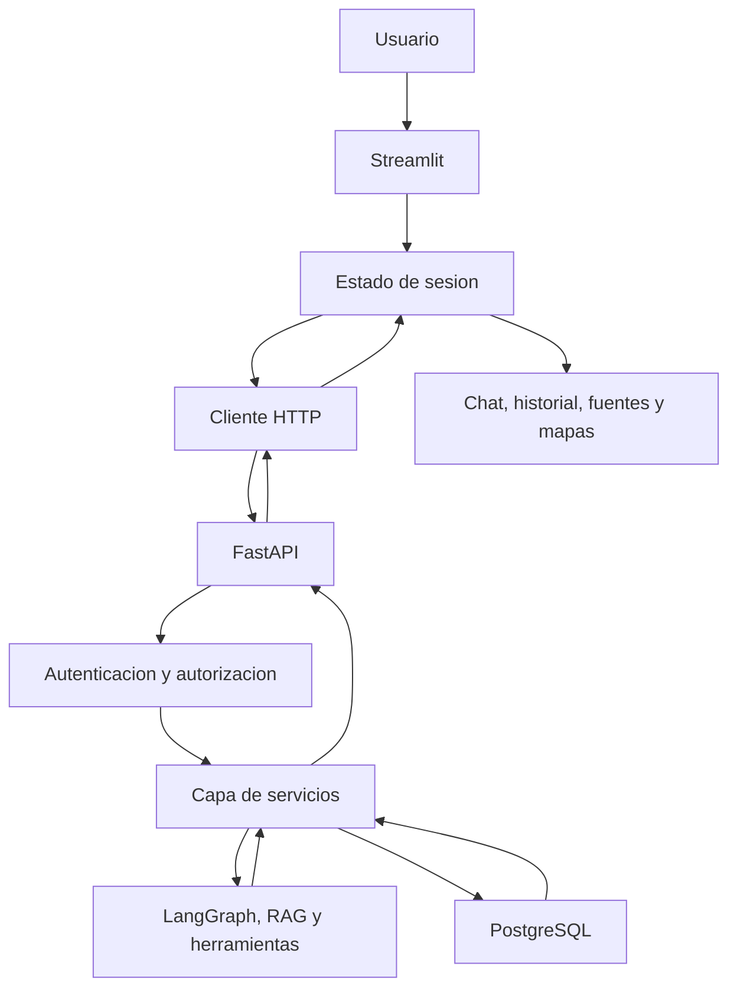

# 07. Cliente web Streamlit

## 1. Objetivo

Definir la interfaz web de ReciclaTÍA, sus responsabilidades, mecanismos de comunicación con el backend, gestión de sesiones y presentación de resultados.

Streamlit constituirá el cliente web del servicio FastAPI y permitirá utilizar las funcionalidades del producto conforme a los permisos del consumidor.

La interfaz no constituirá una segunda implementación del asistente.

## 2. Principios arquitectónicos

- Separación entre frontend y backend.
- Comunicación exclusivamente mediante HTTP.
- Independencia respecto al estado interno de LangGraph.
- Presentación de funcionalidades según los permisos del consumidor.
- Gestión aislada de las sesiones de usuario.
- Protección de credenciales.
- Conservación del contexto visual de la conversación.
- Validación de entradas orientada a la experiencia de usuario.
- Presentación de respuestas y errores controlados.
- Independencia respecto al entorno de despliegue del backend.

Las decisiones de seguridad, autorización y ejecución corresponderán al backend.

## 3. Arquitectura



Streamlit utilizará los contratos públicos de FastAPI.

No importará ni ejecutará directamente:

- src.agent.
- src.graph.
- src.nodes.
- Las herramientas del asistente.
- El sistema RAG.
- ChromaDB.
- Los modelos de persistencia.
- Las sesiones de PostgreSQL.
- Los mecanismos internos de MemorySaver.

La interfaz no accederá directamente a los checkpoints de LangGraph.

## 4. Separación de responsabilidades

### 4.1. Streamlit

Será responsable de:

- Presentar las funcionalidades del producto.
- Recoger las entradas del consumidor.
- Gestionar el estado visual de la sesión.
- Gestionar las credenciales necesarias para la comunicación HTTP.
- Enviar peticiones al backend.
- Interpretar los contratos públicos.
- Mostrar respuestas, planes, fuentes y resultados geográficos.
- Presentar el historial autorizado.
- Mostrar errores controlados.

### 4.2. FastAPI

Será responsable de:

- Autenticar las credenciales.
- Autorizar las operaciones.
- Validar las entradas.
- Aplicar las cuotas y límites.
- Gestionar las conversaciones.
- Coordinar la ejecución del asistente.
- Validar las imágenes.
- Resolver las operaciones HITL.
- Persistir los turnos.
- Construir las respuestas HTTP.

### 4.3. Cliente HTTP

Las operaciones de comunicación con FastAPI deberán centralizarse en un componente reutilizable del frontend.

No se distribuirán implementaciones independientes de peticiones HTTP entre los diferentes elementos visuales.

Este componente será responsable de construir las peticiones, incorporar las cabeceras necesarias, gestionar los tiempos de espera e interpretar las respuestas HTTP.

## 5. Configuración del backend

### 5.1. URL base

La dirección del backend se configurará mediante:

```text
API_BASE_URL
```

Ejemplo de desarrollo local:

```dotenv
API_BASE_URL=http://localhost:8000
```

Ejemplo de producción:

```dotenv
API_BASE_URL=https://nombre-del-servicio.onrender.com
```

La dirección de producción constituye un ejemplo y deberá sustituirse por la URL real del servicio.

### 5.2. Independencia del entorno

El cambio entre un backend local y uno desplegado no deberá requerir modificaciones del código fuente de Streamlit.

La configuración no deberá depender de rutas internas del contenedor ni de conexiones directas a PostgreSQL.

### 5.3. Comunicaciones seguras

Las comunicaciones con el entorno de producción utilizarán HTTPS.

No se desactivará la validación de certificados para establecer conexiones con servicios de producción.

## 6. Perfiles funcionales

La interfaz deberá adaptar las funcionalidades visibles al contexto de autenticación y a los permisos correspondientes.

| Funcionalidad | Free anónimo | Free registrado | User | Admin |
|---|---|---|---|---|
| Consultas textuales | Sí | Sí | Sí | Sí |
| Consultas con imágenes | No | No | Sí | Sí |
| Nueva conversación | Sí | Sí | Sí | Sí |
| HITL | Sí | Sí | Sí | Sí |
| Historial de la sesión actual | Sí | Sí | Sí | Sí |
| Historial persistente autorizado | No | Sí | Sí | Sí |
| Gestión de cuenta propia | No | Sí | Sí | Mediante sesión ordinaria |
| Selección de claves propias | No | Sí | Sí | Mediante sesión ordinaria |
| Acceso global a conversaciones | No | No | No | Sí |

Las funcionalidades administrativas estarán disponibles mediante los endpoints autorizados de la API.

La implementación de un panel administrativo completo en Streamlit no constituye un requisito inicial de la interfaz.

Los permisos se determinarán conforme a [14-autenticacion-autorizacion.md](14-autenticacion-autorizacion.md).

Ocultar funcionalidades en Streamlit no sustituye la autorización del backend.

## 7. Acceso inicial

### 7.1. Modalidades de acceso

La interfaz permitirá:

- Continuar como consumidor Free anónimo.
- Registrar una cuenta.
- Iniciar sesión.
- Utilizar una API key original cuando corresponda.

El acceso al nivel Free no requerirá registro obligatorio.

### 7.2. Acceso anónimo

Cuando un consumidor seleccione el acceso anónimo, Streamlit solicitará una API key Free mediante:

```http
POST /api-keys/free
```

La credencial recibida se conservará durante la sesión de Streamlit.

No se solicitará una nueva API key para cada mensaje, conversación o rerun de la interfaz.

La creación de una nueva conversación no deberá reiniciar las cuotas correspondientes a la clave utilizada.

### 7.3. Acceso registrado

Los consumidores registrados podrán iniciar sesión y seleccionar las API keys propias que estén autorizados a utilizar.

El registro no concederá automáticamente acceso al nivel User.

### 7.4. Cambio de modalidad

El cambio de identidad o modalidad de autenticación deberá limpiar el contexto visual asociado a la modalidad anterior.

No se transferirán automáticamente las conversaciones de una API key anónima a una cuenta registrada.

La propiedad de las conversaciones se conservará conforme a las reglas de persistencia.

## 8. Registro de usuarios

### 8.1. Formulario

El formulario de registro permitirá introducir:

- Email.
- Contraseña.
- Confirmación de contraseña.

La confirmación de contraseña constituye una validación de la interfaz y no formará parte del contrato HTTP RegisterIn.

### 8.2. Validación

Streamlit podrá comprobar previamente:

- Presencia de los campos obligatorios.
- Formato básico del email.
- Cumplimiento de los requisitos de contraseña.
- Coincidencia entre contraseña y confirmación.

Los requisitos de autenticación se definen en [14-autenticacion-autorizacion.md](14-autenticacion-autorizacion.md).

La validación definitiva corresponderá a FastAPI.

### 8.3. Comunicación

El registro se realizará mediante:

```http
POST /auth/register
```

### 8.4. Resultado

Cuando el registro finalice correctamente, la interfaz informará al consumidor y permitirá iniciar sesión.

No se asumirá que el registro concede automáticamente una sesión autenticada ni una API key User.

## 9. Autenticación de usuarios

### 9.1. Inicio de sesión

La interfaz solicitará el email y la contraseña.

La autenticación se realizará mediante:

```http
POST /auth/login
```

Cuando la autenticación sea satisfactoria, Streamlit conservará la información necesaria de LoginOut.

### 9.2. Token de sesión

El token de sesión se conservará dentro del estado de sesión correspondiente al consumidor.

No se almacenará en archivos locales, parámetros de URL ni estructuras globales compartidas.

### 9.3. Consulta de cuenta

La información del usuario autenticado podrá obtenerse mediante:

```http
GET /auth/me
```

### 9.4. Caducidad

Cuando el backend indique que una sesión ha caducado o ha dejado de ser válida, la interfaz deberá solicitar una nueva autenticación.

La información protegida correspondiente a la sesión anterior deberá retirarse de la vista activa.

### 9.5. Cierre de sesión

El cierre de sesión se realizará mediante:

```http
POST /auth/logout
```

Streamlit deberá eliminar de su estado local:

- El token de sesión.
- La información del usuario autenticado.
- La API key seleccionada.
- Las credenciales originales conservadas.
- La conversación activa.
- El historial protegido.
- Las aprobaciones pendientes visibles.

Si el backend no está disponible, se limpiará igualmente la sesión local y se informará de que no ha podido confirmarse la invalidación remota del token.

### 9.6. Modificación de contraseña

La interfaz permitirá modificar la contraseña mediante:

```http
PATCH /auth/password
```

Después de una modificación satisfactoria, deberá solicitarse una nueva autenticación conforme a las reglas de invalidación de sesiones.

## 10. Gestión de API keys

### 10.1. Consulta de claves propias

Los consumidores registrados podrán consultar sus API keys mediante:

```http
GET /api-keys
```

### 10.2. Información visible

La interfaz podrá mostrar la información pública incluida en ApiKeyOut:

- Identificador.
- Rol.
- Estado.
- Fecha de creación.
- Fecha de última utilización, cuando esté disponible.

No se mostrarán hashes de API keys.

### 10.3. Generación

Los consumidores registrados podrán solicitar nuevas claves mediante:

```http
POST /api-keys
```

Los roles disponibles estarán condicionados por las reglas de autorización.

El backend determinará si la emisión está permitida.

### 10.4. Visualización del secreto original

Cuando se genere una nueva API key, la interfaz podrá mostrar su valor original únicamente a partir de la respuesta de emisión.

Deberá informarse de que la credencial original no podrá recuperarse posteriormente desde PostgreSQL.

No se conservará el secreto en estructuras compartidas entre consumidores.

### 10.5. Selección de clave

Los consumidores registrados deberán seleccionar explícitamente la API key que desean utilizar.

La selección se realizará mediante su identificador público api_key.id.

Las claves inactivas no podrán seleccionarse para realizar nuevas consultas.

Podrán seleccionarse para consultar el historial autorizado cuando el contrato correspondiente lo permita.

### 10.6. Cambio de clave

Cuando se seleccione otra API key:

- Se descartará la conversación activa de la interfaz.
- Se eliminarán los resultados visibles correspondientes a la clave anterior.
- Se retirarán los planes pendientes de la vista activa.
- Se actualizarán las funcionalidades disponibles.
- Se consultará el historial autorizado correspondiente a la nueva clave.

El cambio de clave no eliminará ni modificará las conversaciones persistidas anteriormente.

## 11. Modalidades de autenticación HTTP

### 11.1. Consumidor anónimo o credencial original

Las operaciones autenticadas mediante una API key original utilizarán:

```http
X-API-Key: <api_key>
```

Esta modalidad podrá utilizarse con las claves Free, User y Admin conforme a sus respectivos permisos.

### 11.2. Cuenta autenticada

Las operaciones correspondientes a una cuenta utilizarán:

```http
Authorization: Bearer <session_token>
```

### 11.3. Cuenta autenticada con clave seleccionada

Las operaciones del asistente realizadas mediante una clave Free registrada o User podrán utilizar:

```http
Authorization: Bearer <session_token>
X-API-Key-Id: <api_key_id>
```

### 11.4. Credenciales administrativas

Las operaciones administrativas requerirán la API key Admin original.

No se utilizarán credenciales administrativas mediante la selección ordinaria de una API key asociada a una sesión.

### 11.5. Modalidades incompatibles

El cliente HTTP no deberá combinar X-API-Key con la modalidad de autenticación mediante sesión y selección de clave.

Las cabeceras deberán construirse según el contrato de cada endpoint.

Las modalidades de autenticación se definen en [12-contratos-http.md](12-contratos-http.md).

## 12. Estado de sesión de Streamlit

### 12.1. Responsabilidad

st.session_state conservará la información necesaria para mantener la experiencia de usuario entre los reruns de Streamlit.

No constituirá la fuente de verdad del estado operativo del asistente.

### 12.2. Organización

Se conservará el prefijo rt_ para las variables de sesión correspondientes a ReciclaTÍA.

El estado de sesión deberá diferenciar:

- Identidad del consumidor.
- Modalidad de autenticación.
- Credenciales de sesión.
- API key seleccionada.
- Conversación activa.
- Última respuesta HTTP.
- Mensajes visibles.
- Aprobación pendiente.
- Preferencias de visualización.
- Información de ubicación autorizada.
- Estado del formulario y del cargador de imágenes.

### 12.3. Adaptación de las claves existentes

| Clave | Responsabilidad |
|---|---|
| rt_thread_id | Identificador de la conversación activa |
| rt_estado | Último resultado público recibido del backend |
| rt_mensajes | Mensajes y resultados visibles |
| rt_max_steps | Configuración autorizada de rondas por especialista |
| rt_usar_ubicacion | Autorización de utilización de coordenadas |
| rt_latitud | Latitud proporcionada por el consumidor |
| rt_longitud | Longitud proporcionada por el consumidor |
| rt_mostrar_mapa | Preferencia de visualización geográfica |
| rt_version_imagen | Control del estado del cargador de imágenes |

rt_estado dejará de contener EstadoProducto y conservará únicamente la representación pública necesaria para la interfaz.

La configuración de max_turns corresponderá al backend.

No se permitirá modificar max_turns desde Streamlit mientras el contrato HTTP no contemple esta posibilidad.

### 12.4. Información adicional

Se incorporarán las variables necesarias para conservar:

- Token de sesión.
- Información pública del usuario.
- API key anónima.
- API key original cuando corresponda.
- Identificador de la clave seleccionada.
- Rol de la clave.
- Identificador de aprobación pendiente.
- Estado de una petición HTTP en curso.
- Información pública del historial recuperado.

Los nombres definitivos de estas variables deberán mantener una organización coherente con las claves existentes.

### 12.5. Aislamiento

El estado de sesión de un consumidor no podrá compartirse con otros consumidores.

No se almacenarán credenciales, mensajes ni resultados personalizados en mecanismos de caché global compartida.

## 13. Gestión de conversaciones

### 13.1. Nueva conversación

Cuando el consumidor inicie una nueva conversación, Streamlit deberá:

- Limpiar el thread_id activo.
- Limpiar los mensajes visibles.
- Eliminar el plan y la aprobación pendiente de la vista activa.
- Limpiar los resultados documentales y geográficos.
- Restablecer la autorización de ubicación.
- Limpiar el cargador de imágenes.

La primera petición de una conversación nueva enviará thread_id=None o no proporcionará el identificador, según el contrato HTTP.

El backend será responsable de generar el UUID correspondiente.

### 13.2. Identificador recibido

Streamlit conservará el thread_id devuelto por FastAPI.

El identificador se utilizará en las operaciones posteriores de la misma conversación.

### 13.3. Continuidad

La interfaz permitirá realizar nuevas consultas cuando el estado público recibido indique que la conversación puede continuar.

Deberán considerarse:

- Existencia de HITL pendiente.
- Finalización de la conversación.
- Límites conocidos.
- Estado de autenticación.
- Disponibilidad operativa del hilo.
- Existencia de una petición en curso.

El backend realizará las comprobaciones definitivas.

### 13.4. Conversaciones finalizadas

Cuando una conversación haya finalizado, no se habilitará el envío de nuevas consultas en ese hilo.

El consumidor podrá consultar sus resultados visibles e iniciar una nueva conversación.

### 13.5. Conversaciones no reutilizables

Cuando el backend comunique que el estado operativo de una conversación se ha perdido o no puede reutilizarse de forma segura, Streamlit deberá informar al consumidor.

No intentará reconstruir el checkpoint utilizando los mensajes visibles o el historial SQL.

### 13.6. Cambio de contexto

No se reutilizarán automáticamente planes, evidencias, coordenadas ni identificaciones multimodales procedentes de otra conversación.

## 14. Consultas textuales

### 14.1. Entrada

La interfaz utilizará un componente de entrada de texto adecuado para conversaciones.

Se respetará la longitud máxima establecida en el contrato HTTP.

Las preguntas vacías o compuestas únicamente por espacios deberán impedirse en la interfaz cuando sea posible.

### 14.2. Comunicación

Las consultas textuales se enviarán mediante:

```http
POST /ask
```

### 14.3. Petición

Ejemplo de una nueva consulta:

```json
{
    "pregunta": "¿Dónde puedo reciclar unas pilas?",
    "thread_id": null,
    "auto_aprobar": false,
    "ubicacion": null,
    "max_steps": null
}
```

Streamlit enviará explícitamente auto_aprobar=False.

### 14.4. Procesamiento

Mientras exista una petición en curso, la interfaz deberá impedir envíos accidentales duplicados.

La finalización de un rerun no deberá provocar automáticamente una nueva petición al asistente.

### 14.5. Respuesta

La interfaz actualizará la conversación utilizando los campos autorizados de AskOut.

No reconstruirá el estado interno de LangGraph a partir de la respuesta.

## 15. Ubicación

### 15.1. Autorización

La utilización de coordenadas será voluntaria.

La interfaz permitirá activar explícitamente el envío de ubicación.

### 15.2. Coordenadas manuales

Inicialmente se utilizarán coordenadas introducidas manualmente por el consumidor.

Los valores de ejemplo no representan la ubicación real del dispositivo.

No se enviarán cuando el consumidor no haya autorizado su utilización.

### 15.3. Validación

La interfaz podrá comprobar que ambas coordenadas:

- Están presentes.
- Son numéricas.
- Son finitas.
- Se encuentran dentro de los rangos permitidos.

La validación definitiva corresponderá a FastAPI.

### 15.4. Comunicación

Las consultas textuales enviarán la ubicación conforme al contrato UbicacionIn.

Las consultas multimodales enviarán latitud y longitud mediante los campos correspondientes del formulario multipart.

No se enviará únicamente una de las dos coordenadas.

### 15.5. Restablecimiento

La autorización de utilización de ubicación deberá restablecerse al iniciar una nueva conversación.

### 15.6. Geolocalización automática

La geolocalización mediante el navegador constituye una ampliación opcional.

No se implementará geocodificación automática de direcciones ni cálculo de rutas durante esta fase.

## 16. Consultas multimodales

### 16.1. Disponibilidad

La entrada de imágenes únicamente deberá habilitarse para consumidores cuyas credenciales permitan consultas multimodales.

### 16.2. Carga de imágenes

La interfaz permitirá seleccionar archivos JPEG y PNG.

Podrá realizar comprobaciones preliminares destinadas a mejorar la experiencia del consumidor.

Estas comprobaciones no sustituirán los mecanismos de seguridad y validación del backend.

### 16.3. Adaptación de imágenes

La interfaz no deberá rechazar automáticamente una imagen únicamente por superar los límites finales de peso o resolución cuando el backend pueda adaptarla de forma segura.

Las restricciones absolutas y los límites finales se definen en [15-robustez-observabilidad.md](15-robustez-observabilidad.md).

La responsabilidad de validar, comprimir y redimensionar las imágenes corresponderá al backend.

### 16.4. Comunicación

Las consultas multimodales se enviarán mediante:

```http
POST /ask/image
```

Se utilizará multipart/form-data.

| Campo | Contenido |
|---|---|
| imagen | Archivo seleccionado |
| pregunta | Consulta textual |
| thread_id | Identificador de conversación, cuando exista |
| auto_aprobar | False |
| latitud | Coordenada autorizada, cuando corresponda |
| longitud | Coordenada autorizada, cuando corresponda |
| max_steps | Configuración opcional autorizada |

### 16.5. Independencia del almacenamiento local

Streamlit enviará el contenido del archivo al backend.

No proporcionará una ruta local para que FastAPI intente acceder a ella.

La interfaz no necesitará crear archivos temporales destinados a la ejecución de las herramientas del asistente.

### 16.6. Validación semántica

La identificación multimodal y la validación semántica corresponderán al backend.

Streamlit no realizará llamadas directas a Gemini.

### 16.7. Resultados

La interfaz deberá distinguir entre:

- Imagen procesada correctamente.
- Imagen fuera del dominio.
- Identificación incierta.
- Contenido no permitido.
- Archivo inválido.
- Fallo técnico.

Cuando la identificación sea incierta, podrá solicitarse al consumidor una nueva imagen.

### 16.8. Limpieza

El cargador de imágenes deberá limpiarse cuando corresponda para evitar reenvíos accidentales.

La interfaz no conservará permanentemente las imágenes recibidas.

## 17. Supervisión humana — HITL

### 17.1. Presentación

La interfaz mostrará el plan devuelto por FastAPI cuando exista una aprobación pendiente.

El plan deberá conservar la información necesaria para que el consumidor pueda adoptar una decisión.

### 17.2. Habilitación de acciones

Los botones Aprobar y Rechazar únicamente estarán disponibles cuando:

- pendiente_hitl=True.
- Exista un approval_id válido.
- El plan corresponda a la conversación activa.
- No exista una petición de resolución en curso.
- No exista un error que impida resolver la aprobación.

### 17.3. Resolución

Las decisiones se enviarán mediante:

```http
POST /approve
```

Ejemplo:

```json
{
    "thread_id": "550e8400-e29b-41d4-a716-446655440000",
    "approval_id": "550e8400-e29b-41d4-a716-446655440002",
    "aprobado": true
}
```

Los identificadores corresponden a un ejemplo ilustrativo.

La interfaz utilizará los identificadores recibidos realmente del backend.

### 17.4. Aprobación

Cuando el backend confirme una aprobación satisfactoria, Streamlit deberá:

- Actualizar la representación del turno.
- Mostrar la decisión registrada.
- Retirar las acciones HITL.
- Impedir nuevas consultas en la conversación finalizada.

### 17.5. Rechazo

Cuando el backend confirme un rechazo satisfactorio, Streamlit deberá:

- Mostrar la decisión registrada.
- Retirar el plan de la lista de aprobaciones pendientes.
- Habilitar una reformulación si las condiciones de continuidad lo permiten.

### 17.6. Respuestas directas

Cuando una respuesta no requiera HITL, no se mostrarán los botones Aprobar y Rechazar.

No se interpretará plan_aprobado=None como un rechazo.

### 17.7. Aprobaciones obsoletas

Cuando el backend devuelva STALE_APPROVAL, no se presentará la decisión como resuelta.

Se retirarán las acciones correspondientes al identificador obsoleto y se informará de la incompatibilidad del estado.

No se intentará aprobar automáticamente un plan posterior.

### 17.8. Prevención de duplicados

Una decisión HITL no deberá enviarse repetidamente como consecuencia de:

- Reruns de Streamlit.
- Pulsaciones múltiples.
- Cambios de elementos visuales.
- Actualizaciones del estado de sesión.

La autorización definitiva y la prevención de modificaciones concurrentes corresponderán al backend.

## 18. Historial de conversaciones

### 18.1. Historial visual

Streamlit conservará durante la sesión los mensajes y resultados recibidos en la conversación activa.

Este historial visual no constituye una garantía de persistencia relacional.

### 18.2. Consumidores anónimos

Los consumidores Free anónimos podrán consultar los mensajes visibles conservados durante su sesión de Streamlit.

No tendrán acceso a los endpoints de historial persistente.

### 18.3. Consumidores registrados

Los consumidores registrados podrán consultar el historial de sus propias API keys mediante los endpoints autenticados por sesión:

```http
GET /api-keys/{api_key_id}/threads
GET /api-keys/{api_key_id}/threads/{thread_id}
GET /api-keys/{api_key_id}/threads/{thread_id}/messages
```

### 18.4. Acceso mediante API key

Cuando la modalidad y el rol lo permitan, podrán utilizarse:

```http
GET /threads
GET /threads/{thread_id}
GET /threads/{thread_id}/messages
```

### 18.5. Claves desactivadas

El propietario de una API key desactivada podrá consultar su historial mediante una sesión válida cuando se encuentre autorizado.

No podrá utilizar dicha clave para iniciar nuevas consultas.

### 18.6. Claves eliminadas

El historial ordinario de las claves eliminadas lógicamente no estará disponible para los consumidores registrados.

Se aplicarán las reglas de acceso administrativo correspondientes.

### 18.7. Presentación del historial

Los mensajes recuperados se mostrarán respetando el orden proporcionado por el backend.

Se distinguirán los mensajes del usuario y los mensajes del asistente.

El historial persistente se representará conforme a MessageOut.

### 18.8. Alcance del historial

La recuperación de mensajes persistidos no implica recuperar:

- Checkpoints.
- Planes pendientes.
- Trazas internas.
- Estado de especialistas.
- Resultados estructurados de herramientas no persistidos.
- Archivos adjuntos originales.

La interfaz no reconstruirá información que no esté incluida en el contrato de persistencia.

### 18.9. Conversaciones anteriores

Consultar una conversación almacenada no implica necesariamente que pueda continuarse.

La vista del historial deberá diferenciarse de la conversación operativa cuando no exista información suficiente para confirmar su continuidad.

El backend será responsable de determinar si una operación posterior sobre el hilo puede realizarse.

## 19. Presentación de resultados

### 19.1. Chat

La interfaz mostrará las preguntas y respuestas correspondientes a la conversación activa.

La respuesta deberá conservar el contenido proporcionado por el backend.

No se modificarán las recomendaciones mediante inferencias adicionales de Streamlit.

### 19.2. Planes

Los planes se mostrarán como elementos diferenciados de la respuesta informativa.

Se indicará su estado cuando corresponda:

- Pendiente.
- Aprobado.
- Rechazado.

### 19.3. Fuentes

Las referencias documentales deberán mostrarse a partir de los campos autorizados del contrato público.

Cuando no existan fuentes, la interfaz no generará referencias ficticias.

### 19.4. Evidencia

La interfaz podrá mostrar los estados de evidencia:

- Suficiente.
- Parcial.
- Insuficiente.

Las limitaciones proporcionadas por el backend deberán conservarse.

### 19.5. Abstenciones

Las abstenciones válidas deberán presentarse como respuestas del asistente y no como fallos de conexión o errores inesperados.

### 19.6. Resultados geográficos

Cuando el backend proporcione información geográfica, la interfaz podrá mostrar:

- Nombre de la instalación.
- Dirección.
- Modalidad.
- Distancia.
- Horarios publicados.
- Información de procedencia.
- Avisos y limitaciones.

Se utilizarán exclusivamente los campos disponibles en el contrato GeografiaOut.

### 19.7. Mapas

Los mapas se construirán utilizando las coordenadas devueltas por el backend.

No se inventarán coordenadas para instalaciones que no dispongan de ellas.

No se calcularán rutas ni tiempos de desplazamiento mediante la interfaz.

### 19.8. Procedencia geográfica

La interfaz deberá distinguir entre resultados procedentes de:

- api.
- corpus_local.

Cuando se utilicen datos de respaldo, deberá conservarse el aviso sobre su posible desactualización.

### 19.9. Horarios

Los horarios publicados no se presentarán como garantías de apertura física.

La interfaz representará la información temporal proporcionada por el asistente sin implementar una segunda lógica de interpretación horaria.

## 20. Estado del servicio

### 20.1. Health check

La disponibilidad del backend se comprobará mediante:

```http
GET /health
```

### 20.2. Información visible

La interfaz podrá indicar:

- Backend disponible.
- Backend no disponible.
- Servicio no preparado.
- Error de conexión.

### 20.3. Interpretación

Una respuesta satisfactoria de GET /health no constituye una garantía de que todos los proveedores externos se encuentren disponibles.

La interfaz no afirmará que una consulta podrá completarse correctamente únicamente porque el health check haya sido satisfactorio.

### 20.4. Frecuencia de comprobación

Las comprobaciones deberán evitar peticiones innecesarias durante cada modificación visual o rerun.

No se realizarán llamadas al asistente para comprobar la disponibilidad del servicio.

## 21. Gestión de errores HTTP

### 21.1. Contrato

Los errores del backend se interpretarán mediante ErrorOut.

La interfaz utilizará el código HTTP, el código de error y el mensaje público proporcionado.

### 21.2. Presentación

| HTTP | Comportamiento general |
|---|---|
| 401 | Solicitar autenticación o una credencial válida |
| 403 | Informar de que la operación no está autorizada |
| 404 | Informar de que el recurso no está disponible |
| 409 | Gestionar el conflicto según el código de error |
| 413 | Informar de que el archivo supera los límites admitidos |
| 415 | Informar de que el formato multimedia no está permitido |
| 422 | Mostrar el problema de validación correspondiente |
| 429 | Informar del límite alcanzado y del tiempo de reintento disponible |
| 500 | Comunicar un fallo interno controlado |
| 503 | Informar de indisponibilidad o falta de capacidad |
| 504 | Informar de que se ha superado el tiempo de espera |

Los códigos específicos y su significado se definen en [12-contratos-http.md](12-contratos-http.md).

### 21.3. Conflictos de conversación

La interfaz deberá diferenciar, entre otros:

- NO_PENDING_APPROVAL.
- PENDING_APPROVAL.
- STALE_APPROVAL.
- THREAD_CLOSED.
- TURN_LIMIT_REACHED.
- THREAD_BUSY.
- THREAD_STATE_LOST.

No se tratarán todos los conflictos como si fueran fallos de conexión.

### 21.4. Límites de consumo

Cuando se reciba RATE_LIMIT_EXCEEDED, la interfaz informará del límite alcanzado.

Si existe una cabecera Retry-After válida, podrá utilizarse para informar del tiempo de reintento.

No se generará automáticamente otra API key para eludir la restricción.

### 21.5. Falta de capacidad

Cuando el backend devuelva SERVER_BUSY, se informará de que el asistente no dispone de capacidad para admitir una nueva ejecución en ese momento.

No se implementará una cola automática de consultas en Streamlit.

### 21.6. Respuestas inesperadas

Si el backend devuelve una respuesta que no respeta el contrato esperado, la interfaz deberá presentar un fallo controlado.

No mostrará estructuras internas, excepciones completas ni respuestas HTML de infraestructura como si fueran mensajes válidos del asistente.

### 21.7. Errores locales

Los fallos de comunicación sin respuesta HTTP deberán distinguirse de los errores devueltos explícitamente por FastAPI.

## 22. Timeouts y reintentos

### 22.1. Timeout del cliente

El tiempo de espera HTTP de Streamlit deberá ser superior al timeout establecido para el asistente.

Se propone inicialmente un tiempo de espera de 90 segundos para las operaciones del asistente, conforme a [16-despliegue.md](16-despliegue.md).

### 22.2. Operaciones ordinarias

Los endpoints que no requieran ejecutar el asistente podrán disponer de tiempos de espera inferiores.

### 22.3. Timeout del backend

Cuando FastAPI devuelva AGENT_TIMEOUT, la interfaz no considerará el turno satisfactoriamente resuelto.

### 22.4. Timeout del cliente

Cuando Streamlit agote su propio tiempo de espera sin recibir respuesta, no deberá asumir que el backend ha cancelado la ejecución.

Tampoco deberá asumir que la operación no se ha ejecutado o que no ha consumido recursos.

### 22.5. Reintentos

No se repetirán automáticamente peticiones POST cuyo resultado sea desconocido como consecuencia de:

- Timeouts.
- Pérdidas de conexión.
- Respuestas incompletas.

El consumidor deberá recibir información sobre la incertidumbre del resultado.

### 22.6. Continuación

La interfaz no reconstruirá un resultado satisfactorio a partir de una petición cuya resolución no haya podido confirmar.

Cuando no pueda determinarse de forma segura el estado de la conversación, deberá informar de la limitación y permitir iniciar una nueva conversación.

## 23. Seguridad y privacidad

### 23.1. Credenciales

Streamlit no almacenará credenciales en:

- Archivos de texto.
- Parámetros de URL.
- Logs.
- Cachés compartidas.
- Variables globales asociadas a todos los consumidores.

### 23.2. Secretos del backend

La interfaz no necesitará disponer de:

- GEMINI_API_KEY.
- DATABASE_URL.
- Credenciales de PostgreSQL.
- Secretos internos del backend.

No se configurará una API key administrativa global para autenticar automáticamente las consultas de todos los consumidores.

### 23.3. Validación de permisos

La interfaz podrá adaptar sus elementos visuales según el perfil autenticado.

No se confiará exclusivamente en estos elementos para impedir operaciones no autorizadas.

### 23.4. Renderizado

Las respuestas generadas por el asistente deberán tratarse como contenido no confiable.

No se ejecutará código contenido en las respuestas ni se habilitará la interpretación arbitraria de HTML no confiable.

### 23.5. Datos de otros consumidores

No se compartirán entre sesiones:

- Credenciales.
- Conversaciones.
- Mensajes.
- Planes.
- Coordenadas.
- Imágenes.
- Historiales.

### 23.6. CORS

Las peticiones HTTP realizadas desde el proceso de Streamlit hacia FastAPI no constituyen peticiones directas del navegador al backend.

Las reglas CORS se aplicarán a los clientes que realicen peticiones desde un navegador conforme a [15-robustez-observabilidad.md](15-robustez-observabilidad.md).

## 24. Diagnóstico y observabilidad

### 24.1. Información pública

La interfaz podrá mostrar información de diagnóstico autorizada, como:

- Estado del backend.
- thread_id.
- request_id.
- Código HTTP.
- Código de error.
- Estado público de la conversación.
- Existencia de una aprobación pendiente.

### 24.2. Identificador de petición

El request_id recibido mediante X-Request-ID o ErrorOut podrá mostrarse para facilitar la identificación de incidencias.

### 24.3. Trazas internas

Streamlit no tendrá acceso directo a los logs de nodos ni a las trazas internas de herramientas.

No se expondrán automáticamente estructuras internas de LangGraph para conservar el panel de diagnóstico anterior.

### 24.4. Diagnóstico autorizado

Cualquier ampliación futura de las capacidades de diagnóstico deberá utilizar contratos públicos específicamente autorizados.

La observabilidad del backend se define en [15-robustez-observabilidad.md](15-robustez-observabilidad.md).

## 25. Eficiencia de la interfaz

Streamlit deberá evitar operaciones HTTP innecesarias.

En particular:

- No se generarán API keys durante cada rerun.
- No se repetirán consultas previamente enviadas.
- No se duplicarán decisiones HITL.
- No se solicitará el historial completo durante cada modificación visual.
- No se enviarán imágenes cuando no exista una consulta correspondiente.
- No se repetirán peticiones POST automáticamente tras un timeout.
- No se ejecutarán comprobaciones de salud mediante consultas al asistente.
- No se realizarán llamadas directas a Gemini.
- No se reconstruirán índices vectoriales.
- No se consultará directamente PostgreSQL.

Las preferencias visuales y los cambios locales que no requieran datos del backend deberán resolverse dentro de la interfaz.

## 26. Validación

### 26.1. Configuración y conectividad

Las pruebas deberán verificar:

- Comunicación con FastAPI local.
- Comunicación con FastAPI desplegado.
- Cambio de entorno mediante API_BASE_URL.
- Interpretación de GET /health.
- Comportamiento ante un backend no disponible.

### 26.2. Autenticación

Las pruebas deberán verificar:

- Acceso Free anónimo.
- Conservación de la API key anónima durante los reruns.
- Registro de usuarios.
- Inicio de sesión.
- Cierre de sesión.
- Modificación de contraseña.
- Caducidad de sesión.
- Selección de claves propias.
- Ausencia de mezcla entre modalidades de autenticación.

### 26.3. Conversaciones

Las pruebas deberán verificar:

- Creación de una conversación.
- Recepción y conservación de thread_id.
- Continuidad de una conversación.
- Nueva conversación independiente.
- Cambio de API key.
- Limpieza del contexto visual.
- Respuestas directas.
- Abstenciones válidas.
- Conversaciones finalizadas.
- Pérdida del estado operativo.

### 26.4. HITL

Las pruebas deberán verificar:

- Presentación de planes pendientes.
- Existencia de approval_id.
- Aprobación.
- Rechazo.
- Reformulación posterior.
- Ausencia de botones HITL en respuestas directas.
- Prevención de envíos duplicados.
- Gestión de aprobaciones obsoletas.
- Gestión de fallos de resolución.

### 26.5. Imágenes

Las pruebas deberán verificar:

- Restricción de acceso según el rol.
- Envío multipart/form-data.
- Archivos JPEG y PNG.
- Presentación de errores de imagen.
- Adaptación satisfactoria de imágenes por el backend.
- Imágenes fuera del dominio.
- Identificaciones inciertas.
- Limpieza del cargador.
- Ausencia de reenvíos accidentales.

### 26.6. Ubicación y resultados

Las pruebas deberán verificar:

- Ubicación desactivada.
- Coordenadas autorizadas.
- Coordenadas inválidas.
- Visualización de fuentes.
- Visualización de resultados geográficos.
- Representación de mapas.
- Identificación de la procedencia.
- Presentación de limitaciones.
- Diferenciación entre horarios publicados y apertura física.

### 26.7. Historial

Las pruebas deberán verificar:

- Ausencia de historial persistente para consumidores anónimos.
- Historial de claves propias.
- Historial de claves desactivadas.
- Restricción de claves eliminadas.
- Separación entre historial y estado operativo.
- Disponibilidad del historial después de un redeploy.

### 26.8. Robustez

Las pruebas deberán verificar:

- Credenciales inválidas.
- Operaciones no autorizadas.
- Cuotas agotadas.
- Conflictos de conversación.
- Falta de capacidad.
- Timeouts del backend.
- Timeouts del cliente.
- Ausencia de reintentos automáticos incompatibles.
- Respuestas HTTP inesperadas.

### 26.9. Seguridad

Las pruebas deberán verificar:

- Aislamiento entre sesiones.
- Ausencia de secretos en logs.
- Limpieza del estado al cerrar sesión.
- Ausencia de acceso directo a LangGraph.
- Ausencia de acceso directo a PostgreSQL.
- Ausencia de llamadas directas a Gemini.
- Ausencia de elevaciones de privilegios desde la interfaz.

La estrategia general de pruebas se define en [08-pruebas-y-validacion.md](08-pruebas-y-validacion.md).

## 27. Criterios de aceptación

- Streamlit funciona como cliente HTTP de FastAPI.
- El frontend puede conectarse a diferentes entornos mediante API_BASE_URL.
- La interfaz no ejecuta directamente el asistente.
- El acceso Free no requiere registro obligatorio.
- La API key anónima se conserva durante la sesión.
- Los consumidores pueden registrarse e iniciar sesión.
- Las cuentas registradas pueden consultar y seleccionar sus claves autorizadas.
- El registro no concede automáticamente acceso al nivel User.
- Las modalidades de autenticación no se mezclan.
- El cambio de API key limpia el contexto visual anterior.
- El backend genera el identificador de las conversaciones nuevas.
- Streamlit conserva el thread_id recibido.
- Las consultas textuales utilizan POST /ask.
- Las consultas multimodales utilizan POST /ask/image.
- Las imágenes se transmiten mediante multipart/form-data.
- Las consultas multimodales respetan los permisos del consumidor.
- La ubicación se utiliza únicamente cuando ha sido autorizada.
- Las respuestas directas no muestran acciones HITL.
- Las aprobaciones utilizan thread_id y approval_id.
- Streamlit envía auto_aprobar=False.
- Las aprobaciones válidas finalizan la conversación correspondiente.
- Los rechazos permiten reformular cuando procede.
- Las fuentes y limitaciones se representan correctamente.
- Los resultados geográficos conservan su procedencia.
- Los mapas utilizan coordenadas recibidas del backend.
- Los consumidores pueden consultar el historial autorizado.
- El historial persistente no se confunde con el checkpoint.
- Los errores HTTP se presentan de forma controlada.
- Los límites de consumo se comunican correctamente.
- Los timeouts no provocan reintentos POST automáticos.
- Las peticiones no se duplican durante los reruns.
- Las credenciales no se comparten entre consumidores.
- El cierre de sesión limpia el contexto protegido.
- Streamlit puede utilizarse con el backend desplegado en Render.
- Las funcionalidades existentes de presentación de resultados se conservan.

## 28. Fuera de alcance inicial

Durante esta fase no se requiere:

- Despliegue independiente de Streamlit en producción.
- Panel administrativo completo dentro de Streamlit.
- Geolocalización automática del navegador.
- Geocodificación de direcciones.
- Cálculo de rutas.
- Comunicación mediante WebSockets.
- Generación de respuestas en streaming.
- Reconstrucción de checkpoints desde el historial SQL.
- Persistencia durable de las sesiones de Streamlit.
- Integración con pasarelas de pago.
- Gestión comercial de suscripciones.

Las funcionalidades administrativas podrán utilizarse mediante Swagger u otros clientes HTTP autorizados.

## 29. Especificaciones relacionadas

| Documento | Responsabilidad |
|---|---|
| [00-producto.md](00-producto.md) | Alcance funcional y perfiles de acceso |
| [03-generacion.md](03-generacion.md) | Respuestas, fuentes y evidencia |
| [04-consultas-generales.md](04-consultas-generales.md) | Interpretación geográfica y temporal |
| [05-tools.md](05-tools.md) | Resultados de herramientas |
| [06-langgraph.md](06-langgraph.md) | Estado operativo y HITL |
| [08-pruebas-y-validacion.md](08-pruebas-y-validacion.md) | Evaluación y pruebas |
| [10-seguridad.md](10-seguridad.md) | Seguridad del núcleo |
| [11-arquitectura-mlops.md](11-arquitectura-mlops.md) | Separación arquitectónica |
| [12-contratos-http.md](12-contratos-http.md) | Comunicación HTTP |
| [13-persistencia.md](13-persistencia.md) | Historial persistente |
| [14-autenticacion-autorizacion.md](14-autenticacion-autorizacion.md) | Identidad, credenciales y permisos |
| [15-robustez-observabilidad.md](15-robustez-observabilidad.md) | Cuotas, errores y robustez |
| [16-despliegue.md](16-despliegue.md) | Configuración y entornos |