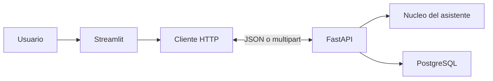

# 07. Cliente web Streamlit

## 1. Objetivo

Adaptar la interfaz existente de ReciclaTÍA para que funcione como cliente HTTP de FastAPI, conservando las funcionalidades visuales desarrolladas durante el PB02.

Streamlit será responsable de la interacción con el consumidor, la gestión de su sesión y la presentación de los resultados.

No ejecutará directamente LangGraph, RAG, herramientas, Gemini, ChromaDB ni operaciones sobre PostgreSQL.

## 2. Arquitectura y configuración



Las peticiones HTTP se centralizarán en un componente reutilizable del frontend, responsable de:

- Construir las peticiones.
- Incorporar las credenciales correspondientes.
- Aplicar los tiempos de espera.
- Interpretar las respuestas y errores.

La dirección del backend se establecerá mediante API_BASE_URL.

Desarrollo local:

```dotenv
API_BASE_URL=http://localhost:8000
```

Producción:

```dotenv
API_BASE_URL=https://nombre-del-servicio.onrender.com
```

El cambio de entorno no requerirá modificaciones del código.

Las comunicaciones de producción utilizarán HTTPS.

La interfaz respetará los contratos definidos en [12-contratos-http.md](12-contratos-http.md).

## 3. Acceso y autenticación

### 3.1. Modalidades de acceso

La interfaz permitirá:

- Continuar como consumidor Free anónimo.
- Registrar una cuenta.
- Iniciar sesión.
- Utilizar una API key original.

Las funcionalidades visibles dependerán de los permisos establecidos en [14-autenticacion-autorizacion.md](14-autenticacion-autorizacion.md).

Ocultar elementos de la interfaz no sustituye la autorización del backend.

### 3.2. Acceso anónimo

Se solicitará una API key mediante POST /api-keys/free.

La clave recibida se conservará durante la sesión de Streamlit.

No se solicitarán nuevas claves al iniciar conversaciones, enviar mensajes o ejecutar reruns.

Las conversaciones anónimas no se transferirán automáticamente a una cuenta registrada.

### 3.3. Gestión de cuentas

| Operación | Endpoint |
|---|---|
| Registro | POST /auth/register |
| Inicio de sesión | POST /auth/login |
| Consulta de cuenta | GET /auth/me |
| Cierre de sesión | POST /auth/logout |
| Modificación de contraseña | PATCH /auth/password |

El formulario de registro incluirá email, contraseña y confirmación de contraseña.

La confirmación se comprobará localmente y no se enviará al backend.

El registro satisfactorio permitirá iniciar sesión posteriormente, sin generar automáticamente una sesión ni una API key.

Tras modificar correctamente la contraseña, se solicitará una nueva autenticación.

### 3.4. Gestión de API keys

Los consumidores registrados podrán:

- Consultar sus claves mediante GET /api-keys.
- Solicitar nuevas claves mediante POST /api-keys.
- Seleccionar una clave propia autorizada.
- Consultar su información pública.

La emisión de claves User dependerá de la autorización del backend.

El secreto original únicamente se mostrará cuando se reciba durante la emisión. Se informará de que no podrá recuperarse posteriormente.

Las claves inactivas no podrán utilizarse para ejecutar el asistente, aunque su historial podrá consultarse cuando esté autorizado.

### 3.5. Cabeceras HTTP

| Modalidad | Cabeceras |
|---|---|
| API key original | X-API-Key |
| Cuenta autenticada | Authorization: Bearer |
| Cuenta y clave seleccionada | Authorization: Bearer y X-API-Key-Id |

Las cabeceras se construirán conforme al contrato de cada endpoint.

No se combinarán credenciales originales con autenticación mediante sesión.

Las operaciones administrativas requerirán la API key Admin original. Una sesión ordinaria no concederá privilegios administrativos.

## 4. Estado de sesión

### 4.1. Responsabilidad

st.session_state conservará únicamente la información necesaria para mantener la experiencia del consumidor entre reruns.

No constituirá la fuente de verdad del estado operativo de LangGraph.

Se conservará el prefijo rt_ de las variables existentes.

### 4.2. Variables principales

| Variable | Responsabilidad |
|---|---|
| rt_thread_id | Identificador recibido del backend o None |
| rt_estado | Último AskOut válido de la conversación activa |
| rt_mensajes | Mensajes y resultados visibles durante la sesión |
| rt_max_steps | Configuración opcional de rondas |
| rt_usar_ubicacion | Autorización de envío de coordenadas |
| rt_latitud | Latitud proporcionada por el consumidor |
| rt_longitud | Longitud proporcionada por el consumidor |
| rt_mostrar_mapa | Preferencia de visualización geográfica |
| rt_version_imagen | Control del cargador de imágenes |
| rt_aviso | Aviso temporal de la interfaz |

Se incorporarán las variables necesarias para gestionar:

- Modalidad de autenticación.
- Token de sesión y datos públicos del usuario.
- API key original o identificador de la clave seleccionada.
- Rol de acceso.
- Petición en curso.
- Disponibilidad operativa del hilo.
- Historial persistente consultado.

rt_estado dejará de contener EstadoProducto.

approval_id se obtendrá del último AskOut válido, evitando mantener identificadores de aprobación contradictorios.

Se eliminará el control de max_turns de la interfaz.

### 4.3. Limpieza del estado

El cambio de identidad, modalidad de autenticación o API key deberá limpiar el contexto visual anterior, incluyendo conversaciones, mensajes, aprobaciones, ubicación e imágenes.

El cierre de sesión eliminará las credenciales y los datos protegidos de la sesión local.

Si el backend no está disponible durante el cierre de sesión, se realizará igualmente la limpieza local y se informará de que no ha podido confirmarse la invalidación remota del token.

## 5. Conversaciones

### 5.1. Nueva conversación

Al iniciar una conversación nueva:

- rt_thread_id será None.
- rt_estado se reiniciará.
- Se limpiarán mensajes, planes y resultados anteriores.
- Se desactivará el envío de ubicación.
- Se reiniciará el cargador de imágenes.
- Se conservará la credencial activa.

Streamlit no generará identificadores UUID para conversaciones.

El identificador se obtendrá de la respuesta del backend.

### 5.2. Continuidad

La interfaz actualizará el contexto operativo a partir de los resultados HTTP válidos.

Una respuesta anterior a LangGraph podrá contener thread_id=None. En ese caso no se considerará creada una conversación operativa.

Si existe un hilo previo y se recibe una respuesta anterior al agente, se conservará el identificador autorizado devuelto.

Las aclaraciones anteriores a LangGraph no forman parte de su contexto. El consumidor deberá reformular su consulta incorporando la información necesaria.

### 5.3. Disponibilidad

La interfaz impedirá nuevos envíos cuando:

- Exista una aprobación pendiente.
- La conversación haya finalizado.
- Se haya alcanzado el límite de turnos conocido.
- Exista una petición en curso.
- El hilo no pueda reutilizarse de forma segura.
- La credencial haya dejado de ser válida.

El último turno permitido podrá resolver su aprobación pendiente.

Las comprobaciones definitivas corresponderán al backend.

## 6. Consultas

### 6.1. Consultas textuales

Se enviarán mediante POST /ask.

Ejemplo:

```json
{
    "pregunta": "¿Dónde puedo reciclar unas pilas?",
    "thread_id": null,
    "auto_aprobar": false,
    "ubicacion": null,
    "max_steps": null
}
```

Streamlit enviará explícitamente auto_aprobar=False.

La interfaz podrá impedir preguntas vacías o superiores a 500 caracteres después de aplicar strip().

La validación definitiva corresponderá a FastAPI.

### 6.2. Ubicación

El envío de coordenadas será voluntario.

Inicialmente se utilizarán coordenadas introducidas manualmente.

Los valores de ejemplo no deberán presentarse como la ubicación real del dispositivo ni enviarse sin autorización explícita.

Las consultas textuales utilizarán UbicacionIn.

Las consultas multimodales incluirán latitud y longitud mediante los campos multipart correspondientes.

No se enviarán coordenadas incompletas.

La autorización de ubicación se restablecerá al iniciar una conversación nueva o cambiar de identidad.

### 6.3. Consultas multimodales

El cargador de imágenes únicamente estará disponible para credenciales User y Admin.

Se utilizará POST /ask/image mediante multipart/form-data.

| Campo | Contenido |
|---|---|
| imagen | Archivo JPEG o PNG |
| pregunta | Consulta textual |
| thread_id | Identificador, cuando exista |
| auto_aprobar | false |
| latitud | Coordenada autorizada, cuando corresponda |
| longitud | Coordenada autorizada, cuando corresponda |
| max_steps | Configuración opcional |

Los campos opcionales ausentes se omitirán conforme al contrato multipart.

Streamlit transmitirá el contenido del archivo, no una ruta local.

No rechazará automáticamente imágenes que superen los límites finales cuando puedan adaptarse dentro de los límites absolutos establecidos.

La validación, adaptación e identificación semántica corresponderán al backend conforme a [15-robustez-observabilidad.md](15-robustez-observabilidad.md).

La interfaz representará los resultados de admisibilidad y solicitará otra imagen cuando corresponda.

El cargador se reiniciará después del envío para evitar reutilizaciones accidentales.

### 6.4. Prevención de duplicados

Las consultas se enviarán únicamente como consecuencia de una acción explícita del consumidor.

Los reruns, cambios de preferencias visuales y pulsaciones repetidas no deberán generar peticiones duplicadas.

Se bloquearán los controles incompatibles mientras exista una operación en curso.

## 7. Supervisión humana — HITL

### 7.1. Presentación

Streamlit mostrará la respuesta y el plan recibidos del backend.

Los botones Aprobar y Rechazar únicamente estarán disponibles cuando el último AskOut válido contenga:

- pendiente_hitl=True.
- thread_id válido.
- approval_id válido.
- done=False.
- error=None.

Además, no deberá existir una petición en curso ni un resultado operativo incierto.

Las respuestas anteriores a LangGraph no mostrarán botones HITL.

### 7.2. Resolución

Las decisiones se enviarán mediante POST /approve.

Ejemplo:

```json
{
    "thread_id": "550e8400-e29b-41d4-a716-446655440000",
    "approval_id": "550e8400-e29b-41d4-a716-446655440001",
    "aprobado": true
}
```

Los identificadores procederán de la respuesta pendiente real.

La interfaz no enviará el plan completo ni modificará localmente plan_aprobado, pendiente_hitl o done para simular una resolución.

### 7.3. Resultado

| Decisión confirmada | Comportamiento |
|---|---|
| Aprobación | Mostrar el resultado aprobado y bloquear nuevas consultas del hilo |
| Rechazo | Mostrar el rechazo y permitir reformular si el hilo continúa disponible |
| Fallo o resultado incierto | No simular una resolución |

El historial visual podrá conservar la propuesta originalmente mostrada, identificándola como rechazada cuando exista confirmación del backend.

El historial SQL se representará independientemente conforme al contrato de persistencia.

### 7.4. Conflictos

Cuando se reciba STALE_APPROVAL o NO_PENDING_APPROVAL, se retirarán las acciones asociadas a la propuesta anterior.

No se aprobará automáticamente otro plan.

Si no puede confirmarse el estado operativo actual, se impedirá continuar desde la representación local desactualizada.

Las reglas de resolución se establecen en [06-langgraph.md](06-langgraph.md).

## 8. Presentación de resultados

### 8.1. Chat

Se conservarán los componentes existentes de presentación de preguntas, respuestas, ejemplos y planes.

Las respuestas se mostrarán sin modificar sus recomendaciones.

Se distinguirán:

- Respuestas informativas.
- Aclaraciones.
- Abstenciones.
- Planes pendientes, aprobados o rechazados.
- Limitaciones de evidencia.
- Errores técnicos.

### 8.2. Fuentes

Las referencias documentales procederán exclusivamente de FuenteOut.

Se mostrarán los nombres de las fuentes y las URL autorizadas cuando estén disponibles.

No se construirán enlaces ni referencias adicionales.

### 8.3. Geografía

Se utilizarán GeografiaOut y PuntoLimpioOut para representar:

- Modalidad y dirección.
- Distrito, cuando esté disponible.
- Distancia geográfica.
- Horarios publicados.
- Radio consultado.
- Total de registros encontrados.
- Procedencia.
- Avisos.

Los mapas utilizarán las coordenadas recibidas del backend.

Las tablas y mapas se identificarán como resultados de proximidad, no como una reproducción exhaustiva de las recomendaciones de la respuesta.

Una búsqueda válida sin coincidencias se mostrará de forma diferenciada de la ausencia de una búsqueda geográfica.

La interfaz no recalculará distancias, compatibilidades, horarios ni rutas.

### 8.4. Diagnóstico

El panel de diagnóstico podrá mostrar:

- Estado del backend.
- thread_id.
- request_id.
- Código HTTP y código de error.
- Estado de evidencia.
- Estado público de la conversación.
- turnos_consumidos.
- Existencia de HITL pendiente.

Se eliminará la dependencia del panel actual respecto a las trazas internas de LangGraph.

## 9. Historial persistente

### 9.1. Modalidades de acceso

| Modalidad | Endpoint de listado |
|---|---|
| Free anónimo | No disponible |
| Cuenta autenticada | GET /api-keys/{api_key_id}/threads |
| API key User o Admin original | GET /threads |

La consulta de una conversación y sus mensajes utilizará los endpoints correspondientes definidos en [12-contratos-http.md](12-contratos-http.md).

Las restricciones de acceso a claves inactivas o eliminadas se establecen en [14-autenticacion-autorizacion.md](14-autenticacion-autorizacion.md).

### 9.2. Representación

Los mensajes se mostrarán conforme a MessageOut, respetando el orden recibido y diferenciando usuario y asistente.

El historial persistente puede diferir de las interacciones visibles durante la sesión, puesto que únicamente contiene los turnos almacenados conforme a [13-persistencia.md](13-persistencia.md).

### 9.3. Independencia del estado operativo

La vista del historial será de solo lectura.

Seleccionar una conversación histórica no la convertirá automáticamente en una conversación operativa.

No se reconstruirán checkpoints, aprobaciones pendientes, imágenes ni resultados estructurados a partir de los mensajes SQL.

La continuidad operativa únicamente se permitirá desde una conversación activa cuyo estado público haya sido confirmado.

Después de un reinicio del backend, el historial autorizado podrá consultarse aunque el checkpoint correspondiente haya desaparecido.

## 10. Conectividad y gestión de errores

### 10.1. Health check

Se utilizará GET /health para comprobar la disponibilidad del servicio.

La comprobación no se repetirá innecesariamente durante cada rerun.

Una respuesta satisfactoria del health check no garantiza la disponibilidad de todos los proveedores externos.

### 10.2. Errores

La interfaz interpretará ErrorOut y mostrará mensajes comprensibles.

| Situación | Comportamiento |
|---|---|
| Entrada inválida | Permitir corregir los campos |
| Credencial inválida o sesión caducada | Solicitar autenticación válida |
| Operación no autorizada | Informar de la restricción |
| Conversación cerrada o agotada | Permitir iniciar otra conversación |
| HITL pendiente | Impedir nuevas consultas |
| THREAD_BUSY | Informar de que existe una ejecución activa |
| THREAD_STATE_LOST | Impedir continuar el hilo |
| STALE_APPROVAL | Retirar las acciones obsoletas |
| HTTP 429 | Mostrar el límite y Retry-After cuando exista |
| SERVER_BUSY | Informar de falta de capacidad |
| HTTP 500 o 503 | Comunicar el fallo técnico correspondiente |
| HTTP 504 | Informar del timeout sin asumir cancelación inmediata |

No se generarán nuevas API keys para eludir límites de consumo.

El catálogo completo de errores se establece en [12-contratos-http.md](12-contratos-http.md).

### 10.3. Timeout del cliente

El timeout HTTP de las operaciones del asistente será inicialmente de 90 segundos, superior al presupuesto de ejecución del backend.

Este valor deberá ajustarse conforme a las pruebas de rendimiento.

Los endpoints ordinarios podrán utilizar tiempos de espera inferiores.

### 10.4. Resultados inciertos

Un timeout local, una pérdida de conexión o una respuesta incompleta no permiten determinar necesariamente si el backend ejecutó la operación.

Ante una operación que pueda haber modificado el estado sin recibir confirmación:

- No se repetirá automáticamente la petición POST.
- No se simulará un resultado satisfactorio.
- Se bloqueará la continuación del hilo cuando su estado sea incierto.
- Se permitirá consultar el historial autorizado o iniciar una nueva conversación.

Una respuesta HTTP explícita que confirme que la operación no fue admitida podrá permitir un nuevo intento manual cuando corresponda.

Los errores locales no se presentarán como códigos HTTP recibidos del backend.

### 10.5. Respuestas incompatibles

Las respuestas deberán respetar el contrato público esperado.

No se mostrarán como respuestas del asistente estructuras inválidas, páginas HTML de infraestructura, excepciones completas o resultados técnicos incompatibles.

## 11. Seguridad y eficiencia

Las credenciales, mensajes, imágenes e historiales permanecerán aislados en la sesión correspondiente.

No se utilizarán cachés compartidas para almacenar información personalizada.

Streamlit no necesitará GEMINI_API_KEY, DATABASE_URL ni una API key administrativa global.

Los secretos no se incluirán en URLs, archivos locales ni logs.

Las respuestas generadas se representarán como contenido no confiable, sin habilitar la ejecución de HTML o JavaScript arbitrario.

Podrán conservarse los estilos estáticos controlados de la aplicación existente.

Las peticiones realizadas desde el proceso de Streamlit hacia FastAPI no están sujetas a las restricciones CORS del navegador.

Los requisitos generales de seguridad se establecen en [10-seguridad.md](10-seguridad.md) y [14-autenticacion-autorizacion.md](14-autenticacion-autorizacion.md).

## 12. Fuera de alcance inicial

- Panel administrativo completo en Streamlit.
- Despliegue independiente obligatorio del frontend.
- Geolocalización automática.
- Geocodificación y cálculo de rutas.
- WebSockets y respuestas en streaming.
- Reconstrucción de checkpoints perdidos.
- Persistencia durable de sesiones de Streamlit.
- Pagos y suscripciones comerciales.

Las operaciones administrativas podrán comprobarse mediante Swagger.

## 13. Criterios de aceptación

- Streamlit funciona exclusivamente como cliente HTTP del backend.
- El cambio de entorno se realiza mediante API_BASE_URL.
- El acceso anónimo conserva su API key durante la sesión.
- Las cuentas registradas pueden autenticarse y seleccionar claves autorizadas.
- El cambio de identidad o clave limpia el contexto anterior.
- Los identificadores de conversaciones proceden del backend.
- Las consultas textuales y multimodales respetan sus contratos.
- Las imágenes no requieren almacenamiento local permanente.
- Las coordenadas se envían únicamente con autorización.
- Streamlit utiliza auto_aprobar=False.
- Los botones HITL solo aparecen ante propuestas pendientes confirmadas.
- Las decisiones utilizan thread_id y approval_id.
- Las fuentes, mapas y limitaciones se representan sin recalcular evidencias.
- El historial persistente permanece separado del estado operativo.
- Los errores y timeouts no provocan reintentos automáticos de operaciones inciertas.
- Los reruns no duplican peticiones.
- Se conservan las funcionalidades visuales compatibles del PB02.
- La interfaz funciona con el backend local y con el desplegado en Render.

La estrategia de pruebas se establece en [08-pruebas-y-validacion.md](08-pruebas-y-validacion.md).