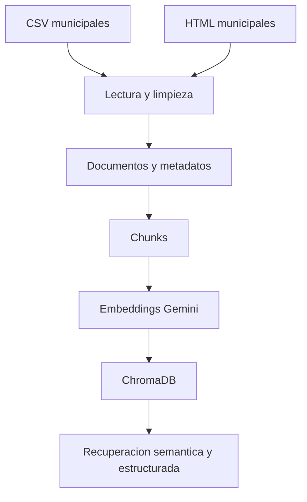

# 09. Corpus, procedencia y fuentes externas

## 1. Objetivo

Definir los recursos documentales, las fuentes externas y los mecanismos de trazabilidad de la información utilizada por ReciclaTÍA.

El sistema deberá conservar la procedencia de los datos utilizados para fundamentar sus respuestas y distinguir entre información documental, información obtenida de servicios externos y resultados derivados de operaciones de procesamiento.

## 2. Principios

- Utilización de fuentes municipales identificables.
- Conservación de la procedencia documental.
- Delimitación del ámbito geográfico.
- Coherencia entre documentos, chunks, embeddings e índice vectorial.
- Diferenciación entre información documental e información obtenida mediante servicios externos.
- Transparencia sobre las limitaciones y actualización de los datos.
- Reutilización de los artefactos documentales existentes.
- Separación entre el corpus del RAG y los datos de los consumidores.
- Protección de la información personal.
- Independencia respecto a las interfaces del producto.

La recuperación de una fuente no garantiza por sí sola la corrección factual de todas las afirmaciones generadas a partir de ella.

## 3. Ámbito documental

### 3.1. Cobertura temática

El corpus local contiene información relacionada con:

- Clasificación de residuos domésticos.
- Destinos de depósito.
- Fracciones de recogida.
- Modalidades de recogida.
- Puntos limpios municipales.
- Residuos admitidos por modalidad.
- Horarios publicados.
- Servicios específicos de recogida.

### 3.2. Cobertura geográfica

El corpus se limita al municipio de Madrid.

Los documentos no deberán utilizarse para presentar como válidas normas o condiciones municipales correspondientes a otros ámbitos geográficos.

### 3.3. Limitaciones del corpus

El corpus no constituye:

- Un catálogo universal de residuos.
- Una recopilación exhaustiva de todos los residuos existentes.
- Un sistema de actualización documental en tiempo real.
- Una garantía de disponibilidad efectiva de los servicios municipales.
- Una fuente de información municipal específica de otras localidades.

Las respuestas deberán conservar estas limitaciones cuando resulten relevantes.

## 4. Clasificación de los datos

El sistema utilizará diferentes categorías de datos, cada una con una finalidad y un mecanismo de almacenamiento diferenciados.

| Categoría | Finalidad | Almacenamiento |
|---|---|---|
| Documentos originales | Fundamentación documental | data/raw/ |
| Fragmentos documentales | Recuperación de evidencia | output/chunks.json |
| Embeddings | Representación vectorial | output/embeddings.json |
| Índice vectorial | Recuperación semántica y estructurada | ChromaDB |
| Información municipal externa | Búsquedas geográficas | Resultado de herramientas |
| Estado operativo | Continuidad de conversaciones | MemorySaver |
| Usuarios | Identificación y gestión de cuentas | PostgreSQL |
| API keys | Autenticación y autorización | PostgreSQL |
| Conversaciones | Identificación y propiedad | PostgreSQL |
| Mensajes | Historial persistente | PostgreSQL |
| Sesiones de autenticación | Acceso temporal a cuentas | Memoria del proceso |
| Imágenes recibidas | Identificación multimodal | Almacenamiento temporal cuando resulte necesario |
| Registros operativos | Observabilidad | Sistema de logging |

Los diferentes sistemas de almacenamiento no deberán utilizarse indistintamente.

## 5. Corpus documental

### 5.1. Estructura

Los documentos originales se conservarán dentro de:

```text
data/
└── raw/
    ├── csv/
    ├── html/
    ├── pdf/
    └── txt/
```

Los directorios pdf/ y txt/ podrán mantenerse como parte de la estructura existente.

Actualmente no contienen documentos del corpus.

La existencia de estos directorios no implica que existan fuentes adicionales disponibles para la recuperación.

### 5.2. Archivos CSV

| Archivo | Contenido y finalidad |
|---|---|
| tipos_residuos.csv | Relaciones entre residuos y destinos de depósito |
| puntos_limpios_fijos.csv | Información sobre puntos limpios fijos |
| puntos_limpios_moviles.csv | Paradas y horarios de puntos limpios móviles |
| puntos_limpios_moviles_24h.csv | Información sobre la modalidad móvil de 24 horas |
| puntos_limpios_proximidad.csv | Información sobre puntos limpios de proximidad |

### 5.3. Archivos HTML

| Archivo | Contenido y finalidad |
|---|---|
| fraccion_organica.html | Recogida de residuos orgánicos |
| fraccion_papel.html | Recogida de papel y cartón |
| fraccion_plasticos_metales_briks.html | Recogida de plásticos, metales y briks |
| fraccion_resto.html | Recogida de la fracción resto |
| fraccion_vidrio.html | Recogida de envases de vidrio |
| recogida_aceite_vegetal.html | Recogida de aceite vegetal usado |
| recogida_muebles_enseres.html | Recogida de muebles, electrodomésticos y enseres |
| residuos_punto_limpio_fijo.html | Residuos admitidos en puntos limpios fijos |
| residuos_punto_limpio_movil.html | Residuos admitidos en puntos limpios móviles |
| residuos_punto_limpio_proximidad.html | Residuos admitidos en puntos limpios de proximidad |

### 5.4. Conservación de documentos originales

Los documentos originales deberán conservarse como referencia de las transformaciones documentales.

Los procesos de limpieza, fragmentación e indexación no deberán modificar indebidamente los archivos originales.

Las correcciones o actualizaciones del corpus constituirán operaciones controladas e independientes de las consultas ordinarias.

## 6. Transformación documental

### 6.1. Flujo de procesamiento



Las transformaciones deberán conservar la relación entre los documentos originales y sus representaciones procesadas.

### 6.2. Artefactos generados

| Artefacto | Responsabilidad |
|---|---|
| output/chunks.json | Almacenar los fragmentos documentales y sus metadatos |
| output/embeddings.json | Almacenar las representaciones vectoriales del corpus |
| output/chroma_db/ | Almacenar el índice utilizado por ChromaDB |

Los artefactos deberán mantener la coherencia necesaria para realizar operaciones de recuperación.

### 6.3. Configuración

El modelo de embeddings, las dimensiones vectoriales, el nombre de la colección y la métrica de distancia se definen en [01-retrieval.md](01-retrieval.md).

No se establecerán valores alternativos en esta especificación.

## 7. Metadatos documentales

### 7.1. Finalidad

Los metadatos permitirán identificar la procedencia de los fragmentos y aplicar restricciones durante la recuperación.

### 7.2. Campos relevantes

| Campo | Responsabilidad |
|---|---|
| source | Identificar el archivo de origen |
| path | Identificar la ubicación documental dentro del corpus |
| document_type | Identificar la naturaleza o modalidad del documento |
| district | Identificar el distrito municipal cuando corresponda |
| destino | Identificar el destino documentado del residuo cuando corresponda |

Podrán conservarse otros metadatos existentes, incluyendo referencias a las filas originales de los archivos CSV.

La disponibilidad de los campos dependerá de la naturaleza del documento de origen.

No se crearán metadatos ficticios para completar información ausente.

### 7.3. Conservación

Los procesos de carga, limpieza, fragmentación, generación de embeddings e indexación deberán preservar los metadatos necesarios para:

- Identificar las fuentes.
- Aplicar filtros.
- Recuperar registros estructurados.
- Relacionar los resultados con sus documentos originales.
- Construir referencias documentales verificables.

### 7.4. Utilización durante la recuperación

Los metadatos podrán utilizarse para restringir los resultados según la modalidad, el distrito o la fuente correspondiente.

Las reglas de recuperación filtrada se definen en [02-mejoras-retrieval.md](02-mejoras-retrieval.md).

## 8. Procedencia y referencias documentales

### 8.1. Trazabilidad

Cada referencia documental deberá poder relacionarse con la información realmente utilizada durante la recuperación o generación.

No se inventarán fuentes, identificadores, enlaces ni nombres de documentos.

### 8.2. Identificadores de fragmentos

Los identificadores utilizados durante la generación, como C1 o C2, corresponden al contexto de la llamada en la que se han generado.

No constituyen identificadores documentales globales ni identificadores persistentes de PostgreSQL.

Las reglas de validación de referencias se definen en [03-generacion.md](03-generacion.md).

### 8.3. Referencias públicas

La capa HTTP deberá transformar las referencias internas al contrato FuenteOut.

La transformación deberá conservar la información necesaria para identificar la fuente sin exponer rutas absolutas del servidor, estructuras internas del contenedor ni información sensible.

Los enlaces a documentos originales deberán proceder de referencias documentales conocidas y verificables.

No se utilizarán direcciones inventadas por el modelo de lenguaje.

### 8.4. Presentación

Streamlit deberá representar las fuentes proporcionadas por el backend.

La interfaz no construirá referencias documentales independientes ni añadirá fuentes que no hayan sido utilizadas.

## 9. Fuentes CSV — Portal de Datos Abiertos del Ayuntamiento de Madrid

| Archivo en el proyecto | Fuente oficial |
|---|---|
| puntos_limpios_fijos.csv | [Puntos limpios fijos](https://datos.madrid.es/dataset/200284-0-puntos-limpios-fijos) |
| puntos_limpios_moviles.csv | [Puntos limpios móviles](https://datos.madrid.es/dataset/300101-0-puntos-limpios-moviles) |
| puntos_limpios_moviles_24h.csv | [Puntos limpios móviles 24 horas](https://datos.madrid.es/dataset/900026-0-puntos-limpios-residuos) |
| puntos_limpios_proximidad.csv | [Puntos limpios de proximidad](https://datos.madrid.es/dataset/300198-0-puntos-proximidad) |
| tipos_residuos.csv | [Tipos de residuos y dónde depositarlos](https://datos.madrid.es/dataset/300199-0-tipo-residuo) |

Los conjuntos de datos proceden del Portal de Datos Abiertos del Ayuntamiento de Madrid.

Las referencias originales deberán conservarse para permitir identificar su procedencia y consultar las condiciones de reutilización correspondientes.

## 10. Fuentes HTML — Ayuntamiento de Madrid

| Archivo en el proyecto | Página municipal de origen |
|---|---|
| fraccion_organica.html | [Recogida de residuos orgánicos](https://www.madrid.es/portales/munimadrid/es/Recogida-de-residuos-organicos/?vgnextchannel=f81379ed268fe410VgnVCM1000000b205a0aRCRD&vgnextoid=12bc51e3f7bee510VgnVCM1000001d4a900aRCRD) |
| fraccion_papel.html | [Recogida de la fracción papel y cartón](https://www.madrid.es/portales/munimadrid/es/Inicio/El-Ayuntamiento/Moratalaz/Recogida-de-la-fraccion-papel-y-carton/?vgnextchannel=7cb0ca5d5fb96010VgnVCM100000dc0ca8c0RCRD&vgnextfmt=default&vgnextoid=d9eb6c9c78eb2910VgnVCM2000001f4a900aRCRD) |
| fraccion_plasticos_metales_briks.html | [Recogida de plásticos, metales y briks](https://www.madrid.es/portales/munimadrid/es/Recogida-de-plasticos-metales-y-briks-Horarios-y-frecuencias-de-recogida-/?vgnextchannel=3dfcbb21278fe410VgnVCM1000000b205a0aRCRD&vgnextfmt=default&vgnextoid=54c4ebd9be6e8610VgnVCM1000001d4a900aRCRD) |
| fraccion_resto.html | [Recogida de la fracción resto no reciclable](https://www.madrid.es/portales/munimadrid/es/Recogida-fraccion-resto-no-reciclable-y-horario/?vgnextchannel=f81379ed268fe410VgnVCM1000000b205a0aRCRD&vgnextoid=61c4ebd9be6e8610VgnVCM1000001d4a900aRCRD) |
| fraccion_vidrio.html | [Recogida de vidrio](https://www.madrid.es/portales/munimadrid/es/Recogida-de-vidrio/?vgnextchannel=f81379ed268fe410VgnVCM1000000b205a0aRCRD&vgnextoid=e3ab6c9c78eb2910VgnVCM2000001d4a900aRCRD) |
| recogida_aceite_vegetal.html | [Recogida de aceite vegetal usado](https://www.madrid.es/portales/munimadrid/es/Inicio/Medio-ambiente/Recogida-de-residuos/Recogida-de-aceite-vegetal-usado/?vgnextchannel=f81379ed268fe410VgnVCM1000000b205a0aRCRD&vgnextfmt=default&vgnextoid=803fab39d9462510VgnVCM1000000b205a0aRCRD) |
| recogida_muebles_enseres.html | [Recogida de muebles, electrodomésticos y enseres](https://www.madrid.es/portales/munimadrid/es/Inicio/MedioAmbiente/ResiduosYLimpiezaUrbana/Tramites/Recogida-de-muebles-electrodomesticos-y-enseres/?vgnextchannel=e5bcbb21278fe410VgnVCM1000000b205a0aRCRD&vgnextfmt=default&vgnextoid=168e3381d0030910VgnVCM1000001d4a900aRCRD) |
| residuos_punto_limpio_fijo.html | [Puntos Limpios Fijos: cantidades admisibles](https://www.madrid.es/portales/munimadrid/es/UnidadWeb/Puntos-Limpios-Fijos-del-Ayuntamiento-de-Madrid-Descripcion-y-cantidades-admisibles-para-particulares/?vgnextchannel=e278e8124824b010VgnVCM1000000b205a0aRCRD&vgnextoid=cc9a2984ca480510VgnVCM2000000c205a0aRCRD) |
| residuos_punto_limpio_movil.html | [Puntos Limpios Móviles: cantidades admisibles](https://sede.madrid.es/portal/site/tramites/menuitem.1f3361415fda829be152e15284f1a5a0/?vgnextchannel=518aa38813180210VgnVCM100000c90da8c0RCRD&vgnextfmt=pda&vgnextoid=3cbc6163c4480510VgnVCM2000000c205a0aRCRD) |
| residuos_punto_limpio_proximidad.html | [Puntos Limpios de Proximidad: cantidades admisibles](https://www.madrid.es/portales/munimadrid/es/Inicio/Medio-ambiente/Gestiones-y-tramites/Puntos-Limpios-de-Proximidad-Descripcion-y-cantidades-admisibles-/?vgnextchannel=658f79ed268fe410VgnVCM1000000b205a0aRCRD&vgnextfmt=default&vgnextoid=2682a2dcf3189610VgnVCM1000001d4a900aRCRD) |

Las fuentes HTML deberán conservar su asociación con los archivos documentales correspondientes.

La existencia de una página municipal no implica que su contenido actual coincida necesariamente con la versión incorporada al corpus.

## 11. Fuente geográfica externa

### 11.1. Servicio municipal

La herramienta buscar_puntos_limpios_cercanos utilizará el servicio ArcGIS REST del Ayuntamiento de Madrid:

[API municipal de puntos limpios](https://sigma.madrid.es/hosted/rest/services/RESIDUOS/PUNTOS_LIMPIOS/MapServer/5/query)

### 11.2. Información recuperada

La información obtenida podrá incluir, según los campos disponibles:

- Identificación de instalaciones.
- Direcciones.
- Modalidades de recogida.
- Coordenadas geográficas.
- Horarios.
- Otros atributos municipales relevantes.

No se completarán mediante inferencia los campos que no estén disponibles.

### 11.3. Sistema de referencia

Las operaciones geográficas utilizarán coordenadas WGS84, EPSG:4326.

Las distancias se calcularán mediante Haversine conforme al contrato definido en [05-tools.md](05-tools.md).

### 11.4. Procedencia de resultados

Los resultados geográficos deberán identificar su procedencia mediante el campo fuente.

| Valor | Significado |
|---|---|
| api | Información obtenida del servicio municipal externo |
| corpus_local | Información obtenida de los registros documentales locales |

### 11.5. Limitaciones de actualidad

Los datos obtenidos mediante la API municipal no constituyen necesariamente una comprobación de la situación física actual de las instalaciones.

La existencia de una instalación, una dirección o un horario en la respuesta del servicio no garantiza que se encuentre operativa.

## 12. Respaldo documental geográfico

### 12.1. Finalidad

El corpus local podrá utilizarse como respaldo cuando la consulta al servicio municipal no pueda ejecutarse correctamente por causas técnicas.

### 12.2. Condiciones

El respaldo deberá conservar las restricciones aplicables a la consulta, incluyendo:

- Coordenadas autorizadas.
- Radio de búsqueda.
- Modalidad solicitada.
- Procedencia de los registros.

### 12.3. Diferenciación de fuentes

Los resultados obtenidos mediante respaldo no podrán presentarse como resultados obtenidos de la API municipal.

El asistente deberá indicar que proceden del corpus local y que pueden encontrarse desactualizados.

### 12.4. Resultados vacíos

Una respuesta válida de la API municipal con cero coincidencias constituye un resultado legítimo.

No deberá activar el respaldo únicamente por la ausencia de instalaciones dentro del radio solicitado.

Las condiciones de utilización del respaldo se definen en [05-tools.md](05-tools.md).

## 13. Fuentes de información temporal

### 13.1. Horarios de instalaciones

Los horarios procederán de los registros documentales o geográficos correspondientes.

Cada horario deberá permanecer asociado a la instalación o parada de la que procede.

### 13.2. Hora actual

La herramienta hora_actual proporcionará la información temporal correspondiente a Europe/Madrid.

La hora obtenida permitirá interpretar los horarios publicados.

No constituye una fuente documental sobre los horarios de las instalaciones.

### 13.3. Regla específica para envases de vidrio

La regla específica de horario para el depósito de envases de vidrio utilizará la documentación municipal identificada mediante FUENTE_HORARIO_VIDRIO.

Fuente de referencia:

[Recogida de vidrio — Ayuntamiento de Madrid](https://www.madrid.es/portales/munimadrid/es/Recogida-de-vidrio/)

La regla únicamente deberá aplicarse cuando exista una clasificación documental compatible con envases de vidrio destinados al contenedor verde.

Las condiciones de activación e interpretación se definen en [04-consultas-generales.md](04-consultas-generales.md).

### 13.4. Interpretación de horarios

Los horarios publicados deberán distinguirse de la apertura física real de las instalaciones.

No se asumirán incidencias, cierres excepcionales, cambios de horario o condiciones que no puedan comprobarse mediante las fuentes disponibles.

## 14. Gemini como proveedor externo

### 14.1. Responsabilidades

Gemini proporcionará las capacidades externas necesarias para:

- Generación de embeddings.
- Generación de respuestas fundamentadas.
- Razonamiento y enrutamiento cuando corresponda.
- Identificación multimodal.
- Síntesis de información cuando no pueda resolverse mediante mecanismos deterministas.

### 14.2. Naturaleza de las respuestas

Las respuestas de Gemini no constituyen fuentes documentales municipales.

Los resultados del modelo deberán tratarse como información generada que requiere los mecanismos de validación correspondientes.

### 14.3. Identificación multimodal

La descripción de una imagen podrá proporcionar información sobre las características observables de un objeto.

Esta información no deberá considerarse evidencia documental suficiente para recomendar un destino de reciclaje.

Las recomendaciones deberán contrastarse mediante los mecanismos autorizados del RAG.

### 14.4. Fallos del proveedor

Los errores de Gemini deberán distinguirse de la ausencia de evidencia documental.

No se sustituirán respuestas inválidas o fallos técnicos por datos inventados.

### 14.5. Credenciales

Las credenciales necesarias para utilizar Gemini deberán gestionarse mediante variables de entorno y mecanismos seguros.

No se incorporarán credenciales a los documentos, chunks, embeddings, imágenes Docker ni registros públicos.

## 15. Actualización del corpus

### 15.1. Naturaleza de la actualización

Las actualizaciones documentales constituirán operaciones controladas e independientes del flujo conversacional.

Durante esta fase no se implementará un sistema automático de actualización continua de todas las fuentes municipales.

### 15.2. Modificación de documentos

Cuando se incorporen modificaciones al corpus deberá garantizarse la coherencia entre:

- Documentos originales.
- Fragmentos documentales.
- Metadatos.
- Embeddings.
- Colección ChromaDB.

### 15.3. Cambios de configuración

Las modificaciones que afecten a la compatibilidad de las representaciones vectoriales requerirán actualizar los artefactos correspondientes.

No se mezclarán representaciones incompatibles en una misma colección.

### 15.4. Reconstrucción del índice

La reconstrucción del índice a partir de embeddings existentes no constituye una actualización del corpus.

Esta operación únicamente reconstruye la estructura utilizada para recuperar los datos ya procesados.

No deberá presentarse como una actualización de las fuentes municipales.

## 16. Integración con Docker y Render

### 16.1. Recursos documentales

La imagen Docker del backend deberá incluir los recursos necesarios para garantizar el funcionamiento del RAG.

Entre ellos:

- Documentos originales necesarios para la recuperación.
- Chunks existentes.
- Embeddings existentes.
- Índice vectorial reconstruido conforme a la configuración establecida.

### 16.2. Reconstrucción

El índice deberá poder reconstruirse durante la construcción de la imagen utilizando los artefactos disponibles.

No será necesario generar nuevamente los embeddings del corpus durante cada despliegue.

### 16.3. Disponibilidad

El backend deberá disponer de una colección ChromaDB compatible y utilizable.

La ausencia del índice necesario no deberá presentarse como ausencia de evidencia documental.

### 16.4. Independencia de PostgreSQL

La incorporación de PostgreSQL no sustituirá ChromaDB como sistema de recuperación documental.

Los recursos documentales permanecerán separados del almacenamiento relacional.

### 16.5. Redespliegues

La disponibilidad del corpus y del índice después de un redeploy deberá garantizarse mediante los recursos incorporados a la imagen y los mecanismos de reconstrucción correspondientes.

No se dependerá del sistema de archivos local del contenedor anterior para recuperar recursos documentales obligatorios.

Los requisitos de infraestructura se definen en [16-despliegue.md](16-despliegue.md).

## 17. Separación entre corpus y datos de consumidores

### 17.1. Finalidad del corpus

ChromaDB almacenará las representaciones documentales necesarias para resolver consultas sobre residuos.

No se utilizará como base de datos de usuarios, credenciales o conversaciones.

### 17.2. Datos relacionales

PostgreSQL almacenará las entidades y los datos definidos en [13-persistencia.md](13-persistencia.md).

El almacenamiento relacional no sustituirá los mecanismos de recuperación semántica.

### 17.3. Conversaciones

Los mensajes de los consumidores no se incorporarán automáticamente al corpus documental.

Las consultas y respuestas generadas no se convertirán en nuevas fuentes de conocimiento del RAG.

### 17.4. Estado operativo

MemorySaver conservará la información necesaria para la continuidad operativa del asistente.

Los checkpoints no constituirán documentos del corpus.

### 17.5. Prevención de contaminación documental

Los siguientes elementos no deberán incorporarse automáticamente a los artefactos documentales:

- Preguntas de consumidores.
- Respuestas generadas.
- Planes del asistente.
- Decisiones HITL.
- Imágenes aportadas por consumidores.
- Coordenadas personales.
- Credenciales.
- Registros internos.
- Resultados temporales de herramientas.

La incorporación de nuevos documentos al corpus requerirá un proceso documental autorizado e independiente.

## 18. Tratamiento de imágenes y ubicación

### 18.1. Imágenes

Las imágenes aportadas por los consumidores se utilizarán exclusivamente para las operaciones multimodales correspondientes.

No se conservarán permanentemente ni se incorporarán automáticamente al corpus.

La descripción visual podrá utilizarse como contexto operativo cuando resulte necesario para resolver la consulta.

### 18.2. Coordenadas

Las coordenadas proporcionadas por los consumidores se utilizarán para las operaciones geográficas autorizadas.

No se almacenarán como registros documentales ni como entidades independientes del corpus.

### 18.3. Persistencia

Las reglas de almacenamiento de mensajes y tratamiento de información personal se definen en [13-persistencia.md](13-persistencia.md).

La ausencia de campos específicos para imágenes o coordenadas no garantiza que el contenido textual de un mensaje esté libre de información personal.

### 18.4. Procesamiento externo

El análisis multimodal y determinadas operaciones de inferencia requieren transmitir información al proveedor externo autorizado.

No se presentará ReciclaTÍA como un sistema completamente local o desconectado.

Las restricciones de tratamiento de datos y archivos temporales se definen en [15-robustez-observabilidad.md](15-robustez-observabilidad.md).

## 19. Licencias y atribución

### 19.1. Datos abiertos

Según las referencias documentales existentes del proyecto, los conjuntos CSV incorporados desde el Portal de Datos Abiertos del Ayuntamiento de Madrid identifican la licencia Creative Commons Attribution 4.0 International (CC BY 4.0).

Deberán respetarse las condiciones de reutilización aplicables a cada conjunto.

### 19.2. Atribución

La utilización de fuentes municipales deberá conservar la información necesaria para reconocer su procedencia.

La transformación de los documentos en chunks o embeddings no elimina los requisitos de atribución correspondientes.

### 19.3. Fuentes HTML

Las condiciones de reutilización de las páginas HTML deberán considerarse conforme a las disposiciones aplicables a sus respectivas fuentes.

No se asumirá automáticamente que todas las páginas municipales utilizan la misma licencia que los conjuntos de datos abiertos.

### 19.4. Actualización de condiciones

Las condiciones de reutilización deberán revisarse cuando se incorporen nuevas fuentes o se amplíe el alcance del producto.

El hecho de utilizar fuentes oficiales del Ayuntamiento de Madrid no implica que ReciclaTÍA constituya un servicio oficial municipal.

## 20. Seguridad de las fuentes

### 20.1. Datos no confiables

Los documentos recuperados y los resultados externos deberán tratarse como datos no confiables desde el punto de vista de la ejecución del asistente.

### 20.2. Instrucciones incorporadas

Las instrucciones presentes en documentos HTML, archivos CSV o resultados externos no podrán modificar:

- Las instrucciones del sistema.
- Los permisos de las herramientas.
- Los límites de ejecución.
- Las reglas de autenticación.
- Las decisiones HITL.
- Los permisos de acceso a conversaciones.

### 20.3. Servicios autorizados

Las herramientas únicamente podrán realizar consultas a los servicios externos contemplados en sus contratos.

No se utilizarán enlaces encontrados en el corpus como autorización para realizar peticiones HTTP arbitrarias.

### 20.4. Validación

La información recuperada deberá superar los mecanismos de validación correspondientes antes de utilizarse como evidencia.

Las reglas generales de seguridad se definen en [10-seguridad.md](10-seguridad.md).

## 21. Gestión de fallos documentales

| Situación | Comportamiento esperado |
|---|---|
| Documento sin información suficiente | Comunicar la limitación |
| Fuente no identificable | No inventar su procedencia |
| Metadato ausente | No completar mediante inferencias injustificadas |
| Ausencia de resultados relevantes | Abstención o aclaración |
| Índice ChromaDB no disponible | Error técnico |
| Embeddings incompatibles | Impedir la recuperación incompatible |
| Fallo de la API municipal | Utilizar el respaldo autorizado cuando corresponda |
| API municipal con cero coincidencias | Conservar el resultado vacío |
| Respaldo local utilizado | Identificar su procedencia y limitaciones |
| Horario desconocido | Comunicar incertidumbre temporal |
| Fallo del proveedor Gemini | Gestionar como fallo técnico |
| Información documental contradictoria | Comunicar limitaciones o abstenerse |

La falta de disponibilidad de un sistema de almacenamiento o proveedor externo no deberá presentarse como falta de información documental.

## 22. Limitaciones

Las respuestas del asistente estarán condicionadas por las siguientes limitaciones:

- El corpus representa una selección de fuentes municipales.
- Las fuentes pueden haber cambiado después de incorporarse al proyecto.
- No existe una actualización automática permanente del corpus.
- Los documentos pueden contener información incompleta.
- La recuperación semántica puede devolver fragmentos insuficientes.
- Una referencia válida no garantiza por sí sola la corrección factual.
- Una instalación cercana puede no admitir el residuo consultado.
- Un horario publicado no garantiza la apertura física de una instalación.
- El respaldo documental puede contener información desactualizada.
- Los servicios externos pueden sufrir fallos o interrupciones.
- La identificación visual no garantiza una clasificación exacta del objeto.
- El ámbito documental se limita a Madrid ciudad.

Estas limitaciones deberán reflejarse en las respuestas cuando afecten a su interpretación o suficiencia.

## 23. Validación

Las pruebas deberán verificar:

- Disponibilidad de los documentos originales.
- Conservación de las referencias municipales.
- Coherencia entre documentos, chunks y embeddings.
- Conservación de metadatos.
- Compatibilidad del índice vectorial.
- Reconstrucción desde artefactos existentes.
- Ausencia de generación innecesaria de embeddings.
- Recuperación de evidencia con procedencia identificable.
- Diferenciación entre api y corpus_local.
- Ausencia de respaldo ante resultados válidos sin coincidencias.
- Conservación de horarios asociados a sus instalaciones.
- Diferenciación entre fuentes documentales y respuestas generadas.
- Separación entre datos del corpus y datos de consumidores.
- Ausencia de incorporación automática de mensajes al corpus.
- Ausencia de exposición de rutas internas y credenciales.
- Disponibilidad de los recursos documentales en Docker.
- Disponibilidad del índice después de un redeploy.

La estrategia general de pruebas se define en [08-pruebas-y-validacion.md](08-pruebas-y-validacion.md).

## 24. Criterios de aceptación

- El corpus conserva los documentos municipales existentes.
- Las fuentes originales permanecen identificadas.
- Los documentos, chunks y embeddings mantienen su coherencia.
- Los metadatos permiten identificar la procedencia documental.
- Los mecanismos de recuperación pueden utilizar los filtros establecidos.
- Las referencias utilizadas corresponden a información realmente recuperada.
- No se generan fuentes documentales ficticias.
- Las respuestas de Gemini no se presentan como fuentes municipales.
- Los resultados geográficos identifican su procedencia.
- La utilización del respaldo local comunica sus limitaciones.
- Los resultados vacíos válidos no provocan búsquedas de respaldo innecesarias.
- Los horarios permanecen asociados a sus instalaciones.
- La información temporal no se presenta como garantía de apertura física.
- ChromaDB permanece independiente de PostgreSQL.
- El índice puede reconstruirse utilizando los embeddings existentes.
- La construcción de la imagen no requiere regenerar los embeddings del corpus.
- Los datos documentales están disponibles en el entorno desplegado.
- Los mensajes de consumidores no se incorporan automáticamente al corpus.
- Las imágenes y coordenadas personales no se convierten en fuentes documentales.
- Las credenciales no forman parte de los artefactos documentales.
- Las condiciones de reutilización y atribución se respetan.
- Los fallos técnicos se distinguen de la ausencia de evidencia.
- El ámbito documental continúa limitado a Madrid ciudad.

## 25. Especificaciones relacionadas

| Documento | Responsabilidad |
|---|---|
| [00-producto.md](00-producto.md) | Alcance funcional y geográfico |
| [01-retrieval.md](01-retrieval.md) | Pipeline documental y recuperación semántica |
| [02-mejoras-retrieval.md](02-mejoras-retrieval.md) | Metadatos, filtros y consultas estructuradas |
| [03-generacion.md](03-generacion.md) | Generación y referencias documentales |
| [04-consultas-generales.md](04-consultas-generales.md) | Interpretación documental, geográfica y temporal |
| [05-tools.md](05-tools.md) | Herramientas y servicios externos |
| [06-langgraph.md](06-langgraph.md) | Estado operativo y evidencias |
| [07-streamlit.md](07-streamlit.md) | Presentación de fuentes y resultados |
| [08-pruebas-y-validacion.md](08-pruebas-y-validacion.md) | Evaluación y pruebas |
| [10-seguridad.md](10-seguridad.md) | Seguridad del núcleo |
| [11-arquitectura-mlops.md](11-arquitectura-mlops.md) | Separación arquitectónica |
| [12-contratos-http.md](12-contratos-http.md) | Representación pública de fuentes y resultados |
| [13-persistencia.md](13-persistencia.md) | Almacenamiento relacional |
| [15-robustez-observabilidad.md](15-robustez-observabilidad.md) | Tratamiento de datos, imágenes y registros |
| [16-despliegue.md](16-despliegue.md) | Disponibilidad de recursos documentales en producción |