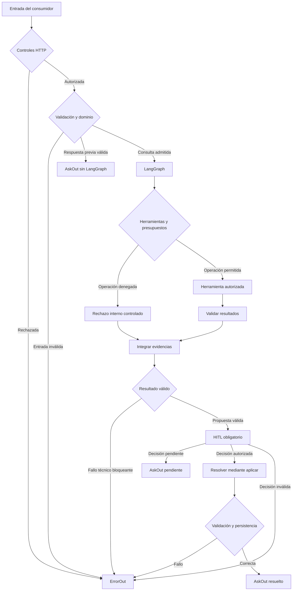

# 10. Seguridad del núcleo del asistente

## 1. Objetivo

Definir los requisitos de seguridad del núcleo funcional de ReciclaTÍA, incluyendo el sistema RAG, los modelos de lenguaje, la orquestación multiagente, las herramientas, las fuentes de información y los mecanismos de supervisión humana.

El sistema deberá protegerse frente a entradas no confiables que pretendan modificar sus reglas de funcionamiento, ejecutar operaciones no autorizadas, comprometer la integridad de las evidencias o alterar indebidamente el estado de las conversaciones.

La incorporación de la arquitectura MLOps deberá preservar los controles desarrollados durante el PB02 y reforzar aquellos necesarios para exponer el asistente mediante una API REST.

Los controles críticos de seguridad deberán aplicarse mediante Python y no depender exclusivamente de instrucciones proporcionadas al modelo de lenguaje.

## 2. Principios de seguridad

- Separación entre datos e instrucciones.
- Principio de mínimo privilegio.
- Denegación por defecto de operaciones no autorizadas.
- Validación determinista de operaciones críticas.
- Autorización explícita de herramientas.
- Utilización exclusiva de fuentes autorizadas.
- Limitación de recursos y capacidades.
- Aislamiento entre conversaciones.
- Protección de credenciales e información interna.
- Fundamentación documental de recomendaciones.
- HITL obligatorio en las ejecuciones satisfactorias de LangGraph.
- Diferenciación entre resultados semánticos y fallos técnicos.
- Protección frente a entradas adversariales.
- Minimización de datos personales.
- Independencia de los controles respecto a la interfaz utilizada.

La capacidad del modelo para solicitar una operación no implica que dicha operación esté autorizada.

Las instrucciones del consumidor, los documentos y las respuestas de proveedores externos no podrán modificar las reglas de seguridad.

## 3. Ámbito de seguridad

### 3.1. Seguridad del núcleo

Esta especificación comprende:

- Validación de entradas.
- Protección frente a inyección de instrucciones.
- Seguridad del RAG.
- Validación de respuestas.
- Control de fuentes.
- Autorización de herramientas.
- Validación de argumentos.
- Protección del estado operativo.
- Seguridad de HITL.
- Procesamiento multimodal.
- Tratamiento seguro de resultados externos.
- Protección de información interna.

### 3.2. Seguridad HTTP

La autenticación de consumidores, autorización de endpoints y comprobación de propiedad se definen en [14-autenticacion-autorizacion.md](14-autenticacion-autorizacion.md).

Los contratos públicos se establecen en [12-contratos-http.md](12-contratos-http.md).

### 3.3. Seguridad operativa

Los mecanismos de protección frente a consumo excesivo, concurrencia, timeouts, recepción multimedia y exposición de datos en logs se definen en [15-robustez-observabilidad.md](15-robustez-observabilidad.md).

### 3.4. Seguridad de infraestructura

Los requisitos relacionados con secretos, aislamiento de entornos y configuración de infraestructura se definen en [16-despliegue.md](16-despliegue.md).

### 3.5. Independencia del núcleo

Las validaciones internas deberán mantenerse durante la ejecución independiente mediante terminal.

La ausencia de FastAPI no permitirá omitir las restricciones de herramientas, argumentos, evidencias y estado.

La CLI no dependerá de las credenciales HTTP de ReciclaTÍA ni de PostgreSQL.

## 4. Modelo de confianza

### 4.1. Entradas no confiables

Se tratarán como datos no confiables:

- Preguntas del consumidor.
- Imágenes recibidas.
- Texto presente en imágenes.
- Descripciones visuales.
- Documentos recuperados.
- Metadatos documentales.
- Respuestas de Gemini.
- Argumentos generados por el modelo.
- Resultados de servicios externos.
- Resultados de herramientas.
- Información contextual de conversaciones.
- Identificadores y parámetros proporcionados por clientes.

La procedencia oficial de un documento no implica que su contenido pueda utilizarse como instrucciones ejecutables.

### 4.2. Decisiones autorizadas

Las decisiones críticas corresponderán a mecanismos controlados mediante Python.

Entre ellas:

- Admisión de entradas.
- Autenticación.
- Autorización.
- Comprobación de propiedad.
- Validación de argumentos.
- Selección de operaciones permitidas.
- Comprobación de presupuestos.
- Validación de referencias.
- Transiciones de estado.
- Generación de identificadores.
- Resolución de aprobaciones.
- Persistencia.

### 4.3. Responsabilidad del modelo

Gemini podrá:

- Interpretar consultas.
- Proponer rutas.
- Solicitar herramientas autorizadas.
- Interpretar observaciones visuales.
- Generar respuestas fundamentadas.
- Proponer planes.

Sus resultados deberán superar los controles correspondientes.

El modelo no podrá determinar por sí solo si una operación está autorizada.

### 4.4. Roles independientes

Se distinguirán:

- Los roles de API keys Free, User y Admin.
- Los roles internos residuos y puntos.

Una API key Admin no ampliará los permisos de los especialistas.

El rol interno de un especialista no concederá privilegios administrativos sobre el backend.

### 4.5. Límites de confianza

La validación estructural de una respuesta no demuestra automáticamente que su contenido sea correcto.

La seguridad deberá combinar controles deterministas, restricciones de capacidades, validación de evidencias y pruebas adversariales.

## 5. Arquitectura de protección



Las consultas multimodales deberán superar su identificación semántica previa antes de iniciar LangGraph.

El diagrama representa las capas funcionales de protección y no modifica la topología del agente.

Los mecanismos internos de seguridad permanecerán activos en la ejecución independiente mediante terminal.

## 6. Validación de entradas

### 6.1. Consultas textuales

Se comprobará:

- Tipo de dato.
- Presencia de contenido válido.
- Longitud.
- Ámbito funcional.
- Ámbito geográfico.
- Compatibilidad con el estado conversacional.

La longitud máxima será de 500 caracteres después de eliminar espacios iniciales y finales.

Una pregunta vacía después de aplicar strip() devolverá HTTP 400 EMPTY_QUESTION.

Una pregunta que supere el límite devolverá HTTP 422 QUESTION_TOO_LONG.

Las estructuras inválidas respetarán el catálogo de errores establecido.

### 6.2. Filtrado previo HTTP

El backend aplicará un filtro determinista de dominio antes de ejecutar LangGraph.

Las consultas inequívocamente fuera del ámbito del producto podrán resolverse sin invocar:

- Gemini.
- RAG.
- LangGraph.
- Herramientas.

Estas respuestas no consumirán cuota comercial ni turnos del agente.

No generarán HITL ni mensajes persistidos.

Continuarán sujetas a los controles HTTP correspondientes.

### 6.3. Contexto conversacional

El filtro deberá considerar el contexto operativo autorizado cuando exista una conversación previa.

No se rechazará automáticamente una consulta breve únicamente porque no contenga palabras clave del dominio.

Las reformulaciones podrán depender de información previamente conservada.

### 6.4. Ambigüedad

Una consulta ambigua no se considerará automáticamente maliciosa.

Cuando falte información decisiva, podrá solicitarse una aclaración.

Se distinguirá entre:

- Aclaración determinista previa al agente.
- Aclaración del RAG independiente.
- Aclaración generada dentro de LangGraph.

Únicamente las aclaraciones obtenidas dentro de una ejecución satisfactoria de LangGraph estarán sujetas al HITL obligatorio.

### 6.5. Restricciones de estado

Cuando exista un thread_id, deberán comprobarse los permisos y las restricciones operativas antes de devolver una respuesta previa.

El filtrado no permitirá eludir:

- La propiedad de la conversación.
- El HITL pendiente.
- La finalización del hilo.
- El agotamiento de turnos.
- La exclusión mutua.
- La pérdida del checkpoint.

### 6.6. Validaciones independientes

La validación realizada por Streamlit no sustituirá la validación HTTP.

La validación realizada por FastAPI no sustituirá las comprobaciones internas del núcleo.

No se duplicará innecesariamente la lógica de negocio, pero se mantendrán los controles propios de cada límite de confianza.

## 7. Protección frente a prompt injection

### 7.1. Inyección directa

Las instrucciones introducidas por el consumidor no podrán autorizar operaciones dirigidas a:

- Ignorar las reglas del sistema.
- Modificar el dominio.
- Ampliar permisos.
- Ejecutar herramientas no autorizadas.
- Inventar evidencias.
- Incrementar presupuestos.
- Revelar secretos.
- Acceder a conversaciones ajenas.
- Alterar checkpoints.
- Aprobar planes sin autorización.
- Realizar búsquedas abiertas en Internet.

### 7.2. Inyección indirecta

Los datos recuperados podrán contener instrucciones dirigidas al asistente.

Estas instrucciones se tratarán como contenido no confiable.

No adquirirán autoridad por encontrarse dentro de:

- Documentos HTML.
- Archivos CSV.
- Metadatos.
- Fragmentos recuperados.
- Respuestas HTTP.
- Descripciones visuales.
- Resultados de herramientas.
- Historial conversacional.

### 7.3. Separación de instrucciones y datos

Se conservarán los mecanismos existentes de src/agent_prompts.py y src/generate.py.

Las instrucciones del sistema permanecerán diferenciadas de:

- La pregunta.
- El contexto conversacional.
- Las evidencias.
- Los resultados de herramientas.

La construcción del contexto deberá identificar la naturaleza de la información incorporada.

La separación de mensajes e instrucciones constituye una medida complementaria, no una garantía absoluta frente a prompt injection.

### 7.4. Protección determinista

Los controles críticos continuarán ejecutándose mediante Python aunque el modelo interprete incorrectamente una entrada adversarial.

Las instrucciones proporcionadas a Gemini no sustituirán:

- La allowlist de herramientas.
- Los permisos por especialista.
- La validación de argumentos.
- La comprobación de propiedad.
- Los límites internos.
- La validación de referencias.
- La resolución autorizada de HITL.

### 7.5. Tratamiento de intentos de inyección

Cuando una consulta contenga instrucciones potencialmente maliciosas, el sistema podrá:

- Resolver una abstención controlada anterior al agente.
- Denegar una operación concreta.
- Continuar únicamente con las partes admisibles.
- Comunicar el error correspondiente si se incumple un contrato HTTP.

No se considerará automáticamente que toda consulta que mencione instrucciones, reglas o seguridad constituye un ataque.

No se utilizará una clasificación de Gemini como único mecanismo de protección.

### 7.6. Resultado funcional

Una abstención válida ante una consulta fuera de dominio podrá devolverse mediante HTTP 200.

Una operación HTTP no autorizada deberá devolver el error correspondiente.

Un fallo técnico no se presentará como una abstención satisfactoria.

Cuando el agente complete correctamente una respuesta controlada dentro de LangGraph, deberá conservar el HITL obligatorio.

## 8. Seguridad del RAG

### 8.1. Fuentes autorizadas

La recuperación documental utilizará exclusivamente el corpus autorizado de ReciclaTÍA.

El modelo no podrá incorporar arbitrariamente nuevos documentos, fuentes o proveedores.

### 8.2. Integridad documental

Los documentos originales, fragmentos, embeddings y artefactos derivados deberán mantener una relación coherente.

Las consultas de consumidores no modificarán automáticamente estos recursos.

### 8.3. Prevención de contaminación

No se incorporarán automáticamente al corpus:

- Preguntas.
- Respuestas generadas.
- Conversaciones.
- Imágenes de consumidores.
- Descripciones visuales.
- Instrucciones del modelo.
- Resultados operativos.

La actualización del corpus será un proceso independiente y autorizado.

### 8.4. Metadatos

Los metadatos documentales se utilizarán para identificar procedencia, filtrar resultados y construir referencias.

No podrán modificar las instrucciones del sistema.

Una URL incluida en los metadatos no autorizará automáticamente su consulta.

### 8.5. Referencias

Las fuentes deberán corresponder a documentos realmente recuperados o utilizados mediante mecanismos deterministas autorizados.

No se aceptarán referencias inventadas.

### 8.6. Suficiencia de evidencia

El sistema distinguirá:

- Evidencia suficiente.
- Evidencia parcial.
- Evidencia insuficiente.

La recuperación de un documento no garantiza que su contenido respalde la respuesta.

La insuficiencia legítima deberá generar una abstención o aclaración conforme a los contratos correspondientes.

### 8.7. Fallos de recuperación

Un fallo técnico de ChromaDB o del proveedor de embeddings no se convertirá automáticamente en una búsqueda vacía.

La ausencia legítima de documentos deberá distinguirse de la imposibilidad técnica de recuperarlos.

### 8.8. Ámbito geográfico

El corpus municipal no se utilizará para fundamentar normas o servicios específicos de otros municipios.

Se conservarán las restricciones de src/domain.py y los mecanismos de interpretación documental existentes.

No se incorporará un servicio externo de geocodificación para completar esta comprobación.

## 9. Seguridad de las respuestas generadas

### 9.1. Validación estructural

Las respuestas de Gemini deberán superar las validaciones correspondientes antes de incorporarse a las evidencias.

Se conservarán los mecanismos de src/generation_validation.py.

### 9.2. Validación de citas

Los identificadores deberán corresponder a fragmentos realmente proporcionados al modelo.

Las referencias documentales se construirán mediante Python utilizando los metadatos originales.

No se confiará en nombres de documentos, rutas o enlaces inventados por Gemini.

### 9.3. Ámbito de las referencias

Los identificadores C1, C2 y sucesivos tendrán alcance local dentro de cada llamada RAG.

Cuando se integren resultados de diferentes llamadas, deberá conservarse la procedencia correspondiente.

No se eliminarán referencias únicamente porque coincida su chunk_id.

### 9.4. Enlaces autorizados

Las URL públicas de procedencia se obtendrán mediante el catálogo autorizado definido en [09-datos-y-fuentes.md](09-datos-y-fuentes.md).

No se construirán enlaces mediante generación libre del modelo.

Cuando no exista una URL autorizada disponible, el campo público correspondiente podrá contener None.

### 9.5. Prohibición de datos inventados

El asistente no deberá fabricar:

- Fuentes documentales.
- Destinos municipales.
- Instalaciones.
- Direcciones.
- Coordenadas.
- Horarios.
- Distancias.
- Compatibilidades.
- Resultados de herramientas.
- Decisiones del consumidor.
- Estados de ejecución.
- Identificadores de aprobación.

### 9.6. Protección de información interna

Las respuestas no deberán exponer:

- Credenciales.
- Tokens de sesión.
- Hashes.
- Cadenas de conexión.
- Configuraciones sensibles.
- Prompts privados.
- Rutas internas innecesarias.
- Información de conversaciones ajenas.

La protección deberá comenzar evitando incorporar secretos al contexto del modelo.

No se dependerá exclusivamente de que Gemini rechace una solicitud de exposición.

### 9.7. Contenido no ejecutable

Las respuestas generadas constituirán contenido informativo.

No se utilizarán directamente como:

- Código Python ejecutable.
- Consultas SQL arbitrarias.
- Comandos del sistema operativo.
- Instrucciones de administración.
- Operaciones de modificación del estado.

Streamlit deberá representar el contenido recibido sin habilitar ejecución arbitraria de HTML o JavaScript generado por el modelo.

### 9.8. Fallos de validación

Una salida estructuralmente inválida deberá tratarse conforme al contrato de generación.

Se conservará SalidaGeneracionInvalida.

No se fabricarán referencias ni abstenciones para ocultar el incumplimiento del contrato.

### 9.9. Limitaciones

La validación estructural y la comprobación de citas no garantizan la exactitud factual de todas las afirmaciones.

La calidad deberá verificarse mediante las pruebas establecidas en [08-pruebas-y-validacion.md](08-pruebas-y-validacion.md).

## 10. Seguridad de las herramientas

### 10.1. Registro autorizado

Se conservarán TOOLS y TOOL_BY_NAME en src/tools/__init__.py.

Las únicas herramientas registradas serán:

- consultar_rag.
- buscar_puntos_limpios_cercanos.
- hora_actual.
- describir_imagen.

La existencia de una función en el código no implica que el modelo pueda invocarla.

identificar_imagen() constituirá una función interna y no una quinta herramienta.

### 10.2. Permisos por especialista

Se conservará AGENT_TOOLS_BY_ROLE.

| Herramienta | residuos | puntos |
|---|---|---|
| consultar_rag | Sí | Sí |
| buscar_puntos_limpios_cercanos | No | Sí |
| hora_actual | No | Sí |
| describir_imagen | Sí | No |

El supervisor no podrá ampliar los permisos mediante instrucciones generadas por Gemini.

### 10.3. Ejecución centralizada

Se conservarán los mecanismos:

- ejecutar_tool().
- ejecutar_tool_estructurado().

La ejecución de especialistas utilizará el contrato estructurado y los permisos correspondientes.

La modalidad de ejecución independiente no constituirá una operación HTTP accesible a consumidores.

### 10.4. Validación de argumentos

Se comprobarán:

- Nombres registrados.
- Permisos del especialista.
- Estructura de argumentos.
- Campos permitidos.
- Tipos de datos.
- Rangos.
- Presupuestos.
- Condiciones de ejecución.

No se aceptarán argumentos que permitan modificar libremente:

- URLs.
- Rutas de archivos.
- Credenciales.
- Coordenadas autorizadas.
- Límites internos.
- Configuraciones de proveedores.

Las validaciones deberán contemplar posibles conversiones automáticas de tipos realizadas por las bibliotecas utilizadas.

### 10.5. Entradas controladas por Python

Se conservará el mecanismo existente de _preparar_args().

Las coordenadas utilizadas en las búsquedas geográficas procederán del estado autorizado.

La ruta utilizada por describir_imagen() en ejecución local procederá de la entrada autorizada.

Los argumentos generados por Gemini no podrán sustituir estos valores.

En el flujo HTTP con identificación visual previa no se proporcionará una nueva ruta para repetir la identificación.

### 10.6. Operaciones denegadas

Cuando una herramienta no esté autorizada:

- No se ejecutará.
- No se utilizarán resultados ficticios.
- Se conservará una traza controlada.
- Se comunicará el rechazo correspondiente.
- Se mantendrán los presupuestos y controles aplicables.

### 10.7. Validación de resultados

Los resultados deberán respetar sus contratos antes de incorporarse como evidencias.

ok=True no garantizará por sí solo que los datos sean suficientes o pertinentes.

ok=False no constituirá evidencia válida.

### 10.8. Propagación de fallos

Se conservará el contrato ResultadoTool.

Los errores públicos e internos destinados al modelo deberán mantenerse sanitizados.

La implementación conservará información técnica suficiente para diferenciar fallos internos, dependencias indisponibles y otros errores relevantes.

No se expondrán excepciones completas.

No se dependerá exclusivamente de interpretar mensajes arbitrarios para determinar el código HTTP posterior.

### 10.9. Recuperación autorizada

Una operación denegada o fallida podrá recuperarse mediante un mecanismo permitido cuando exista una alternativa válida.

La recuperación no concederá nuevas capacidades al modelo.

Un fallo imprescindible no recuperado deberá impedir la finalización satisfactoria.

## 11. Acceso a servicios externos

### 11.1. Servicios autorizados

| Servicio o recurso | Finalidad |
|---|---|
| Gemini | Embeddings, razonamiento, generación e identificación visual |
| ChromaDB | Recuperación del corpus autorizado |
| ArcGIS municipal | Información geográfica de puntos limpios |
| Corpus local | Respaldo geográfico autorizado |
| Reloj del sistema | Información temporal |

PostgreSQL constituirá un recurso de persistencia del backend, no una herramienta de consulta libre del modelo.

### 11.2. Fuentes de conocimiento

El conocimiento documental procederá exclusivamente del corpus y de las referencias normativas previamente autorizadas.

La información geográfica procederá de ArcGIS municipal o de su respaldo local.

Gemini no constituirá una fuente documental independiente.

### 11.3. Prohibición de búsquedas abiertas

No se habilitarán:

- Motores de búsqueda.
- Navegación general por Internet.
- Grounding mediante búsquedas externas.
- Herramientas de consulta web arbitraria.
- Proveedores documentales adicionales.
- Proveedores geográficos alternativos.

### 11.4. Restricción de destinos

Los destinos de las peticiones externas estarán controlados por la configuración del producto.

El modelo y los consumidores no podrán proporcionar direcciones arbitrarias.

La API municipal utilizará el servicio autorizado definido en [05-tools.md](05-tools.md).

### 11.5. Protección frente a SSRF

Las herramientas no permitirán utilizar sus argumentos para realizar peticiones arbitrarias a:

- Servicios internos.
- Interfaces administrativas.
- Recursos locales del servidor.
- Servicios de metadatos de infraestructura.
- Destinos externos no autorizados.

Las redirecciones HTTP deberán deshabilitarse o validarse conforme a los destinos autorizados cuando resulte aplicable.

No se incorporará un cliente de navegación general accesible al modelo.

### 11.6. Referencias documentales

La presentación de una URL oficial al consumidor no implicará que el backend deba consultar dicha dirección.

La actualización de documentos constituirá una operación independiente.

### 11.7. Respuestas externas

Las respuestas de proveedores se tratarán como datos no confiables.

No podrán modificar permisos, configuraciones ni reglas del sistema.

### 11.8. Fallos externos

Se utilizarán los mecanismos autorizados de recuperación.

No se fabricarán respuestas ni se consultarán nuevos proveedores para ocultar un fallo técnico.

## 12. Protección frente a consumo excesivo

### 12.1. Límites internos

El asistente respetará los límites correspondientes a:

- Longitud de las consultas.
- Tamaño del contexto documental.
- Iteraciones del supervisor.
- Rondas de especialistas.
- Llamadas a herramientas.
- Turnos por conversación.
- Tamaño del historial.
- Recursión del grafo.

Los valores se establecen en [15-robustez-observabilidad.md](15-robustez-observabilidad.md).

### 12.2. Aplicación determinista

El modelo no podrá ampliar los presupuestos mediante instrucciones, reformulaciones o múltiples solicitudes de herramientas.

### 12.3. Operaciones repetidas

Se evitarán llamadas redundantes que no contribuyan a resolver la consulta.

La reutilización de resultados deberá respetar su procedencia y ámbito de validez.

### 12.4. Identificación visual reutilizada

Una identificación multimodal previamente validada no deberá generar una segunda llamada a Gemini.

La reutilización no se contabilizará como una invocación ficticia de herramienta.

### 12.5. Agotamiento de presupuestos

Cuando se alcance un límite, se impedirán las operaciones adicionales incompatibles.

Si el flujo no puede completarse correctamente, se comunicará el fallo correspondiente.

No se generarán evidencias o planes ficticios para aparentar una ejecución satisfactoria.

### 12.6. Protección HTTP

El núcleo no mantendrá cuotas comerciales independientes.

La autenticación, rate limiting, cuotas comerciales, capacidad del executor y timeout global corresponderán a la capa HTTP.

Todos los perfiles, incluido Admin, estarán sujetos a los límites técnicos.

## 13. Seguridad multimodal

### 13.1. Autorización

Únicamente las API keys User y Admin podrán acceder a POST /ask/image.

Las claves Free recibirán HTTP 403 INSUFFICIENT_PERMISSIONS.

La autorización deberá comprobarse antes de procesar la imagen mediante Gemini.

### 13.2. Recepción

Se aplicarán límites al tamaño del archivo y del cuerpo HTTP.

No se confiará exclusivamente en Content-Length.

La recepción deberá impedir la acumulación ilimitada de archivos antes de su validación.

### 13.3. Validación técnica

Las imágenes deberán comprobarse antes de enviarse al proveedor.

Se validarán:

- Formato real.
- Integridad.
- Peso.
- Resolución.
- Ausencia de animación no admitida.
- Riesgos de descompresión excesiva.
- Compatibilidad con los límites establecidos.

Los formatos autorizados serán JPEG y PNG.

Los límites finales serán de 5 MiB y 16.000.000 píxeles.

Los límites absolutos de recepción serán de 20 MiB y 32.000.000 píxeles.

### 13.4. Adaptación segura

Cuando una imagen supere los límites finales, pero permanezca dentro de los límites absolutos, podrá adaptarse mediante redimensionamiento o compresión.

La imagen resultante deberá validarse nuevamente.

No se desactivarán los mecanismos de protección de Pillow para admitir imágenes incompatibles.

### 13.5. Acceso a archivos

Las herramientas únicamente podrán acceder a imágenes situadas dentro de las ubicaciones autorizadas bajo assets/.

Se conservarán las comprobaciones mediante resolve() e is_relative_to().

Deberán impedirse rutas que escapen del directorio permitido, incluyendo enlaces simbólicos que resuelvan fuera de este.

### 13.6. Rutas HTTP

Los clientes HTTP no podrán proporcionar rutas locales.

El backend generará los nombres de los archivos temporales.

No se utilizará directamente el nombre original para construir una ruta de almacenamiento.

### 13.7. Identificación semántica

Se utilizará identificar_imagen() y el contrato compartido IdentificacionImagen:

```python
class IdentificacionImagen(TypedDict):
    estado: Literal[
        "allowed",
        "out_of_domain",
        "policy_violation",
        "uncertain",
    ]
    descripcion: str
```

La respuesta se validará mediante Python.

TypedDict no constituye por sí mismo un mecanismo de validación en tiempo de ejecución.

### 13.8. Estados de admisibilidad

| Estado | Comportamiento |
|---|---|
| allowed | Continuar con LangGraph |
| out_of_domain | Abstención previa controlada |
| policy_violation | HTTP 422 IMAGE_CONTENT_NOT_ALLOWED |
| uncertain | Solicitar otra imagen antes del agente |

Un fallo técnico no se transformará en ninguno de estos estados semánticos para ocultar el error.

### 13.9. Inyección multimodal

El texto y las instrucciones presentes en imágenes se tratarán como contenido observado.

No podrán:

- Modificar el dominio.
- Alterar los permisos.
- Ampliar presupuestos.
- Ordenar llamadas externas.
- Exponer secretos.
- Aprobar planes.
- Modificar el estado.

La descripción obtenida de Gemini también se tratará como información no confiable.

### 13.10. Interrupción del flujo

Las imágenes no admitidas no continuarán hacia:

- LangGraph.
- Recuperación documental.
- Búsquedas geográficas.
- Síntesis.
- Generación de planes.
- HITL.

No incrementarán turnos_consumidos.

No generarán mensajes SQL ni nuevas conversaciones del agente.

Las identificaciones ya ejecutadas consumirán la cuota comercial correspondiente.

### 13.11. Reutilización de la identificación

Las identificaciones admitidas se proporcionarán al agente mediante identificacion_imagen.

No se proporcionará simultáneamente ruta_imagen.

No se repetirán llamadas multimodales.

No se generarán resultados ficticios de describir_imagen.

La procedencia de la observación visual deberá distinguirse de una nueva ejecución de herramienta.

### 13.12. Identificación frente a evidencia

La observación visual podrá fundamentar una descripción del objeto.

La clasificación de su destino de reciclaje requerirá evidencia documental autorizada.

La identificación visual no ampliará las fuentes de conocimiento del producto.

### 13.13. Privacidad y eliminación

Se eliminarán metadatos innecesarios de las imágenes HTTP, incluyendo EXIF y coordenadas GPS.

Los archivos temporales se eliminarán cuando ninguna ejecución pueda seguir utilizándolos.

No se eliminarán prematuramente durante un timeout si el worker continúa procesándolos.

No se conservarán imágenes binarias en PostgreSQL ni referencias operativas a archivos temporales eliminados dentro de checkpoints HTTP.

El procesamiento mediante Gemini implica transmitir la imagen preparada al proveedor autorizado.

La política de eliminación del producto no garantiza la eliminación de datos mantenidos por dicho proveedor conforme a sus propias condiciones.

## 14. Seguridad geográfica y temporal

### 14.1. Autorización de ubicación

Las búsquedas geográficas únicamente utilizarán coordenadas proporcionadas voluntariamente por el consumidor.

### 14.2. Validación

Se comprobarán:

- Presencia conjunta de latitud y longitud.
- Tipos compatibles.
- Valores finitos.
- Rangos autorizados.
- Radio permitido.

No se admitirán valores booleanos como coordenadas o radios.

### 14.3. Ubicación supuesta

El modelo no podrá inventar coordenadas.

No se utilizarán automáticamente:

- Coordenadas predeterminadas.
- Direcciones del consumidor.
- Ubicaciones inferidas mediante IP.
- Metadatos GPS de imágenes.
- Ubicaciones extraídas mediante proveedores externos.

### 14.4. Procedencia geográfica

Los resultados deberán distinguir entre:

- ArcGIS municipal.
- Corpus local de respaldo.

Los datos locales no se presentarán como información consultada directamente en ArcGIS.

### 14.5. Integridad de resultados

No se fabricarán coordenadas, instalaciones ni distancias.

Una respuesta no vacía cuyos registros sean completamente inválidos no se interpretará como ausencia legítima de instalaciones.

### 14.6. Compatibilidad

La proximidad no constituirá evidencia de que una instalación admite un residuo.

Las referencias negativas a modalidades de recogida no podrán interpretarse como autorizaciones.

### 14.7. Interpretación temporal

La evaluación horaria utilizará Europe/Madrid y documentación autorizada.

No se afirmará apertura física basándose exclusivamente en horarios publicados.

La información temporal imprescindible que no pueda obtenerse debido a un fallo técnico no se sustituirá por una hora inventada.

## 15. Seguridad del estado conversacional

### 15.1. Aislamiento

Cada conversación mantendrá un estado independiente.

No se compartirán automáticamente:

- Mensajes.
- Contexto.
- Evidencias.
- Planes.
- Aprobaciones.
- Coordenadas.
- Identificaciones visuales.
- Resultados de herramientas.

### 15.2. Identificación

Los nuevos thread_id HTTP se generarán mediante UUID en el backend.

El conocimiento de thread_id no constituirá autorización.

Un identificador proporcionado por el cliente que no corresponda a una conversación existente no permitirá crearla arbitrariamente.

### 15.3. Propiedad

Cada conversación HTTP pertenecerá a una API key.

La autorización se comprobará antes de consultar o modificar su checkpoint.

Dos API keys del mismo usuario no compartirán automáticamente sus conversaciones.

Los accesos administrativos respetarán los controles establecidos en la especificación 14.

### 15.4. Recursos ajenos

Un consumidor no autorizado recibirá THREAD_NOT_FOUND conforme al contrato HTTP.

No se revelará previamente si la conversación está ocupada, cerrada, agotada o contiene una aprobación pendiente.

### 15.5. Fuente de verdad

El checkpoint real tendrá prioridad sobre cualquier representación del cliente.

Los consumidores HTTP no podrán aportar directamente:

- EstadoProducto.
- EstadoGrafo.
- Checkpoints.
- Contadores internos.
- Evidencias.
- Planes modificados.
- Identificaciones visuales supuestamente validadas.

### 15.6. Contexto autorizado

El contexto utilizado deberá pertenecer al hilo autorizado.

Las evidencias anteriores no se considerarán automáticamente válidas para una nueva recomendación.

### 15.7. Estados incompatibles

No se admitirán nuevas consultas cuando:

- Exista HITL pendiente.
- La conversación esté finalizada.
- Se haya agotado el límite de turnos.
- Exista una ejecución concurrente.
- El checkpoint no esté disponible.
- El estado no sea consistente.
- La operación no esté autorizada.

La aprobación correspondiente al último turno permitido podrá resolverse aunque se haya alcanzado el límite de turnos.

### 15.8. Exclusión mutua

Las operaciones de modificación deberán ejecutarse bajo el bloqueo correspondiente al hilo.

Las comprobaciones, resolución y persistencia deberán mantenerse coordinadas.

El timeout no autorizará liberar prematuramente el bloqueo.

### 15.9. Pérdida de estado

No se reconstruirán automáticamente checkpoints utilizando el historial SQL o mensajes proporcionados por consumidores.

Una conversación persistida sin estado operativo fiable recibirá HTTP 409 THREAD_STATE_LOST al intentar continuarla.

La lectura del historial autorizado permanecerá diferenciada de la capacidad de ejecución.

## 16. Seguridad de HITL

### 16.1. Finalidad

HITL constituye un mecanismo de revisión y registro de decisiones.

No constituye una autorización para ejecutar acciones físicas, contratar servicios o realizar operaciones administrativas externas.

### 16.2. Obligatoriedad

Toda ejecución satisfactoria de LangGraph deberá producir:

- Una respuesta válida.
- Un plan válido.
- Un approval_id.
- Una interrupción real antes de aplicar.

No se incorporarán rutas satisfactorias que eviten esta interrupción.

### 16.3. Validación del plan

El plan deberá contener al menos dos cadenas no vacías.

Deberá ser coherente con la respuesta y las evidencias disponibles.

No se utilizará un plan proporcionado por el consumidor como sustituto del almacenado en el checkpoint.

### 16.4. Identificador de aprobación

approval_id se generará mediante UUID en Python.

El identificador corresponderá exclusivamente a la propuesta pendiente.

No será generado ni controlado por Gemini.

### 16.5. Autorización de decisiones

La resolución requerirá:

- Credencial válida.
- Rol autorizado.
- Acceso autorizado a la conversación.
- Checkpoint consistente.
- Interrupción HITL real.
- Plan válido.
- approval_id coincidente.
- Decisión booleana válida.
- Ausencia de ejecución concurrente incompatible.

Conocer approval_id no sustituirá la autenticación ni la autorización.

### 16.6. Aprobaciones inexistentes

Si no existe una aprobación pendiente, se devolverá HTTP 409 NO_PENDING_APPROVAL.

La disponibilidad del botón en Streamlit no constituirá un control de seguridad suficiente.

### 16.7. Aprobaciones obsoletas

Una aprobación correspondiente a un identificador anterior no podrá resolver una propuesta posterior.

Se devolverá HTTP 409 STALE_APPROVAL cuando exista una propuesta pendiente diferente.

### 16.8. Aprobaciones duplicadas

Una decisión resuelta no podrá volver a modificar el mismo turno.

La exclusión mutua y las comprobaciones posteriores deberán impedir resoluciones simultáneas o repetidas.

No se generarán pares duplicados de mensajes SQL.

### 16.9. Aprobación manual

Streamlit utilizará auto_aprobar=False.

El modo interactivo de terminal solicitará una decisión explícita.

La decisión deberá resolverse mediante aprobar_plan() conforme a [06-langgraph.md](06-langgraph.md).

### 16.10. Aprobación automática

La aprobación automática únicamente podrá realizarse mediante una modalidad explícitamente autorizada por los contratos del producto.

Se utilizará el mismo mecanismo de resolución que en la aprobación manual.

No se modificará done directamente para simular una aprobación.

El modelo no podrá decidir aprobar su propio plan.

### 16.11. Respuestas anteriores al agente

Las respuestas resueltas antes de ejecutar LangGraph no requerirán planes ni HITL.

Esto incluye las abstenciones deterministas previas, determinadas aclaraciones y las imágenes no admitidas.

No se generarán aprobaciones ficticias.

Esta excepción no se aplicará a las respuestas informativas, abstenciones o aclaraciones obtenidas dentro de una ejecución satisfactoria de LangGraph.

### 16.12. Fallos de resolución

Una actualización o reanudación fallida del checkpoint no se presentará como una decisión satisfactoria.

No se persistirán turnos fallidos.

Los estados inconsistentes deberán quedar protegidos frente a su reutilización.

### 16.13. Limpieza

Después de resolver correctamente una aprobación se eliminará approval_id del estado pendiente.

La aprobación finalizará la conversación.

El rechazo permitirá reformular dentro de las restricciones establecidas.

## 17. Protección de credenciales

### 17.1. Credenciales externas

Las credenciales de Gemini se obtendrán mediante la configuración segura del entorno.

No se proporcionarán al modelo como parte de los prompts.

### 17.2. Separación de credenciales

Se mantendrán diferenciados:

- GEMINI_API_KEY.
- API_KEY de aprovisionamiento administrativo.
- API keys de consumidores.
- Tokens de sesión.
- DATABASE_URL.

Una credencial de ReciclaTÍA no permitirá acceder directamente a Gemini.

La credencial de Gemini no se utilizará para autenticar consumidores.

### 17.3. Almacenamiento

Las contraseñas se almacenarán mediante bcrypt.

Las API keys y tokens opacos generados con suficiente entropía se gestionarán mediante hashes SHA-256 conforme a la especificación 14.

Las API keys originales únicamente se devolverán durante su emisión autorizada.

Los tokens originales únicamente se devolverán durante el inicio de sesión.

### 17.4. Privilegios

La autorización ordinaria del nivel User dependerá de USER_TIER_ALLOWED_USER_IDS.

No se concederán privilegios únicamente por registrar una dirección de email incluida en una lista autorizada.

El producto no verificará automáticamente la titularidad del correo durante el PB03.

### 17.5. Protección de secretos

Las credenciales no se incorporarán a:

- Prompts.
- Evidencias.
- Contextos documentales.
- Resultados de herramientas.
- Historiales.
- Logs.
- URLs.
- Repositorios.

Los archivos que contengan secretos deberán excluirse del control de versiones.

### 17.6. Transporte

Las comunicaciones en producción utilizarán HTTPS.

Las credenciales se transmitirán mediante las cabeceras autorizadas.

Las respuestas que contengan secretos originales incluirán Cache-Control: no-store.

### 17.7. Revocación

Las operaciones nuevas deberán comprobar el estado actual de las credenciales.

Una revocación impedirá admitir nuevas ejecuciones.

Las operaciones en curso deberán volver a comprobar la autorización correspondiente antes de entregar y persistir sus resultados.

No se garantizará la cancelación inmediata de llamadas externas previamente iniciadas.

## 18. Protección de datos personales

### 18.1. Minimización

El sistema tratará únicamente la información necesaria para proporcionar las funcionalidades autorizadas.

No solicitará datos personales adicionales que resulten innecesarios.

### 18.2. Información aportada

Los consumidores podrán incluir información personal dentro de:

- Preguntas.
- Imágenes.
- Coordenadas.
- Datos de registro.
- Conversaciones.

El procesamiento deberá ajustarse a las responsabilidades de cada componente.

### 18.3. Proveedores externos

La generación de embeddings, inferencia e identificación visual podrán requerir el envío de información a Gemini.

La búsqueda geográfica podrá requerir el envío de coordenadas al servicio municipal.

No se presentará el producto como un sistema completamente local o desconectado de proveedores externos.

### 18.4. Separación documental

Los datos de consumidores no se incorporarán automáticamente al corpus.

Las herramientas no dispondrán de acceso libre a la base de datos de usuarios y conversaciones.

### 18.5. Persistencia

La persistencia respetará el modelo definido en [13-persistencia.md](13-persistencia.md).

Se almacenarán únicamente los mensajes correspondientes a turnos de LangGraph correctamente resueltos.

No se almacenarán imágenes binarias.

### 18.6. Datos dentro de mensajes

La ausencia de columnas específicas para imágenes, direcciones o coordenadas no garantiza que los mensajes almacenados estén libres de información personal.

El consumidor podría incluir estos datos directamente en una pregunta.

### 18.7. Estado operativo

Los checkpoints podrán contener información contextual necesaria para la conversación.

No deberán exponerse directamente mediante respuestas públicas.

MemorySaver no proporcionará por sí mismo un mecanismo específico de cifrado o supresión definitiva de datos.

### 18.8. Eliminación lógica

La eliminación lógica constituirá un mecanismo de gestión de recursos e integridad referencial.

No equivaldrá automáticamente a la supresión física definitiva de todos los datos personales asociados.

Los procedimientos adicionales de conservación, anonimización y supresión deberán desarrollarse antes de una futura explotación comercial.

## 19. Seguridad de registros y trazas

### 19.1. Finalidad

Las trazas internas permitirán analizar:

- Operaciones solicitadas.
- Herramientas ejecutadas.
- Operaciones denegadas.
- Resultados reutilizados.
- Presupuestos alcanzados.
- Procedencia.
- Decisiones HITL.
- Fallos técnicos.

### 19.2. Información prohibida

Los registros operativos no deberán contener:

- Contraseñas.
- API keys.
- Tokens.
- Hashes de credenciales.
- Cadenas de conexión.
- Cabeceras de autenticación.
- Prompts privados.
- Imágenes binarias.
- Coordenadas personales.
- Preguntas y respuestas completas.
- Descripciones visuales completas.
- Documentos recuperados completos.
- Rutas internas innecesarias.

### 19.3. Trazas del núcleo

Se conservarán los mecanismos de trazabilidad existentes, incluyendo las vistas acotadas de resultados.

Deberá revisarse que las vistas de diagnóstico no expongan información sensible.

Las trazas internas no se confundirán con los logs HTTP.

### 19.4. Identidades autorizadas

Los registros HTTP podrán contener los identificadores necesarios para diagnosticar operaciones.

No se registrará como autorizado un thread_id cuya propiedad no se haya comprobado.

No se utilizarán secretos originales como identificadores de consumo.

### 19.5. Exposición pública

EstadoGrafo, EstadoProducto, checkpoints y trazas completas no se serializarán directamente mediante los endpoints públicos.

Los resultados se transformarán mediante los contratos autorizados.

### 19.6. Errores sanitizados

Los manejadores de errores no expondrán:

- Stack traces.
- Consultas SQL.
- Excepciones completas.
- Credenciales.
- Variables sensibles.
- Cuerpos completos de peticiones.
- Rutas internas innecesarias.

Los errores de validación tampoco reproducirán contraseñas o tokens recibidos.

### 19.7. Observabilidad

Se utilizarán request_id, códigos HTTP y códigos de error conforme a [15-robustez-observabilidad.md](15-robustez-observabilidad.md).

La información de diagnóstico deberá ser suficiente sin necesidad de registrar datos sensibles.

## 20. Gestión segura de fallos

### 20.1. Principio general

Un fallo técnico no provocará la relajación automática de los controles de seguridad.

### 20.2. Condiciones no verificables

Si no puede comprobarse una condición crítica de autorización o integridad, no se ejecutará la operación correspondiente.

Un fallo de PostgreSQL durante la autenticación no se tratará como si la credencial fuera válida.

### 20.3. Fallos del modelo

Las salidas inválidas podrán activar mecanismos autorizados de recuperación cuando corresponda.

Estos mecanismos conservarán las restricciones de seguridad.

No se realizarán reintentos ilimitados.

### 20.4. Fallos de herramientas

Los fallos no producirán evidencias ficticias.

No se ampliarán los servicios externos autorizados para intentar recuperar una operación.

### 20.5. Abstenciones frente a errores

Una abstención por insuficiencia documental legítima podrá constituir un resultado satisfactorio.

Un fallo técnico no recuperado de una operación imprescindible deberá comunicarse mediante el error correspondiente.

### 20.6. Prevención de falsos éxitos

No se devolverá HTTP 200 cuando:

- El agente contenga un error técnico.
- No pueda verificarse el resultado.
- Falte el HITL obligatorio.
- Falle una dependencia imprescindible.
- El checkpoint resulte inconsistente.
- No pueda confirmarse una persistencia obligatoria.
- Se supere el timeout.

Toda respuesta AskOut satisfactoria contendrá error=None.

### 20.7. Fallos de estado

Los checkpoints cuya consistencia no pueda garantizarse no se reutilizarán.

No se reconstruirán automáticamente utilizando mensajes del consumidor o datos SQL.

### 20.8. Fallos de persistencia

La imposibilidad de persistir correctamente un turno deberá gestionarse conforme a [13-persistencia.md](13-persistencia.md).

No se comunicará una operación satisfactoria cuando su persistencia obligatoria no pueda confirmarse.

### 20.9. Timeout

La devolución de HTTP 504 no implicará necesariamente que el worker haya terminado.

Se conservarán los recursos necesarios hasta la finalización real.

Los resultados tardíos no se persistirán.

### 20.10. Respuestas perdidas

El cliente no repetirá automáticamente operaciones POST cuyo resultado sea desconocido.

No se inferirá la existencia de un HITL pendiente utilizando exclusivamente el historial SQL.

## 21. Matriz de riesgos y controles

| Riesgo | Control principal | Especificación |
|---|---|---|
| Inyección directa | Separación de datos e instrucciones y controles Python | 10 |
| Inyección documental | Contexto no confiable y validación de referencias | 03, 09, 10 |
| Inyección multimodal | Identificación estructurada y restricciones de autoridad | 05, 10, 15 |
| Herramienta no autorizada | Registro y permisos por especialista | 05 |
| Argumentos maliciosos | Validación y sustitución de entradas autorizadas | 05, 10 |
| Acceso arbitrario a archivos | Resolución de rutas y directorios permitidos | 05, 10 |
| SSRF | Destinos HTTP controlados | 05, 10 |
| Búsquedas externas no autorizadas | Restricción de servicios y herramientas | 05, 10 |
| Citas inventadas | Validación de identificadores y metadatos | 03 |
| Enlaces inventados | Catálogo autorizado de procedencia | 09, 12 |
| Respuesta sin evidencia | Control de suficiencia y abstención | 03 |
| Contaminación del corpus | Separación de datos documentales y operativos | 09 |
| Bucles del agente | Presupuestos deterministas | 06, 15 |
| Consumo excesivo | Cuotas, rate limiting y capacidad limitada | 15 |
| Emisión abusiva de claves | Límites temporales y de claves activas | 14, 15 |
| Elevación de privilegios | Autorización por roles y UUID autorizados | 14 |
| Acceso a recursos ajenos | Comprobación de propiedad | 14 |
| Mezcla de conversaciones | Aislamiento por thread_id | 06 |
| Aprobación inexistente | Comprobación de checkpoint real | 06, 12 |
| Aprobación obsoleta | Validación de approval_id | 06, 15 |
| Aprobación ficticia | Resolución obligatoria mediante aplicar | 06 |
| Modificaciones concurrentes | Exclusión mutua por conversación | 15 |
| Estado inconsistente | Invalidación del hilo | 06, 13, 15 |
| Ubicación inventada | Coordenadas explícitamente autorizadas | 04, 05 |
| Compatibilidad incorrecta | Validación de evidencia documental | 04 |
| Horarios inventados | Interpretación temporal determinista | 04 |
| Imagen excesivamente grande | Límites absolutos y adaptación segura | 15 |
| Identificación visual duplicada | Reutilización de observación autorizada | 05, 06 |
| Exposición de secretos | Hashing, configuración y sanitización | 14, 15, 16 |
| Exposición de datos en registros | Restricciones de logging | 15 |
| Persistencia tardía | Separación entre worker y persistencia final | 13, 15 |
| Falso éxito HTTP | Validación integral de resultados | 12, 15 |
| Revocación durante ejecución | Nueva comprobación de autorización | 14, 15 |

Los controles serán complementarios.

La existencia de una medida no eliminará la necesidad de aplicar las restantes cuando corresponda.

## 22. Validación adversarial

### 22.1. Inyección de instrucciones

Se comprobarán solicitudes dirigidas a:

- Ignorar las instrucciones del sistema.
- Ampliar el dominio.
- Inventar evidencia.
- Revelar prompts.
- Exponer credenciales.
- Realizar búsquedas externas.
- Aprobar planes sin autorización.

También se probarán instrucciones incorporadas a documentos, imágenes y resultados de herramientas.

### 22.2. Herramientas

Se comprobarán:

- Herramientas inexistentes.
- Herramientas fuera de la allowlist.
- Herramientas permitidas únicamente para otro especialista.
- Argumentos desconocidos.
- Tipos incompatibles.
- Valores fuera de rango.
- Intentos de superar presupuestos.
- Sustitución de coordenadas por el modelo.
- Sustitución de rutas autorizadas.
- Solicitudes de servicios externos no permitidos.

### 22.3. Archivos

Se comprobarán:

- Rutas fuera de assets/.
- Referencias a directorios superiores.
- Enlaces simbólicos incompatibles.
- Extensiones engañosas.
- Archivos corruptos.
- Archivos vacíos.
- Imágenes animadas no admitidas.
- Límites absolutos de peso y resolución.
- Riesgos de descompresión excesiva.
- Eliminación de metadatos.

### 22.4. Multimodalidad

Se comprobarán:

- Imágenes fuera de dominio.
- Imágenes con contenido no permitido.
- Identificaciones inciertas.
- Identificaciones estructuralmente inválidas.
- Instrucciones maliciosas visibles en imágenes.
- Fallos del proveedor.
- Reutilización de identificaciones admitidas.
- Ausencia de llamadas duplicadas.
- Ausencia de LangGraph tras un rechazo previo.
- Ausencia de HITL tras un rechazo previo.
- Ausencia de mensajes persistidos en consultas no admitidas.

### 22.5. Evidencias

Se comprobarán:

- Referencias inexistentes.
- Citas pertenecientes a otra llamada.
- Enlaces no autorizados.
- Evidencia insuficiente.
- Resultados externos inválidos.
- Compatibilidades contradictorias.
- Horarios asociados a instalaciones incorrectas.
- Ausencia legítima de documentos.
- Fallos de recuperación.
- Fallos de ArcGIS y del respaldo local.

### 22.6. Autenticación y autorización

Se comprobarán:

- Credenciales ausentes.
- Credenciales incorrectas.
- Claves desactivadas.
- Usuarios desactivados.
- Credenciales eliminadas.
- Intentos de elevar privilegios.
- Emisión ordinaria User no autorizada.
- Selección de una API key ajena.
- Acceso a conversaciones ajenas.
- Acceso multimodal mediante Free.
- Acceso administrativo mediante sesión ordinaria.
- Revocación durante una ejecución.

### 22.7. Estado conversacional

Se comprobarán:

- Aislamiento de conversaciones.
- Estados aportados indebidamente por clientes.
- Identificadores inexistentes.
- Consultas durante HITL pendiente.
- Continuación de conversaciones finalizadas.
- Agotamiento de turnos.
- Modificaciones concurrentes.
- Pérdida de checkpoints.
- Reutilización de estados inconsistentes.

### 22.8. HITL

Se comprobarán:

- Aprobaciones sin checkpoint pendiente.
- Aprobaciones obsoletas.
- Aprobaciones duplicadas.
- Aprobaciones concurrentes.
- Intentos de modificar un plan desde el cliente.
- Intentos de aprobación mediante instrucciones al modelo.
- Aprobación automática mediante resolución real.
- Fallos durante la reanudación.
- Resolución del último turno permitido.
- Ausencia de HITL en respuestas anteriores al agente.
- HITL obligatorio en todas las ejecuciones satisfactorias de LangGraph.

### 22.9. Información sensible

Se comprobará que no aparecen secretos ni información interna no autorizada en:

- Respuestas generadas.
- Resultados de herramientas.
- Contratos HTTP.
- Errores de validación.
- Logs.
- Trazas expuestas.
- Mensajes de excepción.

### 22.10. Fallos técnicos

Se comprobarán:

- Fallos de autenticación dependientes de PostgreSQL.
- Fallos imprescindibles de herramientas.
- Salidas inválidas de Gemini.
- Fallos de persistencia.
- Timeouts.
- Resultados tardíos.
- Invalidación de checkpoints.
- Ausencia de falsos éxitos HTTP 200.

### 22.11. Regresión

Se conservarán las pruebas existentes relacionadas con:

- tests/test_tools_registry.py.
- tests/test_generate.py.
- tests/test_rag_domain.py.
- tests/test_rag_tool.py.
- tests/test_describir_imagen.py.
- tests/test_api_puntos_limpios.py.
- tests/test_agent_regression.py.
- tests/test_agent_resultado.py.
- tests/test_agent_schedule_integration.py.

Las pruebas existentes se adaptarán únicamente cuando cambien expresamente los contratos o se corrijan comportamientos verificados.

No se modificarán pruebas para ocultar regresiones.

Se utilizarán mocks y dependencias controladas cuando resulte necesario evitar consumo innecesario de proveedores.

La estrategia general se establece en [08-pruebas-y-validacion.md](08-pruebas-y-validacion.md).

## 23. Limitaciones de seguridad

### 23.1. Modelos de lenguaje

La separación de datos e instrucciones no garantiza una protección absoluta frente a prompt injection.

Los controles deterministas limitan las capacidades del modelo, pero no garantizan que toda interpretación o respuesta sea correcta.

### 23.2. Evidencia documental

La validación de referencias no garantiza la fundamentación factual completa.

La calidad deberá comprobarse mediante evaluaciones específicas.

### 23.3. Identificación multimodal

La clasificación semántica de imágenes puede producir falsos positivos y falsos negativos.

La validación estructural no garantiza la correcta identificación visual.

### 23.4. Filtrado de dominio

Las reglas deterministas de dominio no constituyen un clasificador infalible.

Deberán evaluarse consultas ambiguas, reformulaciones y entradas adversariales.

### 23.5. Estado operativo

MemorySaver no proporciona persistencia durable.

Tampoco constituye por sí mismo un mecanismo de cifrado específico de checkpoints.

### 23.6. Dependencias externas

Gemini y ArcGIS pueden introducir limitaciones de disponibilidad y tratamiento de datos.

La aplicación no controla íntegramente el procesamiento realizado por estos proveedores.

### 23.7. Acceso anónimo

Las API keys Free anónimas no permiten identificar permanentemente a una persona.

Los límites de emisión y consumo constituyen medidas de mitigación.

No eliminan completamente el abuso mediante múltiples credenciales.

### 23.8. Infraestructura

El despliegue inicial de un único proceso y un único worker simplificará los controles de concurrencia y consumo.

No eliminará todos los riesgos operativos.

Los contadores y sesiones almacenados en memoria no constituirán mecanismos durables ni distribuidos.

### 23.9. Alcance comercial

El PB03 no constituye por sí mismo una certificación de seguridad, una auditoría completa ni una garantía de cumplimiento normativo para explotación comercial.

### 23.10. Ampliaciones futuras

La incorporación de pagos, operaciones externas, acciones irreversibles o nuevas herramientas requerirá especificaciones adicionales de seguridad.

## 24. Criterios de aceptación

### 24.1. Entradas e instrucciones

- Las entradas externas se tratan como datos no confiables.
- Los documentos no pueden modificar los permisos del asistente.
- Las instrucciones visuales no adquieren autoridad.
- Las decisiones críticas se validan mediante Python.
- El filtrado previo no permite eludir las restricciones de estado.
- Las consultas ambiguas no se consideran automáticamente maliciosas.

### 24.2. Herramientas

- Se conservan las cuatro herramientas registradas.
- identificar_imagen() no constituye una herramienta adicional.
- Los especialistas respetan sus permisos.
- Los argumentos se validan antes de ejecutar operaciones.
- El modelo no sustituye coordenadas ni rutas autorizadas.
- No existe acceso arbitrario al sistema de archivos.
- No existen peticiones a destinos externos arbitrarios.
- Los límites no pueden ampliarse mediante instrucciones al modelo.

### 24.3. Fuentes y evidencias

- El conocimiento documental procede del corpus autorizado.
- La información geográfica procede de ArcGIS o del respaldo local.
- No se realizan búsquedas abiertas en Internet.
- Gemini no constituye una fuente documental independiente.
- Las referencias corresponden a evidencias reales.
- Las URL públicas proceden del catálogo autorizado.
- No se aceptan referencias inventadas.
- Las preguntas de consumidores no contaminan automáticamente el corpus.
- Los fallos técnicos no se presentan como ausencia legítima de evidencia.

### 24.4. Multimodalidad

- Se comprueba la autorización antes de invocar Gemini.
- Las imágenes superan validaciones técnicas.
- Las identificaciones estructuradas se validan mediante Python.
- Las imágenes no admitidas no continúan hacia LangGraph.
- Las identificaciones admitidas se reutilizan.
- No se realizan llamadas multimodales duplicadas.
- No se generan invocaciones ficticias.
- Los archivos temporales se eliminan de forma segura.
- La identificación visual no sustituye la clasificación documental.

### 24.5. Geografía y tiempo

- Las coordenadas se utilizan únicamente cuando están autorizadas.
- El modelo no inventa ubicaciones.
- Los resultados conservan su procedencia.
- La proximidad no se interpreta como compatibilidad.
- Las prohibiciones documentales no se interpretan como autorizaciones.
- Los horarios publicados no se presentan como garantías de apertura física.

### 24.6. Conversaciones y HITL

- Las conversaciones mantienen estados independientes.
- Los clientes no pueden modificar directamente los checkpoints.
- La propiedad se verifica antes de revelar información operativa.
- Toda ejecución satisfactoria de LangGraph alcanza HITL.
- Cada propuesta dispone de approval_id.
- Las decisiones se validan contra el checkpoint real.
- Las aprobaciones obsoletas no modifican el estado.
- Las aprobaciones duplicadas no generan mensajes duplicados.
- El modelo no puede aprobar sus propios planes.
- La aprobación automática reutiliza el mecanismo real.
- Las respuestas anteriores al agente no requieren aprobaciones ficticias.
- No existen salidas satisfactorias directas de LangGraph que eviten aplicar.

### 24.7. Credenciales y privacidad

- Las credenciales no se incorporan al contexto del modelo.
- Los secretos no aparecen en repositorios ni logs.
- Los recursos ajenos no revelan su existencia.
- Los permisos administrativos no se obtienen mediante instrucciones al modelo.
- Las respuestas sensibles incluyen las protecciones correspondientes.
- Las imágenes no se almacenan permanentemente en el producto.
- El historial SQL no se utiliza como mecanismo de reconstrucción de checkpoints.

### 24.8. Fallos y robustez

- Los errores técnicos no generan evidencias ficticias.
- Los errores técnicos no se presentan mediante HTTP 200.
- Las respuestas satisfactorias contienen error=None.
- Los estados inconsistentes no se reutilizan.
- Los fallos no amplían los permisos.
- Los timeouts no liberan prematuramente recursos.
- Los resultados tardíos no se persisten.
- Las operaciones POST de resultado desconocido no se repiten automáticamente.

### 24.9. Arquitectura

- Los controles internos permanecen activos durante la ejecución mediante terminal.
- FastAPI no sustituye las validaciones propias del núcleo.
- Streamlit no determina permisos de seguridad.
- No se incorporan servicios externos innecesarios.
- El núcleo conserva su independencia respecto a PostgreSQL.
- Las limitaciones de seguridad quedan documentadas.
- Se preserva el HITL obligatorio del PB02.

## 25. Especificaciones relacionadas

| Documento | Responsabilidad |
|---|---|
| [00-producto.md](00-producto.md) | Alcance y principios del producto |
| [01-retrieval.md](01-retrieval.md) | Recuperación documental |
| [02-mejoras-retrieval.md](02-mejoras-retrieval.md) | Filtros y consultas estructuradas |
| [03-generacion.md](03-generacion.md) | Generación, evidencia y citas |
| [04-consultas-generales.md](04-consultas-generales.md) | Interpretación de consultas |
| [05-tools.md](05-tools.md) | Herramientas, contratos y permisos |
| [06-langgraph.md](06-langgraph.md) | Estado operativo, orquestación y HITL |
| [07-streamlit.md](07-streamlit.md) | Seguridad de la interfaz |
| [08-pruebas-y-validacion.md](08-pruebas-y-validacion.md) | Evaluación y pruebas adversariales |
| [09-datos-y-fuentes.md](09-datos-y-fuentes.md) | Corpus y fuentes autorizadas |
| [11-arquitectura-mlops.md](11-arquitectura-mlops.md) | Separación arquitectónica |
| [12-contratos-http.md](12-contratos-http.md) | Contratos públicos y errores |
| [13-persistencia.md](13-persistencia.md) | Integridad y almacenamiento relacional |
| [14-autenticacion-autorizacion.md](14-autenticacion-autorizacion.md) | Identidad, credenciales y permisos |
| [15-robustez-observabilidad.md](15-robustez-observabilidad.md) | Protección operativa y observabilidad |
| [16-despliegue.md](16-despliegue.md) | Infraestructura y seguridad de entornos |