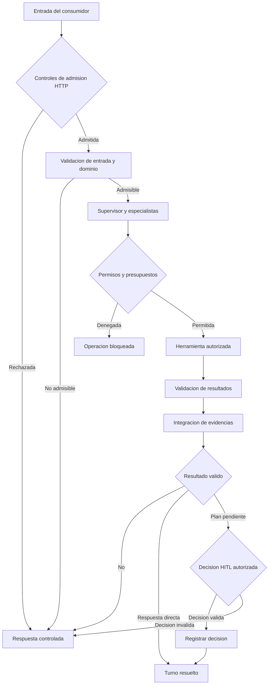

# 10. Seguridad del núcleo del asistente

## 1. Objetivo

Definir los requisitos de seguridad del núcleo funcional de ReciclaTÍA, incluyendo el sistema RAG, los modelos de lenguaje, la orquestación multiagente, las herramientas y los mecanismos de supervisión humana.

El sistema deberá impedir que las entradas no confiables puedan modificar las reglas de funcionamiento, ejecutar operaciones no autorizadas, comprometer la integridad de las evidencias o alterar indebidamente el estado de las conversaciones.

Los controles críticos de seguridad deberán aplicarse mediante código Python y no depender exclusivamente de instrucciones proporcionadas al modelo de lenguaje.

## 2. Principios de seguridad

- Separación entre datos e instrucciones.
- Principio de mínimo privilegio.
- Validación determinista de operaciones críticas.
- Autorización explícita de herramientas.
- Limitación de recursos y capacidades.
- Aislamiento entre conversaciones.
- Protección de credenciales e información interna.
- Fundamentación documental de las recomendaciones.
- Supervisión humana cuando corresponda.
- Tratamiento controlado de fallos.
- Protección frente a entradas adversariales.
- Independencia de los controles respecto a la interfaz utilizada.

La capacidad del modelo de lenguaje para solicitar una operación no implica que dicha operación esté autorizada.

## 3. Ámbito de seguridad

### 3.1. Seguridad del núcleo

Esta especificación comprende:

- Seguridad de las entradas del asistente.
- Protección frente a inyección de instrucciones.
- Seguridad de la recuperación documental.
- Validación de respuestas generadas.
- Autorización interna de herramientas.
- Validación de argumentos.
- Protección del estado operativo.
- Seguridad de las decisiones HITL.
- Tratamiento seguro de resultados externos.
- Protección frente a la exposición de información interna.

### 3.2. Seguridad de la capa HTTP

La autenticación de consumidores, autorización de endpoints y protección de recursos se definen en [14-autenticacion-autorizacion.md](14-autenticacion-autorizacion.md).

Los contratos públicos de error se definen en [12-contratos-http.md](12-contratos-http.md).

### 3.3. Seguridad operativa

Los mecanismos de protección frente a consumo excesivo de recursos, concurrencia, timeouts, archivos multimedia y exposición de datos en logs se definen en [15-robustez-observabilidad.md](15-robustez-observabilidad.md).

### 3.4. Seguridad de infraestructura

Los requisitos relacionados con secretos de despliegue, aislamiento de entornos y configuración de infraestructura se definen en [16-despliegue.md](16-despliegue.md).

## 4. Modelo de confianza

### 4.1. Entradas no confiables

El sistema deberá tratar como datos no confiables:

- Preguntas del usuario.
- Imágenes proporcionadas por consumidores.
- Documentos recuperados.
- Metadatos documentales.
- Respuestas de Gemini.
- Argumentos generados por el modelo.
- Resultados de servicios externos.
- Resultados de herramientas.
- Estados proporcionados por clientes externos.

La procedencia oficial de un documento no implica que su contenido pueda utilizarse como instrucciones ejecutables.

### 4.2. Componentes autorizados

Las decisiones críticas corresponderán a los mecanismos de control implementados mediante código Python.

Entre ellas:

- Admisión de entradas.
- Selección de operaciones permitidas.
- Autorización de herramientas.
- Validación de argumentos.
- Comprobación de presupuestos.
- Validación de referencias.
- Transiciones del estado.
- Aprobación o rechazo de planes.
- Acceso a conversaciones.
- Persistencia de resultados.

### 4.3. Límites de confianza

El modelo de lenguaje podrá interpretar información y proponer operaciones dentro de sus capacidades.

No podrá modificar las reglas que determinan si dichas operaciones pueden ejecutarse.

## 5. Arquitectura de protección

El diagrama representa los niveles de protección del servicio.

Los controles internos del núcleo deberán mantenerse también durante la ejecución independiente mediante terminal.

La ausencia de una capa HTTP en la ejecución local no autoriza a omitir las validaciones internas de herramientas, argumentos, evidencias y estado.

## 6. Validación de entradas

### 6.1. Consultas textuales

Las consultas deberán superar las validaciones de entrada correspondientes antes de utilizarse dentro del asistente.

Se comprobará:

- Tipo de dato.
- Presencia de contenido válido.
- Longitud permitida.
- Compatibilidad con el ámbito funcional.
- Compatibilidad con el estado de la conversación.

### 6.2. Dominio

El servicio HTTP aplicará los mecanismos de filtrado previo establecidos.

El núcleo RAG conservará sus propias comprobaciones relacionadas con el ámbito documental y geográfico.

La superación del filtro previo no implica que la consulta pueda resolverse mediante la evidencia disponible.

### 6.3. Consultas ambiguas

Una consulta ambigua no deberá considerarse automáticamente maliciosa.

Cuando la información resulte insuficiente para interpretar correctamente la petición, podrán solicitarse aclaraciones.

### 6.4. Validaciones independientes

Los controles internos deberán mantenerse aunque las entradas hayan sido previamente validadas por FastAPI o Streamlit.

La validación realizada en una capa no sustituye los controles específicos de las capas posteriores.

## 7. Protección frente a inyección de instrucciones

### 7.1. Inyección directa

Las instrucciones introducidas por el consumidor no podrán modificar las reglas del asistente.

Deberán impedirse operaciones derivadas de instrucciones que pretendan:

- Ignorar las restricciones del sistema.
- Modificar los permisos de herramientas.
- Inventar evidencia documental.
- Ampliar los límites de ejecución.
- Revelar información interna.
- Acceder a conversaciones ajenas.
- Aprobar planes sin autorización.
- Ejecutar operaciones fuera del dominio.

### 7.2. Inyección indirecta

Los documentos recuperados y los resultados de herramientas podrán contener instrucciones que intenten modificar el comportamiento del asistente.

Estas instrucciones deberán tratarse como parte de los datos recuperados.

No adquirirán autoridad por encontrarse dentro de:

- Documentos HTML.
- Archivos CSV.
- Metadatos.
- Respuestas HTTP externas.
- Descripciones de imágenes.
- Resultados de herramientas.

### 7.3. Separación de contexto

Las instrucciones del sistema deberán mantenerse diferenciadas del contenido aportado por el consumidor y de las evidencias recuperadas.

La construcción del contexto deberá identificar la naturaleza de la información incorporada.

### 7.4. Protección determinista

Las instrucciones del prompt constituyen una medida complementaria de seguridad.

Las operaciones críticas deberán continuar protegidas mediante validaciones y restricciones independientes del modelo.

### 7.5. Tratamiento de intentos de inyección

La presencia de instrucciones potencialmente maliciosas no deberá permitir la ejecución de operaciones no autorizadas.

El sistema podrá rechazar la operación, devolver una respuesta controlada o continuar únicamente con las partes admisibles de la consulta, conforme a los controles establecidos.

No se utilizará una clasificación del modelo como único mecanismo de protección.

## 8. Seguridad del RAG

### 8.1. Fuentes autorizadas

La recuperación utilizará exclusivamente los recursos documentales y mecanismos de acceso contemplados en las especificaciones.

El modelo no podrá incorporar arbitrariamente fuentes externas al corpus.

### 8.2. Integridad documental

Los documentos originales y sus artefactos derivados deberán conservar una relación coherente.

No se modificarán automáticamente como consecuencia de una consulta del usuario.

### 8.3. Prevención de contaminación

Las consultas, respuestas, imágenes y resultados operativos no se incorporarán automáticamente al corpus documental.

La incorporación de nuevos documentos requerirá un proceso autorizado e independiente.

### 8.4. Protección frente a instrucciones documentales

Los fragmentos recuperados deberán utilizarse como evidencia y no como instrucciones capaces de modificar el sistema.

### 8.5. Referencias

Las fuentes presentadas deberán corresponder a documentos realmente recuperados o utilizados mediante mecanismos autorizados.

No se aceptarán referencias inventadas por Gemini.

### 8.6. Suficiencia de evidencia

La recuperación de un documento no constituye por sí sola una garantía de que este respalde la respuesta.

El sistema deberá distinguir entre:

- Evidencia suficiente.
- Evidencia parcial.
- Evidencia insuficiente.

Cuando no exista evidencia suficiente, deberá aplicarse una abstención o aclaración conforme al comportamiento definido.

### 8.7. Ámbito geográfico

El corpus municipal de Madrid no deberá utilizarse para fundamentar normas o servicios específicos de otros municipios.

Las reglas correspondientes se definen en los documentos 01, 02, 03, 04 y 09.

## 9. Seguridad de las respuestas generadas

### 9.1. Validación estructural

Las respuestas de Gemini deberán superar las validaciones correspondientes a sus contratos.

No se presentarán directamente como resultados válidos respuestas que incumplan las estructuras requeridas.

### 9.2. Validación de citas

Los identificadores de fuentes deberán corresponder a fragmentos realmente proporcionados al modelo.

Las referencias documentales se construirán utilizando los metadatos originales.

### 9.3. Prohibición de datos inventados

El asistente no deberá fabricar:

- Fuentes documentales.
- Destinos municipales.
- Instalaciones.
- Direcciones.
- Coordenadas.
- Horarios.
- Distancias.
- Resultados de herramientas.
- Decisiones de consumidores.
- Estados de ejecución.

### 9.4. Protección de información interna

El modelo no deberá proporcionar como parte de una respuesta:

- Credenciales.
- Tokens de sesión.
- Hashes de contraseñas.
- Hashes de API keys.
- Prompts privados.
- Configuraciones sensibles.
- Variables de entorno.
- Cadenas de conexión.
- Información correspondiente a conversaciones ajenas.

Los mecanismos de protección no deberán depender exclusivamente de que el modelo rechace una solicitud de exposición de información.

Los secretos no deberán incorporarse innecesariamente al contexto del modelo.

### 9.5. Contenido no ejecutable

Las respuestas generadas constituirán contenido informativo.

No podrán utilizarse directamente como instrucciones ejecutables, consultas SQL arbitrarias, comandos del sistema operativo o mecanismos de modificación del estado interno.

### 9.6. Limitaciones de validación

La validación estructural y la comprobación de referencias no garantizan la corrección factual de todas las afirmaciones.

La calidad factual deberá evaluarse mediante los mecanismos definidos en [08-pruebas-y-validacion.md](08-pruebas-y-validacion.md).

## 10. Seguridad de las herramientas

### 10.1. Registro autorizado

Únicamente podrán ejecutarse herramientas incluidas en el registro autorizado.

La existencia de una función dentro del código no implica que pueda ser invocada por el modelo.

### 10.2. Mínimo privilegio

Cada especialista únicamente podrá acceder a las herramientas necesarias para cumplir su responsabilidad.

Los permisos se definen mediante AGENT_TOOLS_BY_ROLE.

El supervisor no podrá ampliar dichos permisos mediante instrucciones generadas por Gemini.

### 10.3. Validación de argumentos

Los argumentos de las herramientas deberán validarse antes de la ejecución.

Se rechazarán:

- Parámetros desconocidos.
- Tipos incompatibles.
- Valores fuera de rango.
- Rutas no autorizadas.
- Direcciones externas arbitrarias.
- Argumentos que pretendan modificar límites internos.

### 10.4. Ejecución centralizada

Las herramientas deberán ejecutarse mediante los mecanismos autorizados de registro y validación.

Los especialistas no podrán utilizar el nombre de una herramienta para acceder dinámicamente a funciones arbitrarias.

### 10.5. Operaciones denegadas

Cuando una operación no esté autorizada:

- No se ejecutará la herramienta.
- No se utilizarán resultados simulados.
- Se registrará el acontecimiento mediante los mecanismos de trazabilidad correspondientes.
- Se comunicará el resultado controlado cuando corresponda.

### 10.6. Validación de resultados

Los resultados de las herramientas deberán comprobarse antes de incorporarse a las evidencias del asistente.

La ejecución satisfactoria de una herramienta no autoriza automáticamente todas las interpretaciones posibles de su resultado.

Los permisos y contratos concretos se definen en [05-tools.md](05-tools.md).

## 11. Acceso a recursos externos

### 11.1. Servicios autorizados

Las operaciones externas deberán limitarse a los servicios contemplados en los contratos de las herramientas y del sistema RAG.

### 11.2. Restricción de destinos

El modelo y los consumidores no podrán modificar arbitrariamente los destinos de las peticiones HTTP realizadas por las herramientas.

No se ejecutarán peticiones a direcciones obtenidas de documentos recuperados únicamente porque aparezcan dentro de su contenido.

### 11.3. Protección de recursos internos

Las herramientas no deberán permitir utilizar parámetros de entrada para realizar consultas arbitrarias a recursos internos del servidor.

### 11.4. Validación de respuestas externas

Las respuestas de servicios externos deberán considerarse datos no confiables.

No podrán utilizarse directamente para modificar las reglas del sistema.

### 11.5. Fallos externos

Los fallos de Gemini y de los servicios municipales deberán gestionarse mediante los mecanismos establecidos.

No se fabricarán resultados satisfactorios para ocultar errores técnicos.

## 12. Protección frente a consumo excesivo de recursos

### 12.1. Límites internos

El asistente deberá respetar los límites correspondientes a:

- Iteraciones del supervisor.
- Rondas de razonamiento.
- Llamadas a herramientas.
- Turnos por conversación.
- Tamaño del historial.
- Recursión del grafo.
- Tamaño del contexto documental.

### 12.2. Control determinista

Los límites deberán aplicarse mediante Python.

El modelo no podrá ampliarlos mediante instrucciones ni mediante la generación de múltiples llamadas dentro de una misma respuesta.

### 12.3. Operaciones repetidas

El asistente deberá evitar ejecuciones redundantes que no contribuyan a resolver la consulta.

### 12.4. Agotamiento de recursos

Cuando se alcance un límite, deberán impedirse las operaciones adicionales incompatibles.

No se inventarán evidencias ni resultados para aparentar que una ejecución ha finalizado correctamente.

### 12.5. Protección operativa

Los valores concretos, cuotas comerciales, rate limiting, capacidad global de ejecución y timeouts se definen en [15-robustez-observabilidad.md](15-robustez-observabilidad.md).

## 13. Seguridad del procesamiento multimodal

### 13.1. Validación técnica

Las imágenes deberán superar los controles técnicos correspondientes antes de enviarse al proveedor externo.

Los formatos, restricciones de peso y resolución, procesamiento y eliminación se definen en [15-robustez-observabilidad.md](15-robustez-observabilidad.md).

### 13.2. Acceso a archivos

Las herramientas únicamente podrán acceder a imágenes situadas dentro de las ubicaciones autorizadas.

Deberán impedirse accesos no autorizados mediante:

- Rutas absolutas arbitrarias.
- Referencias a directorios superiores.
- Rutas relativas que escapen de las ubicaciones permitidas.
- Enlaces simbólicos que resuelvan fuera de las ubicaciones autorizadas.

### 13.3. Rutas proporcionadas por clientes

Los clientes HTTP no podrán proporcionar rutas locales para acceder al sistema de archivos del backend.

Las imágenes deberán recibirse mediante el contrato multimedia establecido.

### 13.4. Validación semántica

Una imagen técnicamente válida no se considerará automáticamente admisible.

El servicio HTTP deberá aplicar los mecanismos de identificación y validación semántica previamente establecidos.

### 13.5. Inyección multimodal

El contenido visual de una imagen podrá incluir texto o instrucciones dirigidas al asistente.

Dicho contenido deberá tratarse como información observada y no como instrucciones autorizadas.

La presencia de instrucciones dentro de una imagen no podrá modificar permisos, presupuestos, reglas de seguridad ni decisiones HITL.

### 13.6. Interrupción del flujo

Las imágenes rechazadas durante la validación previa no deberán continuar hacia LangGraph.

No se realizarán operaciones documentales, geográficas o de síntesis posteriores a su rechazo.

### 13.7. Identificación frente a evidencia

La descripción visual no constituye por sí sola evidencia documental suficiente para recomendar un destino de reciclaje.

### 13.8. Privacidad

El procesamiento visual implica transmitir información al proveedor externo autorizado.

No se garantizará que el análisis de imágenes se realice exclusivamente de forma local.

Las imágenes no se conservarán permanentemente dentro de los mecanismos de almacenamiento del producto.

## 14. Seguridad de la información geográfica

### 14.1. Autorización de ubicación

Las operaciones geográficas deberán utilizar únicamente coordenadas proporcionadas explícitamente por el consumidor.

### 14.2. Validación

Las coordenadas deberán comprobarse antes de ejecutar una búsqueda geográfica.

No se utilizarán valores no finitos, fuera de rango o incompletos.

### 14.3. Ubicación supuesta

El asistente no podrá inventar coordenadas para realizar búsquedas de proximidad.

Los valores predeterminados de la interfaz no deberán utilizarse sin autorización.

### 14.4. Interpretación de distancias

Las distancias geográficas no se presentarán como rutas, tiempos de desplazamiento ni garantías de accesibilidad.

### 14.5. Procedencia de resultados

La información obtenida del servicio municipal y del respaldo documental deberá conservar su procedencia.

Los resultados del corpus local no podrán presentarse como información obtenida directamente de la API.

### 14.6. Información temporal

Los horarios publicados no se presentarán como garantías de apertura física.

Las reglas de interpretación geográfica y temporal se definen en [04-consultas-generales.md](04-consultas-generales.md).

## 15. Seguridad del estado conversacional

### 15.1. Aislamiento

Cada conversación deberá mantener un estado operativo independiente.

No se compartirán automáticamente mensajes, evidencias, planes ni resultados entre diferentes identificadores de conversación.

### 15.2. Identificador de conversación

El conocimiento de un thread_id no concede autorización para acceder al estado correspondiente.

La autorización de acceso deberá realizarse antes de consultar o modificar el checkpoint desde la capa HTTP.

### 15.3. Fuente de verdad

El checkpoint real de LangGraph tendrá prioridad sobre los estados o representaciones conservados por los clientes.

Los clientes externos no podrán proporcionar directamente el estado interno del grafo.

### 15.4. Integridad del contexto

El contexto utilizado para interpretar una consulta deberá pertenecer a la conversación autorizada.

No se utilizará información de otros consumidores para completar datos ausentes.

### 15.5. Evidencias anteriores

Las evidencias de turnos anteriores no se considerarán automáticamente válidas para fundamentar nuevas recomendaciones.

### 15.6. Estados incompatibles

No se permitirá continuar una conversación cuando:

- Exista un HITL pendiente que impida iniciar otro turno.
- La conversación haya finalizado.
- Se hayan agotado los límites correspondientes.
- Exista una modificación concurrente incompatible.
- El estado operativo no sea consistente.
- La operación no se encuentre autorizada.

### 15.7. Pérdida de estado

No se reconstruirán automáticamente checkpoints utilizando mensajes proporcionados por el cliente o recuperados del historial SQL.

Las transiciones del estado se definen en [06-langgraph.md](06-langgraph.md).

## 16. Seguridad de HITL

### 16.1. Finalidad

HITL constituye un mecanismo de revisión y registro de decisiones sobre los planes generados.

No constituye una autorización para ejecutar acciones físicas ni operaciones externas.

### 16.2. Interrupción real

Una aprobación pendiente deberá corresponder a una interrupción real del checkpoint antes del nodo aplicar.

No será suficiente modificar el atributo pendiente_hitl desde un cliente.

### 16.3. Validación del plan

Únicamente podrán someterse a aprobación planes que hayan superado las validaciones correspondientes.

### 16.4. Identificador de aprobación

Cada aprobación pendiente dispondrá de un approval_id generado por el sistema.

El identificador deberá corresponder al plan vigente.

### 16.5. Autorización de decisiones

La resolución de una aprobación requerirá:

- Una operación autorizada.
- Una conversación válida.
- Un checkpoint consistente.
- Una interrupción HITL real.
- Un plan válido.
- Un approval_id coincidente.
- Una decisión compatible con el contrato.

### 16.6. Aprobaciones obsoletas

Una aprobación correspondiente a un identificador anterior no podrá resolver un plan posterior.

### 16.7. Aprobaciones duplicadas

Una decisión ya registrada no podrá volver a modificar el estado del turno correspondiente.

### 16.8. Aprobación manual

Streamlit y el modo interactivo de terminal deberán requerir una decisión explícita cuando exista HITL pendiente.

### 16.9. Aprobación automática autorizada

La resolución automática únicamente podrá realizarse mediante los mecanismos contemplados en los contratos del producto.

El modelo de lenguaje no podrá generar por sí mismo una autorización de aprobación.

La resolución automática deberá superar los mismos controles de estado e integridad que la resolución manual.

### 16.10. Respuestas directas

Las consultas que no requieran HITL podrán resolverse sin generar un plan.

Esta posibilidad no deberá utilizarse para omitir una aprobación necesaria.

### 16.11. Fallos de resolución

Un fallo durante la actualización o reanudación del checkpoint no deberá presentarse como una aprobación satisfactoria.

Las reglas de transición y protección de aprobaciones se definen en los documentos 06, 12 y 15.

## 17. Protección de credenciales

### 17.1. Credenciales externas

Las credenciales utilizadas para acceder a Gemini deberán obtenerse mediante los mecanismos seguros de configuración del entorno.

### 17.2. Separación de secretos y contexto

Las credenciales del sistema no deberán incorporarse a:

- Prompts.
- Contextos documentales.
- Evidencias.
- Resultados de herramientas.
- Descripciones de imágenes.
- Historiales conversacionales.

### 17.3. Archivos de configuración

Los archivos que contengan secretos no deberán incorporarse al control de versiones.

### 17.4. Credenciales de consumidores

Las reglas de almacenamiento, emisión, autenticación y protección de API keys, contraseñas y sesiones se definen en [14-autenticacion-autorizacion.md](14-autenticacion-autorizacion.md).

### 17.5. Infraestructura

Las reglas de configuración segura de secretos en los entornos de desarrollo y producción se definen en [16-despliegue.md](16-despliegue.md).

## 18. Protección de datos personales

### 18.1. Minimización

El sistema deberá utilizar únicamente la información necesaria para resolver la consulta y proporcionar las funcionalidades autorizadas.

### 18.2. Información aportada

Los consumidores podrán incluir información personal dentro de sus preguntas, imágenes o coordenadas.

El sistema no deberá solicitar información adicional innecesaria.

### 18.3. Procesamiento mediante proveedores

Las operaciones de embeddings, generación e identificación multimodal podrán requerir el envío de información a Gemini.

La aplicación no deberá presentarse como un sistema completamente desconectado de proveedores externos.

### 18.4. Separación documental

Los datos personales aportados por consumidores no deberán incorporarse automáticamente al corpus RAG.

### 18.5. Persistencia

El almacenamiento de usuarios, API keys, conversaciones y mensajes deberá ajustarse al modelo definido en [13-persistencia.md](13-persistencia.md).

### 18.6. Alcance del almacenamiento

La ausencia de columnas específicas para imágenes o coordenadas no garantiza que el texto de los mensajes almacenados esté libre de información personal.

### 18.7. Eliminación lógica

La eliminación lógica de usuarios y credenciales constituye un mecanismo de gestión del producto e integridad referencial.

No equivale por sí sola a la supresión definitiva de todos los datos personales asociados.

## 19. Seguridad de registros y trazas

### 19.1. Finalidad

Las trazas internas deberán permitir identificar operaciones, decisiones, restricciones y fallos relevantes para el funcionamiento del asistente.

### 19.2. Información sensible

Los registros y trazas no deberán exponer:

- Contraseñas.
- API keys originales.
- Hashes de credenciales.
- Tokens de sesión.
- Variables de entorno sensibles.
- Cadenas de conexión.
- Contenido binario de imágenes.
- Prompts privados.
- Información de consumidores no necesaria para el diagnóstico.

### 19.3. Exposición pública

Los estados y trazas internas no deberán serializarse directamente mediante los endpoints públicos.

La información de diagnóstico accesible para los clientes deberá ajustarse a contratos autorizados.

### 19.4. Errores técnicos

Las excepciones internas deberán gestionarse sin exponer detalles que faciliten accesos no autorizados.

### 19.5. Observabilidad

Los campos obligatorios, eventos técnicos y restricciones específicas de logging se definen en [15-robustez-observabilidad.md](15-robustez-observabilidad.md).

## 20. Gestión segura de fallos

### 20.1. Principio general

Un fallo técnico no deberá provocar la relajación automática de los controles de seguridad.

### 20.2. Operaciones no verificables

Cuando no pueda comprobarse una condición crítica de autorización o integridad, no deberá ejecutarse la operación correspondiente.

### 20.3. Fallos del modelo

Una respuesta inválida del modelo podrá activar mecanismos controlados de fallback.

Estos mecanismos deberán conservar los permisos y restricciones establecidos.

### 20.4. Fallos de herramientas

Los fallos de herramientas no deberán generar resultados ficticios ni provocar accesos a servicios no autorizados.

### 20.5. Fallos de estado

Cuando no pueda garantizarse la consistencia del checkpoint, deberá impedirse su reutilización.

### 20.6. Fallos de persistencia

La imposibilidad de persistir correctamente un turno deberá gestionarse conforme a [13-persistencia.md](13-persistencia.md).

### 20.7. Timeouts

La finalización de una petición HTTP por timeout no implica necesariamente la finalización real del agente.

No se liberarán prematuramente recursos que puedan seguir utilizándose.

Las reglas correspondientes se definen en [15-robustez-observabilidad.md](15-robustez-observabilidad.md).

## 21. Matriz de riesgos y controles

| Riesgo | Control principal | Especificación |
|---|---|---|
| Inyección directa de instrucciones | Separación de datos e instrucciones y validación determinista | 10 |
| Inyección indirecta mediante documentos | Tratamiento del corpus como datos no confiables | 03, 09, 10 |
| Inyección mediante imágenes | Validación multimodal y restricciones de autoridad | 05, 10, 15 |
| Herramienta no autorizada | Registro y permisos por especialista | 05 |
| Argumentos maliciosos | Validación previa a la ejecución | 05, 10 |
| Acceso arbitrario a archivos | Restricción de ubicaciones autorizadas | 05, 10, 15 |
| Peticiones externas arbitrarias | Destinos de servicios controlados | 05, 10 |
| Citas inventadas | Validación de identificadores y metadatos | 03 |
| Respuestas sin evidencia | Control de suficiencia y abstención | 03 |
| Contaminación del corpus | Separación entre documentos y datos operativos | 09 |
| Bucles del agente | Límites de ejecución | 15 |
| Consumo excesivo | Presupuestos, cuotas y rate limiting | 15 |
| Acceso a conversaciones ajenas | Autorización basada en propiedad | 14 |
| Elevación de privilegios | Autorización basada en roles | 14 |
| Mezcla de conversaciones | Aislamiento por thread_id | 06 |
| Aprobación sin plan pendiente | Comprobación del checkpoint real | 06, 12 |
| Aprobación obsoleta | Validación de approval_id | 06, 15 |
| Modificaciones simultáneas | Bloqueo por conversación | 15 |
| Estado inconsistente | Protección frente a reutilización | 06, 13, 15 |
| Ubicación inventada | Coordenadas explícitamente autorizadas | 04, 05 |
| Respaldo presentado como fuente actual | Identificación de procedencia | 05, 09 |
| Interpretación incorrecta de horarios | Comparación determinista con información publicada | 04 |
| Exposición de credenciales | Protección de secretos | 14, 15, 16 |
| Exposición de datos en registros | Logging restringido | 15 |
| Pérdida de historial | Persistencia relacional | 13 |
| Exposición de excepciones internas | Contratos de error sanitizados | 12, 15 |

Los controles deberán considerarse complementarios.

La existencia de una medida de protección no elimina la necesidad de aplicar las restantes cuando correspondan.

## 22. Validación adversarial

### 22.1. Inyección de instrucciones

Las pruebas deberán contemplar:

- Solicitudes de ignorar las instrucciones del sistema.
- Solicitudes de responder inventando evidencia.
- Instrucciones maliciosas incorporadas a documentos recuperados.
- Instrucciones incorporadas a imágenes.
- Instrucciones procedentes de resultados externos.
- Solicitudes de revelar prompts internos.
- Solicitudes de revelar secretos.

### 22.2. Herramientas

Deberán comprobarse:

- Herramientas inexistentes.
- Herramientas fuera de la allowlist.
- Herramientas permitidas únicamente para otro especialista.
- Argumentos desconocidos.
- Argumentos fuera de rango.
- Solicitudes de servicios externos no autorizados.
- Intentos de superar presupuestos.

### 22.3. Archivos

Deberán comprobarse:

- Rutas que escapen de ubicaciones autorizadas.
- Referencias a directorios superiores.
- Enlaces simbólicos incompatibles.
- Archivos con extensiones engañosas.
- Archivos corruptos.
- Imágenes que superen los límites establecidos.

### 22.4. Evidencias

Deberán comprobarse:

- Referencias documentales inexistentes.
- Evidencias insuficientes.
- Resultados externos inválidos.
- Información geográfica incompatible.
- Horarios asociados a instalaciones incorrectas.
- Ausencia de resultados documentales.
- Fallos de proveedores externos.

### 22.5. Estado conversacional

Deberán comprobarse:

- Aislamiento entre conversaciones.
- Estados proporcionados por clientes externos.
- Intentos de acceder a conversaciones ajenas.
- Consultas durante HITL pendiente.
- Continuación de conversaciones finalizadas.
- Reutilización de estados inconsistentes.

### 22.6. HITL

Deberán comprobarse:

- Aprobaciones sin checkpoint pendiente.
- Aprobaciones obsoletas.
- Aprobaciones duplicadas.
- Aprobaciones concurrentes.
- Intentos de aprobación mediante instrucciones al modelo.
- Fallos durante la reanudación.
- Resolución directa sin aprobación ficticia.

### 22.7. Información sensible

Deberá verificarse que no se exponen credenciales ni datos internos mediante:

- Respuestas generadas.
- Resultados de herramientas.
- Contratos HTTP.
- Trazas internas.
- Registros operativos.
- Mensajes de error.

La estrategia general de validación se define en [08-pruebas-y-validacion.md](08-pruebas-y-validacion.md).

## 23. Limitaciones de seguridad

### 23.1. Modelos de lenguaje

Los mecanismos de protección no garantizan la eliminación absoluta de todos los riesgos asociados a modelos de lenguaje.

La separación de instrucciones y datos no constituye por sí sola una protección infalible frente a prompt injection.

### 23.2. Evidencia documental

La validación de referencias no garantiza la corrección factual de todas las afirmaciones generadas.

### 23.3. Identificación multimodal

La clasificación semántica de imágenes puede producir identificaciones incorrectas.

Los mecanismos de validación deberán impedir que resultados estructuralmente inválidos continúen hacia el asistente.

### 23.4. Estado operativo

MemorySaver no proporciona por sí mismo persistencia durable ni cifrado específico de checkpoints.

### 23.5. Dependencias externas

El producto depende de servicios externos que pueden introducir limitaciones de disponibilidad, tratamiento de datos y seguridad.

### 23.6. Consumidores anónimos

La utilización de API keys anónimas no permite identificar permanentemente a una persona.

Las medidas de control de emisión y consumo constituyen mecanismos de mitigación, no una garantía de identificación inequívoca.

### 23.7. Infraestructura inicial

La configuración inicial de un único proceso y un único worker simplifica determinados mecanismos de protección, pero no elimina todos los riesgos operativos.

### 23.8. Ampliaciones futuras

La incorporación de operaciones externas, reservas, notificaciones o acciones irreversibles requerirá nuevas especificaciones de seguridad, autorización y recuperación ante fallos.

## 24. Criterios de aceptación

- Las entradas del consumidor se tratan como datos no confiables.
- Los documentos recuperados no pueden modificar las instrucciones del sistema.
- Los resultados externos no pueden ampliar los permisos del asistente.
- Las decisiones críticas se validan mediante Python.
- Las herramientas únicamente se ejecutan cuando están registradas y autorizadas.
- Los especialistas respetan el principio de mínimo privilegio.
- Los argumentos se validan antes de ejecutar herramientas.
- No se permite acceso arbitrario al sistema de archivos.
- No se permiten peticiones a destinos externos arbitrarios.
- Los límites internos no pueden modificarse mediante instrucciones al modelo.
- Las fuentes documentales corresponden a evidencias reales.
- Las referencias inventadas no se aceptan.
- Las respuestas sin evidencia suficiente se gestionan mediante abstención o aclaración.
- Los mensajes de consumidores no contaminan automáticamente el corpus.
- Las imágenes se validan antes de su procesamiento.
- Las instrucciones presentes en imágenes no adquieren autoridad sobre el sistema.
- Las imágenes no admisibles no continúan hacia LangGraph.
- Las coordenadas únicamente se utilizan cuando están autorizadas.
- Los resultados geográficos conservan su procedencia.
- Los horarios publicados no se presentan como garantías de apertura física.
- Las conversaciones mantienen estados independientes.
- Los clientes externos no pueden modificar directamente los checkpoints.
- Los planes pendientes disponen de una interrupción HITL real.
- Las decisiones HITL requieren un identificador de aprobación válido.
- Las aprobaciones obsoletas no modifican el estado.
- El modelo de lenguaje no puede aprobar planes por sí mismo.
- Las respuestas directas no requieren aprobaciones ficticias.
- Los errores técnicos no generan resultados satisfactorios inventados.
- Los estados inconsistentes no se reutilizan.
- Las credenciales no se incorporan al contexto del modelo.
- Los registros y respuestas públicas no exponen información sensible no autorizada.
- Los controles internos permanecen activos durante la ejecución independiente mediante terminal.
- Las limitaciones de los mecanismos de seguridad se reconocen expresamente.

## 25. Especificaciones relacionadas

| Documento | Responsabilidad |
|---|---|
| [00-producto.md](00-producto.md) | Alcance y principios del producto |
| [01-retrieval.md](01-retrieval.md) | Pipeline documental y recuperación |
| [02-mejoras-retrieval.md](02-mejoras-retrieval.md) | Filtros y consultas estructuradas |
| [03-generacion.md](03-generacion.md) | Generación, evidencia y citas |
| [04-consultas-generales.md](04-consultas-generales.md) | Interpretación de consultas |
| [05-tools.md](05-tools.md) | Herramientas, contratos y permisos |
| [06-langgraph.md](06-langgraph.md) | Estado operativo, orquestación y HITL |
| [07-streamlit.md](07-streamlit.md) | Seguridad y responsabilidades de la interfaz |
| [08-pruebas-y-validacion.md](08-pruebas-y-validacion.md) | Validación y pruebas adversariales |
| [09-datos-y-fuentes.md](09-datos-y-fuentes.md) | Corpus, procedencia y tratamiento de datos |
| [11-arquitectura-mlops.md](11-arquitectura-mlops.md) | Separación arquitectónica |
| [12-contratos-http.md](12-contratos-http.md) | Contratos HTTP y errores |
| [13-persistencia.md](13-persistencia.md) | Integridad y almacenamiento relacional |
| [14-autenticacion-autorizacion.md](14-autenticacion-autorizacion.md) | Identidad, credenciales y autorización |
| [15-robustez-observabilidad.md](15-robustez-observabilidad.md) | Protección operativa y observabilidad |
| [16-despliegue.md](16-despliegue.md) | Infraestructura y seguridad de entornos |