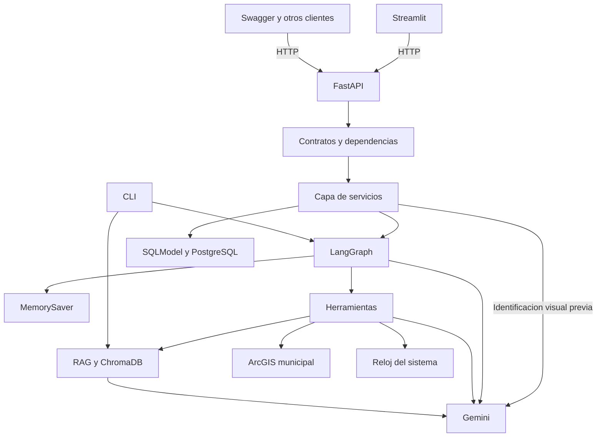

# 11. Arquitectura MLOps

## 1. Principios arquitectónicos

- Separación de responsabilidades.
- Independencia del núcleo respecto a las interfaces.
- Validación de entradas y salidas mediante Pydantic.
- Centralización de las reglas de negocio.
- Control determinista de seguridad y ejecución.
- Separación entre estado operativo y persistencia.
- Conservación de las funcionalidades desarrolladas durante el PB02.

La incorporación de MLOps no implicará reescribir innecesariamente el asistente.

## 2. Arquitectura general

## 3. Capas y responsabilidades

| Capa | Tecnología | Responsabilidad |
|---|---|---|
| Presentación | Streamlit | Interacción y representación de resultados |
| Transporte | FastAPI | Endpoints, dependencias y respuestas HTTP |
| Contratos | Pydantic | Validación y serialización |
| Servicios | Python | Autorización, admisión, coordinación y persistencia |
| Orquestación | LangGraph | Especialistas, estado operativo y HITL |
| Herramientas | Python | Operaciones documentales, geográficas, temporales y visuales |
| Recuperación | RAG y ChromaDB | Recuperación y generación documental |
| Persistencia | SQLModel y PostgreSQL | Almacenamiento relacional |
| Inferencia | Gemini | Embeddings, razonamiento, generación y visión |
| Infraestructura | Docker y Render | Empaquetado y despliegue |

## 4. Dependencias y organización

- Streamlit utilizará exclusivamente los contratos HTTP del backend.
- FastAPI coordinará las operaciones mediante la capa de servicios.
- La capa de servicios utilizará los contratos públicos del orquestador y los mecanismos autorizados de persistencia.
- LangGraph utilizará las herramientas y el núcleo RAG existentes.
- El núcleo no dependerá de FastAPI, Streamlit ni PostgreSQL.
- Los módulos de persistencia no ejecutarán el asistente.
- La CLI conservará el acceso independiente al núcleo.

La estructura objetivo del repositorio se establece en el apartado 24 de [plan-trabajo-pb03.md](../docs/plan-trabajo-pb03.md).

Se conservará src/ para los componentes existentes y los módulos relacionales previstos, api/ para el backend HTTP y app.py como punto de entrada de Streamlit.

No se trasladarán archivos existentes únicamente para reproducir una estructura teórica.

## 5. Estado y almacenamiento

| Recurso | Almacenamiento | Supervivencia al redeploy |
|---|---|---|
| Usuarios y API keys | PostgreSQL | Sí |
| Conversaciones y mensajes resueltos | PostgreSQL | Sí |
| Checkpoints y HITL pendiente | MemorySaver | No |
| Sesiones de autenticación | Memoria del backend | No |
| Contadores de consumo | Memoria del backend | No |
| Bloqueos y capacidad de ejecución | Memoria del backend | No |
| Índice documental | ChromaDB | Reconstruible desde los artefactos |
| Estado visual | Sesión de Streamlit | Independiente del backend |

El historial persistente no sustituirá el estado operativo del agente.

No se reconstruirán automáticamente checkpoints perdidos utilizando mensajes SQL.

Las reglas correspondientes se establecen en [06-langgraph.md](06-langgraph.md), [13-persistencia.md](13-persistencia.md) y [14-autenticacion-autorizacion.md](14-autenticacion-autorizacion.md).

## 6. Concurrencia

La arquitectura inicial utilizará un único proceso de Uvicorn y un único worker de ThreadPoolExecutor para las operaciones costosas del asistente.

La concurrencia HTTP será independiente de la capacidad de ejecución del agente.

thread_id identifica una conversación de LangGraph, no un hilo de ejecución de Python.

Los mecanismos de exclusión mutua, admisión, timeout e invalidación de estados se establecen en [15-robustez-observabilidad.md](15-robustez-observabilidad.md).

No se incrementará el número de procesos o réplicas sin adaptar previamente los recursos compartidos en memoria.

## 7. Infraestructura

| Componente | Entorno inicial |
|---|---|
| FastAPI, LangGraph, RAG y ChromaDB | Contenedor Docker en Render |
| PostgreSQL | Servicio gestionado de Render |
| Streamlit | Cliente local mediante API_BASE_URL |
| Gemini y ArcGIS | Servicios externos autorizados |

La configuración de despliegue, secretos, CI/CD y recuperación operativa se establece en [16-despliegue.md](16-despliegue.md).

## 8. Compatibilidad y alcance

Se conservarán los contratos y funcionalidades del PB02, salvo las modificaciones expresamente establecidas en las especificaciones.

La estrategia de regresión y validación se define en [08-pruebas-y-validacion.md](08-pruebas-y-validacion.md).

Quedan fuera del alcance inicial:

- Microservicios independientes para el RAG.
- Kubernetes.
- Redis.
- JWT y OAuth.
- Persistencia durable de checkpoints.
- Múltiples réplicas del backend.

La geolocalización automática, el despliegue independiente de Streamlit y la automatización de integración continua mediante GitHub Actions serán opcionales.

La estrategia de CI/CD deberá documentarse independientemente de que se implemente su automatización.