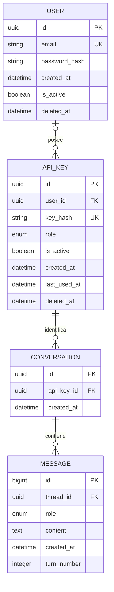

# 13. Persistencia y modelo relacional

## 1. Objetivo

Implementar la persistencia relacional de ReciclaTÍA mediante SQLModel y PostgreSQL, garantizando la integridad de los datos, el aislamiento de conversaciones y el almacenamiento atómico de los turnos resueltos.

PostgreSQL se utilizará tanto en desarrollo como en producción. No se utilizará SQLite como almacenamiento alternativo.

El historial persistente permanecerá separado del estado operativo de LangGraph.

## 2. Responsabilidades

| Archivo | Responsabilidad |
|---|---|
| src/enums.py | Enumerados compartidos |
| src/models.py | Modelos relacionales y restricciones |
| src/db.py | Engine, sesiones y operaciones de persistencia |
| api/service.py | Coordinación del asistente y persistencia |
| api/dependencies.py | Dependencias de acceso a recursos |
| api/security.py | Autenticación y autorización |
| api/schemas.py | Contratos públicos independientes de los modelos relacionales |

La persistencia no ejecutará directamente el agente ni determinará permisos, cuotas o decisiones HITL.

## 3. Modelo entidad-relación



Se conservarán exclusivamente estas cuatro tablas.

Cada conversación pertenece a una API key. El propietario registrado se obtiene mediante la relación con api_key.user_id.

No se duplicará user_id en conversation.

No se crearán tablas adicionales para checkpoints, sesiones, cuotas, aprobaciones pendientes, imágenes ni contadores de turnos.

## 4. Modelos relacionales

### 4.1. Convenciones

- Nombres en snake_case.
- UUID generados mediante mecanismos autorizados del backend.
- Fechas TIMESTAMPTZ almacenadas en UTC.
- Claves primarias y foráneas explícitas.
- Restricciones de integridad gestionadas por PostgreSQL.
- Eliminación lógica de usuarios y API keys.
- Ausencia de eliminación física en cascada.

### 4.2. Tabla user

| Campo | Tipo PostgreSQL | Nullable | Restricción o default |
|---|---|---|---|
| id | UUID | No | Primary Key |
| email | VARCHAR(254) | No | Unique |
| password_hash | VARCHAR(255) | No | — |
| created_at | TIMESTAMPTZ | No | Fecha actual |
| is_active | BOOLEAN | No | True |
| deleted_at | TIMESTAMPTZ | Sí | NULL |

El email se almacenará normalizado y conservará su restricción de unicidad incluso después de eliminar lógicamente una cuenta.

La contraseña original nunca se almacenará.

### 4.3. Tabla api_key

| Campo | Tipo PostgreSQL | Nullable | Restricción o default |
|---|---|---|---|
| id | UUID | No | Primary Key |
| user_id | UUID | Sí | Foreign Key → user.id |
| key_hash | CHAR(64) | No | Unique |
| role | ENUM(api_key_role) | No | free, user, admin |
| is_active | BOOLEAN | No | True |
| created_at | TIMESTAMPTZ | No | Fecha actual |
| last_used_at | TIMESTAMPTZ | Sí | NULL |
| deleted_at | TIMESTAMPTZ | Sí | NULL |

key_hash contendrá la representación hexadecimal SHA-256 de la credencial.

Las claves Free podrán tener user_id=NULL. Las claves User y Admin requerirán un propietario.

Se aplicará la restricción:

```sql
CHECK (role = 'free' OR user_id IS NOT NULL)
```

El identificador, propietario, rol y hash serán inmutables mediante las operaciones ordinarias.

last_used_at se actualizará después de autenticar y autorizar la clave y superar los controles de admisión correspondientes.

No representa necesariamente una ejecución satisfactoria ni se utilizará como contador de consumo.

### 4.4. Tabla conversation

| Campo | Tipo PostgreSQL | Nullable | Restricción o default |
|---|---|---|---|
| id | UUID | No | Primary Key |
| api_key_id | UUID | No | Foreign Key → api_key.id |
| created_at | TIMESTAMPTZ | No | Fecha actual |

conversation.id corresponderá al thread_id de LangGraph.

La propiedad se establecerá durante la creación y no podrá modificarse posteriormente.

### 4.5. Tabla message

| Campo | Tipo PostgreSQL | Nullable | Restricción o default |
|---|---|---|---|
| id | BIGINT | No | Primary Key, autoincremental |
| thread_id | UUID | No | Foreign Key → conversation.id |
| role | ENUM(message_role) | No | user, assistant |
| content | TEXT | No | No vacío |
| created_at | TIMESTAMPTZ | No | Fecha actual |
| turn_number | INTEGER | No | Mayor que cero |

Se aplicarán las restricciones:

```sql
CHECK (turn_number > 0)

CHECK (length(btrim(content)) > 0)

UNIQUE (thread_id, turn_number, role)
```

La aplicación comprobará adicionalmente que el contenido no esté vacío después de eliminar los espacios exteriores.

Cada turno resuelto generará exactamente dos mensajes.

Los enumerados ApiKeyRole y MessageRole se definirán en src/enums.py.

Los enumerados nativos de PostgreSQL almacenarán los valores de sus miembros Python, no sus nombres internos.

## 5. Integridad e índices

### 5.1. Estados de usuarios y claves

| Estado | is_active | deleted_at |
|---|---|---|
| Activo | True | NULL |
| Desactivado | False | NULL |
| Eliminado | False | Fecha de eliminación |

Las tablas user y api_key incorporarán:

```sql
CHECK (deleted_at IS NULL OR NOT is_active)
```

Una eliminación lógica no podrá revertirse mediante una operación ordinaria de reactivación.

La desactivación no eliminará una fecha de eliminación previamente establecida.

Las claves foráneas protegerán la integridad referencial e impedirán eliminar físicamente registros con dependencias.

### 5.2. Índices adicionales

| Tabla | Campos |
|---|---|
| api_key | user_id |
| conversation | api_key_id |
| message | thread_id, id |

PostgreSQL gestionará los índices correspondientes a las claves primarias y restricciones UNIQUE.

No se crearán índices redundantes.

### 5.3. Emisión y reactivación

La comprobación de los límites de claves activas y su creación o reactivación deberán realizarse dentro de una transacción protegida frente a concurrencia.

Para las claves asociadas a usuarios se bloqueará la fila del propietario antes de comprobar el límite y efectuar la operación.

Los límites y permisos aplicables se establecen en [14-autenticacion-autorizacion.md](14-autenticacion-autorizacion.md).

## 6. Creación de conversaciones

Cuando una consulta sin thread_id vaya a iniciar LangGraph:

1. Superar los controles de admisión y admisibilidad previa.
2. Comprobar que el presupuesto temporal continúa vigente.
3. Generar el identificador mediante nuevo_thread_id().
4. Crear y confirmar la fila conversation.
5. Comprobar nuevamente el presupuesto temporal.
6. Inicializar y ejecutar LangGraph con el mismo identificador.

La creación de la conversación constituye una transacción independiente del almacenamiento posterior de sus mensajes.

Si no puede confirmarse dicha creación, no se iniciará LangGraph.

Las respuestas anteriores al agente no crearán conversaciones ni mensajes.

Los identificadores proporcionados por clientes se tratarán conforme a [12-contratos-http.md](12-contratos-http.md).

Una conversación podrá existir sin mensajes cuando su primer turno esté ejecutándose, pendiente de HITL, haya fallado o haya superado el timeout.

La existencia de una fila conversation no garantiza la disponibilidad de un checkpoint.

## 7. Persistencia de turnos

### 7.1. Criterio de almacenamiento

| Resultado | Persistir mensajes |
|---|---|
| Plan aprobado manual o automáticamente | Sí |
| Plan rechazado | Sí |
| Abstención o aclaración del agente con HITL resuelto | Sí |
| Propuesta pendiente de HITL | No |
| Respuesta anterior a LangGraph | No |
| Petición rechazada antes de la ejecución | No |
| Fallo técnico | No |
| Timeout o resultado tardío | No |

La persistencia exigirá verificar la resolución real del HITL, la correspondencia con el turno actual, la validez del resultado y la ausencia de errores técnicos.

done=False no impide almacenar un turno rechazado correctamente resuelto.

### 7.2. Contenido de los mensajes

| Rol | Contenido |
|---|---|
| user | Pregunta original del consumidor correspondiente al turno |
| assistant | Respuesta definitiva del agente después de resolver HITL |

Se utilizará el registro generado por registrar_turno() para recuperar la pregunta original y comprobar la correspondencia con el turno actual.

Para el mensaje assistant se utilizará la respuesta definitiva del estado resultante después de ejecutar aplicar.

En un turno aprobado se almacenará la respuesta final aprobada.

En un turno rechazado se almacenará:

```text
Plan rechazado. Puedes reformular tu consulta.
```

No se almacenará la propuesta rechazada como respuesta definitiva ni se añadirán anotaciones artificiales al contenido.

El historial interno de LangGraph podrá conservar la propuesta original para facilitar la reformulación.

No se almacenarán como mensajes independientes las decisiones HITL, planes, instrucciones internas ni resultados de herramientas.

### 7.3. Numeración

turn_number procederá directamente de turnos_consumidos del agente.

Los dos mensajes compartirán el mismo número de turno.

No se utilizará MAX(turn_number) para calcular el turno siguiente ni se mantendrá un contador SQL independiente.

Los criterios de incremento se establecen en [06-langgraph.md](06-langgraph.md).

Un fallo podrá producir una discontinuidad en los números almacenados. No se renumerarán los turnos existentes.

### 7.4. Transacción

La capa de servicios deberá:

1. Recuperar el resultado resuelto dentro del presupuesto temporal.
2. Validar el estado y el contrato público.
3. Comprobar nuevamente la autorización aplicable.
4. Insertar el mensaje user.
5. Insertar el mensaje assistant.
6. Confirmar la transacción.
7. Devolver la respuesta HTTP satisfactoria.

Las dos inserciones se realizarán dentro de una única transacción SQL.

La comprobación final de autorización y las escrituras se protegerán frente a modificaciones administrativas concurrentes mediante bloqueos de las filas correspondientes.

Se mantendrá el bloqueo de la conversación durante toda la operación.

La restricción UNIQUE impedirá duplicar mensajes de un mismo rol y turno, pero no convertirá los endpoints en operaciones idempotentes.

### 7.5. Fallos de persistencia

Si falla una inserción antes de confirmar la transacción, se ejecutará rollback.

No deberán quedar turnos parcialmente almacenados.

Si no puede determinarse el resultado de un commit por pérdida de conexión:

- No se asumirá que la transacción se ha revertido.
- No se repetirá automáticamente la escritura.
- No se comunicará éxito HTTP.
- Se protegerá el hilo frente a su reutilización cuando su consistencia no pueda garantizarse.

No existe una transacción atómica compartida entre MemorySaver y PostgreSQL.

Un fallo que comprometa la consistencia entre ambos recursos impedirá continuar el hilo mediante THREAD_STATE_LOST.

Los mensajes anteriormente confirmados permanecerán disponibles.

### 7.6. Timeout y revocación

El worker del asistente podrá crear la fila conversation antes de iniciar LangGraph, pero no realizará la escritura definitiva de sus mensajes.

La persistencia de mensajes corresponderá al coordinador del servicio después de obtener un resultado válido y dentro del presupuesto de ejecución.

Una vez comunicado el timeout, ningún resultado tardío podrá iniciar una nueva persistencia de mensajes.

Las operaciones SQL tendrán sus propios límites de espera.

La creación de una conversación que ya estuviera en curso podrá llegar a confirmarse después del timeout, pero no autorizará un inicio tardío de LangGraph.

Si la autorización deja de ser válida durante la ejecución, no se iniciará una nueva escritura del turno.

Las reglas de sincronización, plazos e invalidación se establecen en [15-robustez-observabilidad.md](15-robustez-observabilidad.md).

## 8. Operaciones de acceso a datos

| Entidad | Operaciones |
|---|---|
| user | Crear, buscar por email o ID, listar, actualizar contraseña y estado, eliminar lógicamente |
| api_key | Crear, buscar por hash o ID, listar, contar claves activas por rol, actualizar último uso y estado, eliminar lógicamente |
| conversation | Crear, buscar por ID y propietario, listar conversaciones autorizadas |
| message | Persistir un turno completo, recuperar mensajes, comprobar existencia de un turno |

Los mensajes se recuperarán mediante ORDER BY id ASC.

created_at representará el momento de almacenamiento.

Las operaciones de historial serán exclusivamente de lectura y no ejecutarán LangGraph ni reconstruirán checkpoints.

Los modelos públicos se establecen en [12-contratos-http.md](12-contratos-http.md).

## 9. Gestión de conexiones

DATABASE_URL se obtendrá del entorno.

Se utilizará un engine compartido durante la vida del backend, con límites de conexión adecuados.

Cada unidad de trabajo dispondrá de su propia Session.

Las sesiones no se compartirán entre hilos de ejecución y deberán cerrarse correctamente.

No se mantendrán transacciones abiertas durante llamadas prolongadas a Gemini o LangGraph cuando no resulte necesario.

La creación de tablas utilizará SQLModel.metadata.create_all(engine), después de importar los modelos.

Las reglas de configuración, inicialización y despliegue se establecen en [16-despliegue.md](16-despliegue.md).

El núcleo RAG y la CLI permanecerán independientes de PostgreSQL.

## 10. Desactivación y eliminación lógica

La desactivación conservará los registros y establecerá is_active=False.

La eliminación lógica establecerá is_active=False y la fecha deleted_at.

Desactivar o eliminar un usuario impedirá utilizar sus claves sin necesidad de modificar individualmente el estado de cada una.

Reactivar un usuario no reactivará las claves desactivadas individualmente ni recuperará sesiones invalidadas.

Reactivar una API key no restablecerá sus contadores deliberadamente ni reconstruirá checkpoints perdidos.

La autorización, invalidación de sesiones y acceso al historial se regulan en [14-autenticacion-autorizacion.md](14-autenticacion-autorizacion.md).

La eliminación lógica no constituye una supresión física definitiva de datos personales.

## 11. Historial y minimización de datos

El historial SQL conservará exclusivamente los mensajes de los turnos correctamente resueltos.

No constituirá una copia completa de las interacciones visuales de Streamlit ni del estado operativo del agente.

No se almacenarán permanentemente como recursos independientes:

- Contraseñas, API keys o tokens originales.
- Imágenes binarias y rutas temporales.
- Coordenadas privadas recibidas como parámetros.
- Prompts, checkpoints y trazas internas.
- Embeddings de consultas personales.

Los mensajes podrán contener información aportada por el consumidor o datos necesarios para representar la respuesta.

Los datos operativos no se incorporarán automáticamente al corpus.

El historial permanecerá disponible después de reinicios y redeploys que conserven PostgreSQL.

No se reconstruirán checkpoints utilizando los mensajes SQL.

La separación de recursos persistentes y volátiles se establece en [11-arquitectura-mlops.md](11-arquitectura-mlops.md).

## 12. Criterios de aceptación

- Las cuatro tablas respetan sus contratos y restricciones.
- No se almacenan credenciales originales.
- Las conversaciones conservan su propietario.
- La emisión concurrente no permite superar los límites de claves activas.
- Los turnos resueltos generan exactamente dos mensajes.
- Los mensajes se almacenan atómicamente y sin duplicados.
- Los rechazos conservan únicamente la respuesta definitiva en el historial SQL.
- Las respuestas anteriores al agente y las propuestas pendientes no generan mensajes.
- Los fallos de persistencia no se presentan como éxitos.
- Los resultados tardíos no generan nuevas escrituras de mensajes.
- Los estados inconsistentes no se reutilizan.
- El historial conserva su orden y sobrevive a los redeploys.
- El núcleo permanece independiente de PostgreSQL.

La estrategia de validación se establece en [08-pruebas-y-validacion.md](08-pruebas-y-validacion.md).